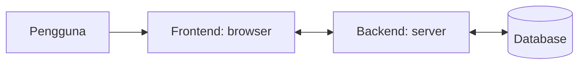

# Pengantar Web Development

Sebelum belajar Laravel, kamu perlu paham dulu apa yang sebenarnya terjadi ketika
sebuah halaman web tampil di browser. Chapter ini memberi peta besarnya: apa itu web,
siapa saja yang terlibat, dan di mana PHP serta Laravel berperan.

!!! info "Posisi dalam kurikulum"
    Ini bab pertama dari **Dasar Web dan PHP**. Bab berikutnya,
    **Client-Server Architecture**, membahas cara kerja
    komunikasi browser dan server secara lebih rinci.

## Tujuan pembelajaran

Setelah menyelesaikan chapter ini, kamu dapat:

- [ ] Menjelaskan apa itu web dan perbedaan *website* dengan *web application*.
- [ ] Membedakan *frontend* dan *backend* beserta contoh tugasnya.
- [ ] Menyebutkan peran HTML, CSS, dan JavaScript.
- [ ] Menjelaskan di mana PHP dan Laravel berada dalam gambaran web.
- [ ] Membuat dan membuka halaman HTML sederhana, lalu mengamatinya di browser.

## Prasyarat

- Tidak ada (ini chapter pertama).
- Peralatan: sebuah **browser** modern (Chrome, Firefox, atau Edge) dan sebuah
  **editor teks** (misalnya Visual Studio Code atau Notepad). PHP dan Composer belum
  dibutuhkan; keduanya dipasang pada chapter berikutnya.

## Apa itu web?

**World Wide Web** (singkatnya *web*) adalah kumpulan dokumen dan aplikasi yang saling
terhubung dan dapat dibuka lewat internet menggunakan browser. Setiap halaman memiliki
alamat unik yang disebut **URL**, misalnya `https://laravel.com/docs`.

Web bukan sama dengan internet. Internet adalah jaringan komputer di seluruh dunia;
web hanyalah salah satu layanan yang berjalan di atasnya (selain email, misalnya).

!!! tip "Analogi"
    Internet seperti jaringan jalan raya. Web adalah layanan pengiriman paket yang
    memakai jalan itu: kamu menulis alamat (URL), paket (halaman) dikirim ke kamu,
    dan browser adalah tempat kamu membukanya.

## Website dan web application

| | Website | Web application |
|---|---|---|
| Tujuan utama | Menyajikan informasi | Memproses data dan interaksi pengguna |
| Isi | Umumnya sama untuk semua pengunjung | Dapat berbeda per pengguna |
| Contoh | Profil perusahaan, blog sederhana | Sistem akademik, toko online, dasbor admin |
| Butuh backend? | Tidak selalu | Hampir selalu |

Batasnya tidak kaku. Laravel dipakai terutama untuk membangun jenis yang kedua.

## Frontend dan backend

Aplikasi web dibagi menjadi dua sisi:

- **Frontend**: bagian yang dilihat dan disentuh pengguna di browser (teks, tombol,
  tampilan).
- **Backend**: bagian di server yang mengerjakan hal-hal yang tidak terlihat:
  menyimpan data, memeriksa login, menghitung, dan menyiapkan isi halaman.



!!! tip "Analogi"
    Restoran: ruang makan dan menu adalah frontend, dapur dan gudang bahan adalah
    backend. Pelanggan hanya melihat ruang makan, tetapi makanan disiapkan di dapur.

Hubungan keduanya dibahas lebih dalam pada beberapa bab berikutnya (client-server, HTTP, serta request dan response).

## Tiga teknologi frontend

Browser memahami tiga bahasa utama:

| Teknologi | Peran | Analogi pada rumah |
|---|---|---|
| **HTML** | Struktur dan isi halaman (judul, paragraf, tautan) | Kerangka dan dinding |
| **CSS** | Tampilan (warna, ukuran, tata letak) | Cat dan dekorasi |
| **JavaScript** | Perilaku dan interaksi | Listrik dan saklar |

Pada bab-bab awal, fokus kita adalah HTML saja. CSS dan JavaScript baru
dipakai lebih serius saat membahas Blade dan integrasi frontend.

## Di mana PHP dan Laravel?

- **PHP** adalah bahasa pemrograman yang berjalan di **server** (sisi backend).
  Browser tidak pernah menerima kode PHP; yang dikirim ke browser adalah hasilnya,
  biasanya berupa HTML.
- **Laravel** adalah *framework* PHP: kumpulan aturan dan alat siap pakai untuk
  membangun backend dengan lebih cepat dan rapi.

Karena itulah kurikulum ini dimulai dari dasar web dan PHP: Laravel hanya akan
terasa masuk akal setelah kamu paham apa yang dikerjakan backend.

## Praktik: halaman HTML pertama

Pada praktik ini belum ada server dan belum ada PHP. Kamu hanya membuat satu berkas
HTML dan membukanya langsung di browser.

### Langkah 1: buat folder dan berkas

Buat folder kerja, misalnya `belajar-web`, lalu buat berkas di dalamnya:

```text
belajar-web/
└── index.html
```

### Langkah 2: isi berkas

```html title="belajar-web/index.html"
<!DOCTYPE html>
<html lang="id">
<head>
    <meta charset="utf-8">
    <title>Halaman Pertamaku</title>
</head>
<body>
    <h1>Halo, Web!</h1>
    <p>Ini halaman web pertama saya.</p>
    <a href="https://laravel.com">Kunjungi Laravel</a>
</body>
</html>
```

Penjelasan:

| Kode | Arti |
|---|---|
| `<!DOCTYPE html>` | Memberi tahu browser bahwa ini dokumen HTML modern. |
| `<html lang="id">` | Elemen akar dokumen; `lang="id"` menandakan bahasa Indonesia. |
| `<head>` | Informasi tentang halaman yang tidak tampil sebagai isi. |
| `<meta charset="utf-8">` | Menetapkan pengkodean karakter agar huruf dan simbol tampil benar. |
| `<title>` | Judul yang muncul pada tab browser. |
| `<body>` | Seluruh isi yang tampil di jendela browser. |
| `<h1>` | Judul utama. |
| `<p>` | Paragraf. |
| `<a href="...">` | Tautan ke alamat lain. |

### Langkah 3: buka di browser

Klik ganda `index.html`, atau seret berkas ke jendela browser.

**Hasil yang diharapkan:**

- Tab browser bertuliskan "Halaman Pertamaku".
- Halaman menampilkan judul besar "Halo, Web!", satu paragraf, dan tautan
  "Kunjungi Laravel".
- Klik tautan itu membuka situs Laravel.

!!! note "Alamat di bilah browser"
    Karena dibuka langsung dari komputer, alamatnya berbentuk `file:///...`, bukan
    `https://...`. Berkas dibaca dari disk, tanpa melewati server web. Pada chapter
    berikutnya kamu akan melihat perbedaannya.

### Langkah 4: ubah dan muat ulang

1. Ubah teks `Halo, Web!` menjadi `Halo, Dunia!` di editor, lalu simpan.
2. Kembali ke browser dan muat ulang halaman (++f5++).
3. Judul seharusnya berubah. Jika belum, pastikan berkas sudah **disimpan**.

### Langkah 5: lihat apa yang diterima browser

1. Klik kanan halaman, pilih **View Page Source** (atau tekan ++ctrl+u++).
   Kamu melihat kode HTML persis seperti yang kamu tulis.
2. Tekan ++f12++ untuk membuka *Developer Tools*, lalu buka tab **Elements**
   (di Firefox: **Inspector**). Di sini browser menampilkan struktur halaman
   dalam bentuk pohon elemen.

Mengamati sumber halaman ini adalah kebiasaan penting. Nanti, ketika Laravel
menghasilkan halaman, kamu bisa memeriksa HTML yang benar-benar dikirim server.

## Kesalahan umum dan debugging

| Gejala | Kemungkinan penyebab | Solusi |
|---|---|---|
| Browser menampilkan kode HTML sebagai teks | Nama berkas `index.html.txt` (ekstensi tersembunyi) | Tampilkan ekstensi berkas dan ganti nama menjadi `index.html`. |
| Halaman kosong | Isi berkas belum tersimpan | Simpan (++ctrl+s++) lalu muat ulang. |
| Huruf aneh pada teks | `<meta charset="utf-8">` hilang atau berkas disimpan bukan UTF-8 | Tambahkan meta charset dan simpan dengan encoding UTF-8. |
| Perubahan tidak terlihat | Memuat ulang tab yang salah, atau cache | Muat ulang dengan ++ctrl+f5++ dan pastikan membuka berkas yang sama. |
| Tautan tidak berfungsi | Kesalahan ejaan `href` atau tidak ada koneksi internet | Periksa alamat dan koneksi. |
| Tampilan berantakan setelah mengedit | Tag penutup hilang (mis. lupa `</p>`) | Pastikan setiap tag pembuka punya penutup yang sesuai. |

## Latihan terpandu

1. Tambahkan sub-judul `<h2>Tentang Saya</h2>` dan satu paragraf perkenalan diri.
2. Tambahkan daftar tiga hobi memakai `<ul>` dan `<li>`:

    ```html
    <ul>
        <li>Membaca</li>
        <li>Menulis kode</li>
        <li>Olahraga</li>
    </ul>
    ```

3. Buka **View Page Source** dan cocokkan dengan berkas di editor.
4. Pada tab **Elements** Developer Tools, klik dua kali sebuah teks lalu ubah.
   Perhatikan bahwa halaman berubah, tetapi berkas `index.html` tidak. Muat ulang
   halaman: perubahan hilang. Mengapa?

??? success "Jawaban nomor 4"
    Developer Tools hanya mengubah salinan halaman yang ada di memori browser.
    Berkas di disk tidak tersentuh, sehingga muat ulang mengembalikan isi aslinya.

**Cek mandiri:**

- [ ] Halaman menampilkan sub-judul, paragraf, dan tiga butir daftar.
- [ ] Judul tab sesuai isi `<title>`.
- [ ] Kamu dapat menunjukkan elemen `<ul>` di tab Elements.

## Pertanyaan review

1. Apa beda internet dan web?
2. Apa beda *website* dan *web application*? Beri satu contoh masing-masing.
3. Apa saja tugas frontend dan backend?
4. Sebutkan peran HTML, CSS, dan JavaScript.
5. Mengapa browser tidak pernah menerima kode PHP?
6. Apa itu Laravel, dan di sisi mana ia berjalan?

## Ringkasan

- Web adalah layanan di atas internet yang diakses lewat browser dan URL.
- Aplikasi web terbagi menjadi frontend (di browser) dan backend (di server).
- HTML mengatur struktur, CSS tampilan, JavaScript perilaku.
- PHP berjalan di server; Laravel adalah framework PHP untuk membangun backend.
- Kamu sudah membuat dan menginspeksi halaman HTML pertamamu.

Selanjutnya: **Client-Server Architecture**.

## Referensi resmi

- [MDN: How the web works](https://developer.mozilla.org/en-US/docs/Learn_web_development/Getting_started/Web_standards/How_the_web_works)
- [MDN: Creating the content of your first website](https://developer.mozilla.org/en-US/docs/Learn_web_development/Getting_started/Your_first_website/Creating_the_content)
- [MDN: Basic HTML syntax](https://developer.mozilla.org/en-US/docs/Learn_web_development/Core/Structuring_content/Basic_HTML_syntax)
- [MDN: What are browser developer tools?](https://developer.mozilla.org/en-US/docs/Learn_web_development/Howto/Tools_and_setup/What_are_browser_developer_tools)
- [Laravel Documentation](https://laravel.com/docs/13.x/readme)
