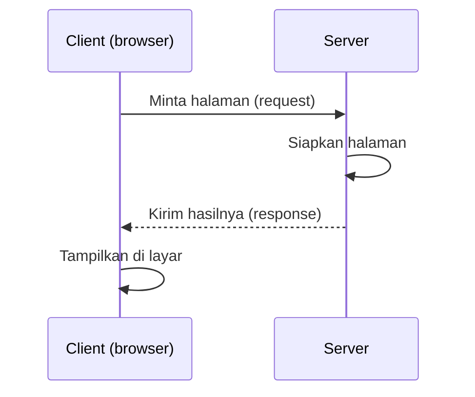
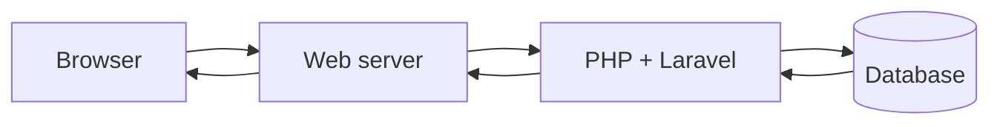

# Client-Server Architecture

Pada bab sebelumnya kamu membuka halaman HTML langsung dari komputermu. Halaman web
sungguhan tidak bekerja begitu: halaman diminta dari komputer lain yang bertugas
melayaninya. Hubungan "peminta" dan "pelayan" inilah yang disebut arsitektur
**client-server**, fondasi dari semua aplikasi web, termasuk Laravel.

## Tujuan pembelajaran

Setelah menyelesaikan bab ini, kamu dapat:

- [ ] Menjelaskan peran client dan server.
- [ ] Menggambarkan alur singkat ketika sebuah halaman web dibuka.
- [ ] Membedakan web server, application server, dan database server.
- [ ] Membedakan halaman statis dan dinamis.
- [ ] Menjelaskan fungsi URL, nama domain, DNS, dan port secara garis besar.
- [ ] Mengamati komunikasi client-server dengan Developer Tools dan terminal.

## Prasyarat

- Bab [Pengantar Web Development](00-01-introduction-to-web-development.md): mengerti
  frontend, backend, dan HTML dasar.
- Browser modern dengan Developer Tools. Terminal (PowerShell atau Command Prompt di
  Windows, terminal di macOS/Linux) untuk latihan akhir.

## Konsep

### Client dan server

- **Client** adalah pihak yang **meminta** layanan. Pada web, client biasanya
  **browser** di laptop atau ponsel kamu.
- **Server** adalah komputer (atau program) yang **menyediakan** layanan: menyimpan
  berkas, menjalankan kode, dan menjawab permintaan client.

Satu server dapat melayani ribuan client sekaligus. Server biasanya menyala terus dan
punya alamat tetap supaya selalu dapat dihubungi.

!!! tip "Analogi"
    Restoran. Pelanggan (client) memesan, dapur dan pelayan (server) menyiapkan dan
    mengantar pesanan. Pelanggan tidak perlu tahu cara memasaknya; cukup tahu cara
    memesan.

Istilah *server* bisa berarti dua hal: **mesin** (komputer fisik atau virtual) atau
**program** yang berjalan di mesin itu (misalnya program yang melayani halaman web).
Satu mesin bisa menjalankan banyak program server sekaligus.

### Alur singkat membuka halaman



1. Kamu mengetik alamat atau mengklik tautan.
2. Browser mengirim **permintaan** (*request*) ke server.
3. Server menyiapkan jawaban: membaca berkas, atau menjalankan kode seperti PHP.
4. Server mengirim **jawaban** (*response*) berisi HTML dan berkas pendukung.
5. Browser menampilkan hasilnya.

Isi permintaan dan jawaban (metode, status, header) dibahas pada bab HTTP dan HTTPS
serta bab Request dan Response.

### Bagaimana browser menemukan server?

| Istilah | Fungsi | Contoh |
|---|---|---|
| **URL** | Alamat lengkap sebuah sumber daya | `https://laravel.com/docs` |
| **Nama domain** | Nama yang mudah diingat untuk sebuah server | `laravel.com` |
| **DNS** | "Buku telepon" internet: menerjemahkan nama domain menjadi alamat IP | `laravel.com` → alamat IP |
| **Alamat IP** | Alamat numerik sebuah mesin di jaringan | Bentuknya seperti `203.0.113.10` |
| **Port** | "Pintu" pada mesin tempat sebuah program server mendengarkan | `80` (HTTP), `443` (HTTPS) |

Ketika kamu mengetik `https://laravel.com/docs`, browser menanyakan alamat IP
`laravel.com` ke DNS, lalu menghubungi alamat itu pada port HTTPS (443, bila tidak
disebut eksplisit).

Saat belajar Laravel nanti, server berjalan di komputermu sendiri. Alamat khusus untuk
itu adalah **localhost** (`127.0.0.1`), dengan port yang ditentukan program server,
misalnya `http://127.0.0.1:8000`.

### Jenis server pada aplikasi web

| Jenis | Tugas | Contoh |
|---|---|---|
| **Web server** | Menerima request HTTP dan menyajikan berkas atau meneruskan ke aplikasi | Nginx, Apache |
| **Application server / runtime** | Menjalankan kode aplikasi dan menghasilkan halaman | PHP (menjalankan Laravel) |
| **Database server** | Menyimpan dan mengambil data terstruktur | MySQL, SQLite |

Pada aplikasi Laravel, ketiganya bekerja berantai:



### Halaman statis dan dinamis

| | Statis | Dinamis |
|---|---|---|
| Isi | Berkas jadi, sama untuk semua orang | Dibuat saat diminta |
| Server | Cukup mengirim berkas | Menjalankan kode, sering memakai database |
| Contoh | Halaman `index.html` bab sebelumnya | Daftar pesanan milikmu setelah login |

Laravel dipakai untuk halaman **dinamis**: isi halaman bergantung pada siapa
pengguna, data di database, dan hal yang diminta.

## Praktik: mengamati client-server

Latihan ini tidak membutuhkan PHP atau Laravel. Kamu akan mengamati komunikasi nyata
antara browser dan sebuah server publik.

### Langkah 1: lihat permintaan di browser

1. Buka tab baru di browser, lalu tekan ++f12++ dan pilih tab **Network**.
2. Buka `https://example.com` (halaman uji sederhana milik IANA).
3. Perhatikan daftar yang muncul di tab Network.

**Yang seharusnya terlihat:**

- Setidaknya satu baris untuk dokumen halaman, dengan kolom *Name*, *Status*, dan *Type*.
- Kolom *Status* untuk halaman utama berisi kode angka. Kode `200` berarti server
  berhasil menjawab (arti kode lain dibahas pada bab status code).
- Klik baris itu: panel *Headers* menampilkan alamat yang diminta (`Request URL`)
  dan data yang dikirim server.
- Tab *Response* atau *Preview* menampilkan HTML yang diterima browser.

Halaman besar menghasilkan banyak baris (gambar, CSS, skrip) karena browser harus
meminta tiap berkas pendukung satu per satu.

### Langkah 2: cari alamat IP sebuah domain

Di terminal, jalankan:

```bash
nslookup example.com
```

**Yang seharusnya terlihat:** nama server DNS yang kamu pakai, lalu satu atau lebih
baris **Address** berisi alamat IP untuk `example.com`. Nilai persisnya dapat berbeda
antar jaringan dan waktu, jadi jangan menyamakannya dengan contoh orang lain.

### Langkah 3: jadilah client tanpa browser

`curl` adalah program client baris perintah. Di Windows PowerShell tulis `curl.exe`
(karena `curl` adalah alias cmdlet lain); di macOS/Linux cukup `curl`.

```bash
curl -I https://example.com
```

Opsi `-I` hanya meminta bagian kepala jawaban.

**Yang seharusnya terlihat:** baris pertama berawalan `HTTP/` diikuti kode status
(untuk halaman ini umumnya `200`), lalu beberapa baris header. Ini menunjukkan bahwa
browser hanyalah salah satu jenis client; program lain bisa meminta hal yang sama.

!!! note "Jika perintah gagal"
    Pesan seperti *could not resolve host* berarti nama domain gagal diterjemahkan
    (periksa koneksi internet/DNS). Perintah `curl` tidak ditemukan pada sistem lama:
    pakai browser untuk langkah 1 saja dan lanjutkan ke latihan.

## Kesalahan umum dan debugging

| Gejala | Kemungkinan penyebab | Solusi |
|---|---|---|
| Tab Network kosong | Developer Tools dibuka setelah halaman dimuat | Muat ulang halaman (++f5++) dengan Network tetap terbuka. |
| `nslookup` tidak dikenal | Alat tidak tersedia di sistem | Lewati langkah ini atau pakai alat DNS lain yang tersedia. |
| `curl` di PowerShell memunculkan error aneh | `curl` adalah alias cmdlet lain | Tulis `curl.exe`. |
| *could not resolve host* | Tidak ada internet, atau salah ketik domain | Periksa koneksi dan ejaan. |
| Mengira "server" selalu komputer terpisah | Server bisa berupa program di komputer yang sama | Ingat dua arti istilah *server*: mesin dan program. |
| Halaman `file:///` dianggap "dari server" | Berkas dibaca dari disk tanpa server | Hanya alamat `http://` atau `https://` yang dilayani server. |

## Latihan terpandu

1. Gambar (di kertas atau dengan Mermaid) alur ketika kamu membuka
   `https://example.com`, mulai dari browser sampai halaman tampil. Cantumkan
   DNS, web server, dan response.
2. Buka `https://example.com` dan sebuah situs lain dengan Network aktif.
   Bandingkan jumlah baris di Network. Mengapa jumlahnya berbeda?
3. Jalankan `nslookup` untuk dua domain berbeda dan bandingkan hasilnya.
4. Sebutkan tiga contoh halaman statis dan tiga contoh halaman dinamis dari
   situs yang kamu kenal, beserta alasannya.
5. Jawab: apa yang berbeda antara membuka `index.html` bab sebelumnya lewat
   `file:///` dan membuka `https://example.com`?

??? success "Jawaban nomor 2 dan 5"
    **Nomor 2:** Situs yang kaya gambar, gaya, dan skrip meminta lebih banyak berkas
    pendukung, sehingga barisnya lebih banyak.

    **Nomor 5:** Dengan `file:///`, browser membaca berkas dari disk; tidak ada server
    yang menerima request dan menjawab. Dengan `https://`, browser mengirim request ke
    server lewat jaringan dan menerima response.

## Pertanyaan review

1. Apa peran client dan server? Berikan satu contoh masing-masing.
2. Apa dua arti kata "server"?
3. Apa fungsi DNS?
4. Apa bedanya URL, nama domain, dan alamat IP?
5. Apa tugas web server, application server, dan database server?
6. Apa beda halaman statis dan dinamis? Untuk jenis mana Laravel dipakai?
7. Apa arti `localhost`?

## Ringkasan

- Client meminta, server melayani; browser adalah client yang paling umum.
- Browser menemukan server lewat nama domain → DNS → alamat IP + port.
- Aplikasi web memadukan web server, aplikasi (PHP/Laravel), dan database.
- Halaman dinamis dibuat server saat diminta; Laravel dibuat untuk jenis ini.
- Developer Tools, `nslookup`, dan `curl` memungkinkan kamu mengamati komunikasi nyata.

Selanjutnya: **HTTP dan HTTPS Fundamentals**.

## Referensi resmi

- [MDN: Client-Server overview](https://developer.mozilla.org/en-US/docs/Learn_web_development/Extensions/Server-side/First_steps/Client-Server_overview)
- [MDN: What is a web server?](https://developer.mozilla.org/en-US/docs/Learn_web_development/Howto/Web_mechanics/What_is_a_web_server)
- [MDN: What is a URL?](https://developer.mozilla.org/en-US/docs/Learn_web_development/Howto/Web_mechanics/What_is_a_URL)
- [MDN: What is a domain name?](https://developer.mozilla.org/en-US/docs/Learn_web_development/Howto/Web_mechanics/What_is_a_domain_name)
- [MDN: Introduction to the server side](https://developer.mozilla.org/en-US/docs/Learn_web_development/Extensions/Server-side/First_steps/Introduction)
