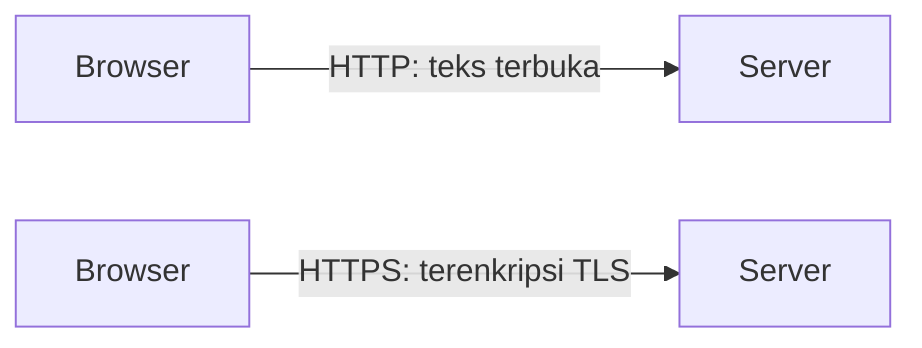

# HTTP dan HTTPS

Client dan server perlu sepakat tentang **bahasa** yang dipakai saat berkomunikasi.
Bahasa itu bernama **HTTP**. Versi amannya, **HTTPS**, melindungi percakapan dari
penyadapan. Semua fitur Laravel, mulai dari route sampai login, dibangun di atas
aturan HTTP.

## Tujuan pembelajaran

Setelah menyelesaikan bab ini, kamu dapat:

- [ ] Menjelaskan apa itu HTTP dan mengapa ia disebut *stateless*.
- [ ] Menyebutkan metode HTTP utama dan kegunaannya.
- [ ] Mengelompokkan status code berdasarkan kelasnya (2xx, 3xx, 4xx, 5xx).
- [ ] Menjelaskan perbedaan HTTP dan HTTPS serta fungsi sertifikat.
- [ ] Mengamati metode, status, dan HTTPS pada sebuah halaman nyata.

## Prasyarat

- Bab [Client-Server Architecture](00-02-client-server-architecture.md): memahami
  client, server, DNS, dan port.
- Browser dengan Developer Tools, serta terminal dengan `curl`.

## Konsep

### Apa itu HTTP?

**HTTP** (*HyperText Transfer Protocol*) adalah protokol, yaitu seperangkat aturan, untuk
memindahkan data web antara client dan server. Pola dasarnya satu arah:
client mengirim **request**, server membalas dengan **response**.

!!! tip "Analogi"
    HTTP seperti tata cara surat-menyurat resmi: ada format alamat, perihal, dan isi.
    Selama kedua pihak memakai format yang sama, surat dari mana pun dapat dibaca.

HTTP bersifat **stateless**: setiap request berdiri sendiri, dan server tidak otomatis
mengingat request sebelumnya. Karena itu, untuk "mengingat" pengguna yang sudah login,
aplikasi memakai mekanisme tambahan seperti **session** dan **cookie** (dibahas saat
autentikasi).

### Metode HTTP

Metode (*method* atau *verb*) menyatakan **maksud** sebuah request.

| Metode | Maksud | Contoh pemakaian |
|---|---|---|
| `GET` | Mengambil data | Membuka halaman, menampilkan daftar |
| `POST` | Mengirim data baru | Mengirim form pendaftaran |
| `PUT` | Mengganti data seluruhnya | Memperbarui satu data lengkap |
| `PATCH` | Mengubah sebagian data | Mengubah satu kolom saja |
| `DELETE` | Menghapus data | Menghapus sebuah artikel |

Saat mengetik alamat di browser atau mengeklik tautan, browser mengirim `GET`.
Form HTML pada praktiknya hanya mengirim `GET` atau `POST`; Laravel menyediakan
cara agar form tetap dapat memakai `PUT`, `PATCH`, dan `DELETE` (dibahas di sub bab
*Form Method Spoofing*).

!!! note "Aman dan tidak aman"
    `GET` seharusnya hanya **membaca** data, tidak mengubah apa pun. Perubahan data
    dilakukan lewat `POST`, `PUT`, `PATCH`, atau `DELETE`. Memegang aturan ini
    membuat aplikasi lebih aman dan lebih mudah diprediksi.

### Status code

Setiap response membawa **status code** berupa angka tiga digit. Angka pertama
menunjukkan kelasnya:

| Kelas | Arti | Contoh umum |
|---|---|---|
| `1xx` | Informasi | Jarang kamu temui secara langsung |
| `2xx` | Berhasil | `200 OK`, `201 Created` |
| `3xx` | Pengalihan (redirect) | `301` permanen, `302` sementara |
| `4xx` | Kesalahan dari sisi client | `404 Not Found`, `403 Forbidden`, `422` data tidak valid |
| `5xx` | Kesalahan dari sisi server | `500 Internal Server Error` |

Membedakan `4xx` dan `5xx` sangat membantu debugging: `4xx` berarti permintaan yang
bermasalah (alamat salah, belum login, data tidak valid), sedangkan `5xx` berarti
aplikasi di server yang bermasalah (misalnya kode PHP error).

### Header sekilas

Selain isi, request dan response membawa **header**: keterangan tambahan berupa pasangan
nama dan nilai, misalnya jenis isi (`Content-Type`) atau browser yang dipakai. Struktur
lengkap request dan response dibahas pada bab berikutnya.

### HTTPS

Pada HTTP biasa, data berjalan sebagai teks yang bisa dibaca pihak yang menyadap jaringan
(misalnya di Wi-Fi umum). **HTTPS** adalah HTTP yang dibungkus enkripsi **TLS**
(*Transport Layer Security*):

- **Kerahasiaan**: isi komunikasi dienkripsi.
- **Keutuhan**: isi tidak bisa diubah di tengah jalan tanpa ketahuan.
- **Identitas server**: **sertifikat** memastikan bahwa kamu benar-benar terhubung
  ke `contoh.com`, bukan situs tiruan.

| | HTTP | HTTPS |
|---|---|---|
| Port bawaan | 80 | 443 |
| Enkripsi | Tidak | Ya (TLS) |
| Awalan URL | `http://` | `https://` |
| Cocok untuk | Percobaan lokal | Semua situs yang dipakai nyata, terutama yang memuat login atau data pribadi |



!!! warning "Keamanan"
    Jangan pernah mengirim kata sandi atau data pribadi lewat HTTP biasa di jaringan
    yang tidak kamu percaya. Aplikasi produksi wajib memakai HTTPS. Untuk
    pengembangan lokal, `http://127.0.0.1:8000` boleh dipakai karena datanya tidak
    keluar dari komputermu.

## Praktik: mengamati HTTP dan HTTPS

### Langkah 1: lihat metode, status, dan HTTPS di browser

1. Buka `https://example.com`, tekan ++f12++, lalu pilih tab **Network** dan muat ulang
   halaman (++f5++).
2. Klik baris dokumen utama. Di panel **Headers**, cari:
    - **Request Method**: seharusnya `GET`.
    - **Status Code**: kode angka dari server, kelas `2xx` untuk halaman yang normal.
    - **Request URL**: diawali `https://`.
3. Perhatikan ikon di sebelah kiri bilah alamat. Klik untuk melihat keterangan koneksi
   dan sertifikat. Browser menandai koneksi HTTPS yang valid dan memperingatkan bila
   ada masalah.

### Langkah 2: lihat status dari terminal

Di Windows PowerShell tulis `curl.exe`; di macOS/Linux cukup `curl`.

```bash
curl -I https://example.com
```

**Yang seharusnya terlihat:** baris pertama berawalan `HTTP/` diikuti status code
kelas `2xx`, lalu beberapa header (misalnya `content-type`).

### Langkah 3: amati status kelas 4xx

Minta alamat yang sengaja tidak ada:

```bash
curl -I https://example.com/halaman-yang-tidak-ada
```

**Yang seharusnya terlihat:** baris status dengan kode berbeda dari langkah 2. Jika
server menjawab bahwa halaman tidak ada, kodenya termasuk kelas `4xx` (lazimnya `404`).
Catat kode yang kamu lihat; jawaban server bisa berbeda dari situs ke situs.

### Langkah 4: bandingkan dengan form

Pada tab Network, buka sebuah situs yang memiliki kolom pencarian, lalu lakukan
pencarian. Perhatikan request yang baru muncul dan **Request Method**-nya. Banyak
pencarian memakai `GET` (kata kunci tampak di URL), sedangkan form login memakai
`POST` (data tidak tampil di URL). Jangan memasukkan kata sandi asli saat bereksperimen.

## Kesalahan umum dan debugging

| Gejala | Kemungkinan penyebab | Solusi |
|---|---|---|
| Browser memperingatkan "Not secure" atau sertifikat tidak valid | Situs memakai HTTP, sertifikat kedaluwarsa, atau nama domain tidak cocok | Gunakan `https://`; pada server sendiri, pasang atau perbarui sertifikat. |
| Menganggap `404` dan `500` sama | Tidak membedakan kelas status | Ingat: `4xx` salah permintaan, `5xx` salah server. |
| Data sensitif muncul di URL | Memakai `GET` untuk form yang mengirim data rahasia | Gunakan `POST`; jangan taruh rahasia di query string. |
| `curl` di PowerShell tidak seperti yang diharapkan | `curl` adalah alias cmdlet lain | Tulis `curl.exe`. |
| Form dengan `DELETE`/`PUT` tidak berjalan | Form HTML hanya mengirim `GET`/`POST` | Pakai teknik spoofing metode (dibahas di Blade Forms nanti). |
| Perubahan tidak terlihat setelah muat ulang | Respons lama tersimpan di cache browser | Muat ulang paksa dengan ++ctrl+f5++. |

## Latihan terpandu

1. Buka tiga situs berbeda dan catat status code, metode, serta apakah memakai HTTPS.
2. Jalankan `curl -I` pada alamat yang valid dan alamat yang tidak ada. Bandingkan
   baris status, lalu sebutkan kelas masing-masing.
3. Pasangkan situasi dengan metode yang tepat:
    - Menampilkan daftar produk
    - Mengirim form pendaftaran
    - Menghapus komentar
    - Mengubah hanya nomor telepon pengguna
4. Pasangkan situasi dengan kelas status:
    - Pengguna mengetik alamat yang salah
    - Kode PHP di server melempar error
    - Halaman berhasil ditampilkan
    - Halaman lama dipindah ke alamat baru
5. Jelaskan dengan kata-katamu mengapa HTTP perlu session/cookie untuk mengingat login.

??? success "Jawaban nomor 3 dan 4"
    **Nomor 3:** `GET`, `POST`, `DELETE`, `PATCH`.

    **Nomor 4:** `4xx` (umumnya `404`), `5xx` (`500`), `2xx` (`200`), `3xx`
    (`301` atau `302`).

## Pertanyaan review

1. Apa itu protokol, dan apa itu HTTP?
2. Apa arti HTTP *stateless*?
3. Sebutkan lima metode HTTP dan fungsinya.
4. Apa arti kelas status `2xx`, `3xx`, `4xx`, dan `5xx`?
5. Apa tiga manfaat utama HTTPS?
6. Apa fungsi sertifikat pada HTTPS?
7. Mengapa `GET` tidak boleh dipakai untuk mengubah data?

## Ringkasan

- HTTP adalah aturan komunikasi web berpola request → response, dan bersifat stateless.
- Metode menyatakan maksud: `GET` membaca; `POST`, `PUT`, `PATCH`, `DELETE` mengubah data.
- Status code dikelompokkan: 2xx berhasil, 3xx redirect, 4xx salah client, 5xx salah server.
- HTTPS = HTTP + TLS: rahasia, utuh, dan terverifikasi lewat sertifikat.
- Developer Tools dan `curl` membantu mengamati metode dan status secara langsung.

Selanjutnya: **Understanding Request and Response**.

## Referensi resmi

- [MDN: An overview of HTTP](https://developer.mozilla.org/en-US/docs/Web/HTTP/Guides/Overview)
- [MDN: HTTP request methods](https://developer.mozilla.org/en-US/docs/Web/HTTP/Reference/Methods)
- [MDN: HTTP response status codes](https://developer.mozilla.org/en-US/docs/Web/HTTP/Reference/Status)
- [MDN: HTTP messages](https://developer.mozilla.org/en-US/docs/Web/HTTP/Guides/Messages)
- [MDN: HTTPS](https://developer.mozilla.org/en-US/docs/Glossary/HTTPS)
- [MDN: Transport Layer Security](https://developer.mozilla.org/en-US/docs/Web/Security/Transport_Layer_Security)
