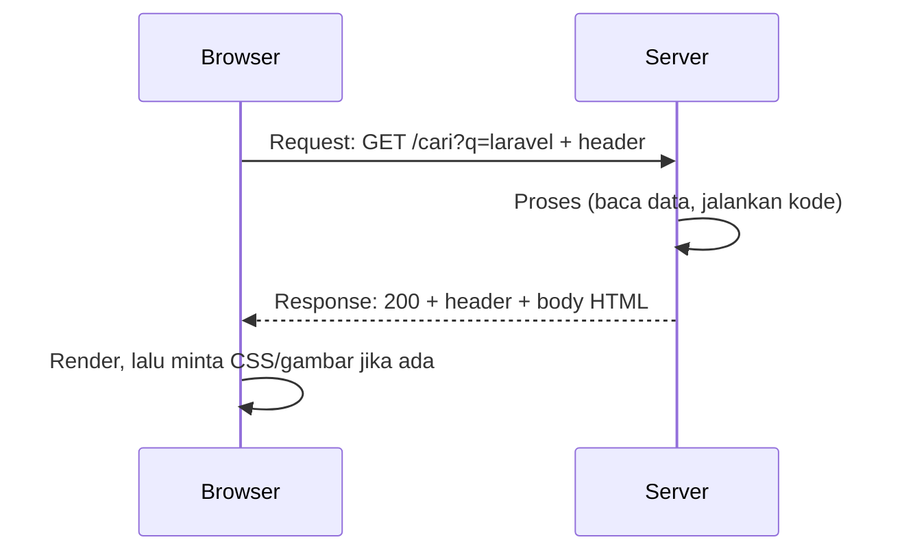

# Request dan Response

Setiap interaksi web adalah pasangan **request** dan **response**. Bab ini membedah
isi keduanya, bagian demi bagian, supaya saat memakai objek `Request` dan `Response`
di Laravel nanti kamu tahu persis data apa yang sedang dibaca atau dikirim.

## Tujuan pembelajaran

Setelah menyelesaikan bab ini, kamu dapat:

- [ ] Menyebutkan bagian-bagian sebuah HTTP request dan response.
- [ ] Menjelaskan fungsi URL, *query string*, header, dan body.
- [ ] Membedakan data yang dikirim lewat query string dan lewat body.
- [ ] Membaca `Content-Type` untuk mengenali jenis isi (HTML, JSON, dan lainnya).
- [ ] Mengamati request dan response nyata dengan Developer Tools dan `curl`.

## Prasyarat

- Bab [HTTP dan HTTPS](00-03-http-https-fundamentals.md): metode, status code, header sekilas.
- Browser dengan Developer Tools, terminal dengan `curl`, dan editor teks.

## Konsep

### Anatomi request

Sebuah request terdiri dari tiga bagian:

```text
GET /docs?versi=13 HTTP/1.1          <- baris awal: metode, path + query, versi
Host: laravel.com                    <- header
Accept: text/html                    <- header

(isi / body, kosong pada GET)        <- body
```

| Bagian | Isi | Contoh |
|---|---|---|
| **Baris awal** | Metode, *path* (+ query string), versi HTTP | `GET /docs?versi=13 HTTP/1.1` |
| **Header** | Keterangan tambahan: tujuan (`Host`), jenis jawaban yang diterima (`Accept`), cookie, dan lainnya | `Host: laravel.com` |
| **Body** | Data yang dikirim ke server; umumnya ada pada `POST`, `PUT`, `PATCH` | Isian form, JSON |

!!! note "Penulisan di contoh"
    Contoh di atas adalah bentuk teks yang disederhanakan untuk belajar. Versi HTTP
    yang dipakai browser modern bisa berbeda, tetapi pembagian bagiannya sama.

### Bagian-bagian URL

```text
https://laravel.com:443/docs/13.x/routing?versi=13&bahasa=id#basic-routing
└─┬──┘   └────┬────┘└┬┘ └──────┬───────┘ └────────┬────────┘└──────┬──────┘
skema      host   port       path           query string        fragment
```

- **Skema**: protokol (`http`/`https`).
- **Host** dan **port**: tujuan koneksi (port sering tidak ditulis).
- **Path**: sumber daya yang diminta di server.
- **Query string**: data tambahan berpasangan `kunci=nilai`, dipisah `&`, dimulai `?`.
- **Fragment** (`#...`): hanya dipakai browser untuk melompat ke bagian halaman;
  **tidak dikirim ke server**.

### Dua cara mengirim data

| | Query string | Body |
|---|---|---|
| Lokasi | Di URL (`?q=laravel`) | Di dalam request, tidak tampak di URL |
| Metode umum | `GET` | `POST`, `PUT`, `PATCH` |
| Terlihat di riwayat browser | Ya | Tidak |
| Cocok untuk | Pencarian, filter, halaman ke-N | Form login, pendaftaran, unggah berkas, JSON |

!!! warning "Jangan taruh rahasia di URL"
    Alamat tersimpan di riwayat browser dan log server. Kata sandi, token, atau data
    pribadi tidak boleh dikirim lewat query string.

Format isi body yang umum:

- `application/x-www-form-urlencoded`: bentuk standar form HTML, mis. `nama=Budi&usia=20`.
- `multipart/form-data`: untuk form yang mengunggah berkas.
- `application/json`: data terstruktur, banyak dipakai pada API:

  ```json
  {"nama": "Budi", "usia": 20}
  ```

### Anatomi response

```text
HTTP/1.1 200 OK                      <- baris status: versi, kode, keterangan
Content-Type: text/html; charset=utf-8   <- header
Content-Length: 1256

<!DOCTYPE html>...                   <- body
```

| Bagian | Isi |
|---|---|
| **Baris status** | Versi HTTP, status code, keterangan (`200 OK`, `404 Not Found`) |
| **Header** | Keterangan tentang jawaban: jenis isi, panjang, cookie yang diminta server disimpan, lokasi tujuan pada redirect |
| **Body** | Isi yang diminta: HTML, JSON, gambar, berkas |

Header **`Content-Type`** memberi tahu browser cara memperlakukan body:

| `Content-Type` | Browser akan |
|---|---|
| `text/html` | Menampilkan sebagai halaman web |
| `application/json` | Menganggapnya data JSON (aplikasi/JavaScript yang membacanya) |
| `text/css`, `image/png`, ... | Memakainya sebagai gaya, gambar, dan seterusnya |

Pada redirect (`3xx`), response membawa header `Location` yang berisi alamat tujuan,
dan browser otomatis mengirim request baru ke alamat itu.

### Alur lengkap



### Kaitannya dengan Laravel

Laravel membungkus request menjadi objek **Request** (untuk membaca query string,
body, header) dan response menjadi objek **Response** (HTML, JSON, redirect, status).
Semua yang dipelajari di bab ini adalah bahan yang dibaca dan dibuat oleh objek-objek itu
pada sub bab *Request Object* dan *Response Object*.

## Praktik: mengamati request dan response

### Langkah 1: buat form pencarian lokal

Buat folder `belajar-web` (atau pakai yang lama) dan berkas berikut:

```html title="belajar-web/cari.html"
<!DOCTYPE html>
<html lang="id">
<head>
    <meta charset="utf-8">
    <title>Form Pencarian</title>
</head>
<body>
    <h1>Form Pencarian</h1>
    <form action="https://example.com/" method="get">
        <label for="q">Kata kunci</label>
        <input id="q" type="text" name="q">
        <button type="submit">Cari</button>
    </form>
</body>
</html>
```

| Kode | Arti |
|---|---|
| `action="https://example.com/"` | Alamat tujuan pengiriman form. |
| `method="get"` | Data dikirim lewat query string. |
| `name="q"` | Nama kunci pada pasangan `kunci=nilai`. Tanpa `name`, input tidak dikirim. |

### Langkah 2: kirim dan amati

1. Buka `cari.html` di browser, tekan ++f12++, pilih tab **Network**.
2. Ketik `laravel` pada kolom, klik **Cari**.
3. Perhatikan alamat di bilah browser.

**Yang seharusnya terlihat:** URL berubah menjadi `https://example.com/?q=laravel`.
Pada tab Network, klik baris dokumen utama lalu lihat:

- **Request URL** memuat `?q=laravel`.
- **Request Method**: `GET`.
- **Request Headers**: antara lain `Host` dan `User-Agent`.
- **Response Headers**: antara lain `Content-Type`.
- **Response** atau **Preview**: HTML yang dikirim server.

Situs `example.com` mengabaikan parameter `q`, tetapi pengiriman tetap terjadi, jadi kamu
bisa melihat bentuk request-nya.

### Langkah 3: lihat request dan response lengkap lewat curl

Di Windows PowerShell tulis `curl.exe`; di macOS/Linux cukup `curl`.

```bash
curl -v "https://example.com/?q=laravel"
```

Opsi `-v` (verbose) mencetak percakapan. Cari pola berikut pada keluaran:

- Baris berawalan `>` adalah **request** yang kamu kirim: baris awal
  (`GET /?q=laravel ...`) dan header seperti `Host`.
- Baris berawalan `<` adalah **response**: baris status dan header seperti
  `content-type`.
- Setelah baris kosong, isi HTML (body).
- Baris berawalan `*` adalah informasi koneksi (termasuk TLS) dari curl.

Isi dan header persisnya dapat berbeda dari waktu ke waktu; yang penting kamu dapat
mengenali ketiga bagian di atas.

### Langkah 4: amati Content-Type

Pada tab Network, klik beberapa baris berbeda (dokumen, gaya, gambar bila ada) dan
bandingkan nilai `Content-Type` pada Response Headers masing-masing.

### Langkah 5: bandingkan dengan POST (tanpa mengirim)

Ubah salinan `cari.html` menjadi `method="post"`, lalu **jangan dikirim** ke situs luar.
Cukup perhatikan bahwa pada form `POST`, data tidak muncul di URL melainkan dikirim di
body. Perilaku ini akan kamu uji langsung pada server milikmu sendiri saat PHP
dan Laravel sudah terpasang.

## Kesalahan umum dan debugging

| Gejala | Kemungkinan penyebab | Solusi |
|---|---|---|
| URL tidak memuat `?q=...` setelah submit | Atribut `name` pada input hilang | Tambahkan `name="q"`. |
| Form terkirim ke alamat salah | `action` keliru | Periksa nilai `action` pada tag `<form>`. |
| Data tidak muncul di tab Network | Developer Tools dibuka setelah submit | Buka Network dulu, baru kirim form. |
| Karakter khusus rusak di URL | Spasi dan simbol harus di-*encode* (`%20`, dll.) | Biarkan browser/form meng-encode otomatis. |
| JSON tampil sebagai teks di browser | Normal; browser menampilkan apa adanya | Periksa `Content-Type` di tab Network. |
| `curl` di PowerShell error | `curl` adalah alias cmdlet lain | Tulis `curl.exe`. |
| Mengira fragment (`#...`) sampai ke server | Fragment hanya dipakai browser | Kirim data penting lewat query string atau body. |

## Latihan terpandu

1. Ubah form agar punya dua input (`q` dan `halaman`), lalu kirim dan baca URL hasilnya.
2. Dari URL ini, tunjukkan skema, host, path, query string, dan fragment:
   `https://contoh.id/artikel/baca?id=7&mode=ringkas#komentar`
3. Pilih metode dan lokasi data (query string atau body) yang tepat untuk:
    - Pencarian artikel
    - Login
    - Filter produk berdasarkan harga
    - Mengunggah foto profil
4. Jalankan `curl -v` pada sebuah alamat lain, lalu tandai bagian request, response,
   header, dan body pada keluarannya.
5. Untuk tiga respons berbeda di tab Network, catat `Content-Type` dan jelaskan
   bagaimana browser memperlakukan masing-masing.

??? success "Jawaban nomor 2 dan 3"
    **Nomor 2:** skema `https`, host `contoh.id`, path `/artikel/baca`, query string
    `id=7&mode=ringkas`, fragment `komentar`.

    **Nomor 3:** pencarian → `GET` + query string; login → `POST` + body; filter
    harga → `GET` + query string; unggah foto → `POST` + body `multipart/form-data`.

## Pertanyaan review

1. Apa saja tiga bagian sebuah request? Tiga bagian sebuah response?
2. Apa perbedaan query string dan body? Kapan memakai masing-masing?
3. Mengapa kata sandi tidak boleh dikirim lewat query string?
4. Apa fungsi header `Content-Type`?
5. Apa itu fragment URL, dan mengapa tidak sampai ke server?
6. Bagaimana redirect bekerja pada level request dan response?
7. Apa kaitan bab ini dengan objek Request dan Response di Laravel?

## Ringkasan

- Request: baris awal + header + body. Response: baris status + header + body.
- URL terdiri dari skema, host, port, path, query string, dan fragment.
- Query string cocok untuk `GET` (pencarian, filter); body untuk `POST`/`PUT`/`PATCH`.
- `Content-Type` memberi tahu cara membaca isi response.
- Developer Tools dan `curl -v` memperlihatkan request dan response sebenarnya.

Selanjutnya: **Introduction to PHP**, bahasa yang menjalankan sisi server Laravel.

## Referensi resmi

- [MDN: HTTP messages](https://developer.mozilla.org/en-US/docs/Web/HTTP/Guides/Messages)
- [MDN: HTTP headers](https://developer.mozilla.org/en-US/docs/Web/HTTP/Reference/Headers)
- [MDN: Content-Type](https://developer.mozilla.org/en-US/docs/Web/HTTP/Reference/Headers/Content-Type)
- [MDN: Sending and retrieving form data](https://developer.mozilla.org/en-US/docs/Learn_web_development/Extensions/Forms/Sending_and_retrieving_form_data)
- [MDN: The form element](https://developer.mozilla.org/en-US/docs/Web/HTML/Reference/Elements/form)
