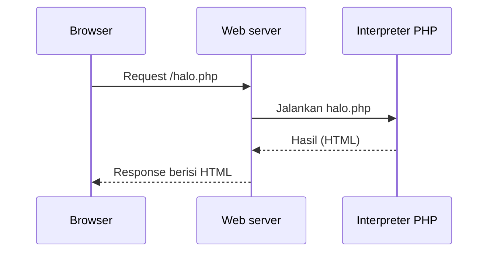

# Pengantar PHP

Laravel adalah framework yang ditulis dengan **PHP**. Sebelum memakai Laravel, kamu perlu
tahu apa itu PHP, mengapa ia dipakai di sisi server, dan seperti apa kode PHP paling
sederhana. Bab ini adalah perkenalan konsep; pemasangan dan eksekusi nyata dilakukan di bab
berikutnya.

## Tujuan pembelajaran

Setelah menyelesaikan bab ini, kamu dapat:

- [ ] Menjelaskan apa itu PHP dan di mana ia berjalan.
- [ ] Menjelaskan alur ketika server menjalankan berkas PHP.
- [ ] Mengenali tag pembuka dan penutup PHP serta perintah `echo`.
- [ ] Membedakan bagian HTML dan bagian PHP dalam satu berkas.
- [ ] Menjelaskan hubungan PHP, Composer, dan Laravel.

## Prasyarat

- Bab [Request dan Response](00-04-request-and-response.md): alur request → response.
- Editor teks. **PHP belum perlu terpasang**; pemasangannya ada di bab berikutnya.

## Konsep

### Apa itu PHP?

**PHP** adalah bahasa pemrograman serbaguna yang paling sering dipakai untuk sisi
**server** pada aplikasi web. Kode PHP dijalankan oleh *interpreter* PHP di server;
browser tidak pernah menerima kode PHP, hanya hasilnya (umumnya HTML atau JSON).

!!! tip "Analogi"
    PHP seperti juru masak di dapur. Pelanggan (browser) hanya menerima hidangan jadi
    (HTML), bukan resep (kode PHP).

Kegunaan umum PHP:

- Menghasilkan halaman web dinamis.
- Mengolah data form.
- Berkomunikasi dengan database.
- Membangun API.
- Menjalankan skrip di terminal (misalnya perintah `php artisan` pada Laravel).

### Alur eksekusi



Kode PHP dibaca dari atas ke bawah. Setiap `echo` menambahkan teks ke hasil. Setelah
selesai, hasil akhir dikirim sebagai isi response.

### Sintaks paling dasar

Kode PHP berada di antara tag pembuka `<?php` dan, bila perlu, tag penutup `?>`:

```php title="halo.php"
<?php

echo "Halo, dunia!";
```

| Bagian | Arti |
|---|---|
| `<?php` | Tag pembuka: dari sini sampai akhir berkas adalah kode PHP. |
| `echo` | Mencetak teks ke keluaran (isi response). |
| `"Halo, dunia!"` | Teks (*string*) yang dicetak. |
| `;` | Mengakhiri satu pernyataan. |

Pada berkas yang **hanya berisi PHP**, tag penutup `?>` tidak ditulis. Itulah gaya
yang dipakai di seluruh kode Laravel.

### PHP bersama HTML

Berkas PHP boleh mencampur HTML dan PHP. Teks di luar tag PHP dikirim apa adanya:

```html+php title="sambutan.php"
<!DOCTYPE html>
<html lang="id">
<head>
    <meta charset="utf-8">
    <title>Sambutan</title>
</head>
<body>
    <h1>Selamat datang</h1>
    <p><?php echo "Hari ini belajar PHP."; ?></p>
</body>
</html>
```

Hasil yang diterima browser (kode PHP sudah hilang, tinggal teksnya):

```html
<p>Hari ini belajar PHP.</p>
```

Pencampuran seperti ini cocok untuk percobaan. Pada Laravel, HTML dan logika dipisah:
HTML berada di *view* (Blade), logika di *controller*.

### PHP, Composer, dan Laravel

| | Peran |
|---|---|
| **PHP** | Bahasa dan interpreter yang menjalankan kode. |
| **Composer** | Pengelola paket PHP; dipakai untuk memasang Laravel dan pustaka lain. |
| **Laravel** | Framework berisi aturan dan alat siap pakai di atas PHP. |

Laravel 13.x membutuhkan **PHP 8.3 atau lebih baru**. Versi PHP yang masih didukung
dapat dicek di [php.net/supported-versions](https://www.php.net/supported-versions.php).

### Lingkungan jalan PHP

PHP dapat dijalankan dengan dua cara yang akan kamu pakai:

- **Lewat terminal**: `php nama-berkas.php`, hasil tampil di terminal.
- **Lewat server web**: browser meminta halaman, server menjalankan PHP, hasil dikirim
  sebagai response.

## Praktik: membaca dan memprediksi kode PHP

Karena PHP belum terpasang, latihan di bab ini adalah **menelusuri kode**: kamu
menuliskan kode, lalu memprediksi hasilnya dengan membacanya baris demi baris.
Kode-kode di bawah ini akan dijalankan sungguhan pada bab pemasangan PHP.

### Langkah 1: buat berkas

Buat folder `belajar-php` dan di dalamnya berkas `halo.php`:

```php title="belajar-php/halo.php"
<?php

echo "Halo, dunia!";
echo "Saya belajar PHP.";
```

### Langkah 2: prediksi hasil

Tuliskan di kertas apa yang menurutmu tercetak. Perhatikan: `echo` tidak otomatis
menambah baris baru.

??? success "Hasil yang diprediksi"
    ```text
    Halo, dunia!Saya belajar PHP.
    ```
    Kedua teks bersambung karena tidak ada karakter baris baru di antaranya.
    Hasil ini diturunkan dari aturan `echo`; belum diverifikasi dengan menjalankan
    PHP, yang baru dilakukan pada bab berikutnya.

### Langkah 3: perbaiki

Ubah menjadi dua baris. Tambahkan `"\n"` (karakter baris baru) di akhir teks pertama:

```php title="belajar-php/halo.php"
<?php

echo "Halo, dunia!\n";
echo "Saya belajar PHP.\n";
```

Prediksi hasilnya, lalu bandingkan:

??? success "Hasil yang diprediksi"
    ```text
    Halo, dunia!
    Saya belajar PHP.
    ```
    (Di browser, baris baru pada HTML tampak sebagai spasi biasa; pemisahan baris
    kasat mata di halaman web memakai tag HTML seperti `<br>` atau `<p>`.)

### Langkah 4: baca PHP di dalam HTML

Pada `sambutan.php` di atas, jawab: apa yang akan dilihat pengguna di browser, dan
apa yang tidak dilihatnya? Jawaban: pengguna melihat judul "Selamat datang" dan
kalimat "Hari ini belajar PHP.". Ia tidak melihat `<?php echo ... ?>` karena PHP sudah
diproses di server.

### Langkah 5 (opsional): cek apakah PHP sudah terpasang

Jika kamu sudah memasang PHP, jalankan:

```bash
php -v
```

Jika perintah dikenali, keluarannya menampilkan nomor versi PHP. Laravel 13.x
membutuhkan PHP 8.3 atau lebih baru. Jika perintah tidak dikenali, itu normal pada
tahap ini; kita memasangnya di bab berikutnya.

## Kesalahan umum dan debugging

| Gejala | Kemungkinan penyebab | Solusi |
|---|---|---|
| Browser menampilkan kode PHP sebagai teks | Berkas dibuka langsung (`file:///`) tanpa melewati server PHP | PHP hanya berjalan lewat interpreter atau server (dibahas di bab pemasangan). |
| `Parse error: syntax error` | Titik koma `;` atau tanda kutip hilang | Periksa akhir tiap pernyataan dan pasangan tanda kutip. |
| Hasil tercetak bersambung | `echo` tidak menambah baris baru | Tambahkan `"\n"` (terminal) atau tag HTML (browser). |
| Teks sebelum `<?php` ikut tercetak | Spasi atau baris kosong di luar tag PHP | Mulai berkas langsung dengan `<?php`. |
| `php` tidak dikenali di terminal | PHP belum terpasang atau belum masuk `PATH` | Pasang PHP pada bab berikutnya. |

## Latihan terpandu

1. Tulis `profil.php` yang mencetak nama dan kotamu, masing-masing satu baris
   (gunakan `"\n"`). Prediksi hasilnya sebelum dijalankan di bab berikutnya.
2. Ubah `sambutan.php` agar paragraf mencetak namamu. Tentukan: bagian mana yang
   dijalankan server, bagian mana yang dikirim apa adanya?
3. Jelaskan dengan kata-katamu mengapa browser tidak pernah melihat kode PHP.
4. Gambarkan alur dari browser meminta `halo.php` sampai teks tampil.

## Pertanyaan review

1. Apa itu PHP dan di mana ia berjalan?
2. Apa fungsi `<?php`, `echo`, dan `;`?
3. Mengapa tag penutup `?>` tidak ditulis pada berkas yang hanya berisi PHP?
4. Apa bedanya menjalankan PHP lewat terminal dan lewat server web?
5. Apa hubungan PHP, Composer, dan Laravel?
6. Versi PHP minimum apa yang dibutuhkan Laravel 13.x?

## Ringkasan

- PHP dijalankan di server; browser hanya menerima hasilnya.
- Kode PHP dimulai dengan `<?php`; `echo` mencetak teks; pernyataan diakhiri `;`.
- PHP boleh dicampur dengan HTML, tetapi Laravel memisahkan keduanya.
- Composer memasang paket, termasuk Laravel, yang membutuhkan PHP 8.3 atau lebih baru.

Selanjutnya: **PHP Installation and Development Environment**, tempat kamu akan menjalankan
kode PHP sungguhan.

## Referensi resmi

- [PHP Manual: Introduction](https://www.php.net/manual/en/introduction.php)
- [PHP Manual: PHP tags](https://www.php.net/manual/en/language.basic-syntax.phptags.php)
- [PHP Manual: echo](https://www.php.net/manual/en/function.echo.php)
- [PHP: Supported Versions](https://www.php.net/supported-versions.php)
- [Laravel: Server Requirements](https://laravel.com/docs/13.x/deployment#server-requirements)
