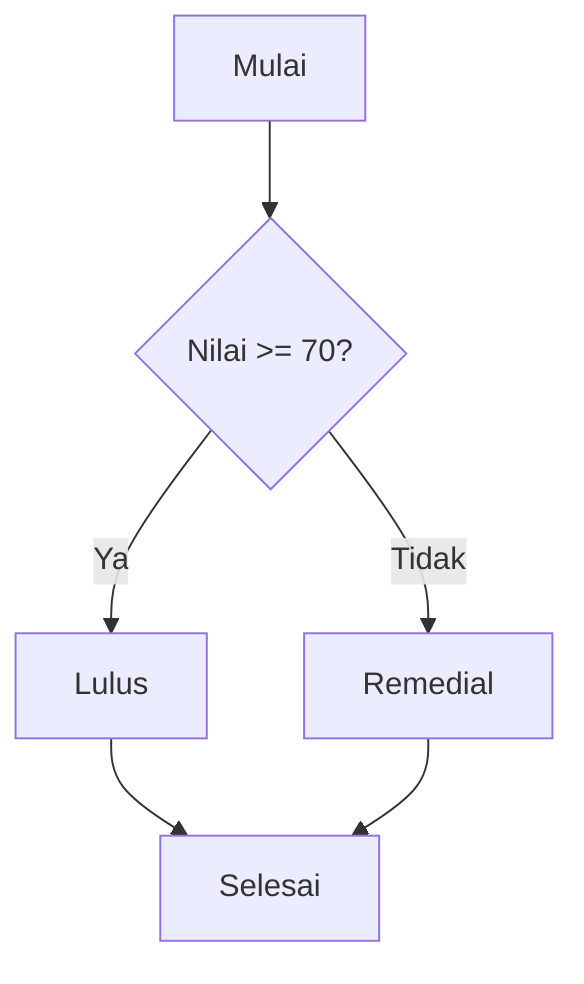

# Pernyataan Kondisional

Program yang berguna harus bisa mengambil keputusan: *jika* pengguna sudah login tampilkan
dasbor, *jika tidak* tampilkan form login. **Pernyataan kondisional** memungkinkan kode
menjalankan blok yang berbeda tergantung kondisi.

## Tujuan pembelajaran

Setelah menyelesaikan bab ini, kamu dapat:

- [ ] Menulis `if`, `else`, dan `elseif` dengan kondisi yang benar.
- [ ] Menggunakan `switch` dan memahami `break` serta `default`.
- [ ] Menggunakan ekspresi `match` dan menjelaskan bedanya dengan `switch`.
- [ ] Menulis sintaks alternatif (`if: ... endif;`) untuk kode yang bercampur HTML.
- [ ] Memilih struktur kondisi yang paling sesuai dengan situasinya.

## Prasyarat

- Bab [Operator PHP](00-10-php-operators.md): operator perbandingan dan logika, `===`.
- PHP 8.3 atau lebih baru terpasang; folder `belajar-php`.

## Konsep

### Alur keputusan



!!! tip "Analogi"
    Persimpangan jalan dengan rambu: jika lampu hijau, jalan; jika merah, berhenti.
    Kondisi adalah lampunya, blok kode adalah tindakannya.

### `if`, `else`, dan `elseif`

```php
if ($nilai >= 70) {
    echo "Lulus";
} else {
    echo "Remedial";
}
```

- Kondisi di dalam kurung dievaluasi menjadi `bool` (nilai lain diubah memakai aturan
  truthy/falsy).
- Blok `{ ... }` hanya dijalankan jika kondisi benar.
- `else` dijalankan jika kondisi `if` salah.

Untuk lebih dari dua kemungkinan, gunakan `elseif`. Kondisi diperiksa dari atas ke bawah,
dan **hanya blok pertama yang cocok** yang dijalankan:

```php
if ($nilai >= 85) {
    echo "A";
} elseif ($nilai >= 70) {
    echo "B";
} elseif ($nilai >= 55) {
    echo "C";
} else {
    echo "D";
}
```

Karena pemeriksaan berurutan, **urutan kondisi penting**. Jika `$nilai >= 55` ditaruh
paling atas, nilai 90 akan berhenti di sana dan menghasilkan `C`.

Kondisi dapat digabung dengan operator logika:

```php
if ($umur >= 17 && $punyaKtp) {
    echo "Boleh mendaftar";
}
```

!!! warning "Waspada `=` di dalam kondisi"
    `if ($x = 5)` **menetapkan** 5 ke `$x` lalu menganggap hasilnya benar, sehingga blok
    selalu berjalan. Untuk membandingkan, pakai `===`.

Kita selalu menulis kurung kurawal `{ }`, meski blok hanya satu baris, agar tidak ada
bug saat baris ditambah.

### `switch`

`switch` membandingkan satu nilai dengan beberapa `case`:

```php
switch ($hari) {
    case "Sabtu":
    case "Minggu":
        echo "Akhir pekan";
        break;
    case "Jumat":
        echo "Hampir akhir pekan";
        break;
    default:
        echo "Hari kerja";
}
```

- `break` menghentikan `switch`. Tanpa `break`, eksekusi **terus jatuh** (*fall-through*) ke
  `case` di bawahnya. Itu sengaja dipakai pada contoh "Sabtu"/"Minggu" di atas.
- `default` dijalankan bila tidak ada `case` yang cocok.
- `switch` membandingkan secara **longgar** (seperti `==`), sehingga `"1"` cocok dengan
  `case 1`.

### `match` (PHP 8)

`match` adalah ekspresi yang **mengembalikan nilai** dan membandingkan secara **ketat**
(seperti `===`):

```php
$pesan = match ($kode) {
    200 => "OK",
    301, 302 => "Redirect",
    404 => "Tidak ditemukan",
    500 => "Error server",
    default => "Tidak dikenal",
};
```

| | `switch` | `match` |
|---|---|---|
| Hasil | Pernyataan (menjalankan kode) | Ekspresi (mengembalikan nilai) |
| Perbandingan | Longgar (`==`) | Ketat (`===`) |
| Perlu `break` | Ya | Tidak |
| Jika tak ada yang cocok | Lewati (tanpa `default`) | Melempar `UnhandledMatchError` |

Satu `match` dapat dipakai untuk rentang dengan `match (true)`:

```php
$grade = match (true) {
    $nilai >= 85 => "A",
    $nilai >= 70 => "B",
    default => "C",
};
```

Akhiri `match` dengan titik koma, karena ia adalah ekspresi.

### Sintaks alternatif untuk HTML

Ketika PHP bercampur HTML, sintaks bertitik dua lebih mudah dibaca daripada kurung
kurawal:

```php
<?php if ($login): ?>
    <p>Selamat datang kembali.</p>
<?php else: ?>
    <p>Silakan masuk.</p>
<?php endif; ?>
```

Bentuknya: `if (...):`, `elseif (...):`, `else:`, dan penutup `endif;`. Bentuk serupa
ada untuk `foreach` (`endforeach;`) dan `while`. Gaya inilah yang kemudian
disederhanakan oleh direktif Blade (`@if ... @endif`) di Laravel.

### Memilih struktur

| Situasi | Pilihan |
|---|---|
| Dua kemungkinan | `if` / `else` (atau ternary untuk nilai sederhana) |
| Banyak kondisi berupa rentang atau ekspresi | `if` / `elseif`, atau `match (true)` |
| Memilih nilai dari satu variabel | `match` |
| Beberapa `case` dengan aksi panjang | `switch` |
| Di dalam HTML | Sintaks alternatif |

## Praktik

Semua berkas dibuat di folder `belajar-php`.

### Langkah 1: `if` / `elseif` / `else`

```php title="belajar-php/kondisi.php"
<?php

$nilai = 78;

if ($nilai >= 85) {
    echo "A\n";
} elseif ($nilai >= 70) {
    echo "B\n";
} elseif ($nilai >= 55) {
    echo "C\n";
} else {
    echo "D\n";
}

if ($nilai >= 70 && $nilai <= 100) {
    echo "Lulus\n";
}
```

```bash
cd belajar-php
php kondisi.php
```

**Yang seharusnya terlihat:**

```text
B
Lulus
```

Nilai 78 gagal di kondisi pertama (`>= 85`), lalu lolos di kondisi kedua (`>= 70`), sehingga
blok lain tidak diperiksa lagi. Ubah `$nilai` menjadi `90`, `60`, `40`, dan `70`, lalu
prediksi dan cocokkan hasilnya.

### Langkah 2: `switch`

```php title="belajar-php/switch.php"
<?php

$hari = "Sabtu";

switch ($hari) {
    case "Sabtu":
    case "Minggu":
        echo "Akhir pekan\n";
        break;
    case "Jumat":
        echo "Hampir akhir pekan\n";
        break;
    default:
        echo "Hari kerja\n";
}
```

**Yang seharusnya terlihat:** `Akhir pekan`. Ubah `$hari` menjadi `"Jumat"` dan
`"Senin"`, lalu amati. Terakhir, hapus satu `break` dan lihat efek fall-through.

### Langkah 3: `match`

```php title="belajar-php/match.php"
<?php

$kode = 404;

$pesan = match ($kode) {
    200 => "OK",
    301, 302 => "Redirect",
    404 => "Tidak ditemukan",
    500 => "Error server",
    default => "Tidak dikenal",
};

echo "Status $kode: $pesan\n";

$nilai = 78;

$grade = match (true) {
    $nilai >= 85 => "A",
    $nilai >= 70 => "B",
    default => "C",
};

echo "Grade: $grade\n";
```

**Yang seharusnya terlihat:**

```text
Status 404: Tidak ditemukan
Grade: B
```

Ini mengulang status code dari bab HTTP, kali ini dalam kode.

### Langkah 4: perbandingan longgar vs ketat

```php title="belajar-php/switch-vs-match.php"
<?php

$x = "1";

switch ($x) {
    case 1:
        echo "switch: cocok\n";
        break;
    default:
        echo "switch: tidak cocok\n";
}

echo match ($x) {
    1 => "match: cocok",
    default => "match: tidak cocok",
}, "\n";
```

**Yang seharusnya terlihat:**

```text
switch: cocok
match: tidak cocok
```

`switch` menganggap `"1"` sama dengan `1`, sedangkan `match` tidak karena tipenya berbeda.

### Langkah 5: `match` tanpa kecocokan

```php title="belajar-php/match-error.php"
<?php

echo match (5) {
    1 => "satu",
    2 => "dua",
};
```

**Yang seharusnya terlihat:** error fatal bertipe `UnhandledMatchError` (bunyi pesan persis
bisa berbeda antar versi PHP). Tambahkan `default => "lainnya",` untuk memperbaikinya.

### Langkah 6: sintaks alternatif di HTML

```php title="belajar-php/tampil.php"
<!DOCTYPE html>
<html lang="id">
<head>
    <meta charset="utf-8">
    <title>Kondisi di HTML</title>
</head>
<body>
    <?php $login = true; ?>

    <?php if ($login): ?>
        <p>Selamat datang kembali.</p>
    <?php else: ?>
        <p>Silakan masuk.</p>
    <?php endif; ?>
</body>
</html>
```

Jalankan server pengembangan dari folder `belajar-php` dan buka halamannya:

```bash
php -S localhost:8000
```

Buka `http://localhost:8000/tampil.php`.

**Yang seharusnya terlihat:** kalimat "Selamat datang kembali." Ubah `$login` menjadi
`false`, simpan, muat ulang, dan kalimat berganti menjadi "Silakan masuk.". Lewat
*View Page Source*, hanya satu paragraf yang sampai ke browser. Hentikan server dengan
++ctrl+c++.

## Kesalahan umum dan debugging

| Gejala | Kemungkinan penyebab | Solusi |
|---|---|---|
| Blok `if` selalu berjalan | Memakai `=` (penugasan) alih-alih `===` | Ganti dengan `===`. |
| Hasil `elseif` salah | Urutan kondisi keliru; kondisi longgar mendahului yang ketat | Susun dari yang paling spesifik ke paling umum. |
| Beberapa blok `switch` berjalan sekaligus | `break` hilang (fall-through) | Tambahkan `break` di tiap `case`. |
| `switch` cocok padahal tipe berbeda | `switch` membandingkan longgar | Pakai `match` bila ingin perbandingan ketat. |
| `UnhandledMatchError` | Tidak ada `case` cocok dan tidak ada `default` | Tambahkan `default`. |
| `Parse error` pada `match` | Lupa koma di antara cabang atau titik koma penutup | Setiap cabang diakhiri koma; tutup dengan `};`. |
| `Parse error` pada sintaks alternatif | Lupa titik dua `:` atau `endif;` | Lengkapi `if (...):` dan `endif;`. |
| Memakai `else if` pada sintaks alternatif | Sintaks alternatif membutuhkan `elseif` | Tulis `elseif`. |

## Latihan terpandu

1. Buat `umur.php` yang mencetak "Anak" (di bawah 13), "Remaja" (13-17), "Dewasa" (18-59),
   atau "Lansia" (60 ke atas) memakai `if`/`elseif`. Uji dengan 12, 13, 17, 18, 59, 60.
2. Ulangi nomor 1 memakai `match (true)`.
3. Buat `bulan.php` yang menerima nomor bulan 1 sampai 12 dan mencetak nama bulan
   memakai `match`, dengan `default` untuk nilai di luar rentang.
4. Buat `hari-kerja.php` memakai `switch` yang mencetak "Libur" untuk Sabtu/Minggu dan
   "Masuk" untuk hari lain.
5. Buat halaman `status.php` yang menampilkan pesan HTML berbeda untuk `$stok > 0`
   ("Tersedia") dan sebaliknya ("Habis"), memakai sintaks alternatif.
6. Jelaskan mengapa `if ($x = 10)` berbahaya dan bagaimana memperbaikinya.

??? success "Jawaban nomor 6"
    `$x = 10` adalah penugasan: ia mengisi `$x` dengan 10, lalu hasilnya (10, truthy)
    dipakai sebagai kondisi sehingga blok selalu berjalan. Perbaikannya
    `if ($x === 10)`.

## Pertanyaan review

1. Apa fungsi `if`, `else`, dan `elseif`?
2. Mengapa urutan kondisi pada rantai `elseif` penting?
3. Apa itu fall-through pada `switch`, dan bagaimana mencegahnya?
4. Apa tiga perbedaan utama `switch` dan `match`?
5. Apa yang terjadi bila `match` tidak menemukan kecocokan dan tidak punya `default`?
6. Kapan sintaks alternatif (`if: ... endif;`) berguna?
7. Mengapa blok kondisi sebaiknya selalu memakai kurung kurawal?

## Ringkasan

- `if`/`elseif`/`else` memilih blok berdasarkan kondisi `bool`; urutan kondisi penting.
- `switch` membandingkan longgar dan butuh `break`; `match` membandingkan ketat, tanpa
  `break`, dan mengembalikan nilai.
- `match` tanpa kecocokan dan tanpa `default` melempar `UnhandledMatchError`.
- Sintaks alternatif memudahkan pencampuran PHP dengan HTML.
- Hindari `=` di dalam kondisi; gunakan `===`.

Selanjutnya: **Loops**.

## Referensi resmi

- [PHP Manual: Control structures](https://www.php.net/manual/en/control-structures.intro.php)
- [PHP Manual: if](https://www.php.net/manual/en/control-structures.if.php)
- [PHP Manual: else](https://www.php.net/manual/en/control-structures.else.php)
- [PHP Manual: elseif/else if](https://www.php.net/manual/en/control-structures.elseif.php)
- [PHP Manual: switch](https://www.php.net/manual/en/control-structures.switch.php)
- [PHP Manual: match](https://www.php.net/manual/en/control-structures.match.php)
- [PHP Manual: Alternative syntax](https://www.php.net/manual/en/control-structures.alternative-syntax.php)
- [PHP Manual: UnhandledMatchError](https://www.php.net/manual/en/class.unhandledmatcherror.php)
