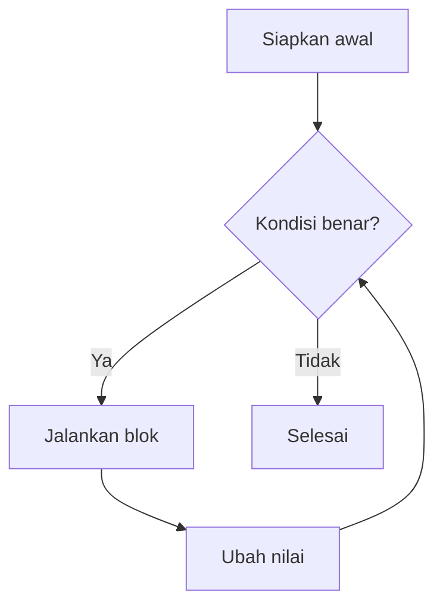

# Perulangan

Banyak pekerjaan berulang: mencetak daftar produk, menjumlahkan angka, memproses setiap
baris data dari database. **Perulangan** (*loop*) memungkinkan satu blok kode dijalankan
berkali-kali tanpa menulis ulang.

## Tujuan pembelajaran

Setelah menyelesaikan bab ini, kamu dapat:

- [ ] Menulis perulangan `for`, `while`, `do-while`, dan `foreach`.
- [ ] Memilih jenis perulangan yang sesuai.
- [ ] Mengontrol perulangan dengan `break` dan `continue`.
- [ ] Membuat perulangan bersarang (*nested loop*).
- [ ] Menghindari perulangan tanpa henti (*infinite loop*).
- [ ] Menulis perulangan dengan sintaks alternatif di dalam HTML.

## Prasyarat

- Bab [Pernyataan Kondisional](00-11-conditional-statements.md): `if` dan kondisi `bool`.
- Bab [Operator PHP](00-10-php-operators.md): `++`, `+=`, operator perbandingan.
- PHP 8.3 atau lebih baru terpasang; folder `belajar-php`.

## Konsep

Sebuah perulangan terdiri dari tiga unsur:

1. **Titik awal** (mis. `$i = 1`).
2. **Kondisi** untuk lanjut atau berhenti (mis. `$i <= 5`).
3. **Perubahan** yang menggerakkan perulangan menuju akhir (mis. `$i++`).



!!! tip "Analogi"
    Berlari mengelilingi lapangan sebanyak 5 putaran: kamu menghitung putaran (perubahan),
    memeriksa apakah sudah 5 (kondisi), dan berhenti saat tercapai.

### `for`

Cocok bila jumlah pengulangan diketahui:

```php
for ($i = 1; $i <= 5; $i++) {
    echo $i, "\n";
}
```

Tiga bagian dalam kurung, dipisah titik koma: **awal**; **kondisi**; **perubahan**.

### `while`

Cocok bila jumlah pengulangan tidak diketahui di awal; kondisi diperiksa **sebelum** setiap
putaran:

```php
$hitung = 3;
while ($hitung > 0) {
    echo $hitung, "\n";
    $hitung--;
}
```

### `do-while`

Mirip `while`, tetapi kondisi diperiksa **sesudah** blok dijalankan, sehingga blok
dijalankan **minimal sekali**:

```php
do {
    echo "Dijalankan sekali\n";
} while (false);
```

### `foreach`

Dipakai untuk menelusuri setiap elemen sebuah *array* (kumpulan nilai). Array dibahas
lengkap pada bab berikutnya; di sini cukup tahu bahwa array ditulis dengan tanda kurung
siku:

```php
$buah = ["apel", "jeruk", "mangga"];

foreach ($buah as $item) {
    echo $item, "\n";
}

foreach ($buah as $indeks => $item) {
    echo $indeks, ": ", $item, "\n";
}
```

- Bentuk pertama mengambil **nilai** tiap elemen.
- Bentuk kedua mengambil **kunci/indeks** dan nilai. Indeks array dimulai dari `0`.

`foreach` adalah perulangan yang paling sering kamu pakai di Laravel, misalnya untuk
menampilkan daftar data. Padanannya di template Blade adalah `@foreach`.

### Memilih jenis perulangan

| Situasi | Pilihan |
|---|---|
| Jumlah putaran diketahui | `for` |
| Berulang selama kondisi benar, jumlah tak pasti | `while` |
| Harus berjalan minimal sekali | `do-while` |
| Menelusuri isi array | `foreach` |

### `break` dan `continue`

| Perintah | Efek |
|---|---|
| `break` | Menghentikan seluruh perulangan |
| `continue` | Melewati sisa putaran ini, lanjut ke putaran berikutnya |

### Perulangan bersarang

Perulangan di dalam perulangan. Putaran dalam selesai penuh untuk setiap satu putaran luar:

```php
for ($baris = 1; $baris <= 3; $baris++) {
    for ($kolom = 1; $kolom <= $baris; $kolom++) {
        echo "*";
    }
    echo "\n";
}
```

### Perulangan tanpa henti

Bila kondisi tidak pernah menjadi salah (misalnya lupa mengubah penghitung), program
berputar selamanya:

```php
$i = 1;
while ($i <= 5) {
    echo $i, "\n";
    // lupa $i++  -> tidak pernah berhenti
}
```

Jika terminal terjebak dalam perulangan seperti ini, tekan ++ctrl+c++ untuk
menghentikannya.

!!! warning "Selalu pastikan perulangan bisa berakhir"
    Periksa bahwa ada perubahan yang membuat kondisi akhirnya salah, atau ada `break`
    yang pasti tercapai.

### Sintaks alternatif untuk HTML

```php
<ul>
<?php for ($i = 1; $i <= 3; $i++): ?>
    <li>Item <?= $i ?></li>
<?php endfor; ?>
</ul>
```

Penutupnya `endfor;`, `endwhile;`, atau `endforeach;`. Bentuk ini mirip dengan `@for` dan
`@foreach` di Blade.

## Praktik

Semua berkas dibuat di folder `belajar-php`.

### Langkah 1: `for`

```php title="belajar-php/for.php"
<?php

for ($i = 1; $i <= 5; $i++) {
    echo "Putaran $i\n";
}

$total = 0;
for ($i = 1; $i <= 100; $i++) {
    $total += $i;
}
echo "Jumlah 1 sampai 100: $total\n";
```

```bash
cd belajar-php
php for.php
```

**Yang seharusnya terlihat:**

```text
Putaran 1
Putaran 2
Putaran 3
Putaran 4
Putaran 5
Jumlah 1 sampai 100: 5050
```

Kamu perlu mencocokkan sendiri hasil di terminalmu dengan keluaran di atas.

### Langkah 2: `while` dan `do-while`

```php title="belajar-php/while.php"
<?php

$hitung = 3;
while ($hitung > 0) {
    echo "Hitung mundur: $hitung\n";
    $hitung--;
}
echo "Selesai\n";

$n = 10;

while ($n < 5) {
    echo "while: tidak pernah tercetak\n";
}

do {
    echo "do-while: tercetak sekali, n = $n\n";
} while ($n < 5);
```

**Yang seharusnya terlihat:**

```text
Hitung mundur: 3
Hitung mundur: 2
Hitung mundur: 1
Selesai
do-while: tercetak sekali, n = 10
```

Blok `while ($n < 5)` tidak berjalan sama sekali karena kondisinya sudah salah sejak awal,
sedangkan `do-while` tetap berjalan sekali.

### Langkah 3: `foreach`

```php title="belajar-php/foreach.php"
<?php

$buah = ["apel", "jeruk", "mangga"];

foreach ($buah as $item) {
    echo "- $item\n";
}

foreach ($buah as $indeks => $item) {
    echo "$indeks: $item\n";
}
```

**Yang seharusnya terlihat:**

```text
- apel
- jeruk
- mangga
0: apel
1: jeruk
2: mangga
```

### Langkah 4: `break` dan `continue`

```php title="belajar-php/break-continue.php"
<?php

for ($i = 1; $i <= 10; $i++) {
    if ($i % 2 === 0) {
        continue;
    }

    if ($i > 7) {
        break;
    }

    echo $i, "\n";
}
```

**Yang seharusnya terlihat:** empat baris: `1`, `3`, `5`, `7`.

Penjelasan: bilangan genap dilewati oleh `continue`; ketika `$i` mencapai `9`
(ganjil dan lebih dari 7), `break` menghentikan seluruh perulangan.

### Langkah 5: perulangan bersarang

```php title="belajar-php/bersarang.php"
<?php

for ($baris = 1; $baris <= 3; $baris++) {
    for ($kolom = 1; $kolom <= $baris; $kolom++) {
        echo "*";
    }
    echo "\n";
}
```

**Yang seharusnya terlihat:**

```text
*
**
***
```

### Langkah 6: perulangan di dalam HTML

```php title="belajar-php/daftar.php"
<!DOCTYPE html>
<html lang="id">
<head>
    <meta charset="utf-8">
    <title>Daftar</title>
</head>
<body>
    <h1>Daftar Buah</h1>
    <?php $buah = ["apel", "jeruk", "mangga"]; ?>
    <ul>
    <?php foreach ($buah as $item): ?>
        <li><?= $item ?></li>
    <?php endforeach; ?>
    </ul>
</body>
</html>
```

Jalankan dari folder `belajar-php`:

```bash
php -S localhost:8000
```

Buka `http://localhost:8000/daftar.php`.

**Yang seharusnya terlihat:** judul "Daftar Buah" dan daftar berpoin berisi apel, jeruk, mangga.
*View Page Source* menampilkan tiga elemen `<li>` yang dihasilkan perulangan. Hentikan
server dengan ++ctrl+c++.

## Kesalahan umum dan debugging

| Gejala | Kemungkinan penyebab | Solusi |
|---|---|---|
| Terminal tidak berhenti mencetak | Perulangan tanpa henti (lupa `$i++` atau kondisi salah) | Tekan ++ctrl+c++, lalu perbaiki kondisi/perubahan. |
| Berulang satu kali terlalu sedikit/banyak | Salah memakai `<` atau `<=` (kesalahan selisih satu) | Telusuri nilai awal dan akhir dengan angka kecil. |
| `continue` membuat perulangan menggantung | `continue` dijalankan sebelum perubahan penghitung pada `while` | Pastikan penghitung berubah sebelum `continue`. |
| `foreach` memberi peringatan <code>foreach() argument must be of type array&#124;object</code> | Yang ditelusuri bukan array (mis. `null`) | Periksa isi dengan `var_dump`, pastikan berupa array. |
| Indeks bergeser | Lupa array dimulai dari `0` | Mulai hitungan dari `0`. |
| Variabel hitung "bocor" | Variabel `$i` tetap ada setelah `for` selesai | Tidak bermasalah, tetapi beri nama jelas bila dipakai lagi. |
| Parse error pada sintaks alternatif | Lupa `:` atau `endforeach;` | Lengkapi sintaks. |

## Latihan terpandu

1. Cetak bilangan 10 turun sampai 1 dengan `for`, lalu ulangi dengan `while`.
2. Hitung faktorial 5 (`5 * 4 * 3 * 2 * 1`) dengan perulangan dan cetak hasilnya (seharusnya `120`).
3. Cetak semua bilangan kelipatan 3 dari 1 sampai 30 (gunakan `%`).
4. Cetak tabel perkalian 1 sampai 5 dengan perulangan bersarang, satu baris untuk
   tiap pengali.
5. Buat daftar tiga nama kota dalam array dan cetak `Kota ke-1: ...` dan seterusnya,
   dengan nomor mulai dari 1 (ingat indeks mulai dari 0).
6. Ubah `daftar.php` agar menambahkan nomor urut di depan tiap buah.
7. Jelaskan perbedaan keluaran `while` dan `do-while` bila kondisi awal salah.

??? success "Petunjuk nomor 2 dan 5"
    **Nomor 2:**
    ```php
    $hasil = 1;
    for ($i = 1; $i <= 5; $i++) {
        $hasil *= $i;
    }
    echo $hasil, "\n";
    ```

    **Nomor 5:** gunakan `foreach ($kota as $indeks => $nama)` dan cetak `$indeks + 1`.

## Pertanyaan review

1. Apa tiga unsur sebuah perulangan?
2. Apa beda `while` dan `do-while`?
3. Kapan `for` lebih cocok daripada `while`?
4. Apa fungsi `foreach`, dan dengan apa ia bekerja?
5. Apa beda `break` dan `continue`?
6. Apa itu perulangan tanpa henti dan bagaimana menghentikannya di terminal?
7. Mengapa array dimulai dari indeks `0`, dan apa dampaknya pada perulangan?

## Ringkasan

- `for` untuk jumlah putaran yang diketahui; `while` untuk kondisi; `do-while` minimal
  sekali; `foreach` untuk menelusuri array.
- `break` menghentikan perulangan; `continue` melompat ke putaran berikutnya.
- Perulangan bersarang menjalankan putaran dalam penuh pada tiap putaran luar.
- Pastikan perulangan bisa berakhir; hentikan yang menggantung dengan ++ctrl+c++.
- Sintaks alternatif (`endfor;`, `endforeach;`) rapi untuk PHP di dalam HTML dan menjadi
  dasar pemahaman `@foreach` di Blade.

Selanjutnya: **Arrays**.

## Referensi resmi

- [PHP Manual: while](https://www.php.net/manual/en/control-structures.while.php)
- [PHP Manual: do-while](https://www.php.net/manual/en/control-structures.do.while.php)
- [PHP Manual: for](https://www.php.net/manual/en/control-structures.for.php)
- [PHP Manual: foreach](https://www.php.net/manual/en/control-structures.foreach.php)
- [PHP Manual: break](https://www.php.net/manual/en/control-structures.break.php)
- [PHP Manual: continue](https://www.php.net/manual/en/control-structures.continue.php)
