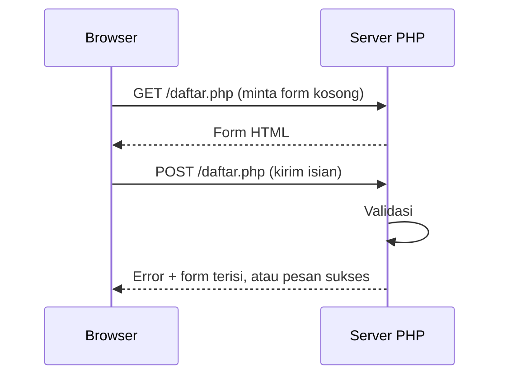

# Penanganan Form PHP

Form adalah cara utama pengguna mengirim data ke aplikasi web: mendaftar, login, mencari,
mengisi komentar. Pada bab ini kamu menangkap data form dengan PHP, memvalidasinya, dan
menampilkannya kembali dengan aman. Ini adalah versi "tanpa framework" dari apa yang nanti
Laravel kerjakan dengan `Request` dan `validate()`.

## Tujuan pembelajaran

Setelah menyelesaikan bab ini, kamu dapat:

- [ ] Membedakan metode `GET` dan `POST` pada form.
- [ ] Membaca data form lewat `$_GET`, `$_POST`, dan `$_SERVER["REQUEST_METHOD"]`.
- [ ] Memvalidasi isian dengan pemeriksaan sederhana dan `filter_var`.
- [ ] Menampilkan pesan error dan mengisi ulang form dengan aman.
- [ ] Menerapkan pola *Post/Redirect/Get* (PRG) dengan `header()`.
- [ ] Menjelaskan mengapa data dari form tidak boleh dipercaya.

## Prasyarat

- Bab [Request dan Response](00-04-request-and-response.md): query string, body, metode.
- Bab [Array](00-13-arrays.md), [Manipulasi String](00-15-string-manipulation.md), dan
  [Pernyataan Kondisional](00-11-conditional-statements.md).
- PHP 8.3 atau lebih baru; folder `belajar-php`. Semua latihan memakai server bawaan PHP,
  jadi jalankan dari folder `belajar-php`:

  ```bash
  php -S localhost:8000
  ```

## Konsep

### Alur form



Satu berkas PHP sering melayani dua peran: menampilkan form (saat `GET`) dan memproses
isian (saat `POST`).

### Atribut penting pada form

```html
<form action="daftar.php" method="post">
    <input type="text" name="nama">
    <button type="submit">Kirim</button>
</form>
```

| Atribut | Fungsi |
|---|---|
| `action` | Alamat tujuan. Jika dikosongkan, form dikirim ke URL saat ini. |
| `method` | `get` (data di URL) atau `post` (data di body). |
| `name` pada input | Kunci data di PHP. Input tanpa `name` **tidak dikirim**. |

### Superglobal untuk data form

| Variabel | Isi |
|---|---|
| `$_GET` | Data dari query string (`?nama=Budi`) |
| `$_POST` | Data dari body request `POST` |
| `$_SERVER["REQUEST_METHOD"]` | Metode request: `"GET"` atau `"POST"` |

Semuanya berupa array asosiatif yang sudah kamu kenal. Isinya **selalu string** (atau array
untuk input berulang), apa pun yang diketik pengguna. Bacalah dengan `??` agar tidak
memicu peringatan bila kunci tidak ada:

```php-inline
$nama = $_POST["nama"] ?? "";
```

Hindari `$_REQUEST` (gabungan GET, POST, dan cookie) karena asal datanya tidak jelas.

### Aturan emas: jangan percaya input

Semua yang datang dari browser bisa dipalsukan, termasuk batasan HTML seperti `required`
atau `maxlength`. Validasi di sisi server **selalu wajib**. Atribut HTML hanya untuk
kenyamanan pengguna.

Dua kewajiban terhadap input:

1. **Validasi**: pastikan isian sesuai aturan (tidak kosong, format benar, rentang benar).
2. **Escape saat menampilkan**: gunakan `htmlspecialchars()` sebelum mencetak ke HTML.

### Validasi dengan `filter_var`

`filter_var($nilai, $filter)` memeriksa nilai dengan filter bawaan dan mengembalikan nilai
yang valid atau `false`:

| Contoh | Hasil |
|---|---|
| `filter_var("budi@contoh.id", FILTER_VALIDATE_EMAIL)` | `"budi@contoh.id"` (valid) |
| `filter_var("bukan email", FILTER_VALIDATE_EMAIL)` | `false` |
| `filter_var("25", FILTER_VALIDATE_INT)` | `25` |
| `filter_var("abc", FILTER_VALIDATE_INT)` | `false` |

Untuk rentang, tambahkan opsi `["options" => ["min_range" => 1, "max_range" => 120]]`.
Bandingkan hasilnya dengan `=== false` (karena `0` adalah bilangan bulat valid yang
bernilai falsy).

### Post/Redirect/Get (PRG)

Setelah `POST` berhasil, jika halaman langsung menampilkan pesan sukses lalu pengguna
menekan muat ulang, browser bertanya apakah akan **mengirim ulang** data, dan isian bisa
tersimpan dua kali. Pola PRG mencegahnya: setelah memproses `POST`, server menjawab dengan
**redirect** ke halaman `GET`:

```php-inline
header("Location: terima-kasih.php");
exit;
```

- `header()` harus dipanggil **sebelum** ada keluaran apa pun (HTML, spasi, baris kosong).
- `exit` menghentikan skrip agar tidak lanjut berjalan setelah redirect.

Laravel menerapkan pola ini secara bawaan lewat `redirect()`.

## Praktik

Semua berkas dibuat di folder `belajar-php`, dan server dijalankan dengan
`php -S localhost:8000` dari folder yang sama.

### Langkah 1: form GET

```php title="belajar-php/salam.php"
<?php

$nama = trim($_GET["nama"] ?? "");
?>
<!DOCTYPE html>
<html lang="id">
<head>
    <meta charset="utf-8">
    <title>Salam</title>
</head>
<body>
    <form method="get">
        <label for="nama">Nama</label>
        <input id="nama" type="text" name="nama" value="<?= htmlspecialchars($nama) ?>">
        <button type="submit">Sapa</button>
    </form>

    <?php if ($nama !== ""): ?>
        <p>Halo, <?= htmlspecialchars($nama) ?>!</p>
    <?php endif; ?>
</body>
</html>
```

Buka `http://localhost:8000/salam.php`, ketik nama, lalu klik **Sapa**.

**Yang seharusnya terlihat:**

- URL berubah menjadi `.../salam.php?nama=...` (data ada di URL).
- Muncul kalimat `Halo, <nama>!` dan kolom tetap terisi.
- Coba ketik `<b>tebal</b>`: teks tampil apa adanya (tidak menjadi cetak tebal) karena sudah
  di-*escape*. Hapus `htmlspecialchars` sementara dan amati bedanya, lalu kembalikan.

### Langkah 2: form POST dengan validasi

```php title="belajar-php/daftar.php"
<?php

$data = ["nama" => "", "email" => "", "umur" => ""];
$errors = [];

if ($_SERVER["REQUEST_METHOD"] === "POST") {
    $data["nama"] = trim($_POST["nama"] ?? "");
    $data["email"] = trim($_POST["email"] ?? "");
    $data["umur"] = trim($_POST["umur"] ?? "");

    if ($data["nama"] === "") {
        $errors["nama"] = "Nama wajib diisi.";
    } elseif (mb_strlen($data["nama"]) > 50) {
        $errors["nama"] = "Nama maksimal 50 karakter.";
    }

    if (filter_var($data["email"], FILTER_VALIDATE_EMAIL) === false) {
        $errors["email"] = "Format email tidak valid.";
    }

    $umur = filter_var($data["umur"], FILTER_VALIDATE_INT, [
        "options" => ["min_range" => 1, "max_range" => 120],
    ]);
    if ($umur === false) {
        $errors["umur"] = "Umur harus angka antara 1 dan 120.";
    }
}

$berhasil = $_SERVER["REQUEST_METHOD"] === "POST" && $errors === [];
?>
<!DOCTYPE html>
<html lang="id">
<head>
    <meta charset="utf-8">
    <title>Pendaftaran Siswa</title>
</head>
<body>
    <h1>Pendaftaran Siswa</h1>

    <?php if ($berhasil): ?>
        <p style="color: green">
            Terima kasih, <?= htmlspecialchars($data["nama"]) ?>. Data diterima.
        </p>
    <?php endif; ?>

    <form action="daftar.php" method="post">
        <p>
            <label for="nama">Nama</label><br>
            <input id="nama" type="text" name="nama" value="<?= htmlspecialchars($data["nama"]) ?>">
            <?php if (isset($errors["nama"])): ?>
                <br><small style="color: red"><?= $errors["nama"] ?></small>
            <?php endif; ?>
        </p>
        <p>
            <label for="email">Email</label><br>
            <input id="email" type="text" name="email" value="<?= htmlspecialchars($data["email"]) ?>">
            <?php if (isset($errors["email"])): ?>
                <br><small style="color: red"><?= $errors["email"] ?></small>
            <?php endif; ?>
        </p>
        <p>
            <label for="umur">Umur</label><br>
            <input id="umur" type="text" name="umur" value="<?= htmlspecialchars($data["umur"]) ?>">
            <?php if (isset($errors["umur"])): ?>
                <br><small style="color: red"><?= $errors["umur"] ?></small>
            <?php endif; ?>
        </p>
        <button type="submit">Daftar</button>
    </form>
</body>
</html>
```

Penjelasan bagian penting:

| Kode | Arti |
|---|---|
| `$_SERVER["REQUEST_METHOD"] === "POST"` | Memproses isian hanya saat form dikirim, bukan saat halaman pertama dibuka. |
| `trim($_POST["nama"] ?? "")` | Mengambil isian dengan aman dan membuang spasi di tepi. |
| `$errors[...] = ...` | Mengumpulkan pesan error per kolom. |
| `filter_var(..., FILTER_VALIDATE_EMAIL)` | Memeriksa format email. |
| `$errors === []` | Tidak ada error berarti semua valid. |
| `htmlspecialchars(...)` | Mengamankan teks yang dicetak kembali ke HTML. |

Pesan error yang ditulis sendiri (`$errors[...]`) berisi teks buatan kita, sehingga
dicetak langsung. Teks yang berasal dari pengguna selalu di-*escape*.

### Langkah 3: menguji di browser

Buka `http://localhost:8000/daftar.php` dan coba tiga skenario:

1. **Kirim form kosong.** Yang seharusnya terlihat: tiga pesan error (nama wajib diisi,
   format email tidak valid, umur harus angka).
2. **Isi sebagian.** Misalnya nama `Budi`, email `budi`, umur `abc`. Yang seharusnya
   terlihat: error untuk email dan umur saja, sedangkan nama tetap terisi `Budi`.
3. **Isi benar semua.** Misalnya `Budi`, `budi@contoh.id`, `20`. Yang seharusnya terlihat:
   pesan hijau `Terima kasih, Budi. Data diterima.`

### Langkah 4: menguji dengan `curl`

Kamu juga bisa menjadi "browser" dari terminal. Di Windows PowerShell tulis `curl.exe`.

```bash
curl -i -d "nama=Budi&email=budi@contoh.id&umur=20" http://localhost:8000/daftar.php
```

Opsi `-d` mengirim data sebagai `POST` dengan format `kunci=nilai&kunci=nilai`.

**Yang seharusnya terlihat:** baris status `HTTP/1.1 200 OK` (atau versi HTTP yang
digunakan server) dan, pada isi jawaban, teks `Terima kasih, Budi. Data diterima.`

Coba juga dengan data tidak valid:

```bash
curl -i -d "nama=&email=salah&umur=0" http://localhost:8000/daftar.php
```

**Yang seharusnya terlihat:** status tetap `200`, dengan tiga pesan error pada isi HTML.
Perhatikan bahwa validasi gagal **tidak** memakai status `4xx` pada contoh ini, hal yang
berbeda dari Laravel yang akan kamu temui nanti.

### Langkah 5: melihat isi `$_POST`

Tambahkan sementara tepat di bawah `<h1>` pada `daftar.php`:

```html+php
<pre><?php print_r($_POST); ?></pre>
```

Kirim form dan amati: kamu melihat array berisi `nama`, `email`, `umur`, semuanya
bertipe string. Hapus baris debugging itu setelah selesai.

### Langkah 6: Post/Redirect/Get

Ubah `daftar.php` agar berhasil mengalihkan ke halaman lain. Tambahkan blok ini
**di dalam** `if ($_SERVER["REQUEST_METHOD"] === "POST")`, setelah semua validasi:

```php-inline
    if ($errors === []) {
        header("Location: terima-kasih.php?nama=" . urlencode($data["nama"]));
        exit;
    }
```

Lalu buat halaman tujuannya:

```php title="belajar-php/terima-kasih.php"
<?php

$nama = trim($_GET["nama"] ?? "");
?>
<!DOCTYPE html>
<html lang="id">
<head>
    <meta charset="utf-8">
    <title>Terima Kasih</title>
</head>
<body>
    <h1>Terima kasih<?= $nama !== "" ? ", " . htmlspecialchars($nama) : "" ?>!</h1>
    <p><a href="daftar.php">Kembali ke form</a></p>
</body>
</html>
```

Uji:

1. Isi form dengan data valid dan kirim. **Yang seharusnya terlihat:** alamat berpindah
   ke `terima-kasih.php?nama=Budi` dengan sapaan namamu.
2. Tekan muat ulang (++f5++): tidak ada peringatan "kirim ulang formulir", karena halaman
   saat ini adalah hasil `GET`.
3. Dengan `curl`:

    ```bash
    curl -i -d "nama=Budi&email=budi@contoh.id&umur=20" http://localhost:8000/daftar.php
    ```

    **Yang seharusnya terlihat:** status berkelas `3xx` (umumnya `302`) dan header
    `Location: terima-kasih.php?nama=Budi`.

Hentikan server dengan ++ctrl+c++ setelah selesai.

## Kesalahan umum dan debugging

| Gejala | Kemungkinan penyebab | Solusi |
|---|---|---|
| Data tidak sampai ke PHP | Input tidak memiliki atribut `name` | Tambahkan `name="..."`. |
| `Undefined array key "nama"` | Membaca `$_POST["nama"]` saat belum ada kiriman | Pakai `$_POST["nama"] ?? ""` dan periksa `REQUEST_METHOD`. |
| Form `POST` tetap terbaca di `$_GET` | `method` form `get` (bawaan) | Tambahkan `method="post"`. |
| `Cannot modify header information - headers already sent` | Ada keluaran (termasuk spasi sebelum `<?php`) sebelum `header()` | Panggil `header()` sebelum HTML dan hapus spasi/baris kosong di awal berkas. |
| Skrip tetap jalan setelah redirect | Lupa `exit` | Tambahkan `exit;` setelah `header(...)`. |
| Tag HTML dari pengguna dieksekusi | Lupa `htmlspecialchars` | Escape semua teks pengguna sebelum dicetak. |
| Validasi lolos padahal kosong | Memeriksa `isset` alih-alih isi (`""` tetap "ada") | Periksa dengan `trim(...) === ""`. |
| Umur `0` dianggap tidak valid padahal angka | Rentang `min_range` | Itu perilaku yang diinginkan; ubah rentang bila perlu. |
| Mengandalkan `required`/`maxlength` HTML saja | Atribut mudah dilewati | Selalu validasi lagi di server. |

## Latihan terpandu

1. Tambahkan kolom `kota` (wajib, maksimal 30 karakter) ke `daftar.php`.
2. Tambahkan kolom `jurusan` berupa `<select>` dengan tiga pilihan. Validasi bahwa nilai yang
   dikirim benar-benar salah satu dari tiga pilihan itu (gunakan `in_array`). Uji dengan
   `curl` yang mengirim nilai di luar pilihan.
3. Ubah form pencarian `salam.php` agar menampilkan pesan "Nama terlalu pendek" bila kurang dari
   3 karakter (setelah `trim`).
4. Ubah `daftar.php` agar kolom email juga ditolak jika lebih dari 100 karakter.
5. Uji kerentanan: kirim `nama=<script>alert(1)</script>` lewat `curl` ke `daftar.php`
   dan periksa isi HTML. Pastikan tag skrip muncul sebagai teks ter-escape
   (`&lt;script&gt;...`).
6. Jelaskan dengan kata-katamu mengapa PRG diperlukan dan bagaimana `curl -i` membuktikannya.

??? success "Petunjuk nomor 2 dan 6"
    **Nomor 2:**
    ```php-inline
    $pilihan = ["informatika", "sistem-informasi", "teknik-komputer"];
    if (!in_array($data["jurusan"], $pilihan, true)) {
        $errors["jurusan"] = "Jurusan tidak valid.";
    }
    ```

    **Nomor 6:** tanpa PRG, hasil `POST` ditampilkan langsung sehingga memuat ulang halaman
    mengirim ulang data. Dengan PRG, `curl -i` memperlihatkan status `3xx` dan header
    `Location`, yaitu bukti bahwa server mengarahkan browser ke halaman `GET`.

## Pertanyaan review

1. Apa beda form `GET` dan `POST`? Kapan memakai masing-masing?
2. Mengapa input tanpa atribut `name` tidak terkirim?
3. Apa isi `$_GET`, `$_POST`, dan `$_SERVER["REQUEST_METHOD"]`?
4. Mengapa validasi di sisi server tetap wajib meski HTML sudah memakai `required`?
5. Apa fungsi `htmlspecialchars` dan kapan dipakai?
6. Mengapa hasil `filter_var` dibandingkan dengan `=== false`?
7. Apa itu pola PRG dan mengapa `exit` dipanggil setelah `header()`?
8. Apa kaitan bab ini dengan `validate()` dan `redirect()` di Laravel?

## Ringkasan

- Form mengirim data lewat `GET` (query string) atau `POST` (body); kunci data berasal dari
  atribut `name`.
- PHP membaca data lewat `$_GET`, `$_POST`; periksa metode dengan `$_SERVER["REQUEST_METHOD"]`.
- Semua input tidak tepercaya: validasi di server, lalu escape dengan `htmlspecialchars`
  saat menampilkan.
- `filter_var` memudahkan validasi email dan angka.
- Pola PRG (`header("Location: ...")` + `exit`) mencegah pengiriman ulang form.
- Laravel mengotomatiskan banyak hal di atas (validasi, old input, redirect, CSRF).

Selanjutnya: **Include dan Require**.

## Referensi resmi

- [PHP Manual: Dealing with forms](https://www.php.net/manual/en/tutorial.forms.php)
- [PHP Manual: $_GET](https://www.php.net/manual/en/reserved.variables.get.php)
- [PHP Manual: $_POST](https://www.php.net/manual/en/reserved.variables.post.php)
- [PHP Manual: $_SERVER](https://www.php.net/manual/en/reserved.variables.server.php)
- [PHP Manual: filter_var](https://www.php.net/manual/en/function.filter-var.php)
- [PHP Manual: Filter constants](https://www.php.net/manual/en/filter.constants.php)
- [PHP Manual: header](https://www.php.net/manual/en/function.header.php)
- [PHP Manual: urlencode](https://www.php.net/manual/en/function.urlencode.php)
- [PHP Manual: Handling file uploads](https://www.php.net/manual/en/features.file-upload.php)
- [Laravel: Validation](https://laravel.com/docs/13.x/validation)
