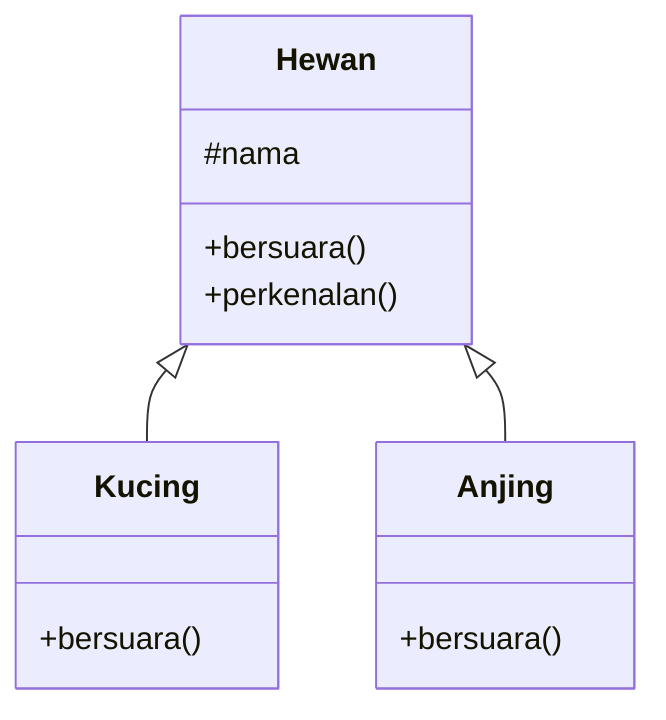

# Pewarisan, Enkapsulasi, dan Polimorfisme

Tiga dari empat pilar OOP akhirnya kita praktikkan: **pewarisan** (class turunan memakai
ulang class induk), **enkapsulasi** (menjaga data agar hanya berubah lewat cara yang
aman), dan **polimorfisme** (satu perintah, banyak perilaku). Ketiganya ada di balik kalimat
sederhana seperti `class MateriController extends Controller`.

## Tujuan pembelajaran

Setelah menyelesaikan bab ini, kamu dapat:

- [ ] Membuat class turunan dengan `extends`, memanggil `parent::`, dan menimpa (*override*) method.
- [ ] Memakai visibilitas `protected` untuk berbagi data dengan class turunan.
- [ ] Menerapkan enkapsulasi dengan property `private` dan method pengubah yang aman.
- [ ] Membuat class abstrak dan interface.
- [ ] Menjelaskan polimorfisme dan memanfaatkannya lewat tipe induk atau interface.
- [ ] Memilih antara pewarisan dan interface secara wajar.

## Prasyarat

- Bab [Class dan Objek](00-19-classes-and-objects.md): constructor, `$this`, visibilitas.
- PHP 8.3 atau lebih baru; folder `belajar-php`.

## Konsep

### Pewarisan (*inheritance*)

Class turunan (*child*) mewarisi property dan method dari class induk (*parent*), lalu
boleh menambah atau mengubahnya.



!!! tip "Analogi"
    Anak mewarisi sifat orang tua, tetapi punya sifat sendiri. Uji kewajaran dengan
    kalimat **"X adalah sejenis Y"**: kucing adalah sejenis hewan (wajar); mobil adalah
    sejenis mesin (kurang tepat, lebih cocok "mobil *memiliki* mesin").

```php
class Hewan
{
    public function __construct(protected string $nama) {}

    public function bersuara(): string
    {
        return "...";
    }

    public function perkenalan(): string
    {
        return "Saya {$this->nama}, " . $this->bersuara();
    }
}

class Kucing extends Hewan
{
    public function bersuara(): string
    {
        return "meong";
    }
}
```

| Konsep | Penjelasan |
|---|---|
| `extends` | `Kucing` mewarisi semua yang `public` dan `protected` dari `Hewan`. |
| `protected` | Dapat diakses class itu sendiri **dan turunannya**, tetapi tidak dari luar. |
| Override | `Kucing::bersuara()` menggantikan `Hewan::bersuara()`. |
| `parent::` | Memanggil versi milik induk, misalnya `parent::__construct($nama)`. |
| `final` | `final class` tidak bisa diwarisi; `final` pada method tidak bisa di-override. |

PHP hanya mengizinkan **satu** class induk. Pewarisan yang berlapis-lapis terlalu dalam
membuat kode sulit dipahami; pakai seperlunya.

### Enkapsulasi (*encapsulation*)

Enkapsulasi berarti **menyembunyikan data** (`private`) dan menyediakan **pintu resmi**
(method `public`) untuk membaca atau mengubahnya. Dengan begitu aturan bisnis terjaga:

```php
class Produk
{
    public function __construct(
        private string $nama,
        private int $harga,
    ) {}

    public function ubahHarga(int $harga): bool
    {
        if ($harga <= 0) {
            return false;
        }

        $this->harga = $harga;

        return true;
    }
}
```

Harga tidak mungkin menjadi nol atau negatif, karena satu-satunya jalan mengubahnya melewati
pemeriksaan di `ubahHarga()`.

| Visibilitas | Class sendiri | Class turunan | Luar |
|---|---|---|---|
| `public` | ✔ | ✔ | ✔ |
| `protected` | ✔ | ✔ | ✘ |
| `private` | ✔ | ✘ | ✘ |

### Class abstrak

Class abstrak adalah kerangka yang **tidak bisa dibuat objeknya** langsung. Ia boleh
berisi method abstrak (tanpa isi) yang **wajib** diisi oleh class turunan:

```php
abstract class Bentuk
{
    abstract public function luas(): float;

    public function info(): string
    {
        return static::class . " dengan luas " . number_format($this->luas(), 2);
    }
}
```

`static::class` menghasilkan nama class dari objek yang sebenarnya (misalnya `Persegi`),
bukan `Bentuk`.

### Interface

Interface adalah **kontrak**: daftar method yang harus dimiliki sebuah class, tanpa
isinya. Sebuah class bisa `implements` banyak interface sekaligus:

```php
interface MetodePembayaran
{
    public function bayar(int $jumlah): string;
}

class Tunai implements MetodePembayaran
{
    public function bayar(int $jumlah): string
    {
        return "Bayar tunai: Rp " . number_format($jumlah, 0, ",", ".");
    }
}
```

| | Class abstrak | Interface |
|---|---|---|
| Berisi kode | Boleh (method biasa dan abstrak) | Hanya tanda tangan method |
| Jumlah per class | Hanya satu (`extends`) | Banyak (`implements`) |
| Cocok untuk | Berbagi kode antar turunan | Mendefinisikan kemampuan/kontrak |

### Polimorfisme (*polymorphism*)

Kode yang menerima **tipe induk atau interface** dapat bekerja dengan semua turunannya,
masing-masing dengan perilakunya sendiri:

```php
function proses(MetodePembayaran $metode, int $jumlah): void
{
    echo $metode->bayar($jumlah), "\n";
}
```

Fungsi `proses` tidak peduli apakah yang datang `Tunai` atau `Transfer`; ia hanya tahu
objek itu bisa `bayar()`. Menambah metode pembayaran baru tidak mengubah `proses`.

### Kaitannya dengan Laravel

- `class MateriController extends Controller` dan `class Materi extends Model`:
  controller dan model mewarisi banyak kemampuan (`where`, `create`, dan lainnya) dari
  class induk.
- *Contract* Laravel adalah interface: kode bergantung pada kontraknya, sehingga
  implementasinya bisa diganti (dibahas pada sub bab *Contracts and Interfaces*).
- Method yang kamu timpa (`boot`, `render`, dan sejenisnya) memakai konsep override.

## Praktik

Semua berkas dibuat di folder `belajar-php`; class dan penggunaannya ditaruh dalam satu
berkas untuk latihan.

### Langkah 1: pewarisan dan polimorfisme

```php title="belajar-php/hewan.php"
<?php

class Hewan
{
    public function __construct(protected string $nama) {}

    public function bersuara(): string
    {
        return "...";
    }

    public function perkenalan(): string
    {
        return "Saya {$this->nama}, " . $this->bersuara();
    }
}

class Kucing extends Hewan
{
    public function __construct(string $nama, private string $warna)
    {
        parent::__construct($nama);
    }

    public function bersuara(): string
    {
        return "meong";
    }

    public function perkenalan(): string
    {
        return parent::perkenalan() . " (bulu {$this->warna})";
    }
}

class Anjing extends Hewan
{
    public function bersuara(): string
    {
        return "guk";
    }
}

$daftar = [new Kucing("Tom", "putih"), new Anjing("Rex"), new Hewan("Makhluk")];

foreach ($daftar as $hewan) {
    echo $hewan->perkenalan(), "\n";
}
```

```bash
cd belajar-php
php hewan.php
```

**Yang seharusnya terlihat:**

```text
Saya Tom, meong (bulu putih)
Saya Rex, guk
Saya Makhluk, ...
```

Kamu perlu mencocokkan sendiri hasil di terminalmu dengan keluaran di atas. Perhatikan
bahwa perulangan memanggil `perkenalan()` pada ketiga objek dengan cara yang sama, tetapi
masing-masing menjawab berbeda: itulah polimorfisme.

Tambahkan `echo $daftar[0]->nama;` di akhir. **Yang seharusnya terlihat:** error karena
`nama` bersifat `protected` dan tidak boleh diakses dari luar class. Hapus baris itu setelah
mencoba.

### Langkah 2: enkapsulasi

```php title="belajar-php/produk.php"
<?php

class Produk
{
    public function __construct(
        private string $nama,
        private int $harga,
    ) {}

    public function ubahHarga(int $harga): bool
    {
        if ($harga <= 0) {
            return false;
        }

        $this->harga = $harga;

        return true;
    }

    public function info(): string
    {
        return "{$this->nama}: Rp " . number_format($this->harga, 0, ",", ".");
    }
}

$produk = new Produk("Pena", 5000);

var_dump($produk->ubahHarga(-100));
var_dump($produk->ubahHarga(7500));
echo $produk->info(), "\n";
```

**Yang seharusnya terlihat:**

```text
bool(false)
bool(true)
Pena: Rp 7.500
```

### Langkah 3: class abstrak

```php title="belajar-php/bentuk.php"
<?php

abstract class Bentuk
{
    abstract public function luas(): float;

    public function info(): string
    {
        return static::class . " dengan luas " . number_format($this->luas(), 2);
    }
}

class Persegi extends Bentuk
{
    public function __construct(private float $sisi) {}

    public function luas(): float
    {
        return $this->sisi ** 2;
    }
}

class Lingkaran extends Bentuk
{
    public function __construct(private float $jari) {}

    public function luas(): float
    {
        return M_PI * $this->jari ** 2;
    }
}

$bentuk = [new Persegi(4), new Lingkaran(5)];

foreach ($bentuk as $b) {
    echo $b->info(), "\n";
}
```

**Yang seharusnya terlihat:**

```text
Persegi dengan luas 16.00
Lingkaran dengan luas 78.54
```

Tambahkan `new Bentuk();` di akhir. **Yang seharusnya terlihat:** error karena class abstrak
tidak dapat dibuat objeknya. Hapus baris itu setelah mencoba.

### Langkah 4: interface

```php title="belajar-php/pembayaran.php"
<?php

interface MetodePembayaran
{
    public function bayar(int $jumlah): string;
}

class Tunai implements MetodePembayaran
{
    public function bayar(int $jumlah): string
    {
        return "Bayar tunai: Rp " . number_format($jumlah, 0, ",", ".");
    }
}

class Transfer implements MetodePembayaran
{
    public function __construct(private string $bank) {}

    public function bayar(int $jumlah): string
    {
        return "Bayar transfer {$this->bank}: Rp " . number_format($jumlah, 0, ",", ".");
    }
}

function proses(MetodePembayaran $metode, int $jumlah): void
{
    echo $metode->bayar($jumlah), "\n";
}

proses(new Tunai(), 50000);
proses(new Transfer("BCA"), 50000);
```

**Yang seharusnya terlihat:**

```text
Bayar tunai: Rp 50.000
Bayar transfer BCA: Rp 50.000
```

Fungsi `proses()` tidak berubah ketika kamu menambah metode pembayaran baru.

### Langkah 5: `instanceof`

Tambahkan di akhir `pembayaran.php`:

```php
$metode = new Tunai();

var_dump($metode instanceof MetodePembayaran);
var_dump($metode instanceof Transfer);
```

**Yang seharusnya terlihat:**

```text
bool(true)
bool(false)
```

## Kesalahan umum dan debugging

| Gejala | Kemungkinan penyebab | Solusi |
|---|---|---|
| `Cannot access protected property` | Mengakses `protected` dari luar class | Sediakan method `public` untuk mengaksesnya. |
| Property induk tidak terisi pada turunan | Constructor turunan tidak memanggil `parent::__construct()` | Panggil `parent::__construct(...)`. |
| `Cannot instantiate abstract class` | Membuat objek dari class abstrak | Buat objek dari class turunannya. |
| `Class X contains 1 abstract method and must therefore be declared abstract or implement...` | Turunan lupa mengisi method abstrak/interface | Implementasikan semua method yang diwajibkan. |
| `Declaration of ... must be compatible with ...` | Tanda tangan method override berbeda dari induk | Samakan parameter dan tipe kembalian (atau perlonggar sesuai aturan). |
| `Class X cannot extend final class` | Mewarisi class `final` | Gunakan komposisi atau hapus `final` jika memang boleh. |
| `TypeError` saat memanggil `proses()` | Objek tidak mengimplementasikan interface yang diminta | Pastikan class menulis `implements`. |
| Hierarki pewarisan terlalu dalam dan membingungkan | Pewarisan dipakai berlebihan | Cek kalimat "X adalah sejenis Y"; pertimbangkan interface atau komposisi. |

## Latihan terpandu

1. Tambahkan class `Burung extends Hewan` dengan suara `cuit` dan masukkan ke daftar pada
   `hewan.php`. Pastikan perulangan tidak perlu diubah.
2. Tambahkan class `Segitiga extends Bentuk` (alas dan tinggi, luas `0.5 * alas * tinggi`) dan
   tampilkan bersama bentuk lain.
3. Tambahkan metode pembayaran `EWallet implements MetodePembayaran` dengan nama aplikasi,
   lalu panggil lewat `proses()`.
4. Tambahkan method `tarik(int $jumlah): bool` pada `Rekening` (bab sebelumnya) agar saldo
   tidak bisa menjadi negatif, lalu jelaskan bagaimana enkapsulasi membantu.
5. Buat class `Karyawan` dengan method `gaji(): int`, lalu `Manajer extends Karyawan` yang
   meng-override `gaji()` dengan menambah tunjangan (pakai `parent::gaji()`).
6. Jelaskan dengan contohmu sendiri kapan interface lebih tepat daripada class abstrak.

??? success "Petunjuk nomor 5 dan 6"
    **Nomor 5:**
    ```php
    class Manajer extends Karyawan
    {
        public function gaji(): int
        {
            return parent::gaji() + 2000000;
        }
    }
    ```

    **Nomor 6:** gunakan interface ketika class-class yang tidak berhubungan perlu
    memenuhi kemampuan yang sama (misalnya `Tunai` dan `Transfer`), atau ketika satu class
    perlu beberapa kontrak. Gunakan class abstrak ketika turunan berbagi kode nyata.

## Pertanyaan review

1. Apa yang diwarisi sebuah class turunan, dan apa arti `parent::`?
2. Apa beda `public`, `protected`, dan `private`?
3. Bagaimana enkapsulasi menjaga data tetap valid?
4. Apa beda class abstrak dan interface?
5. Apa itu polimorfisme dan apa keuntungannya?
6. Apa arti `final`?
7. Mengapa `MateriController extends Controller` dan model Eloquent memanfaatkan pewarisan?
8. Kapan sebaiknya menghindari pewarisan dan memakai komposisi?

## Ringkasan

- `extends` mewarisi; `protected` dibagikan ke turunan; override menggantikan perilaku;
  `parent::` memanggil versi induk.
- Enkapsulasi: data `private`, akses lewat method `public` yang menjaga aturan.
- Class abstrak = kerangka berisi sebagian kode dan method wajib; interface = kontrak murni.
- Polimorfisme: kode bergantung pada tipe induk/interface dan bekerja untuk semua turunan.
- Laravel memakai pewarisan dan interface (contract) di hampir semua tempat.

Selanjutnya: **Exception Handling**.

## Referensi resmi

- [PHP Manual: Inheritance](https://www.php.net/manual/en/language.oop5.inheritance.php)
- [PHP Manual: Visibility](https://www.php.net/manual/en/language.oop5.visibility.php)
- [PHP Manual: Class abstraction](https://www.php.net/manual/en/language.oop5.abstract.php)
- [PHP Manual: Object interfaces](https://www.php.net/manual/en/language.oop5.interfaces.php)
- [PHP Manual: Final keyword](https://www.php.net/manual/en/language.oop5.final.php)
- [PHP Manual: Scope resolution operator (::)](https://www.php.net/manual/en/language.oop5.paamayim-nekudotayim.php)
- [PHP Manual: Traits](https://www.php.net/manual/en/language.oop5.traits.php)
- [Laravel: Contracts](https://laravel.com/docs/13.x/contracts)
