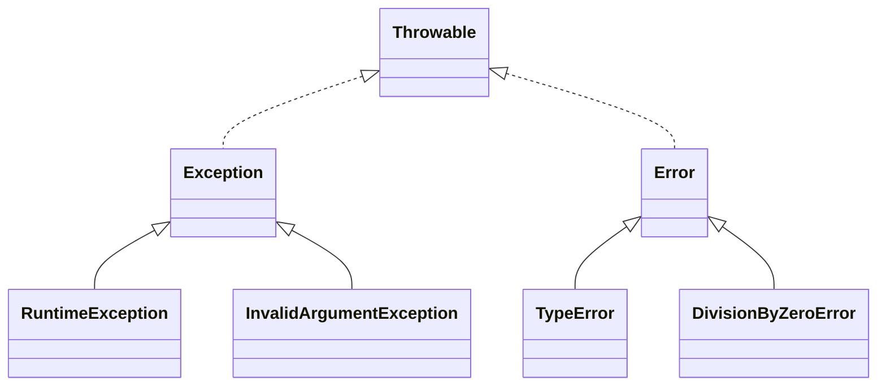

# Penanganan Exception

Program tidak selalu berjalan mulus: berkas hilang, pembagi bernilai nol, saldo tidak
cukup. **Exception** adalah mekanisme PHP untuk melaporkan dan menangani situasi tak biasa
tanpa membuat program langsung runtuh. Kamu akan sering bertemu exception di Laravel,
misalnya saat data tidak ditemukan atau validasi gagal.

## Tujuan pembelajaran

Setelah menyelesaikan bab ini, kamu dapat:

- [ ] Menjelaskan apa itu exception dan mengapa lebih baik daripada mengembalikan kode error.
- [ ] Menulis `try`, `catch`, dan `finally`.
- [ ] Melempar exception dengan `throw`.
- [ ] Membedakan `Exception` dan `Error` serta membaca hierarkinya.
- [ ] Membuat class exception sendiri.
- [ ] Membaca informasi exception (`getMessage`, `getCode`, `getPrevious`, dan lainnya).
- [ ] Menjelaskan praktik aman menangani error pada aplikasi web.

## Prasyarat

- Bab [Pewarisan, Enkapsulasi, Polimorfisme](00-20-inheritance-encapsulation-polymorphism.md):
  `extends`, `parent::`.
- Bab [Fungsi](00-14-functions.md).
- PHP 8.3 atau lebih baru; folder `belajar-php`.

## Konsep

### Masalah

Tanpa exception, fungsi yang gagal biasanya mengembalikan `false` atau `null`. Pemanggil
mudah lupa memeriksanya dan program lanjut dengan data yang salah. Exception **menghentikan
alur normal** dan "melempar" masalah ke atas sampai ada kode yang menanganinya.

!!! tip "Analogi"
    Seperti alarm kebakaran: begitu berbunyi, aktivitas normal dihentikan dan petugas
    yang berwenang menanganinya. Jika tidak ada petugas, seluruh gedung dievakuasi
    (program berhenti).

### `try`, `catch`, dan `finally`

```php-inline
try {
    // kode yang mungkin gagal
} catch (JenisException $e) {
    // penanganan jika JenisException dilempar
} finally {
    // selalu dijalankan, berhasil atau gagal
}
```

| Blok | Fungsi |
|---|---|
| `try` | Membungkus kode yang berisiko gagal |
| `catch` | Menangkap jenis exception tertentu; `$e` adalah objek exception |
| `finally` | Dijalankan **selalu**, cocok untuk membersihkan (menutup berkas, koneksi) |
| `throw` | Melempar exception |

Blok `catch` boleh lebih dari satu, atau menggabungkan beberapa jenis dengan `|`:

```php-inline
catch (TypeError | DivisionByZeroError $e)
```

PHP memeriksa `catch` dari atas ke bawah dan memakai yang pertama cocok. Letakkan jenis
yang lebih spesifik di atas jenis yang umum.

### Hierarki



- `Throwable` adalah dasar dari semuanya.
- `Exception`: masalah yang wajar ditangani aplikasi (data tidak valid, berkas tidak ada).
- `Error`: kesalahan pemrograman atau kondisi mesin (tipe salah, pembagian dengan nol).
- Menangkap `Throwable` menangkap keduanya; lakukan itu hanya di lapisan paling luar
  aplikasi, bukan sembarangan.

Beberapa exception bawaan yang berguna:

| Class | Dipakai saat |
|---|---|
| `InvalidArgumentException` | Argumen yang diberikan tidak valid |
| `RuntimeException` | Kegagalan saat program berjalan |
| `TypeError` | Tipe nilai tidak sesuai deklarasi |
| `DivisionByZeroError` | Pembagian atau modulus dengan nol (`intdiv`, `%`) |

### Informasi dalam exception

| Method | Mengembalikan |
|---|---|
| `getMessage()` | Pesan yang dilampirkan |
| `getCode()` | Kode angka |
| `getFile()`, `getLine()` | Lokasi exception dibuat |
| `getTraceAsString()` | Jejak pemanggilan (*stack trace*) |
| `getPrevious()` | Exception penyebab sebelumnya (jika dirantai) |

### Exception buatan sendiri

Dengan `extends Exception`, kamu membuat jenis masalah yang bermakna bagi domain aplikasi:

```php-inline
class SaldoTidakCukupException extends Exception
{
}
```

Exception khusus membuat `catch` presisi: kamu hanya menangkap masalah yang memang kamu
siapkan penanganannya.

### Merantai exception

Saat menangkap exception tingkat rendah lalu melempar yang lebih bermakna, sertakan yang
asli sebagai `previous` agar jejak penyebab tidak hilang:

```php-inline
throw new RuntimeException("Gagal memuat konfigurasi", 0, $e);
```

### Exception yang tidak ditangkap

Jika tidak ada `catch` yang cocok, PHP menghentikan program dengan *fatal error* "Uncaught
..." disertai jejak pemanggilan. Di aplikasi web, pesan seperti itu **tidak boleh tampil
kepada pengunjung** karena dapat membocorkan jalur berkas, kueri, atau kredensial.

### Praktik aman dan baik

- Jangan menulis `catch` kosong: error yang ditelan tanpa jejak menyulitkan pelacakan.
- Tangkap jenis exception yang spesifik; tangani yang bisa kamu tangani, sisanya biarkan naik.
- Di produksi, matikan tampilan error ke pengunjung (`display_errors` mati) dan **catat**
  ke log (`error_log()`).
- Pesan untuk pengguna ramah dan umum; detail teknis masuk ke log.

### Di Laravel

Laravel menangkap exception di lapisan paling luar dan mengubahnya menjadi halaman error
atau JSON yang sesuai:

| Situasi | Hasil |
|---|---|
| `abort(404)` | Melempar `HttpException` dan menampilkan halaman 404 |
| `findOrFail($id)` pada model yang tidak ada | Melempar `ModelNotFoundException` dan menghasilkan 404 |
| Validasi gagal | Melempar `ValidationException` dan mengembalikan pengguna ke form |
| `APP_DEBUG=true` | Menampilkan halaman debug lengkap (hanya untuk lokal) |
| `APP_DEBUG=false` | Menampilkan halaman error umum (wajib di produksi) |

Laravel juga mengubah warning dan notice PHP biasa menjadi exception (`ErrorException`)
agar semuanya ditangani seragam.

## Praktik

Semua berkas dibuat di folder `belajar-php`.

### Langkah 1: `try`, `catch`, `finally`

```php title="belajar-php/pengecualian.php"
<?php

function bagi(int $a, int $b): float
{
    if ($b === 0) {
        throw new InvalidArgumentException("Pembagi tidak boleh nol.");
    }

    return $a / $b;
}

try {
    echo bagi(10, 2), "\n";
    echo bagi(1, 0), "\n";
    echo "Baris ini tidak tercapai\n";
} catch (InvalidArgumentException $e) {
    echo "Error: ", $e->getMessage(), "\n";
} finally {
    echo "Selesai\n";
}
```

```bash
cd belajar-php
php pengecualian.php
```

**Yang seharusnya terlihat:**

```text
5
Error: Pembagi tidak boleh nol.
Selesai
```

Kamu perlu mencocokkan sendiri hasil di terminalmu dengan keluaran di atas. Perhatikan bahwa
`Baris ini tidak tercapai` tidak tercetak: begitu `throw` dijalankan, eksekusi `try` berhenti
dan melompat ke `catch`.

### Langkah 2: `Error` bawaan dan multi-catch

```php title="belajar-php/hierarki.php"
<?php

function kali(int $x): int
{
    return $x * 2;
}

try {
    echo intdiv(1, 0);
} catch (DivisionByZeroError $e) {
    echo get_class($e), ": ", $e->getMessage(), "\n";
}

try {
    echo kali("abc");
} catch (TypeError $e) {
    echo get_class($e), "\n";
}

try {
    echo intdiv(1, 0);
} catch (TypeError | DivisionByZeroError $e) {
    echo "Ditangkap oleh multi-catch\n";
}

var_dump(new TypeError() instanceof Throwable);
var_dump(new RuntimeException() instanceof Error);
```

**Yang seharusnya terlihat:**

```text
DivisionByZeroError: Division by zero
TypeError
Ditangkap oleh multi-catch
bool(true)
bool(false)
```

### Langkah 3: exception buatan sendiri

```php title="belajar-php/kustom.php"
<?php

class SaldoTidakCukupException extends Exception
{
    public function __construct(private int $kurang)
    {
        parent::__construct("Saldo kurang Rp " . number_format($kurang, 0, ",", "."));
    }

    public function kurang(): int
    {
        return $this->kurang;
    }
}

class Rekening
{
    public function __construct(private int $saldo) {}

    public function tarik(int $jumlah): void
    {
        if ($jumlah > $this->saldo) {
            throw new SaldoTidakCukupException($jumlah - $this->saldo);
        }

        $this->saldo -= $jumlah;
    }

    public function saldo(): int
    {
        return $this->saldo;
    }
}

$rekening = new Rekening(100000);

try {
    $rekening->tarik(30000);
    echo "Saldo: ", $rekening->saldo(), "\n";

    $rekening->tarik(125000);
    echo "Tidak tercapai\n";
} catch (SaldoTidakCukupException $e) {
    echo $e->getMessage(), "\n";
    echo "Kekurangan: ", $e->kurang(), "\n";
}
```

**Yang seharusnya terlihat:**

```text
Saldo: 70000
Saldo kurang Rp 55.000
Kekurangan: 55000
```

Saldo 70000 ditarik 125000, jadi kurang 55000.

### Langkah 4: `finally` dan `return`

```php title="belajar-php/finally.php"
<?php

function coba(): string
{
    try {
        return "dari try";
    } finally {
        echo "finally tetap jalan\n";
    }
}

echo coba(), "\n";
```

**Yang seharusnya terlihat:**

```text
finally tetap jalan
dari try
```

Blok `finally` berjalan sebelum nilai `return` diserahkan ke pemanggil.

### Langkah 5: informasi dan rantai exception

```php title="belajar-php/rantai.php"
<?php

function muatKonfigurasi(): void
{
    try {
        throw new InvalidArgumentException("Berkas tidak valid", 42);
    } catch (InvalidArgumentException $e) {
        throw new RuntimeException("Gagal memuat konfigurasi", 0, $e);
    }
}

try {
    muatKonfigurasi();
} catch (RuntimeException $e) {
    echo $e->getMessage(), "\n";
    echo $e->getPrevious()->getMessage(), "\n";
    echo $e->getPrevious()->getCode(), "\n";
    echo basename($e->getFile()), ":", $e->getLine(), "\n";
}
```

**Yang seharusnya terlihat:**

```text
Gagal memuat konfigurasi
Berkas tidak valid
42
rantai.php:8
```

Angka `8` adalah nomor baris tempat `throw new RuntimeException(...)` berada pada berkas
di atas; bila kamu menambah atau menghapus baris, angkanya ikut berubah.

### Langkah 6: exception yang tidak ditangkap

```php title="belajar-php/tak-tertangkap.php"
<?php

echo "Mulai\n";

throw new Exception("Tidak ada yang menangkap");

echo "Tidak tercapai\n";
```

**Yang seharusnya terlihat:** `Mulai`, lalu program berhenti dengan *fatal error* yang menyebut
`Uncaught Exception: Tidak ada yang menangkap`, berikut nama berkas, nomor baris, dan
jejak pemanggilan (bunyi persis tergantung versi dan pengaturan PHP). Baris
`Tidak tercapai` tidak pernah dicetak.

## Kesalahan umum dan debugging

| Gejala | Kemungkinan penyebab | Solusi |
|---|---|---|
| `Uncaught ...` menghentikan program | Tidak ada `catch` yang cocok | Tambahkan `catch` yang sesuai, atau tangani di lapisan atas. |
| `catch` tidak menangkap `TypeError`/`DivisionByZeroError` | Itu turunan `Error`, bukan `Exception` | Tangkap jenis spesifiknya, atau `Throwable` di lapisan terluar. |
| Pesan error mengungkap jalur berkas ke pengunjung | `display_errors` menyala di produksi | Matikan tampilan error, catat ke log. |
| Masalah "hilang tanpa jejak" | `catch` kosong | Setidaknya catat error (`error_log`) atau lempar ulang. |
| Penyebab asli hilang | Exception baru dilempar tanpa `previous` | Teruskan exception asli sebagai argumen ketiga. |
| `catch` terlalu umum menangkap segalanya | `catch (Throwable $e)` di mana-mana | Tangkap jenis spesifik; biarkan sisanya naik. |
| Sumber daya tidak ditutup saat gagal | Pembersihan hanya di `try` | Pindahkan pembersihan ke `finally`. |
| Urutan `catch` salah | Jenis umum di atas jenis spesifik | Letakkan jenis yang spesifik lebih dulu. |

## Latihan terpandu

1. Ubah `bagi()` agar melempar `DivisionByZeroError` bawaan dengan membiarkan PHP melakukan
   `intdiv`, lalu tangani dengan `catch`.
2. Buat `UsiaTidakValidException extends InvalidArgumentException` dan fungsi
   `daftar(int $usia)` yang melemparkannya bila usia di bawah 17 atau di atas 120.
   Tangkap dan cetak pesannya untuk usia `15`, `30`, dan `150`.
3. Tulis fungsi `bacaBerkas(string $jalur): string` yang melempar `RuntimeException` bila
   berkas tidak ada (`file_exists`). Uji dengan berkas yang ada dan tidak ada.
4. Lengkapi `bacaBerkas()` dengan `finally` yang mencetak `Selesai membaca`.
5. Panggil `bacaBerkas()` di fungsi lain yang menangkap `RuntimeException`, lalu melempar
   `LogicException` baru dengan exception asli sebagai `previous`. Cetak keduanya pesannya.
6. Jelaskan perbedaan `Exception` dan `Error`, dan mengapa `catch (Throwable)` di mana-mana
   adalah praktik buruk.

??? success "Petunjuk nomor 2 dan 6"
    **Nomor 2:**
    ```php-inline
    class UsiaTidakValidException extends InvalidArgumentException {}

    function daftar(int $usia): void
    {
        if ($usia < 17 || $usia > 120) {
            throw new UsiaTidakValidException("Usia $usia tidak valid.");
        }
    }
    ```

    **Nomor 6:** `Exception` untuk masalah yang wajar ditangani aplikasi; `Error` untuk
    kesalahan pemrograman atau kondisi mesin. Menangkap `Throwable` di semua tempat
    menyembunyikan bug sehingga sulit ditemukan; sebaiknya hanya di lapisan terluar untuk
    mencatat dan menampilkan halaman error umum.

## Pertanyaan review

1. Mengapa exception lebih baik daripada mengembalikan `false` saat terjadi kegagalan?
2. Apa fungsi `try`, `catch`, `finally`, dan `throw`?
3. Apa perbedaan `Exception` dan `Error`? Apa induk keduanya?
4. Apa keuntungan membuat class exception sendiri?
5. Bagaimana merantai exception, dan untuk apa?
6. Mengapa detail error tidak boleh ditampilkan kepada pengunjung di produksi?
7. Sebutkan dua contoh exception yang dilempar Laravel dan hasilnya bagi pengunjung.

## Ringkasan

- Exception melaporkan masalah dengan `throw` dan menanganinya dengan `try`/`catch`; `finally`
  selalu dijalankan.
- Hierarki: `Throwable` → `Exception` dan `Error`; tangkap jenis yang spesifik.
- Exception buatan sendiri membuat penanganan lebih jelas; rantai dengan `previous`.
- Jangan menelan error dengan `catch` kosong, dan jangan tampilkan detail teknis ke
  pengunjung; catat ke log.
- Laravel mengubah exception menjadi respons yang sesuai (404, redirect validasi, halaman
  debug saat `APP_DEBUG=true`).

Selanjutnya: **Namespace dan Autoloading**.

## Referensi resmi

- [PHP Manual: Exception](https://www.php.net/manual/en/class.exception.php)
- [PHP Manual: Throwable](https://www.php.net/manual/en/class.throwable.php)
- [PHP Manual: Error](https://www.php.net/manual/en/class.error.php)
- [PHP Manual: TypeError](https://www.php.net/manual/en/class.typeerror.php)
- [PHP Manual: DivisionByZeroError](https://www.php.net/manual/en/class.divisionbyzeroerror.php)
- [PHP Manual: InvalidArgumentException](https://www.php.net/manual/en/class.invalidargumentexception.php)
- [PHP Manual: SPL Exceptions](https://www.php.net/manual/en/spl.exceptions.php)
- [PHP Manual: error_log](https://www.php.net/manual/en/function.error-log.php)
- [PHP Manual: Error handling configuration](https://www.php.net/manual/en/errorfunc.configuration.php)
- [Laravel: Error Handling](https://laravel.com/docs/13.x/errors)
