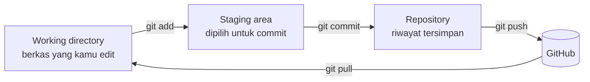

# Dasar Git dan GitHub

Pernahkah kamu menyimpan `tugas-final.docx`, `tugas-final-revisi.docx`, lalu
`tugas-final-revisi-BENAR.docx`? **Git** menyelesaikan masalah itu untuk kode: ia mencatat
riwayat setiap perubahan, memungkinkan kamu kembali ke versi lama, dan membuat banyak orang
bekerja pada proyek yang sama tanpa saling menimpa. **GitHub** adalah layanan daring untuk
menyimpan repositori Git dan berkolaborasi. Hampir semua proyek Laravel dikelola dengan
keduanya.

## Tujuan pembelajaran

Setelah menyelesaikan bab ini, kamu dapat:

- [ ] Menjelaskan perbedaan Git dan GitHub serta konsep repositori, commit, dan branch.
- [ ] Menyiapkan identitas Git dan membuat repositori.
- [ ] Memakai alur `status` → `add` → `commit` → `log`.
- [ ] Menulis `.gitignore` dan memastikan rahasia seperti `.env` tidak ikut tercatat.
- [ ] Membuat branch, menggabungkannya (`merge`), dan menyelesaikan konflik sederhana.
- [ ] Menghubungkan repositori lokal ke GitHub, lalu `push`, `pull`, dan `clone`.
- [ ] Menjelaskan alur kolaborasi dengan pull request.

## Prasyarat

- Bab [Composer dan Manajemen Paket](00-23-composer-and-package-management.md): folder
  `belajar-php/proyek-composer` dengan `.gitignore` yang berisi `/vendor/`.
- Ubuntu (atau sistem lain) dengan akses terminal.
- Akun GitHub gratis (dibutuhkan pada langkah terakhir).

## Konsep

### Git dan GitHub

| | Git | GitHub |
|---|---|---|
| Jenis | Program pencatat riwayat, berjalan di komputermu | Layanan web untuk menyimpan repositori Git dan berkolaborasi |
| Perlu internet? | Tidak | Ya |
| Fungsi | Commit, branch, merge | Penyimpanan jarak jauh, pull request, issue, review |

Git dapat dipakai tanpa GitHub. Layanan serupa lain: GitLab, Bitbucket.

!!! tip "Analogi"
    Git seperti **mesin waktu dengan buku catatan**: tiap kali kamu "mengambil foto"
    kondisi proyek (commit), ia dicatat lengkap dengan catatan dan penulisnya, sehingga
    kamu bisa kembali ke foto mana pun.

### Tiga area kerja



- **Working directory**: berkas di folder proyek.
- **Staging area**: tempat kamu memilih perubahan mana yang akan masuk commit berikutnya.
- **Repository**: riwayat commit (folder tersembunyi `.git`).

### Istilah dasar

| Istilah | Arti |
|---|---|
| **Repositori** (*repo*) | Proyek beserta seluruh riwayatnya |
| **Commit** | Satu "foto" kondisi proyek dengan pesan dan penulis |
| **Branch** | Jalur kerja terpisah; `main` adalah jalur utama |
| **Merge** | Menggabungkan satu branch ke branch lain |
| **Remote** | Salinan repositori di server lain (mis. GitHub), biasanya bernama `origin` |
| **Clone** | Mengunduh repositori beserta riwayatnya |
| **Pull request** (PR) | Permintaan di GitHub agar perubahan dari suatu branch ditinjau dan digabung |

### Perintah inti

| Perintah | Fungsi |
|---|---|
| `git init` | Membuat repositori baru di folder saat ini |
| `git status` | Melihat berkas yang berubah / belum dilacak |
| `git add berkas` / `git add .` | Memasukkan perubahan ke staging area |
| `git commit -m "pesan"` | Menyimpan staging area sebagai commit |
| `git log --oneline` | Riwayat commit ringkas |
| `git diff` | Perubahan yang belum di-stage; `git diff --staged` untuk yang sudah di-stage |
| `git switch -c nama` | Membuat dan pindah ke branch baru |
| `git switch nama` | Pindah branch |
| `git merge nama` | Menggabungkan branch `nama` ke branch aktif |
| `git remote add origin URL` | Menghubungkan ke repositori jarak jauh |
| `git push` / `git pull` | Mengirim / mengambil commit |
| `git clone URL` | Mengunduh repositori |
| `git restore berkas` | Membuang perubahan di working directory (tidak bisa dipulihkan) |
| `git revert <hash>` | Membuat commit baru yang membatalkan commit tertentu |

### Pesan commit yang baik

- Ringkas dan jelas, dalam kalimat perintah: `Tambah validasi email pada form pendaftaran`.
- Satu commit untuk satu perubahan yang bermakna; hindari pesan seperti `update` atau `fix`.

### `.gitignore` dan rahasia

`.gitignore` mendaftar berkas yang **tidak boleh dilacak**: folder `vendor/`, berkas
sementara, dan terutama berkas rahasia seperti `.env`.

!!! danger "Jangan pernah commit rahasia"
    Kata sandi, kunci API, dan `.env` yang tercatat di riwayat Git tetap ada di sana
    walau kamu menghapusnya di commit berikutnya, dan menjadi masalah besar bila repositori
    dipublikasikan. Tambahkan `.env` ke `.gitignore` **sebelum** commit pertama. Kerangka
    proyek Laravel umumnya sudah menyertakan `.gitignore` yang mengabaikan `.env` dan `vendor/`.

### Konflik merge

Bila dua branch mengubah **baris yang sama**, Git tidak bisa memilih sendiri dan menandai
berkas:

```text
<<<<<<< HEAD
Judul B
=======
Judul A
>>>>>>> edit-a
```

Bagian atas adalah versi branch aktif, bagian bawah dari branch yang digabung. Kamu memilih
(atau menggabungkan) isi akhir, menghapus ketiga penanda, lalu `git add` dan `git commit`.

## Praktik

### Langkah 1: pasang dan periksa Git

```bash
git --version
```

**Yang seharusnya terlihat:** baris `git version` diikuti nomor versi. Jika tidak dikenal,
pasang dengan:

```bash
sudo apt update
sudo apt install -y git
```

### Langkah 2: atur identitas

```bash
git config --global user.name "Nama Kamu"
git config --global user.email "email@contoh.id"
git config --global init.defaultBranch main
git config --global --list
```

**Yang seharusnya terlihat:** daftar konfigurasi yang memuat `user.name`, `user.email`, dan
`init.defaultBranch=main` sesuai isianmu. Gunakan email yang sama dengan akun GitHub-mu
(atau alamat `noreply` dari GitHub).

### Langkah 3: buat repositori dan `.gitignore`

```bash
cd belajar-php/proyek-composer
git init
```

**Yang seharusnya terlihat:** pesan bahwa repositori kosong dibuat (menyebut folder `.git`).

Perbarui `.gitignore` agar juga mengabaikan rahasia:

```text title="belajar-php/proyek-composer/.gitignore"
/vendor/
.env
```

Buat berkas rahasia palsu untuk menguji:

```bash
echo "RAHASIA=jangan-di-commit" > .env
git status
```

**Yang seharusnya terlihat:** `git status` menyebut `On branch main` dan daftar
**Untracked files** yang memuat `.gitignore`, `composer.json`, `composer.lock`,
`index.php`, dan `src/`. Folder `vendor/` dan berkas `.env` **tidak** muncul karena
diabaikan. Kamu perlu mencocokkan sendiri hasil di terminalmu.

### Langkah 4: commit pertama

```bash
git add .
git status
git commit -m "Commit pertama: proyek Composer dengan class Buku"
git log --oneline
```

**Yang seharusnya terlihat:**

- Setelah `git add .`, `git status` menampilkan **Changes to be committed**.
- `git commit` menampilkan ringkasan commit (jumlah berkas yang berubah).
- `git log --oneline` menampilkan satu baris: kode pendek commit (hash) diikuti pesanmu.
- Jalankan `git status` lagi: `nothing to commit, working tree clean`.

### Langkah 5: ubah, lihat selisih, commit lagi

Tambahkan satu baris ke `index.php`, misalnya `echo "Selesai\n";` di akhir, lalu:

```bash
git status
git diff
git add index.php
git commit -m "Cetak pesan selesai di index.php"
git log --oneline
```

**Yang seharusnya terlihat:**

- `git status`: **Changes not staged for commit** untuk `index.php`.
- `git diff`: baris yang ditambah ditandai `+`.
- `git log --oneline`: kini dua commit, yang terbaru di atas.

Jika ingin membuang perubahan yang belum di-stage pada sebuah berkas, gunakan
`git restore index.php`. Hati-hati: perubahan itu tidak bisa dikembalikan.

### Langkah 6: branch dan merge

```bash
git switch -c fitur-anggota
```

Buat berkas baru `src/Model/Anggota.php`:

```php title="belajar-php/proyek-composer/src/Model/Anggota.php"
<?php

namespace Latihan\Model;

class Anggota
{
    public function __construct(public string $nama) {}
}
```

```bash
git add src/Model/Anggota.php
git commit -m "Tambah class Anggota"
git switch main
ls src/Model
```

**Yang seharusnya terlihat:** setelah `git switch main`, berkas `Anggota.php` **tidak ada**
di `src/Model`, karena ia hanya ada di branch `fitur-anggota`. Gabungkan:

```bash
git merge fitur-anggota
ls src/Model
git log --oneline
```

**Yang seharusnya terlihat:** Git menampilkan hasil merge (karena `main` tidak berubah
sejak branch dibuat, biasanya berupa *fast-forward*), `Anggota.php` kini ada di `main`, dan
commit "Tambah class Anggota" muncul di riwayat. Hapus branch yang sudah digabung:

```bash
git branch -d fitur-anggota
```

### Langkah 7: menyelesaikan konflik

Buat berkas `README.md` dan commit:

```bash
echo "Proyek latihan" > README.md
git add README.md
git commit -m "Tambah README"
```

Buat dua perubahan yang bertabrakan pada baris yang sama:

```bash
git switch -c edit-a
echo "Judul A" > README.md
git commit -am "Ubah judul menjadi A"

git switch main
echo "Judul B" > README.md
git commit -am "Ubah judul menjadi B"

git merge edit-a
```

**Yang seharusnya terlihat:** Git melaporkan `CONFLICT (content): Merge conflict in README.md`
dan merge berhenti. Buka `README.md`: isinya memuat penanda `<<<<<<<`, `=======`, dan
`>>>>>>>`. Edit berkas menjadi satu baris final (misalnya `Judul Gabungan`) tanpa penanda,
lalu:

```bash
git add README.md
git commit --no-edit
git log --oneline
```

**Yang seharusnya terlihat:** commit merge muncul di riwayat dan `git status` bersih. Hapus
branch bantu: `git branch -d edit-a`.

### Langkah 8: GitHub

1. Masuk ke GitHub, buat repositori baru bernama `proyek-composer`. Jangan centang
   pilihan untuk membuat README atau `.gitignore` (repositorimu sudah memilikinya).
2. Siapkan autentikasi. GitHub tidak lagi menerima kata sandi akun untuk operasi Git;
   gunakan **SSH key** atau **personal access token** sesuai panduan resmi
   (lihat bagian referensi).
3. Hubungkan dan kirim:

    ```bash
    git remote add origin git@github.com:USERNAME/proyek-composer.git
    git push -u origin main
    ```

    Ganti `USERNAME` dengan nama akunmu (atau pakai URL HTTPS bila memilih token).
4. Muat ulang halaman repositori di GitHub.

**Yang seharusnya terlihat:** berkas `composer.json`, `composer.lock`, `index.php`,
`src/`, `README.md`, dan `.gitignore` tampil di GitHub, beserta riwayat commit. Folder
`vendor/` dan berkas `.env` **tidak ada**, karena tidak pernah dilacak.

### Langkah 9: `clone` dan `pull`

Simulasikan rekan tim:

```bash
cd ..
git clone git@github.com:USERNAME/proyek-composer.git salinan
cd salinan
composer install
php index.php
```

**Yang seharusnya terlihat:** repositori terunduh dengan riwayatnya, `composer install` mengisi
`vendor/` dari `composer.lock`, dan `php index.php` berjalan seperti semula.

Lalu di folder `proyek-composer` asli, ubah sesuatu, commit, dan `git push`. Di folder
`salinan`, jalankan `git pull`. **Yang seharusnya terlihat:** perubahan itu muncul di
`salinan`.

### Langkah 10: alur pull request (membaca)

Pada GitHub, tim biasanya tidak langsung mengubah `main`. Alurnya:

1. Buat branch fitur dan `push`.
2. Buka **Pull request** dari branch itu ke `main`.
3. Rekan meninjau, memberi komentar, dan menyetujui.
4. PR digabung (*merged*) ke `main`.

Coba satu kali pada repositorimu: buat branch `uji-pr`, ubah `README.md`, `git push -u origin
uji-pr`, lalu buka PR di GitHub dan gabungkan.

## Kesalahan umum dan debugging

| Gejala | Kemungkinan penyebab | Solusi |
|---|---|---|
| `Author identity unknown` / `Please tell me who you are` | Nama dan email belum diatur | `git config --global user.name` dan `user.email`. |
| `nothing to commit` padahal sudah edit | Berkas belum disimpan, atau belum di-`add` | Simpan berkas; `git add`; cek `git status`. |
| `.env` muncul di `git status` | Belum masuk `.gitignore`, atau sudah telanjur dilacak | Tambahkan ke `.gitignore`; bila sudah dilacak: `git rm --cached .env`. |
| `fatal: not a git repository` | Perintah dijalankan di luar repositori | `cd` ke folder proyek, atau `git init`. |
| `Permission denied (publickey)` | SSH key belum ditambahkan ke GitHub | Ikuti panduan SSH GitHub; atau gunakan HTTPS dengan token. |
| `Authentication failed` (HTTPS) | Memakai kata sandi akun | Gunakan personal access token. |
| `rejected ... non-fast-forward` pada `push` | Remote punya commit yang belum kamu ambil | `git pull`, selesaikan konflik bila ada, lalu `push` lagi. |
| `CONFLICT` saat merge | Perubahan di baris yang sama | Edit berkas, hapus penanda, `git add`, `git commit`. |
| Berkas lenyap setelah `git restore` | `restore` membuang perubahan yang belum di-commit | Commit lebih sering; jangan `restore` sembarangan. |
| Rahasia sempat ter-commit atau ter-`push` | Lupa `.gitignore` | Ganti rahasia itu **segera** (anggap bocor), lalu bersihkan riwayat sesuai panduan GitHub. |
| `error: pathspec ... did not match` pada `git switch` | Nama branch salah | Cek `git branch` untuk daftar branch. |

## Latihan terpandu

1. Buat branch `fitur-pencarian`, tambahkan method `cari(string $kata): array` pada
   `Perpustakaan` (mengembalikan judul yang mengandung `$kata`), commit, lalu merge ke `main`.
2. Pastikan `git log --oneline` memuat pesan commit yang jelas. Tulis ulang dua pesan
   commit yang buruk (`update`, `fix`) menjadi pesan yang baik (hanya latihan menulis;
   jangan ubah riwayat yang sudah di-push).
3. Buat commit yang salah, lalu batalkan dengan `git revert` dan jelaskan perbedaannya dengan
   `git restore`.
4. Buat konflik lain dengan sengaja pada `composer.json` (ubah `description` di dua branch)
   dan selesaikan.
5. Tambahkan `README.md` yang menjelaskan proyek, cara `composer install`, dan cara menjalankan
   `php index.php`; commit dan push.
6. Jelaskan perbedaan `git pull` dan `git push`, dan alasan `vendor/` tidak ada di GitHub.

??? success "Petunjuk nomor 3 dan 6"
    **Nomor 3:** `git revert <hash>` membuat commit **baru** yang membatalkan perubahan commit
    lama (riwayat tetap utuh dan aman untuk repositori bersama). `git restore` membuang
    perubahan yang belum di-commit di working directory dan tidak bisa dibatalkan.

    **Nomor 6:** `git pull` mengambil commit dari remote ke lokal; `git push` mengirim commit
    lokal ke remote. `vendor/` diabaikan karena dapat dibuat ulang dengan `composer install`.

## Pertanyaan review

1. Apa beda Git dan GitHub?
2. Apa fungsi staging area?
3. Apa beda `git add`, `git commit`, dan `git push`?
4. Mengapa branch berguna?
5. Bagaimana mengenali dan menyelesaikan konflik merge?
6. Apa fungsi `.gitignore` dan apa yang wajib ada di dalamnya untuk proyek Laravel?
7. Mengapa rahasia tidak boleh di-commit, dan apa yang dilakukan bila terlanjur?
8. Apa itu pull request dan siapa yang diuntungkan?

## Ringkasan

- Git mencatat riwayat perubahan; GitHub menyimpan repositori daring dan memfasilitasi kolaborasi.
- Alur dasar: `status` → `add` → `commit` → `log`; kirim ke GitHub dengan `push`, ambil dengan `pull`.
- Branch memisahkan pekerjaan; `merge` menggabungkannya; konflik diselesaikan dengan menyunting dan `add`/`commit`.
- `.gitignore` menjaga `vendor/` dan `.env` tidak tercatat; rahasia tidak boleh masuk Git.
- Pull request adalah cara tim meninjau perubahan sebelum digabung ke `main`.

Dengan ini seluruh sub bab pada **Dasar Web dan PHP** selesai. Bab utama ini ditutup dengan
[Proyek Praktik: Sistem Manajemen Siswa](proyek-sistem-siswa.md), yang memakai semua yang
kamu pelajari, termasuk Composer dan Git. Lihat juga [Peta Belajar](index.md).

## Referensi resmi

- [Pro Git (buku resmi)](https://git-scm.com/book/en/v2)
- [Dokumentasi Git](https://git-scm.com/doc)
- [Git: gitignore](https://git-scm.com/docs/gitignore)
- [Git: Basic branching and merging](https://git-scm.com/book/en/v2/Git-Branching-Basic-Branching-and-Merging)
- [GitHub: About Git](https://docs.github.com/en/get-started/using-git/about-git)
- [GitHub: Quickstart for repositories](https://docs.github.com/en/repositories/creating-and-managing-repositories/quickstart-for-repositories)
- [GitHub: Setting your username in Git](https://docs.github.com/en/get-started/getting-started-with-git/setting-your-username-in-git)
- [GitHub: Connecting with SSH](https://docs.github.com/en/authentication/connecting-to-github-with-ssh)
- [GitHub: About pull requests](https://docs.github.com/en/pull-requests/collaborating-with-pull-requests/proposing-changes-to-your-work-with-pull-requests/about-pull-requests)
