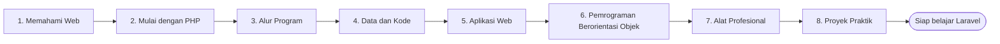

# Peta Belajar: Dasar Web dan PHP

Bab utama ini adalah fondasi untuk seluruh perjalanan belajar Laravel. Kamu akan memahami cara
kerja web, menguasai PHP, memakai pemrograman berorientasi objek, lalu menyiapkan alat kerja
profesional (Composer dan Git). Halaman ini adalah **peta**: urutan belajar, tujuan tiap tahap,
dan kriteria bahwa kamu siap melangkah ke Laravel.

## Tujuan Pembelajaran

Setelah menyelesaikan bab utama ini, kamu dapat:

- [ ] Menjelaskan cara kerja web: client, server, HTTP, request, dan response.
- [ ] Menulis program PHP dengan variabel, tipe data, operator, kondisi, perulangan, array, fungsi, dan string.
- [ ] Menangani form dan menjaga keamanan dasar aplikasi web.
- [ ] Menerapkan pemrograman berorientasi objek dan penanganan exception.
- [ ] Mengelola kode dengan namespace, autoloading, Composer, dan Git.
- [ ] Membangun aplikasi CRUD sederhana dengan PHP native.

## Prasyarat

Tidak ada. Kamu hanya membutuhkan komputer, browser, editor teks, dan kemauan mencoba.
Perangkat lunak yang dibutuhkan (PHP, Composer, Git) dipasang pada sub bab yang bersangkutan.

## Gambaran Besar

Ikuti tahap secara berurutan. Setiap tahap memakai hasil tahap sebelumnya, jadi melompat
biasanya membuat bingung.

## Peta Per Tahap

### Tahap 1: Memahami Web

| Sub bab | Yang kamu pelajari | Hasil akhir |
|---|---|---|
| [Pengantar Web Development](00-01-introduction-to-web-development.md) | Web, frontend, backend, HTML | Halaman HTML pertama |
| [Client-Server Architecture](00-02-client-server-architecture.md) | Client, server, DNS, port | Mengamati komunikasi nyata |
| [HTTP dan HTTPS](00-03-http-https-fundamentals.md) | Metode, status code, HTTPS | Membaca status dan metode |
| [Request dan Response](00-04-request-and-response.md) | Anatomi request dan response | Membaca percakapan HTTP |

### Tahap 2: Mulai dengan PHP

| Sub bab | Yang kamu pelajari | Hasil akhir |
|---|---|---|
| [Pengantar PHP](00-05-introduction-to-php.md) | Peran PHP di server | Memahami alur eksekusi |
| [Pemasangan PHP](00-06-php-installation-and-development-environment.md) | PHP, Composer, server pengembangan | Lingkungan kerja siap |
| [Sintaks PHP](00-07-php-syntax.md) | Tag, `echo`, komentar | Program PHP pertama |
| [Variabel dan Konstanta](00-08-variables-and-constants.md) | Menyimpan data | Memakai variabel dengan benar |
| [Tipe Data PHP](00-09-php-data-types.md) | `string`, `int`, `float`, `bool`, `null` | Memeriksa tipe dengan `var_dump` |
| [Operator PHP](00-10-php-operators.md) | Aritmetika, perbandingan, logika | Menulis ekspresi |

### Tahap 3: Alur Program

| Sub bab | Yang kamu pelajari | Hasil akhir |
|---|---|---|
| [Pernyataan Kondisional](00-11-conditional-statements.md) | `if`, `switch`, `match` | Program yang mengambil keputusan |
| [Perulangan](00-12-loops.md) | `for`, `while`, `foreach` | Mengulang pekerjaan |

### Tahap 4: Data dan Kode

| Sub bab | Yang kamu pelajari | Hasil akhir |
|---|---|---|
| [Array](00-13-arrays.md) | Array berindeks, asosiatif, multidimensi | Mengelola kumpulan data |
| [Fungsi](00-14-functions.md) | Parameter, `return`, closure | Kode yang dapat dipakai ulang |
| [Manipulasi String](00-15-string-manipulation.md) | Mencari, memotong, memformat | Mengolah teks |

### Tahap 5: Aplikasi Web

| Sub bab | Yang kamu pelajari | Hasil akhir |
|---|---|---|
| [Penanganan Form PHP](00-16-php-form-handling.md) | `$_GET`, `$_POST`, validasi, PRG | Form dengan validasi |
| [Include dan Require](00-17-include-and-require.md) | Memecah berkas, konfigurasi | Halaman dengan header dan footer bersama |

### Tahap 6: Pemrograman Berorientasi Objek

| Sub bab | Yang kamu pelajari | Hasil akhir |
|---|---|---|
| [Pemrograman Berorientasi Objek](00-18-object-oriented-programming.md) | Gagasan dan istilah OOP | Merancang class di atas kertas |
| [Class dan Objek](00-19-classes-and-objects.md) | Class, constructor, `static` | Membuat dan memakai objek |
| [Pewarisan, Enkapsulasi, Polimorfisme](00-20-inheritance-encapsulation-polymorphism.md) | `extends`, abstract, interface | Hierarki class sederhana |
| [Penanganan Exception](00-21-exception-handling.md) | `try`, `catch`, exception kustom | Menangani error dengan rapi |

### Tahap 7: Alat Profesional

| Sub bab | Yang kamu pelajari | Hasil akhir |
|---|---|---|
| [Namespace dan Autoloading](00-22-namespace-and-autoloading.md) | Namespace, PSR-4 | Struktur proyek yang rapi |
| [Composer dan Manajemen Paket](00-23-composer-and-package-management.md) | `composer.json`, paket | Memasang dan memakai paket |
| [Dasar Git dan GitHub](00-24-git-and-github-fundamentals.md) | Commit, branch, merge, GitHub | Riwayat proyek yang terkelola |

### Tahap 8: Proyek Praktik

| Proyek | Yang kamu bangun | Hasil akhir |
|---|---|---|
| [Sistem Manajemen Siswa](proyek-sistem-siswa.md) | CRUD siswa dengan PHP native, OOP, Composer, dan Git | Aplikasi web yang berjalan |

## Kriteria Penyelesaian

Kamu siap melanjutkan ke bab utama berikutnya bila:

- [ ] Memahami dasar PHP (tahap 2 sampai 5).
- [ ] Mampu membangun aplikasi PHP sederhana ([proyek praktik](proyek-sistem-siswa.md)).
- [ ] Memahami dasar OOP (tahap 6).
- [ ] Mampu memakai Composer dan Git (tahap 7).

## Cara Belajar yang Disarankan

1. Siapkan satu folder kerja, misalnya `belajar-php`, dan simpan semua latihan di sana.
2. Ketik sendiri kodenya, jangan hanya menyalin. Jalankan, lalu cocokkan dengan hasil yang diharapkan.
3. Kerjakan latihan di akhir setiap sub bab sebelum lanjut.
4. Saat bertemu error, baca pesannya dan buka bagian **Kesalahan Umum**.
5. Catat pertanyaan yang belum terjawab, lalu ulangi sub bab terkait bila perlu.
6. Gunakan Git sejak awal untuk menyimpan perkembanganmu.

!!! info "Status materi"
    Seluruh sub bab pada bab utama ini masih berstatus **DRAFT**. Kode dan keluaran
    ditulis berdasarkan dokumentasi dan belum seluruhnya diuji di lingkungan nyata. Bila
    kamu menemukan perbedaan, catat dan laporkan.

## Referensi Resmi

- [PHP Manual](https://www.php.net/manual/en/)
- [Composer Documentation](https://getcomposer.org/doc/)
- [Pro Git](https://git-scm.com/book/en/v2)
- [Laravel Documentation (13.x)](https://laravel.com/docs/13.x/readme)
