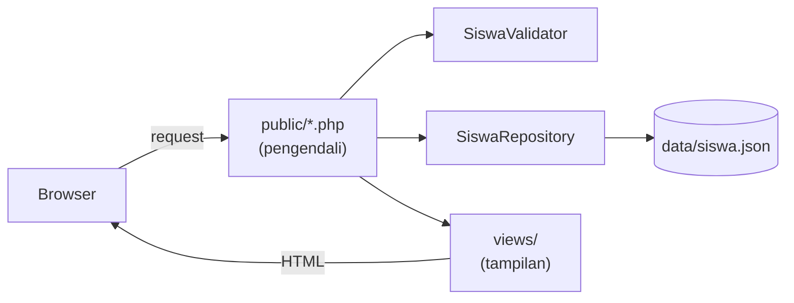
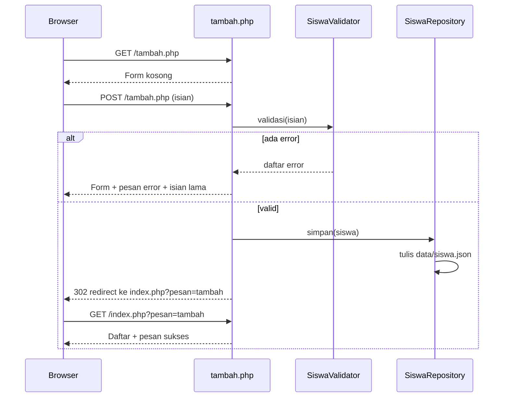

# Proyek Praktik: Sistem Manajemen Siswa

Selamat, kamu sudah mempelajari fondasi web dan PHP. Pada proyek ini semua keterampilan itu
dipakai bersama untuk membangun aplikasi kecil yang benar-benar bisa dipakai: **Sistem
Manajemen Siswa** dengan PHP native (tanpa framework). Kamu akan membuat fitur tambah, lihat,
cari, ubah, dan hapus data siswa (disebut **CRUD**), memakai class, Composer, dan Git.

## Tujuan Pembelajaran

Setelah menyelesaikan proyek ini, kamu dapat:

- [ ] Merancang struktur aplikasi PHP yang memisahkan model, penyimpanan, validasi, dan tampilan.
- [ ] Membangun fitur CRUD siswa dengan form, validasi, dan pola Post/Redirect/Get.
- [ ] Menyimpan data ke berkas JSON lewat class *repository*.
- [ ] Memakai Composer untuk autoloading PSR-4 pada proyek sendiri.
- [ ] Menerapkan praktik keamanan dasar: validasi input, *escape* output, dan metode `POST` untuk penghapusan.
- [ ] Menjelaskan keterbatasan aplikasi ini dan bagaimana Laravel mengatasinya.
- [ ] Mengelola proyek dengan Git.

## Prasyarat

Proyek ini memakai seluruh materi pada bab utama **Dasar Web dan PHP**, terutama:

- [Penanganan Form PHP](00-16-php-form-handling.md) dan [Include dan Require](00-17-include-and-require.md).
- [Class dan Objek](00-19-classes-and-objects.md) serta [Penanganan Exception](00-21-exception-handling.md).
- [Namespace dan Autoloading](00-22-namespace-and-autoloading.md) dan
  [Composer dan Manajemen Paket](00-23-composer-and-package-management.md).
- [Dasar Git dan GitHub](00-24-git-and-github-fundamentals.md).

Lingkungan: PHP 8.3 atau lebih baru dan Composer terpasang (`php -v`, `composer -V`
berfungsi), editor teks, dan browser.

## Pengantar

Sistem informasi akademik menyimpan data mahasiswa atau siswa: nomor induk, nama, email, dan
jurusan. Staf perlu menambah siswa baru, mencari, memperbaiki kesalahan data, dan menghapus
siswa yang keluar. Itu adalah contoh nyata kebutuhan **CRUD**:

| Huruf | Operasi | Pada proyek ini |
|---|---|---|
| **C**reate | Membuat data | Form tambah siswa |
| **R**ead | Membaca data | Daftar dan pencarian siswa |
| **U**pdate | Mengubah data | Form ubah siswa |
| **D**elete | Menghapus data | Tombol hapus |

Hampir semua aplikasi bisnis berisi variasi dari empat operasi ini. Itulah sebabnya Laravel
menyediakan banyak alat untuk CRUD, dan itulah yang kita rasakan "manual" di sini.

## Penjelasan Konsep

### Persyaratan aplikasi

| Kode | Persyaratan |
|---|---|
| R1 | Menampilkan daftar siswa (NIM, nama, email, jurusan) |
| R2 | Mencari siswa berdasarkan nama atau NIM |
| R3 | Menambah siswa lewat form dengan validasi |
| R4 | Mengubah data siswa lewat form dengan validasi |
| R5 | Menghapus siswa |
| R6 | NIM harus unik, berupa 8 sampai 12 digit angka |
| R7 | Jurusan dipilih dari daftar tetap |
| R8 | Data tersimpan permanen walau server dimatikan |

### Mengapa dipecah ke beberapa class?

Menaruh semuanya dalam satu berkas cepat berantakan. Kita memisahkan tanggung jawab:

| Bagian | Tanggung jawab |
|---|---|
| `Siswa` (model) | Menyimpan data satu siswa |
| `SiswaRepository` | Membaca dan menulis data ke berkas |
| `SiswaValidator` | Memeriksa kebenaran isian |
| `views/` | Tampilan HTML |
| `public/*.php` | Pengendali: menerima request, memanggil bagian lain, memilih tampilan |

Pemisahan ini menjadi dasar pola **MVC** yang kamu pelajari di Laravel nanti: model,
tampilan (view), dan pengendali (controller). Jika kelak penyimpanan diganti database, cukup
class repository yang berubah.

### Mengapa berkas JSON?

Database baru dipelajari pada bab utama selanjutnya. Untuk saat ini, kita menyimpan data
sebagai **JSON**, format teks untuk menyimpan array. Dua fungsi PHP yang dibutuhkan:

| Fungsi | Kegunaan |
|---|---|
| `json_encode($array)` | Mengubah array menjadi teks JSON |
| `json_decode($teks, true)` | Mengubah teks JSON menjadi array asosiatif |
| `file_get_contents($jalur)` | Membaca seluruh isi berkas menjadi teks |
| `file_put_contents($jalur, $teks)` | Menulis teks ke berkas |

Keterbatasan: berkas dibaca dan ditulis ulang seluruhnya setiap kali, tidak ada pencarian
efisien, dan dua pengguna yang menyimpan bersamaan bisa saling menimpa. Database mengatasi
semua itu. Opsi `LOCK_EX` pada `file_put_contents` hanya mencegah tulisan bertabrakan pada
saat yang sama, bukan menggantikan database.

### Keamanan

| Risiko | Penanganan di proyek ini |
|---|---|
| **XSS** (skrip jahat tertanam di data) | Semua keluaran di-*escape* dengan fungsi `e()` yang memakai `htmlspecialchars` |
| Input tidak valid atau berbentuk array | Dibaca lewat `ambilTeks()` yang hanya menerima teks, lalu divalidasi |
| Penghapusan lewat tautan (dapat dipicu mesin pencari atau tautan palsu) | Hapus hanya lewat `POST` |
| Isian yang dimanipulasi | Jurusan dicocokkan dengan daftar putih |
| **CSRF** (situs lain memaksa browser pengguna mengirim `POST`) | **Belum ditangani.** Ini keterbatasan proyek ini; Laravel menyediakan token CSRF otomatis (`@csrf`) |
| Berkas data bisa dibuka lewat web | Berkas disimpan di luar folder `public/` |

!!! warning "Jangan gunakan proyek ini di server publik"
    Aplikasi ini tidak memiliki login dan perlindungan CSRF. Ia dibuat untuk belajar di
    komputer sendiri. Autentikasi dan CSRF dibahas pada bab utama berikutnya.

## Cara Kerja



Alur menambah siswa (pola Post/Redirect/Get):



## Contoh Praktik

### Struktur proyek

```text
belajar-php/sistem-siswa/
├── composer.json
├── config.php
├── .gitignore
├── data/
│   └── .gitkeep
├── public/              <- hanya folder ini yang diakses browser
│   ├── index.php
│   ├── tambah.php
│   ├── ubah.php
│   └── hapus.php
├── src/
│   ├── helpers.php
│   ├── Model/
│   │   └── Siswa.php
│   ├── Repository/
│   │   └── SiswaRepository.php
│   └── Validation/
│       └── SiswaValidator.php
└── views/
    ├── layout/
    │   ├── header.php
    │   └── footer.php
    ├── daftar.php
    └── form.php
```

Folder `public/` adalah *document root* server; folder lain (`src/`, `data/`, `views/`) tidak
dapat dibuka langsung lewat browser.

### Penjelasan Kode

| Berkas | Peran | Konsep yang dipakai |
|---|---|---|
| `composer.json` | Autoload `Sistem\` → `src/` dan memuat `helpers.php` | Composer, PSR-4 |
| `config.php` | Pengaturan: nama aplikasi, jalur berkas data, daftar jurusan | Berkas yang `return` array |
| `src/helpers.php` | Fungsi bantu `e()` dan `ambilTeks()` | Fungsi, escape output |
| `Model/Siswa.php` | Satu data siswa | Class, constructor promotion, `static` |
| `Repository/SiswaRepository.php` | CRUD ke berkas JSON | Class, array, exception, file |
| `Validation/SiswaValidator.php` | Aturan validasi | Kondisi, `filter_var`, string |
| `public/*.php` | Pengendali tiap halaman | Form, PRG, kode status HTTP |
| `views/*.php` | Tampilan HTML | Sintaks alternatif, `include` |

## Implementasi Langkah demi Langkah

Semua perintah dijalankan dari folder `belajar-php`, kecuali disebutkan lain.

### Langkah 1: siapkan folder dan Composer

```bash
mkdir -p sistem-siswa/{public,src/Model,src/Repository,src/Validation,views/layout,data}
cd sistem-siswa
touch data/.gitkeep
```

```json title="belajar-php/sistem-siswa/composer.json"
{
    "name": "latihan/sistem-siswa",
    "description": "Student Management System dengan PHP native",
    "type": "project",
    "require": {
        "php": "^8.3"
    },
    "autoload": {
        "psr-4": {
            "Sistem\\": "src/"
        },
        "files": [
            "src/helpers.php"
        ]
    }
}
```

Kunci `files` meminta Composer memuat `src/helpers.php` setiap kali autoloader dimuat. Ini
dibutuhkan karena fungsi biasa (bukan class) tidak bisa dimuat otomatis oleh PSR-4.

```text title="belajar-php/sistem-siswa/.gitignore"
/vendor/
.env
/data/*.json
```

Berkas data siswa tidak ikut Git, karena itu data milik pemakai, bukan kode.

### Langkah 2: konfigurasi dan fungsi bantu

```php title="belajar-php/sistem-siswa/config.php"
<?php

return [
    "nama_aplikasi" => "Sistem Manajemen Siswa",
    "berkas_data" => __DIR__ . "/data/siswa.json",
    "jurusan" => [
        "informatika" => "Informatika",
        "sistem-informasi" => "Sistem Informasi",
        "teknik-komputer" => "Teknik Komputer",
    ],
];
```

```php title="belajar-php/sistem-siswa/src/helpers.php"
<?php

/**
 * Meng-escape teks sebelum dicetak ke HTML (mencegah XSS).
 */
function e(?string $teks): string
{
    return htmlspecialchars($teks ?? "", ENT_QUOTES, "UTF-8");
}

/**
 * Mengambil satu isian bertipe teks dari array input ($_GET / $_POST).
 * Nilai yang bukan teks (misalnya array) dianggap kosong.
 */
function ambilTeks(array $sumber, string $kunci): string
{
    $nilai = $sumber[$kunci] ?? "";

    return is_string($nilai) ? trim($nilai) : "";
}
```

| Bagian | Penjelasan |
|---|---|
| `__DIR__ . "/data/siswa.json"` | Jalur absolut berkas data, aman dari mana pun skrip dijalankan. |
| `e(?string $teks)` | Pembungkus `htmlspecialchars`; `ENT_QUOTES` ikut meng-escape tanda kutip. |
| `ambilTeks(...)` | Pengguna bisa mengirim `?q[]=x` (array). Fungsi ini memastikan nilai yang dipakai selalu `string`. |

### Langkah 3: model `Siswa`

```php title="belajar-php/sistem-siswa/src/Model/Siswa.php"
<?php

namespace Sistem\Model;

class Siswa
{
    public function __construct(
        public int $id,
        public string $nim,
        public string $nama,
        public string $email,
        public string $jurusan,
    ) {}

    public static function dariArray(array $data): static
    {
        return new static(
            (int) ($data["id"] ?? 0),
            (string) ($data["nim"] ?? ""),
            (string) ($data["nama"] ?? ""),
            (string) ($data["email"] ?? ""),
            (string) ($data["jurusan"] ?? ""),
        );
    }

    public function keArray(): array
    {
        return [
            "id" => $this->id,
            "nim" => $this->nim,
            "nama" => $this->nama,
            "email" => $this->email,
            "jurusan" => $this->jurusan,
        ];
    }
}
```

`id` bernilai `0` untuk siswa yang belum disimpan. `dariArray` membuat objek dari baris data
JSON; `keArray` mengubah objek menjadi array untuk disimpan. Kata `static` membuat kedua
bagian bekerja juga untuk class turunan.

### Langkah 4: `SiswaRepository`

```php title="belajar-php/sistem-siswa/src/Repository/SiswaRepository.php"
<?php

namespace Sistem\Repository;

use RuntimeException;
use Sistem\Model\Siswa;

class SiswaRepository
{
    public function __construct(private string $berkas) {}

    /**
     * @return Siswa[]
     */
    public function semua(): array
    {
        $daftar = array_map(
            fn (array $baris) => Siswa::dariArray($baris),
            $this->baca()
        );

        usort($daftar, fn (Siswa $a, Siswa $b) => strcasecmp($a->nama, $b->nama));

        return $daftar;
    }

    public function cari(int $id): ?Siswa
    {
        foreach ($this->baca() as $baris) {
            if ((int) $baris["id"] === $id) {
                return Siswa::dariArray($baris);
            }
        }

        return null;
    }

    public function cariNim(string $nim): ?Siswa
    {
        foreach ($this->baca() as $baris) {
            if ((string) $baris["nim"] === $nim) {
                return Siswa::dariArray($baris);
            }
        }

        return null;
    }

    public function simpan(Siswa $siswa): Siswa
    {
        $data = $this->baca();

        if ($siswa->id === 0) {
            $siswa->id = $this->idBerikutnya($data);
            $data[] = $siswa->keArray();
        } else {
            foreach ($data as $indeks => $baris) {
                if ((int) $baris["id"] === $siswa->id) {
                    $data[$indeks] = $siswa->keArray();
                }
            }
        }

        $this->tulis($data);

        return $siswa;
    }

    public function hapus(int $id): bool
    {
        $data = $this->baca();
        $sisa = array_values(array_filter(
            $data,
            fn (array $baris) => (int) $baris["id"] !== $id
        ));

        if (count($sisa) === count($data)) {
            return false;
        }

        $this->tulis($sisa);

        return true;
    }

    private function baca(): array
    {
        if (!is_file($this->berkas)) {
            return [];
        }

        $isi = file_get_contents($this->berkas);

        if ($isi === false || trim($isi) === "") {
            return [];
        }

        $data = json_decode($isi, true);

        if (!is_array($data)) {
            throw new RuntimeException("Berkas data rusak: " . basename($this->berkas));
        }

        return $data;
    }

    private function tulis(array $data): void
    {
        $folder = dirname($this->berkas);

        if (!is_dir($folder)) {
            mkdir($folder, 0775, true);
        }

        $json = json_encode(array_values($data), JSON_PRETTY_PRINT | JSON_UNESCAPED_UNICODE);

        if ($json === false || file_put_contents($this->berkas, $json, LOCK_EX) === false) {
            throw new RuntimeException("Gagal menulis berkas data.");
        }
    }

    private function idBerikutnya(array $data): int
    {
        $daftarId = array_map(fn (array $baris) => (int) $baris["id"], $data);

        return $daftarId === [] ? 1 : max($daftarId) + 1;
    }
}
```

| Method | Penjelasan |
|---|---|
| `semua()` | Mengubah setiap baris menjadi objek `Siswa`, lalu mengurutkan menurut nama (tanpa membedakan huruf besar-kecil). |
| `cari($id)` / `cariNim($nim)` | Mengembalikan `Siswa` atau `null` bila tidak ada (tipe `?Siswa`). |
| `simpan($siswa)` | Jika `id === 0` berarti data baru: beri ID berikutnya dan tambahkan. Jika tidak, ganti baris yang ID-nya sama. |
| `hapus($id)` | Menyaring baris dengan ID itu; mengembalikan `false` bila tidak ada yang dihapus. |
| `baca()` | Membaca berkas; kosong atau belum ada dianggap `[]`; JSON rusak melempar `RuntimeException`. |
| `tulis()` | Membuat folder bila perlu, menulis JSON, dan melempar exception bila gagal. `LOCK_EX` mengunci berkas saat menulis. |
| `idBerikutnya()` | ID terbesar saat ini ditambah 1. |

Method `baca`, `tulis`, dan `idBerikutnya` bersifat `private` karena hanya urusan internal
(enkapsulasi). Pemanggil cukup tahu `semua`, `cari`, `simpan`, dan `hapus`.

### Langkah 5: `SiswaValidator`

```php title="belajar-php/sistem-siswa/src/Validation/SiswaValidator.php"
<?php

namespace Sistem\Validation;

use Sistem\Repository\SiswaRepository;

class SiswaValidator
{
    public function __construct(
        private SiswaRepository $repository,
        private array $jurusan,
    ) {}

    /**
     * @param int $abaikanId ID siswa yang sedang diubah (agar NIM miliknya sendiri tidak dianggap duplikat)
     * @return array<string, string> pesan error per kolom; kosong berarti valid
     */
    public function validasi(array $input, int $abaikanId = 0): array
    {
        $errors = [];

        $nim = $input["nim"] ?? "";
        $nama = $input["nama"] ?? "";
        $email = $input["email"] ?? "";
        $jurusan = $input["jurusan"] ?? "";

        if ($nim === "") {
            $errors["nim"] = "NIM wajib diisi.";
        } elseif (!ctype_digit($nim) || strlen($nim) < 8 || strlen($nim) > 12) {
            $errors["nim"] = "NIM harus 8 sampai 12 digit angka.";
        } else {
            $sudahAda = $this->repository->cariNim($nim);

            if ($sudahAda !== null && $sudahAda->id !== $abaikanId) {
                $errors["nim"] = "NIM sudah terdaftar.";
            }
        }

        if ($nama === "") {
            $errors["nama"] = "Nama wajib diisi.";
        } elseif (mb_strlen($nama) > 100) {
            $errors["nama"] = "Nama maksimal 100 karakter.";
        }

        if (filter_var($email, FILTER_VALIDATE_EMAIL) === false) {
            $errors["email"] = "Format email tidak valid.";
        }

        if (!array_key_exists($jurusan, $this->jurusan)) {
            $errors["jurusan"] = "Pilih jurusan yang tersedia.";
        }

        return $errors;
    }
}
```

`ctype_digit($nim)` bernilai `true` hanya bila seluruh karakter string adalah angka `0`-`9`.
Validator menerima repository melalui constructor sehingga ia bisa memeriksa keunikan NIM. Pola
ini disebut *dependency injection*, dibahas pada bab Laravel nanti.

### Langkah 6: tampilan

```php title="belajar-php/sistem-siswa/views/layout/header.php"
<!DOCTYPE html>
<html lang="id">
<head>
    <meta charset="utf-8">
    <meta name="viewport" content="width=device-width, initial-scale=1">
    <title><?= e($judul) ?> - <?= e($config["nama_aplikasi"]) ?></title>
</head>
<body>
    <header>
        <strong><?= e($config["nama_aplikasi"]) ?></strong> |
        <a href="index.php">Daftar Siswa</a> |
        <a href="tambah.php">Tambah Siswa</a>
    </header>
    <hr>
    <main>
```

```php title="belajar-php/sistem-siswa/views/layout/footer.php"
    </main>
    <hr>
    <footer>
        <small>Proyek latihan PHP native.</small>
    </footer>
</body>
</html>
```

```php title="belajar-php/sistem-siswa/views/daftar.php"
<h1>Daftar Siswa</h1>

<?php if ($pesan !== null): ?>
    <p style="color: green"><?= e($pesan) ?></p>
<?php endif; ?>

<form method="get" action="index.php">
    <label for="q">Cari</label>
    <input id="q" type="search" name="q" value="<?= e($kataKunci) ?>" placeholder="Nama atau NIM">
    <button type="submit">Cari</button>
</form>

<p><a href="tambah.php">+ Tambah siswa</a></p>

<?php if ($daftar === []): ?>
    <p>Belum ada data siswa.</p>
<?php else: ?>
    <table border="1" cellpadding="6" cellspacing="0">
        <tr>
            <th>NIM</th>
            <th>Nama</th>
            <th>Email</th>
            <th>Jurusan</th>
            <th>Aksi</th>
        </tr>
        <?php foreach ($daftar as $siswa): ?>
            <tr>
                <td><?= e($siswa->nim) ?></td>
                <td><?= e($siswa->nama) ?></td>
                <td><?= e($siswa->email) ?></td>
                <td><?= e($config["jurusan"][$siswa->jurusan] ?? $siswa->jurusan) ?></td>
                <td>
                    <a href="ubah.php?id=<?= $siswa->id ?>">Ubah</a>
                    <form method="post" action="hapus.php" style="display: inline"
                          onsubmit="return confirm('Hapus siswa ini?')">
                        <input type="hidden" name="id" value="<?= $siswa->id ?>">
                        <button type="submit">Hapus</button>
                    </form>
                </td>
            </tr>
        <?php endforeach; ?>
    </table>
<?php endif; ?>
```

```php title="belajar-php/sistem-siswa/views/form.php"
<h1><?= e($judul) ?></h1>

<form action="<?= e($aksi) ?>" method="post">
    <p>
        <label for="nim">NIM</label><br>
        <input id="nim" type="text" name="nim" value="<?= e($data["nim"]) ?>">
        <?php if (isset($errors["nim"])): ?>
            <br><small style="color: red"><?= e($errors["nim"]) ?></small>
        <?php endif; ?>
    </p>
    <p>
        <label for="nama">Nama</label><br>
        <input id="nama" type="text" name="nama" value="<?= e($data["nama"]) ?>">
        <?php if (isset($errors["nama"])): ?>
            <br><small style="color: red"><?= e($errors["nama"]) ?></small>
        <?php endif; ?>
    </p>
    <p>
        <label for="email">Email</label><br>
        <input id="email" type="text" name="email" value="<?= e($data["email"]) ?>">
        <?php if (isset($errors["email"])): ?>
            <br><small style="color: red"><?= e($errors["email"]) ?></small>
        <?php endif; ?>
    </p>
    <p>
        <label for="jurusan">Jurusan</label><br>
        <select id="jurusan" name="jurusan">
            <option value="">-- Pilih jurusan --</option>
            <?php foreach ($config["jurusan"] as $kode => $label): ?>
                <option value="<?= e($kode) ?>" <?= $data["jurusan"] === $kode ? "selected" : "" ?>>
                    <?= e($label) ?>
                </option>
            <?php endforeach; ?>
        </select>
        <?php if (isset($errors["jurusan"])): ?>
            <br><small style="color: red"><?= e($errors["jurusan"]) ?></small>
        <?php endif; ?>
    </p>
    <button type="submit"><?= e($tombol) ?></button>
    <a href="index.php">Batal</a>
</form>
```

Penjelasan: header dan footer dipakai bersama (seperti bab Include dan Require). `daftar.php`
dan `form.php` hanya berisi tampilan, tidak ada logika bisnis; semua data datang dari
variabel yang disiapkan pengendali. Perhatikan bahwa **setiap** teks dinamis dibungkus `e()`.

### Langkah 7: pengendali (halaman di `public/`)

```php title="belajar-php/sistem-siswa/public/index.php"
<?php

require __DIR__ . "/../vendor/autoload.php";

use Sistem\Repository\SiswaRepository;

$config = require __DIR__ . "/../config.php";
$repository = new SiswaRepository($config["berkas_data"]);

$daftarPesan = [
    "tambah" => "Siswa berhasil ditambahkan.",
    "ubah" => "Data siswa berhasil diperbarui.",
    "hapus" => "Siswa berhasil dihapus.",
];
$pesan = $daftarPesan[ambilTeks($_GET, "pesan")] ?? null;

$kataKunci = ambilTeks($_GET, "q");
$daftar = $repository->semua();

if ($kataKunci !== "") {
    $daftar = array_filter(
        $daftar,
        fn ($siswa) => str_contains(mb_strtolower($siswa->nama), mb_strtolower($kataKunci))
            || str_contains($siswa->nim, $kataKunci)
    );
}

$judul = "Daftar Siswa";

require __DIR__ . "/../views/layout/header.php";
require __DIR__ . "/../views/daftar.php";
require __DIR__ . "/../views/layout/footer.php";
```

Pesan sukses dikirim lewat **kode pendek** di URL (`?pesan=tambah`) dan dicocokkan dengan
daftar pesan tetap, jadi pengguna tidak bisa menyisipkan teks bebas ke halaman.

```php title="belajar-php/sistem-siswa/public/tambah.php"
<?php

require __DIR__ . "/../vendor/autoload.php";

use Sistem\Model\Siswa;
use Sistem\Repository\SiswaRepository;
use Sistem\Validation\SiswaValidator;

$config = require __DIR__ . "/../config.php";
$repository = new SiswaRepository($config["berkas_data"]);
$validator = new SiswaValidator($repository, $config["jurusan"]);

$data = ["nim" => "", "nama" => "", "email" => "", "jurusan" => ""];
$errors = [];

if ($_SERVER["REQUEST_METHOD"] === "POST") {
    foreach (array_keys($data) as $kunci) {
        $data[$kunci] = ambilTeks($_POST, $kunci);
    }

    $errors = $validator->validasi($data);

    if ($errors === []) {
        $repository->simpan(
            new Siswa(0, $data["nim"], $data["nama"], $data["email"], $data["jurusan"])
        );

        header("Location: index.php?pesan=tambah");
        exit;
    }
}

$judul = "Tambah Siswa";
$aksi = "tambah.php";
$tombol = "Simpan";

require __DIR__ . "/../views/layout/header.php";
require __DIR__ . "/../views/form.php";
require __DIR__ . "/../views/layout/footer.php";
```

```php title="belajar-php/sistem-siswa/public/ubah.php"
<?php

require __DIR__ . "/../vendor/autoload.php";

use Sistem\Model\Siswa;
use Sistem\Repository\SiswaRepository;
use Sistem\Validation\SiswaValidator;

$config = require __DIR__ . "/../config.php";
$repository = new SiswaRepository($config["berkas_data"]);
$validator = new SiswaValidator($repository, $config["jurusan"]);

$id = filter_var($_GET["id"] ?? "", FILTER_VALIDATE_INT);
$siswa = $id === false ? null : $repository->cari($id);

if ($siswa === null) {
    http_response_code(404);
    echo "Siswa tidak ditemukan.";
    exit;
}

$data = [
    "nim" => $siswa->nim,
    "nama" => $siswa->nama,
    "email" => $siswa->email,
    "jurusan" => $siswa->jurusan,
];
$errors = [];

if ($_SERVER["REQUEST_METHOD"] === "POST") {
    foreach (array_keys($data) as $kunci) {
        $data[$kunci] = ambilTeks($_POST, $kunci);
    }

    $errors = $validator->validasi($data, $siswa->id);

    if ($errors === []) {
        $repository->simpan(
            new Siswa($siswa->id, $data["nim"], $data["nama"], $data["email"], $data["jurusan"])
        );

        header("Location: index.php?pesan=ubah");
        exit;
    }
}

$judul = "Ubah Siswa";
$aksi = "ubah.php?id=" . $siswa->id;
$tombol = "Simpan Perubahan";

require __DIR__ . "/../views/layout/header.php";
require __DIR__ . "/../views/form.php";
require __DIR__ . "/../views/layout/footer.php";
```

```php title="belajar-php/sistem-siswa/public/hapus.php"
<?php

require __DIR__ . "/../vendor/autoload.php";

use Sistem\Repository\SiswaRepository;

if ($_SERVER["REQUEST_METHOD"] !== "POST") {
    http_response_code(405);
    header("Allow: POST");
    echo "Metode tidak diizinkan.";
    exit;
}

$config = require __DIR__ . "/../config.php";
$repository = new SiswaRepository($config["berkas_data"]);

$id = filter_var($_POST["id"] ?? "", FILTER_VALIDATE_INT);

if ($id !== false) {
    $repository->hapus($id);
}

header("Location: index.php?pesan=hapus");
exit;
```

| Pola | Penjelasan |
|---|---|
| `filter_var($_GET["id"] ?? "", FILTER_VALIDATE_INT)` | `id` valid hanya bila bilangan bulat; selain itu `false`. |
| `$siswa === null` lalu `http_response_code(404)` | ID tidak ada menghasilkan halaman 404, bukan error PHP. |
| `$validator->validasi($data, $siswa->id)` | Saat mengubah, NIM milik siswa itu sendiri tidak dianggap duplikat. |
| `header("Location: ...")` + `exit` | Post/Redirect/Get setelah berhasil menyimpan. |
| `hapus.php` menolak selain `POST` | Penghapusan tidak boleh terjadi hanya karena sebuah tautan dibuka (`405`). |

### Langkah 8: hasilkan autoloader

```bash
composer dump-autoload
```

Perintah ini membuat folder `vendor/` berisi `autoload.php` yang memuat class `Sistem\...` dan
`src/helpers.php`.

### Langkah 9: jalankan server

Dari folder `sistem-siswa`:

```bash
php -S localhost:8000 -t public
```

Opsi `-t public` menjadikan folder `public/` sebagai *document root*, sehingga hanya
berkas di dalamnya yang dapat diakses dari browser. Biarkan terminal ini terbuka.

### Langkah 10: kelola dengan Git

Di terminal lain, pada folder `sistem-siswa`:

```bash
git init
git add .
git status
git commit -m "Proyek awal: Sistem Manajemen Siswa PHP native"
git log --oneline
```

`git status` sebelum commit seharusnya **tidak** memuat `vendor/` dan `data/siswa.json`
(diabaikan oleh `.gitignore`), tetapi memuat `data/.gitkeep` agar folder `data/` ikut tercatat.

## Eksekusi dan Verifikasi

Buka `http://localhost:8000/index.php`, lalu jalankan skenario berikut dan centang hasilnya.

| # | Skenario | Langkah | Hasil yang diharapkan |
|---|---|---|---|
| 1 | Daftar kosong | Buka `index.php` pertama kali | Pesan `Belum ada data siswa.` |
| 2 | Validasi kosong | `Tambah Siswa`, kirim form kosong | Empat pesan error (NIM, nama, email, jurusan) |
| 3 | Validasi NIM | NIM `abc123` | `NIM harus 8 sampai 12 digit angka.` dan isian lain tetap terisi |
| 4 | Tambah | NIM `20240001`, Budi, `budi@contoh.id`, Informatika | Pindah ke daftar dengan pesan hijau `Siswa berhasil ditambahkan.` |
| 5 | NIM unik | Tambah lagi dengan NIM `20240001` | `NIM sudah terdaftar.` |
| 6 | Tambah kedua | NIM `20240002`, Sari, `sari@contoh.id`, Sistem Informasi | Daftar memuat dua siswa urut abjad nama (Budi, Sari) |
| 7 | Cari | Ketik `sar` pada kolom cari | Hanya Sari |
| 8 | Ubah | Ubah Budi menjadi `Budi Santoso` | Pesan `Data siswa berhasil diperbarui.` dan nama berubah |
| 9 | Ubah tanpa mengganti NIM | Simpan perubahan tanpa mengubah NIM | Berhasil (NIM sendiri tidak dianggap duplikat) |
| 10 | Hapus | Klik Hapus lalu OK | Pesan `Siswa berhasil dihapus.` dan baris hilang |
| 11 | Persisten | Hentikan server (++ctrl+c++), jalankan lagi | Data yang tersisa masih ada |
| 12 | XSS | Isi nama `<b>tebal</b>` | Tampil sebagai teks `<b>tebal</b>`, bukan cetak tebal |

### Verifikasi dengan `curl`

Di Windows PowerShell tulis `curl.exe`. Dengan server berjalan:

```bash
curl -i -d "nim=20240003&nama=Andi&email=andi@contoh.id&jurusan=informatika" http://localhost:8000/tambah.php
```

**Yang seharusnya terlihat:** status berkelas `3xx` (umumnya `302`) dan header
`Location: index.php?pesan=tambah`.

```bash
curl -i -d "nim=1&nama=&email=salah&jurusan=xyz" http://localhost:8000/tambah.php
```

**Yang seharusnya terlihat:** status `200` dan isi HTML yang memuat pesan error validasi.

```bash
curl -i http://localhost:8000/hapus.php
```

**Yang seharusnya terlihat:** status `405` dan header `Allow: POST`.

```bash
curl -i "http://localhost:8000/ubah.php?id=9999"
```

**Yang seharusnya terlihat:** status `404` dan teks `Siswa tidak ditemukan.`

### Memeriksa berkas data

```bash
cat data/siswa.json
```

## Hasil yang Diharapkan

Setelah skenario 4 dan 6, isi `data/siswa.json` kira-kira:

```json
[
    {
        "id": 1,
        "nim": "20240001",
        "nama": "Budi",
        "email": "budi@contoh.id",
        "jurusan": "informatika"
    },
    {
        "id": 2,
        "nim": "20240002",
        "nama": "Sari",
        "email": "sari@contoh.id",
        "jurusan": "sistem-informasi"
    }
]
```

Aplikasi dianggap selesai bila seluruh delapan persyaratan (R1 sampai R8) terpenuhi dan
dua belas skenario di atas berhasil. Hasil di atas diturunkan dari kode yang ditulis;
aplikasi ini belum dijalankan oleh penulis materi, jadi catat setiap perbedaan yang kamu
temukan.

## Kesalahan Umum dan Pemecahan Masalah

| Gejala | Penyebab | Cara mengenali | Solusi |
|---|---|---|---|
| `Failed to open stream: vendor/autoload.php` | `composer dump-autoload` belum dijalankan | Folder `vendor/` tidak ada | Jalankan `composer dump-autoload` di folder `sistem-siswa`. |
| `Call to undefined function e()` | `helpers.php` tidak dimuat | Kunci `files` hilang di `composer.json` | Tambahkan `"files": ["src/helpers.php"]`, lalu `composer dump-autoload`. |
| `Class "Sistem\..." not found` | Namespace tidak cocok dengan folder atau nama berkas | Bandingkan `namespace` dengan jalur berkas | Samakan, termasuk huruf besar-kecil. |
| `404 Not Found` pada semua halaman | Server dijalankan tanpa `-t public` atau dari folder salah | Terminal menampilkan jalur dokumen root | Jalankan `php -S localhost:8000 -t public` dari folder `sistem-siswa`. |
| `Failed to open ... data/siswa.json` / gagal menulis | Folder `data/` tidak dapat ditulis | Pesan `Gagal menulis berkas data.` | Pastikan folder `data/` ada dan dapat ditulis oleh pengguna yang menjalankan PHP. |
| `Berkas data rusak` | JSON tidak valid (diubah manual) | Buka `data/siswa.json` | Perbaiki sintaks JSON, atau hapus berkas untuk memulai ulang. |
| `Undefined variable $judul` / `$config` di tampilan | Variabel belum diisi sebelum `require` view | Periksa urutan di berkas pengendali | Isi variabel sebelum memuat `header.php`. |
| `headers already sent` | Ada keluaran sebelum `header("Location...")` | Spasi di luar tag PHP | Pastikan `<?php` di baris pertama tanpa spasi sebelumnya. |
| Form tambah tidak menyimpan | Atribut `name` salah di form | Periksa `name` pada input | Samakan dengan kunci `nim`, `nama`, `email`, `jurusan`. |
| Perubahan kode tidak terlihat | Berkas belum disimpan atau cache | Muat ulang paksa dengan ++ctrl+f5++ | Simpan berkas, muat ulang. |

## Latihan Praktik

### Latihan dasar

**D1. Tambah jurusan**
- *Masalah:* program studi baru dibuka.
- *Persyaratan:* tambahkan jurusan keempat (misalnya "Manajemen Informatika") tanpa mengubah kode
  selain satu berkas.
- *Perilaku yang diharapkan:* jurusan baru muncul di dropdown form dan tampil benar di tabel.
- *Tujuan belajar:* memahami pemisahan konfigurasi dari kode.

**D2. Total siswa**
- *Masalah:* staf ingin tahu jumlah siswa dengan cepat.
- *Persyaratan:* tampilkan teks `Total: N siswa` di atas tabel; saat pencarian aktif, tampilkan
  jumlah hasil.
- *Perilaku yang diharapkan:* angka berubah mengikuti tambah, hapus, dan pencarian.
- *Tujuan belajar:* memakai `count()` dan variabel yang disiapkan pengendali.

### Latihan implementasi

**I1. Kolom angkatan**
- *Masalah:* data perlu mencatat tahun angkatan.
- *Persyaratan:* tambahkan `angkatan` (bilangan bulat 4 digit, antara `2000` dan tahun berjalan)
  pada model, validator, form, tabel, dan penyimpanan. Data lama yang belum memiliki angkatan tidak
  boleh membuat aplikasi error.
- *Perilaku yang diharapkan:* angkatan wajib diisi pada siswa baru, tampil di tabel, dan siswa lama tetap
  tampil.
- *Tujuan belajar:* mengubah model dan alur data secara konsisten; kompatibilitas data lama.
- *Petunjuk:* `date("Y")` memberi tahun berjalan; `dariArray()` sudah memakai `?? ` untuk nilai default.

**I2. Pengurutan**
- *Masalah:* staf ingin mengurutkan daftar.
- *Persyaratan:* tautan pada judul kolom NIM dan Nama mengurutkan daftar lewat `?urut=nim` atau
  `?urut=nama`. Nilai selain itu diabaikan.
- *Perilaku yang diharapkan:* urutan berubah; nilai `urut` yang tidak dikenal tidak menimbulkan error.
- *Tujuan belajar:* memakai `usort`, daftar putih, dan query string.

### Latihan tantangan

**T1. Penomoran halaman (pagination)**
- *Masalah:* daftar panjang sulit dibaca.
- *Persyaratan:* tampilkan 5 siswa per halaman dengan tautan Sebelumnya/Berikutnya (`?halaman=2`), dan
  pertahankan kata kunci pencarian pada tautan.
- *Perilaku yang diharapkan:* halaman di luar rentang diarahkan ke halaman valid terdekat.
- *Tujuan belajar:* `array_slice`, perhitungan halaman, dan merangkai query string dengan aman
  (`http_build_query`).
- *Catatan:* kerjakan secara mandiri dahulu; cari fungsi yang dibutuhkan di dokumentasi PHP.

**T2. Ekspor CSV**
- *Masalah:* staf butuh data di spreadsheet.
- *Persyaratan:* halaman `ekspor.php` mengunduh seluruh siswa sebagai berkas CSV dengan header
  `Content-Type` dan `Content-Disposition` yang sesuai.
- *Perilaku yang diharapkan:* berkas terunduh dan terbuka benar di aplikasi spreadsheet.
- *Tujuan belajar:* mengatur header response, `fputcsv`, dan menulis ke `php://output`.

**T3. Pemisahan lapisan penyimpanan**
- *Masalah:* kelak penyimpanan akan diganti dengan database.
- *Persyaratan:* buat `interface SiswaRepositoryInterface` dan buat `SiswaRepository` mengimplementasikannya;
  ubah validator dan pengendali agar bergantung pada interface.
- *Perilaku yang diharapkan:* aplikasi bekerja persis seperti sebelumnya.
- *Tujuan belajar:* interface, polimorfisme, dan persiapan konsep *contract* di Laravel.

## Uji Pemahaman

1. Apa kepanjangan CRUD, dan operasi mana yang dipetakan ke tombol Hapus?
2. Mengapa penghapusan memakai `POST`, bukan tautan biasa (`GET`)?
3. Apa fungsi `e()` dan serangan apa yang dicegahnya?
4. Mengapa `ambilTeks()` diperlukan sebelum nilai input dipakai?
5. Mengapa `SiswaRepository` memisahkan `baca()` dan `tulis()` sebagai method `private`?
6. Apa fungsi parameter `$abaikanId` pada validator?
7. Mengapa setelah menyimpan data halaman diarahkan (`header("Location...")`) alih-alih langsung
   menampilkan hasil?
8. Apa keterbatasan penyimpanan berkas JSON dibanding database?
9. Proteksi keamanan apa yang belum ada pada aplikasi ini, dan bagaimana Laravel menyediakannya?
10. Sebutkan satu bagian proyek ini yang menjadi padanan *model*, *view*, dan *controller* di MVC.

??? success "Kunci jawaban singkat"
    1. Create, Read, Update, Delete; Delete.
    2. `GET` seharusnya tidak mengubah data; tautan bisa terbuka tidak sengaja (mesin pencari,
       tautan palsu).
    3. Meng-escape karakter HTML pada teks; mencegah XSS.
    4. Input bisa berupa array (`?q[]=x`) yang membuat fungsi teks error; `ambilTeks` memastikan `string`.
    5. Enkapsulasi: pemanggil tidak perlu tahu detail penyimpanan.
    6. Agar NIM milik siswa yang sedang diubah tidak dianggap duplikat dirinya sendiri.
    7. Pola PRG: mencegah pengiriman ulang form saat halaman dimuat ulang.
    8. Tidak efisien untuk data besar, rawan tumpang tindih tulis, tidak ada kueri.
    9. CSRF dan autentikasi; Laravel menyediakan token CSRF (`@csrf`) dan sistem autentikasi.
    10. Model: `Siswa` (dan repository); view: folder `views/`; controller: berkas di `public/`.

## Ringkasan

- Kamu membangun aplikasi CRUD lengkap dengan PHP native: daftar, cari, tambah, ubah, hapus.
- Aplikasi dipisah menjadi model, repository, validator, tampilan, dan pengendali, cikal bakal MVC.
- Composer menyediakan autoloading PSR-4 dan memuat fungsi bantu lewat `files`.
- Praktik keamanan dasar diterapkan: validasi, escape output, `POST` untuk hapus, daftar putih; CSRF
  dan autentikasi belum ada.
- Penyimpanan JSON cukup untuk belajar, tetapi database (bab utama berikutnya) jauh lebih sesuai.
- Git mencatat perkembangan proyek.

Bab utama ini selesai. Langkah selanjutnya adalah mempelajari **Laravel**, tempat banyak
pekerjaan manual di proyek ini (routing, validasi, tampilan, CSRF, database) disediakan
framework.

## Referensi Resmi

- [PHP Manual: json_encode](https://www.php.net/manual/en/function.json-encode.php)
- [PHP Manual: json_decode](https://www.php.net/manual/en/function.json-decode.php)
- [PHP Manual: file_get_contents](https://www.php.net/manual/en/function.file-get-contents.php)
- [PHP Manual: file_put_contents](https://www.php.net/manual/en/function.file-put-contents.php)
- [PHP Manual: ctype_digit](https://www.php.net/manual/en/function.ctype-digit.php)
- [PHP Manual: http_response_code](https://www.php.net/manual/en/function.http-response-code.php)
- [PHP Manual: filter_var](https://www.php.net/manual/en/function.filter-var.php)
- [PHP Manual: htmlspecialchars](https://www.php.net/manual/en/function.htmlspecialchars.php)
- [Composer: autoload (composer.json schema)](https://getcomposer.org/doc/04-schema.md)
- [OWASP: Cross Site Scripting (XSS)](https://owasp.org/www-community/attacks/xss/)
- [OWASP: Cross Site Request Forgery (CSRF)](https://owasp.org/www-community/attacks/csrf)
- [Laravel: Routing](https://laravel.com/docs/13.x/routing)
- [Laravel: Validation](https://laravel.com/docs/13.x/validation)
