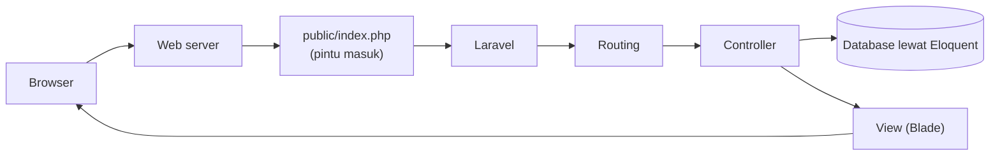

# Mengenal Laravel

Pada bab utama sebelumnya kamu membangun Sistem Manajemen Siswa dengan PHP native: kamu
menulis sendiri pengaturan route, pembacaan form, validasi, *escape* keluaran, dan penyimpanan
data. Hasilnya berjalan, tetapi banyak bagian yang terasa berulang dan harus dijaga sendiri
(termasuk keamanan). **Laravel** hadir untuk mengambil alih sebagian besar pekerjaan berulang itu
agar kamu bisa fokus pada fitur aplikasi.

## Tujuan Pembelajaran

Setelah menyelesaikan sub bab ini, kamu dapat:

- [ ] Menjelaskan apa itu framework dan apa itu Laravel.
- [ ] Menyebutkan fitur utama Laravel dan memetakannya ke pekerjaan yang dulu kamu tulis manual.
- [ ] Menjelaskan dua cara memakai Laravel: *full stack framework* dan *API backend*.
- [ ] Membaca tabel versi dan dukungan Laravel serta menjelaskan versi yang dipakai di materi ini.
- [ ] Memeriksa apakah PHP di komputermu memenuhi syarat Laravel 13.x.
- [ ] Menemukan informasi yang tepat di dokumentasi resmi Laravel.

## Prasyarat

- Bab utama **Dasar Web dan PHP**, terutama [Proyek Sistem Manajemen Siswa](../level-00/proyek-sistem-siswa.md),
  [Class dan Objek](../level-00/00-19-classes-and-objects.md), dan
  [Composer dan Manajemen Paket](../level-00/00-23-composer-and-package-management.md).
- PHP dan Composer terpasang (`php -v` dan `composer -V` berfungsi).
- Browser dan koneksi internet untuk membuka dokumentasi.

Sub bab ini **belum memasang Laravel**; pemasangan dikerjakan pada sub bab *Memasang Laravel*.

## Pengantar

Pikirkan kembali proyek siswa. Untuk satu halaman "Tambah Siswa" kamu mengerjakan:

1. Memetakan alamat URL ke berkas PHP.
2. Membaca dan membersihkan input form.
3. Memvalidasi isian dan menampilkan pesan error.
4. Meng-escape semua keluaran agar aman dari XSS.
5. Menyimpan data (di berkas JSON).
6. Mengalihkan pengguna setelah berhasil.
7. Menyusun tampilan HTML yang konsisten.

Jika aplikasimu memiliki lima puluh halaman, pekerjaan itu dikalikan lima puluh, dan setiap
kali ada yang terlewat (misalnya lupa melindungi form dari CSRF) muncul celah keamanan. Pertanyaan
yang wajar: *adakah cara yang sudah teruji untuk melakukan pekerjaan umum ini?* Jawabannya adalah
framework.

## Penjelasan Konsep

### Apa itu framework?

**Framework** adalah kerangka kerja berisi struktur, aturan, dan kumpulan alat siap pakai
untuk membangun aplikasi. Kamu menulis bagian yang khas untuk aplikasimu; framework
mengerjakan bagian yang umum.

!!! tip "Analogi"
    Membangun aplikasi tanpa framework seperti membangun rumah dengan membuat sendiri batu bata,
    pipa, dan kabel. Memakai framework seperti memakai bahan bangunan standar dan denah
    yang sudah teruji: kamu tetap mendesain rumahmu, tetapi tidak membuat ulang batu bata.

Dua ciri penting framework:

- **Struktur tetap**: ada tempat yang jelas untuk setiap jenis kode (route, controller, tampilan).
- **Alat bawaan**: validasi, akses database, keamanan, pengiriman email, dan lainnya sudah disediakan.

### Apa itu Laravel?

Menurut dokumentasi resminya, **Laravel adalah web application framework dengan sintaks yang
ekspresif dan elegan**. Laravel ditulis dengan PHP, bersifat *open source* (kodenya terbuka di
GitHub), dan dirancang agar pengalaman pengembang menyenangkan sambil tetap menyediakan fitur
yang kuat seperti *dependency injection*, lapisan abstraksi database yang ekspresif, antrean dan
pekerjaan terjadwal, serta pengujian unit dan integrasi.

Laravel memanggil dirinya framework yang **progresif**: ia tumbuh bersamamu. Pemula bisa memulai
dengan fitur dasar, sedangkan pengembang berpengalaman mendapat alat tingkat lanjut.

### Fitur utama dan padanannya di proyek siswa

| Kebutuhan | Cara di proyek siswa (PHP native) | Fitur Laravel | Dibahas pada |
|---|---|---|---|
| Memetakan URL ke kode | Satu berkas PHP per halaman | **Routing** | Bab utama Routing, Controller, dan Request Handling |
| Mengelompokkan logika | Berkas di `public/` | **Controller** | Bab utama yang sama |
| Menampilkan HTML | `views/` dan `include` | **Blade** template | Bab utama Blade Template |
| Memeriksa input | `SiswaValidator` buatan sendiri | **Validation** | Bab utama Form Validation, Authentication, dan Security |
| Melindungi form | Belum ada | **Perlindungan CSRF** bawaan | Bab utama Blade dan Security |
| Menyimpan data | Berkas JSON dan `SiswaRepository` | **Eloquent ORM** dan **migration** | Bab utama Database dan Eloquent ORM |
| Login dan hak akses | Belum ada | **Authentication** dan **authorization** | Bab utama Security |
| Perintah otomatis | Tidak ada | **Artisan** (perintah terminal) | Bab utama ini |
| Pengujian | Manual | **Testing** bawaan (PHPUnit dan Pest) | Bab utama Laravel Testing |
| Pekerjaan latar belakang | Tidak ada | **Queues** dan **scheduler** | Bab utama Advanced Laravel Features |

Tabel ini juga menjadi peta kasar kurikulum: hampir semua baris akan kamu pelajari satu per satu.

### Dua cara memakai Laravel

Dokumentasi resmi menyebut dua pola utama:

| Pola | Artinya | Contoh |
|---|---|---|
| **Full stack framework** | Laravel menerima request dan membuat tampilan (Blade, atau hibrida seperti Inertia) | Sistem informasi akademik dengan halaman web |
| **API backend** | Laravel menyediakan data dan autentikasi untuk aplikasi lain lewat API | Backend untuk aplikasi mobile atau frontend JavaScript terpisah |

Dokumentasi menyebut pola pertama sebagai cara yang paling umum dan produktif, dan itu juga yang
kita mulai lebih dulu. Pola API dipelajari pada bab utama REST API.

### Ekosistem

Di sekitar framework inti ada alat pendukung. Berikut yang disebut dalam dokumentasi resmi (kamu
tidak perlu menguasainya sekarang):

| Alat | Fungsi singkat |
|---|---|
| **Artisan** | Alat baris perintah bawaan untuk membuat kode dan menjalankan tugas |
| **Starter kits** | Kerangka aplikasi siap pakai dengan autentikasi |
| **Laravel Herd** | Lingkungan pengembangan Laravel dan PHP untuk macOS dan Windows |
| **Vite** | Alat untuk mengompilasi CSS dan JavaScript |
| **Laravel Sanctum** | Autentikasi sederhana untuk API, SPA, dan aplikasi mobile |
| **Livewire** dan **Inertia** | Paket komunitas untuk antarmuka interaktif tanpa meninggalkan Laravel |
| **Laravel Cloud** dan **Forge** | Layanan untuk men-*deploy* aplikasi |

### Versi dan dukungan

Laravel dirilis setahun sekali. Setiap rilis mendapat perbaikan bug selama 18 bulan dan perbaikan
keamanan selama 2 tahun. Berikut data dari halaman rilis resmi:

| Versi | PHP yang didukung | Rilis | Perbaikan bug sampai | Perbaikan keamanan sampai |
|---|---|---|---|---|
| 12 | 8.2 - 8.5 | 24 Februari 2025 | 13 Agustus 2026 | 24 Februari 2027 |
| **13** | **8.3 - 8.5** | **17 Maret 2026** | Q3 2027 | 17 Maret 2028 |

Materi ini memakai **Laravel 13.x**, yang membutuhkan **PHP 8.3 atau lebih baru**.

!!! warning "Perhatikan versi dokumentasi"
    Cara menulis sesuatu dapat berubah antar versi. Selalu pastikan halaman dokumentasi yang
    kamu buka bertuliskan **13.x**. Banyak tutorial di internet masih menulis kode untuk versi lama.

### Kelebihan dan batasan

| Kelebihan | Batasan |
|---|---|
| Menghemat pekerjaan berulang dan mengurangi bug umum | Ada kurva belajar: istilah dan konvensi baru |
| Struktur konsisten, mudah dipahami tim | Perlu memahami PHP dan OOP dengan baik |
| Fitur keamanan bawaan | Framework menambah lapisan; aplikasi sangat kecil mungkin terasa berlebihan |
| Dokumentasi dan komunitas besar | Perlu mengikuti perubahan antar versi |

Laravel bukan satu-satunya pilihan; framework PHP lain (misalnya Symfony) atau PHP native juga
dipakai sesuai kebutuhan. Perbandingan dengan PHP native dibahas pada sub bab *Laravel dibanding
PHP Native*.

## Cara Kerja

Gambaran sangat sederhana tentang perjalanan sebuah request di aplikasi Laravel:



Semua request masuk lewat **satu pintu**, `public/index.php`. Dari sana Laravel mencocokkan URL
dengan route, menjalankan controller, mengambil data, lalu mengembalikan tampilan. Diagram ini
disederhanakan; urutan lengkapnya dibahas pada sub bab *Request Lifecycle*.

## Contoh Praktik

Berikut perbandingan satu pekerjaan yang sama. Potongan Laravel di bawah adalah **ilustrasi untuk
dibaca**, belum dijalankan karena Laravel baru dipasang beberapa sub bab ke depan.

**Proyek siswa (PHP native)**, berkas `public/tambah.php`:

```php
$errors = $validator->validasi($data);

if ($errors === []) {
    $repository->simpan(new Siswa(0, $data["nim"], $data["nama"], $data["email"], $data["jurusan"]));
    header("Location: index.php?pesan=tambah");
    exit;
}
```

**Laravel (ilustrasi)**, berkas `app/Http/Controllers/SiswaController.php`:

```php
public function store(Request $request): RedirectResponse
{
    $validated = $request->validate([
        'nim' => ['required', 'digits_between:8,12', 'unique:siswa,nim'],
        'nama' => ['required', 'max:100'],
        'email' => ['required', 'email'],
    ]);

    Siswa::create($validated);

    return redirect()->route('siswa.index')->with('status', 'Siswa berhasil ditambahkan.');
}
```

Dan satu baris pemetaan URL, berkas `routes/web.php`:

```php
Route::post('/siswa', [SiswaController::class, 'store']);
```

### Penjelasan Kode

| Bagian Laravel | Padanan di versi native | Penjelasan |
|---|---|---|
| `$request->validate([...])` | `SiswaValidator::validasi()` | Aturan ditulis sebagai daftar; jika gagal, pengguna otomatis dikembalikan ke form beserta pesan error dan isian lama |
| `'unique:siswa,nim'` | Pemeriksaan NIM unik di validator | Aturan bawaan yang memeriksa database |
| `Siswa::create($validated)` | `SiswaRepository::simpan()` | Eloquent menyimpan ke database tanpa kode berkas JSON |
| `redirect()->route(...)->with(...)` | `header("Location: ...")` dan `exit` | Redirect plus pesan satu kali (*flash message*) |
| `Route::post('/siswa', [...])` | Berkas `tambah.php` terpisah | Satu baris menghubungkan URL ke method controller |

Kode Laravel jauh lebih pendek karena pekerjaan umum disediakan framework. Semua istilah di atas
(controller, Eloquent, validation) akan dijelaskan satu per satu pada bab utama masing-masing; di
sini cukup bandingkan bentuknya.

## Implementasi Langkah demi Langkah

Sub bab ini bersifat orientasi. Langkah-langkah di bawah memastikan lingkunganmu siap dan kamu tahu
cara memakai dokumentasi.

### Langkah 1: periksa lingkungan

Jalankan di terminal (folder mana pun):

```bash
php -v
composer -V
```

### Langkah 2: buka dokumentasi versi yang benar

1. Buka `https://laravel.com/docs/13.x/installation`.
2. Pastikan alamat memuat `13.x`.
3. Baca bagian **Meet Laravel** dan **Why Laravel?**.

### Langkah 3: cari tabel versi

1. Buka `https://laravel.com/docs/13.x/releases`.
2. Temukan tabel versi dan catat kolom PHP serta batas dukungan untuk Laravel 13.

### Langkah 4: petakan fitur ke proyek siswa

Buat catatan sendiri (tabel di berkas teks) dengan tiga kolom: **pekerjaan di proyek siswa**,
**fitur Laravel yang mengerjakannya**, **halaman dokumentasi terkait**. Isi minimal lima baris
dengan bantuan tabel di bagian konsep dan daftar isi dokumentasi.

### Langkah 5: pilih pola pemakaian

Baca bagian **Laravel the Full Stack Framework** dan **Laravel the API Backend** di halaman
instalasi, lalu tuliskan satu kalimat: untuk aplikasi seperti apa kamu ingin memakai masing-masing?

## Eksekusi dan Verifikasi

| Langkah | Cara memverifikasi |
|---|---|
| 1 | `php -v` menampilkan versi PHP **8.3 atau lebih tinggi**; `composer -V` menampilkan `Composer version ...` |
| 2 | Alamat di browser memuat `/docs/13.x/` |
| 3 | Kamu menemukan baris untuk versi 13 dengan rentang PHP `8.3 - 8.5` |
| 4 | Catatanmu memuat minimal lima pasangan pekerjaan dan fitur |
| 5 | Ada satu kalimat tentang rencana pemakaianmu |

Jika `php -v` menunjukkan versi di bawah 8.3, perbarui PHP sesuai sub bab pemasangan PHP sebelum
memasang Laravel.

## Hasil yang Diharapkan

- Kamu dapat menjelaskan dengan kata-katamu sendiri apa itu framework dan Laravel.
- Kamu tahu bahwa kurikulum ini memakai Laravel 13.x dan PHP 8.3+, dan lingkunganmu sudah memenuhi
  syarat PHP.
- Kamu punya tabel catatan "pekerjaan manual ↔ fitur Laravel" yang akan terus kamu lengkapi di sub
  bab berikutnya.

Sub bab ini tidak menjalankan aplikasi Laravel, jadi tidak ada keluaran aplikasi yang diharapkan
selain hasil dua perintah di Langkah 1.

## Kesalahan Umum dan Pemecahan Masalah

| Gejala | Penyebab | Cara mengenali | Solusi | Pencegahan |
|---|---|---|---|---|
| Menganggap Laravel adalah bahasa pemrograman | Istilah framework dan bahasa tertukar | Bingung membedakan "PHP" dan "Laravel" | Ingat: PHP bahasanya, Laravel kerangka yang ditulis dengan PHP | Ulangi bagian konsep |
| Berpikir Laravel menggantikan kebutuhan belajar PHP | Mengira framework menyembunyikan semuanya | Kode Laravel tidak bisa dibaca (class, namespace, closure) | Perkuat dasar PHP dan OOP | Selesaikan bab utama Dasar Web dan PHP dulu |
| Kode dari tutorial tidak berjalan | Tutorial memakai versi Laravel lain | Dokumentasi atau pesan error menyebut versi lain | Cari padanannya di dokumentasi **13.x** | Selalu periksa versi di URL dokumentasi |
| `php -v` menunjukkan versi di bawah 8.3 | PHP terlalu lama | Nomor versi lebih kecil dari 8.3 | Perbarui PHP (lihat sub bab pemasangan PHP) | Periksa syarat sebelum memasang |
| `php` atau `composer` tidak dikenali | Belum terpasang atau `PATH` belum diperbarui | Pesan *command not found* | Pasang, lalu buka ulang terminal | Verifikasi di awal |
| Merasa kewalahan oleh banyak istilah | Terlalu banyak konsep sekaligus | Daftar istilah tidak terhubung | Fokus pada satu fitur per sub bab dan catat di tabel pemetaan | Ikuti urutan kurikulum |

## Latihan Praktik

### Latihan dasar

**D1. Jelaskan Laravel**
- *Masalah:* temanmu bertanya "Laravel itu apa?".
- *Persyaratan:* tulis penjelasan 3-5 kalimat tanpa jargon, memakai satu analogi.
- *Perilaku yang diharapkan:* temanmu yang belum belajar pemrograman mengerti apa gunanya framework.
- *Tujuan belajar:* menjelaskan konsep dengan bahasa sederhana.

**D2. Periksa lingkungan**
- *Masalah:* kamu perlu memastikan komputer siap untuk Laravel 13.
- *Persyaratan:* catat hasil `php -v` dan `composer -V`, lalu nyatakan "memenuhi" atau "belum memenuhi".
- *Perilaku yang diharapkan:* kamu dapat menyebut versi PHP minimum dan membandingkannya.
- *Tujuan belajar:* membaca syarat sistem.

### Latihan implementasi

**I1. Peta fitur**
- *Masalah:* kamu ingin tahu fitur Laravel yang menggantikan kode manual proyek siswa.
- *Persyaratan:* lengkapi tabel catatan dengan **minimal sepuluh baris**, masing-masing dengan tautan ke
  halaman dokumentasi 13.x.
- *Perilaku yang diharapkan:* semua tautan membuka halaman dengan `13.x` pada alamat.
- *Tujuan belajar:* menavigasi dokumentasi resmi.

**I2. Membaca kebijakan dukungan**
- *Masalah:* sebuah perusahaan masih memakai Laravel 12 dan bertanya apakah perlu pindah ke 13.
- *Persyaratan:* berdasarkan tabel rilis, tulis tiga pertimbangan (versi PHP, batas perbaikan bug, batas
  perbaikan keamanan).
- *Perilaku yang diharapkan:* jawabanmu merujuk pada tanggal di tabel resmi, bukan perkiraan.
- *Tujuan belajar:* memahami siklus dukungan versi.

### Latihan tantangan

**T1. Pilih pola untuk tiga aplikasi**
- *Masalah:* tiga proyek: (a) sistem akademik berbasis web, (b) aplikasi mobile pemesanan makanan,
  (c) situs berita dengan halaman web biasa.
- *Persyaratan:* tentukan untuk masing-masing apakah Laravel dipakai sebagai *full stack* atau *API
  backend*, lengkap dengan alasan dan dua fitur Laravel yang paling relevan.
- *Perilaku yang diharapkan:* alasanmu konsisten dengan penjelasan dua pola dalam dokumentasi.
- *Tujuan belajar:* menerapkan konsep pada skenario nyata.
- *Catatan:* kerjakan mandiri; diskusikan dengan rekan atau mentor bila ada.

## Uji Pemahaman

1. Apa yang dimaksud framework, dan mengapa berguna?
2. Apa beda PHP dan Laravel?
3. Sebutkan lima fitur Laravel dan padanan kode manualnya di proyek siswa.
4. Apa beda *full stack framework* dan *API backend*?
5. Versi PHP minimum untuk Laravel 13.x berapa?
6. Berapa lama perbaikan bug dan perbaikan keamanan diberikan untuk setiap rilis Laravel?
7. Mengapa memeriksa versi pada alamat dokumentasi itu penting?
8. Sebutkan satu kelebihan dan satu batasan memakai Laravel.

??? success "Kunci jawaban singkat"
    1. Kerangka kerja berisi struktur dan alat siap pakai; menghemat pekerjaan berulang dan mengurangi
       kesalahan umum.
    2. PHP adalah bahasa; Laravel adalah framework yang ditulis dengan PHP.
    3. Contoh: routing (berkas per halaman), Blade (`views/`), validation (`SiswaValidator`),
       Eloquent (`SiswaRepository`), CSRF (belum ada).
    4. Full stack: Laravel membuat tampilan; API backend: Laravel menyediakan data untuk aplikasi lain.
    5. PHP 8.3.
    6. Bug 18 bulan, keamanan 2 tahun.
    7. Cara penulisan dapat berbeda antar versi.
    8. Kelebihan: hemat pekerjaan; batasan: ada kurva belajar.

## Ringkasan

- Framework menyediakan struktur dan alat siap pakai; Laravel adalah framework PHP untuk aplikasi web.
- Fitur Laravel menggantikan banyak pekerjaan manual: routing, tampilan, validasi, database, keamanan, dan
  lainnya.
- Laravel dapat dipakai sebagai full stack framework atau API backend.
- Materi ini memakai Laravel 13.x dengan PHP 8.3 atau lebih baru.
- Dokumentasi resmi adalah sumber utama; selalu cek versinya.

Selanjutnya: sub bab *Mengapa Menggunakan Laravel?*, yang membahas alasan memilih Laravel secara lebih rinci.

## Referensi Resmi

- [Laravel: Installation (Meet Laravel, Why Laravel?)](https://laravel.com/docs/13.x/installation)
- [Laravel: Release Notes (versi dan dukungan)](https://laravel.com/docs/13.x/releases)
- [Laravel: Starter Kits](https://laravel.com/docs/13.x/starter-kits)
- [Laravel: Directory Structure](https://laravel.com/docs/13.x/structure)
- [Laravel: Artisan Console](https://laravel.com/docs/13.x/artisan)
- [Laravel: Eloquent ORM](https://laravel.com/docs/13.x/eloquent)
- [Laravel: Blade Templates](https://laravel.com/docs/13.x/blade)
- [Laravel: Database Migrations](https://laravel.com/docs/13.x/migrations)
- [Laravel: Testing](https://laravel.com/docs/13.x/testing)
- [Laravel: Queues](https://laravel.com/docs/13.x/queues)
- [Laravel: Authentication](https://laravel.com/docs/13.x/authentication)
- [Kode sumber Laravel di GitHub](https://github.com/laravel/framework)
- Sumber tambahan (non-resmi): [Laracasts](https://laracasts.com), kursus video komunitas yang dirujuk dokumentasi.
