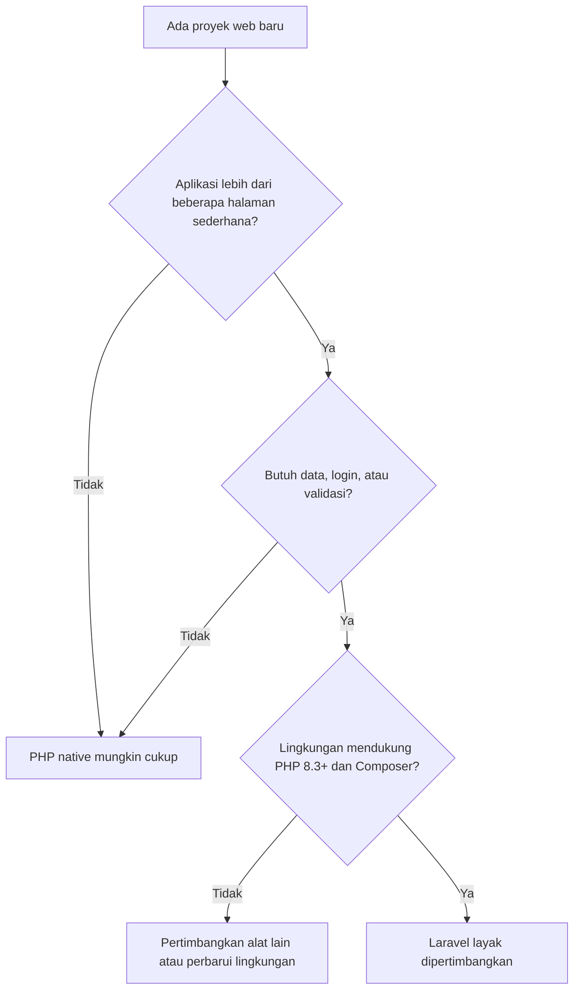

# Mengapa Menggunakan Laravel?

Sub bab sebelumnya menjelaskan *apa* itu Laravel. Sekarang pertanyaannya lebih tajam: *mengapa*
memilih Laravel dibanding menulis semuanya sendiri atau memakai alat lain? Memahami alasannya
membantumu mengambil keputusan yang tepat, termasuk mengenali kapan Laravel **bukan** pilihan
terbaik.

## Tujuan Pembelajaran

Setelah menyelesaikan sub bab ini, kamu dapat:

- [ ] Menjelaskan enam alasan utama memilih Laravel beserta contohnya.
- [ ] Membedakan kode *domain* (khas aplikasi) dari kode *infrastruktur* (pekerjaan umum).
- [ ] Menunjukkan fitur keamanan bawaan Laravel dan padanan risikonya pada proyek PHP native.
- [ ] Menyebutkan biaya dan keterbatasan memakai Laravel.
- [ ] Menggunakan matriks keputusan sederhana untuk menilai kecocokan Laravel pada sebuah proyek.

## Prasyarat

- Sub bab [Mengenal Laravel](01-01-introduction-to-laravel.md).
- Proyek Sistem Manajemen Siswa dari bab utama
  [Dasar Web dan PHP](../level-00/proyek-sistem-siswa.md) tersedia di komputermu
  (folder `belajar-php/sistem-siswa`).

## Pengantar

Memilih teknologi adalah keputusan dengan konsekuensi jangka panjang. Aplikasi yang ditulis
dengan cara tertentu akan dirawat bertahun-tahun, mungkin oleh orang lain. Alasan "karena
populer" tidak cukup. Sub bab ini membahas alasan konkret, dan menguji setiap alasan dengan
pengalamanmu sendiri membangun proyek siswa.

## Penjelasan Konsep

### Kode domain dan kode infrastruktur

Ada dua jenis kode di sebuah aplikasi:

| Jenis | Arti | Contoh pada proyek siswa |
|---|---|---|
| **Domain** | Aturan dan data yang khas bagi aplikasimu | NIM harus 8-12 digit; jurusan yang tersedia; model `Siswa` |
| **Infrastruktur** | Pekerjaan umum yang dibutuhkan hampir semua aplikasi web | Membaca form, escape output, memetakan URL, menyimpan ke berkas, redirect |

!!! tip "Analogi"
    Restoran: resep khas restoranmu adalah *domain*. Listrik, air, dan kompor adalah
    *infrastruktur*. Kamu tidak perlu membangun pembangkit listrik sendiri supaya bisa membuka
    restoran.

Alasan terkuat memilih framework: **sebanyak mungkin waktumu dipakai untuk kode domain**, sedangkan
infrastruktur dikerjakan komponen yang sudah teruji banyak orang.

### Alasan 1: produktivitas dan konvensi

Laravel menetapkan **konvensi**: aturan tidak tertulis yang disepakati, misalnya letak controller
di `app/Http/Controllers` dan nama tabel mengikuti nama model. Dengan konvensi, kamu tidak
perlu mengambil keputusan kecil berulang kali, dan orang lain langsung tahu di mana mencari kode.

Dokumentasi Laravel menyebutnya **framework yang progresif**: pemula tidak kewalahan, dan
pengembang senior mendapat alat seperti *dependency injection*, pengujian unit, antrean, dan
*real-time events*.

- *Manfaat:* fitur umum selesai lebih cepat dan seragam antar proyek.
- *Biaya:* kamu harus mempelajari konvensinya terlebih dahulu.

### Alasan 2: keamanan bawaan

Pada proyek siswa kamu menangani keamanan sendiri dan masih menyisakan celah. Laravel menyediakan
perlindungan standar:

| Risiko | Proyek siswa (PHP native) | Laravel |
|---|---|---|
| **XSS** (skrip jahat tertanam di data) | Harus ingat memakai `e()` di setiap keluaran | Sintaks Blade `{{ }}` otomatis meng-escape dengan `htmlspecialchars` |
| **CSRF** (situs lain memaksa browser mengirim `POST`) | Belum ditangani | Perlindungan CSRF bawaan dengan token (`@csrf`) |
| **SQL injection** | Tidak relevan (belum memakai SQL), tetapi kelak sangat penting | Query builder memakai *PDO parameter binding* |
| **Penyimpanan kata sandi** | Belum ada login | Fasad `Hash` menyediakan hashing Bcrypt dan Argon2 |

Perlindungan bawaan menurunkan kemungkinan lupa. Namun jangan salah kaprah:

!!! warning "Framework bukan jaminan kebal serangan"
    Perlindungan hanya efektif bila dipakai dengan benar. Dokumentasi Laravel sendiri
    memperingatkan bahwa pernyataan SQL mentah atau output yang sengaja tidak di-escape tetap
    berisiko. Memahami cara kerja keamanan tetap tanggung jawabmu.

### Alasan 3: struktur konsisten

Semua proyek Laravel memiliki kerangka yang sama. Anggota tim baru atau pengembang lain dapat
membaca proyek tanpa belajar struktur buatanmu. Pada proyek siswa, strukturnya
(`public/`, `views/`, `src/Repository`) adalah rancanganmu sendiri; Laravel menyediakan struktur
yang sama untuk semua orang.

### Alasan 4: ekosistem yang terintegrasi

Banyak kebutuhan sudah punya komponen resmi yang bekerja bersama: akses database dengan Eloquent,
antrean, email, autentikasi, pengujian, dan lainnya. Karena berasal dari satu ekosistem, mereka
dirancang kompatibel, dan dokumentasinya seragam. Menggabungkan pustaka yang berasal dari
sumber berbeda membutuhkan banyak "lem" yang harus kamu tulis dan rawat sendiri.

### Alasan 5: skalabilitas

Dokumentasi resmi menyebut Laravel mudah di-*scale*: dukungan bawaan untuk sistem cache
terdistribusi yang cepat seperti Redis memungkinkan *horizontal scaling*, dan layanan seperti
Laravel Cloud tersedia untuk beban sangat besar.

Perlu diingat bahwa skalabilitas bergantung pada arsitektur aplikasimu juga, bukan hanya
framework. Pembahasannya ada di bab utama *Performance and Scalability*.

### Alasan 6: pengujian dan pemeliharaan

Laravel dibangun dengan pengujian dalam pikiran: dukungan **Pest** dan **PHPUnit** sudah disertakan
sejak awal. Aplikasi yang bisa diuji otomatis lebih aman untuk diubah. Proyek siswa tidak punya
pengujian otomatis; semua verifikasinya manual.

### Alasan tambahan: dokumentasi, komunitas, dan alat bantu AI

- **Dokumentasi lengkap** untuk setiap versi, dan **komunitas** besar yang berkontribusi di
  GitHub.
- Konvensi yang jelas juga membuat Laravel mudah dipakai bersama alat bantu AI: lokasi file dan
  pola penamaan dapat diprediksi. Dokumentasi resmi menyediakan bagian khusus (AI Assisted
  Development). Alat bantu tidak menggantikan pemahamanmu; kamu tetap harus bisa membaca,
  menguji, dan memperbaiki kode yang dihasilkan.

### Kapan Laravel bukan pilihan terbaik?

| Situasi | Pertimbangan |
|---|---|
| Skrip tunggal atau halaman kecil sekali pakai | Framework terasa berlebihan; PHP native cukup |
| Tim sudah ahli di framework lain dan proyek berjalan baik | Biaya berpindah lebih besar dari manfaat |
| Lingkungan sangat terbatas (hosting tanpa Composer atau PHP versi lama) | Laravel membutuhkan PHP 8.3+ dan alat modern |
| Kebutuhan sangat khusus di luar aplikasi web | Alat lain mungkin lebih cocok |

Framework lain (misalnya Symfony) dan PHP native juga pilihan sah. Tidak ada alat terbaik
untuk semua situasi.

### Biaya yang perlu diperhitungkan

| Biaya | Penjelasan |
|---|---|
| Kurva belajar | Istilah dan konvensi baru |
| Ketergantungan | Aplikasi terikat pada cara kerja framework |
| Pembaruan versi | Rilis tahunan; aplikasi perlu dirawat agar tetap didukung (lihat tabel dukungan di sub bab sebelumnya dan [panduan upgrade](https://laravel.com/docs/13.x/upgrade)) |
| Beban tambahan | Lapisan framework lebih banyak dibanding skrip sederhana |

## Cara Kerja

Proses mengambil keputusan dapat digambarkan sebagai alur sederhana:



Alur ini sengaja ringkas. Dalam praktik, faktor tim, anggaran, dan jadwal juga ikut menentukan.

## Contoh Praktik

Pada praktik ini kamu **mengukur** proyek siswa dan menilainya dengan lensa "domain dan
infrastruktur", lalu memakai matriks keputusan.

### Penjelasan Kode

Tidak ada kode aplikasi baru. Satu perintah terminal dipakai untuk menghitung baris kode:

```bash
find . -name "*.php" -not -path "./vendor/*" | xargs wc -l
```

| Bagian | Arti |
|---|---|
| `find . -name "*.php"` | Mencari semua berkas berakhiran `.php` mulai dari folder saat ini |
| `-not -path "./vendor/*"` | Mengecualikan folder `vendor/` (kode pustaka) |
| `xargs wc -l` | Menghitung jumlah baris tiap berkas dan totalnya |

## Implementasi Langkah demi Langkah

### Langkah 1: ukur proyek siswa

```bash
cd belajar-php/sistem-siswa
find . -name "*.php" -not -path "./vendor/*" | xargs wc -l
```

Catat jumlah baris total dan jumlah berkas.

### Langkah 2: klasifikasikan kode

Untuk setiap berkas berikut, tentukan apakah isinya terutama **domain** atau **infrastruktur**,
dan apa padanannya di Laravel (lihat tabel pemetaan di sub bab sebelumnya):

| Berkas | Domain atau infrastruktur? | Padanan di Laravel |
|---|---|---|
| `src/Model/Siswa.php` | | |
| `src/Validation/SiswaValidator.php` | | |
| `src/Repository/SiswaRepository.php` | | |
| `src/helpers.php` | | |
| `public/tambah.php` | | |
| `views/form.php` | | |
| `config.php` | | |

Panduan penilaian: aturan seperti "NIM 8-12 digit" adalah domain, sedangkan mekanisme membaca berkas
JSON atau meng-escape HTML adalah infrastruktur.

### Langkah 3: audit keamanan

Buat tabel dengan kolom **risiko**, **status di proyek siswa**, dan **fitur Laravel**. Isi minimal
risiko XSS, CSRF, SQL injection, dan penyimpanan kata sandi memakai tabel di bagian konsep, lalu
buka halaman dokumentasi [CSRF Protection](https://laravel.com/docs/13.x/csrf) untuk membaca contoh
serangannya.

### Langkah 4: isi matriks keputusan

Nilai tiga skenario berikut dengan memberi skor 1 (rendah) sampai 5 (tinggi) pada setiap kriteria:

| Kriteria | A. Halaman profil statis satu halaman | B. Sistem akademik (login, data, laporan) | C. API untuk aplikasi mobile |
|---|---|---|---|
| Jumlah fitur | | | |
| Kebutuhan keamanan | | | |
| Kebutuhan pengujian | | | |
| Rencana pemeliharaan jangka panjang | | | |
| **Kecocokan dengan Laravel** (rata-rata) | | | |

### Langkah 5: baca bagian AI di dokumentasi

Buka [AI Assisted Development](https://laravel.com/docs/13.x/ai) dan baca bagian pengantarnya.
Tuliskan satu hal yang kamu setujui dan satu hal yang ingin kamu uji sendiri.

## Eksekusi dan Verifikasi

| Langkah | Cara memverifikasi |
|---|---|
| 1 | Perintah menampilkan daftar berkas `.php` beserta jumlah baris dan baris `total` di akhir |
| 2 | Setiap berkas punya klasifikasi; `Siswa.php` condong ke domain, sedangkan `helpers.php` ke infrastruktur |
| 3 | Tabel memuat setidaknya empat risiko dengan status "belum ditangani" untuk CSRF |
| 4 | Skor skenario B lebih tinggi dari A untuk kecocokan dengan Laravel |
| 5 | Ada dua kalimat catatan |

## Hasil yang Diharapkan

- Jumlah baris proyek siswa berupa angka tertentu yang bergantung kode yang kamu tulis (tidak perlu sama
  dengan orang lain). Hasilnya menunjukkan betapa banyak kode yang kamu tulis untuk fitur sesederhana CRUD.
- Dari klasifikasi, **sebagian besar** berkas ternyata infrastruktur, bukan aturan khas siswa. Itulah porsi
  yang dibantu Laravel.
- Matriks keputusan menunjukkan Laravel lebih sesuai untuk aplikasi dengan banyak fitur dan kebutuhan
  keamanan (B dan C) daripada halaman statis (A).

Tidak ada aplikasi yang dijalankan pada sub bab ini.

## Kesalahan Umum dan Pemecahan Masalah

| Gejala | Penyebab | Cara mengenali | Solusi | Pencegahan |
|---|---|---|---|---|
| Menganggap Laravel selalu paling cepat | Mencampur kecepatan menulis kode dengan kecepatan eksekusi | Klaim performa tanpa pengukuran | Pisahkan: produktivitas pengembang vs performa aplikasi; ukur bila perlu | Gunakan data, bukan asumsi |
| Menganggap framework otomatis aman | Mengabaikan penggunaan yang salah | Memakai SQL mentah atau mematikan escape tanpa pertimbangan | Pelajari batasan tiap perlindungan di dokumentasi | Baca bagian keamanan tiap fitur |
| Memakai Laravel untuk halaman statis sederhana | Alat lebih besar dari kebutuhan | Proyek hanya HTML statis | Pakai solusi lebih ringan | Gunakan matriks keputusan |
| Menolak Laravel karena "terlalu banyak istilah" | Mencoba mempelajari semuanya sekaligus | Daftar istilah menumpuk | Pelajari satu fitur per sub bab | Ikuti urutan kurikulum |
| `xargs: command not found` / `wc` tidak ada | Perintah dijalankan di shell yang tidak mendukung | Pesan *command not found* | Gunakan terminal Bash (Ubuntu), atau hitung baris lewat editor | Gunakan terminal yang sesuai |
| Hasil `find` kosong | Dijalankan di folder yang salah | Tidak ada baris keluaran | `cd` ke folder `sistem-siswa` | Cek folder dengan `pwd` |

## Latihan Praktik

### Latihan dasar

**D1. Enam alasan**
- *Masalah:* temanmu bertanya mengapa sebaiknya belajar Laravel.
- *Persyaratan:* sebutkan tiga alasan dari bagian konsep, masing-masing dengan satu contoh dari proyek siswa.
- *Perilaku yang diharapkan:* alasan dan contoh saling cocok dan tidak bersifat promosi.
- *Tujuan belajar:* menghubungkan konsep dengan pengalaman nyata.

**D2. Domain atau infrastruktur**
- *Masalah:* pisahkan kode yang khas dari yang umum.
- *Persyaratan:* tulis lima contoh domain dan lima contoh infrastruktur dari aplikasi toko online.
- *Perilaku yang diharapkan:* contoh infrastruktur dapat dipakai di aplikasi lain tanpa perubahan berarti.
- *Tujuan belajar:* membedakan dua jenis kode.

### Latihan implementasi

**I1. Audit keamanan lengkap**
- *Masalah:* membuktikan bahwa proyek siswa belum aman untuk produksi.
- *Persyaratan:* daftar minimal enam risiko keamanan (termasuk CSRF, XSS, autentikasi, dan penyimpanan
  data), status tiap risiko pada proyek siswa, dan fitur Laravel yang relevan beserta tautan dokumentasi 13.x.
- *Perilaku yang diharapkan:* setiap klaim status dapat dibuktikan dengan menunjuk kode atau ketiadaan kode.
- *Tujuan belajar:* berpikir kritis tentang keamanan.

**I2. Biaya berpindah**
- *Masalah:* sebuah aplikasi PHP native 5 tahun ingin dipindah ke Laravel.
- *Persyaratan:* tulis tiga manfaat dan tiga risiko/biaya, serta langkah awal yang kamu sarankan.
- *Perilaku yang diharapkan:* pertimbangan realistis, tidak hanya manfaat.
- *Tujuan belajar:* menilai keputusan teknologi secara seimbang.

### Latihan tantangan

**T1. Rekomendasi tertulis**
- *Masalah:* sebuah klinik kecil ingin sistem pendaftaran pasien dan jadwal dokter.
- *Persyaratan:* tulis rekomendasi setengah halaman: apakah Laravel cocok, alasan (minimal tiga), risiko,
  dan alternatif yang dipertimbangkan.
- *Perilaku yang diharapkan:* argumen runtut yang merujuk fitur nyata Laravel dan keterbatasan klinik.
- *Tujuan belajar:* menyusun argumen teknis untuk pemangku kepentingan non-teknis.
- *Catatan:* kerjakan mandiri dan minta rekan menilai apakah argumennya meyakinkan.

## Uji Pemahaman

1. Apa beda kode domain dan kode infrastruktur? Berikan contoh dari proyek siswa.
2. Sebutkan empat risiko keamanan dan fitur Laravel yang mengatasinya.
3. Mengapa sintaks `{{ }}` di Blade lebih aman daripada menulis `echo` di HTML?
4. Mengapa konvensi dianggap menguntungkan tim?
5. Mengapa perlindungan framework tidak menjamin aplikasi kebal serangan?
6. Sebutkan dua situasi ketika Laravel kurang cocok.
7. Apa saja biaya memilih Laravel?
8. Mengapa "dibantu AI" tidak menghapus kebutuhan memahami kode Laravel?

??? success "Kunci jawaban singkat"
    1. Domain: aturan NIM, jurusan, model `Siswa`. Infrastruktur: membaca form, escape, redirect, I/O berkas.
    2. XSS (Blade `{{ }}`), CSRF (token `@csrf`), SQL injection (PDO parameter binding pada query builder),
       kata sandi (fasad `Hash` dengan Bcrypt/Argon2).
    3. `{{ }}` otomatis lewat `htmlspecialchars`, sehingga tidak bergantung pada ingatan pengembang.
    4. Struktur dan lokasi kode dapat diprediksi, jadi pindah proyek dan onboarding lebih cepat.
    5. SQL mentah, mematikan escape, atau salah konfigurasi tetap dapat membuka celah.
    6. Skrip kecil sekali pakai; lingkungan tanpa PHP 8.3+/Composer.
    7. Kurva belajar, ketergantungan, pembaruan versi, beban tambahan.
    8. Kamu tetap bertanggung jawab menguji dan memperbaiki hasilnya.

## Ringkasan

- Alasan utama memilih framework: waktu lebih banyak untuk kode domain karena infrastruktur sudah tersedia.
- Enam alasan: produktivitas dan konvensi, keamanan bawaan, struktur konsisten, ekosistem terintegrasi,
  skalabilitas, dan pengujian.
- Perlindungan bawaan (XSS, CSRF, SQL injection, hashing) membantu, tetapi bukan jaminan.
- Laravel punya biaya: kurva belajar, ketergantungan, pembaruan versi, dan beban tambahan.
- Pilih alat berdasarkan kebutuhan; Laravel kuat untuk aplikasi dengan banyak fitur, bukan untuk skrip
  sekali pakai.

Selanjutnya: *Arsitektur MVC*, yang menjelaskan cara Laravel mengatur kode agar rapi.

## Referensi Resmi

- [Laravel: Installation (Why Laravel?)](https://laravel.com/docs/13.x/installation)
- [Laravel: CSRF Protection](https://laravel.com/docs/13.x/csrf)
- [Laravel: Blade Templates (escaping)](https://laravel.com/docs/13.x/blade)
- [Laravel: Database Query Builder](https://laravel.com/docs/13.x/queries)
- [Laravel: Hashing](https://laravel.com/docs/13.x/hashing)
- [Laravel: Testing](https://laravel.com/docs/13.x/testing)
- [Laravel: AI Assisted Development](https://laravel.com/docs/13.x/ai)
- [Laravel: Upgrade Guide](https://laravel.com/docs/13.x/upgrade)
- [Laravel Cloud](https://cloud.laravel.com)
