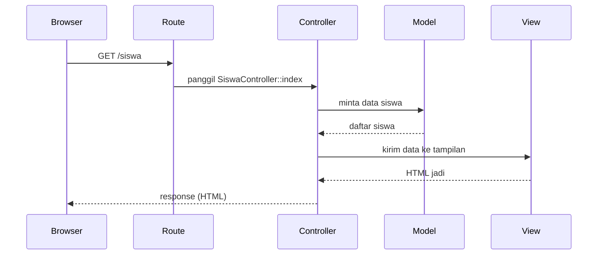
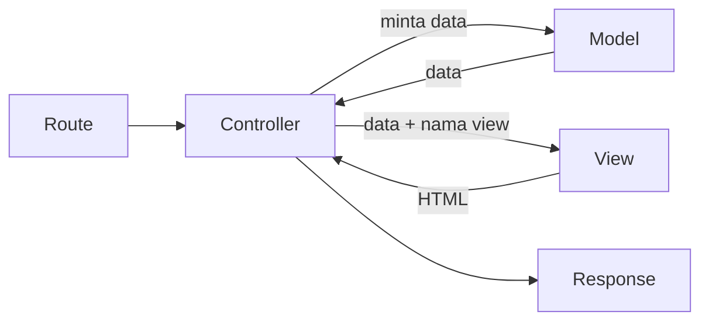

# Arsitektur MVC

Kode Laravel tersebar di beberapa folder dengan peran berbeda: route di satu tempat, controller di
tempat lain, tampilan di tempat lain lagi. Pembagian itu mengikuti pola **MVC** (*Model, View,
Controller*). Memahami MVC membuatmu langsung tahu ke mana kode harus ditulis dan mengapa.

## Tujuan Pembelajaran

Setelah menyelesaikan sub bab ini, kamu dapat:

- [ ] Menjelaskan peran Model, View, dan Controller.
- [ ] Menggambarkan alur sebuah request melalui ketiga komponen itu.
- [ ] Memetakan MVC ke folder dan berkas pada proyek Laravel.
- [ ] Mengklasifikasikan potongan kode ke Model, View, atau Controller.
- [ ] Mengenali pelanggaran MVC yang umum (logika di tampilan, controller yang terlalu gemuk).
- [ ] Membangun contoh MVC mini dengan PHP biasa dan menjalankannya.

## Prasyarat

- Sub bab [Mengapa Menggunakan Laravel?](01-02-why-use-laravel.md).
- Bab utama Dasar Web dan PHP, terutama [Class dan Objek](../level-00/00-19-classes-and-objects.md)
  dan [Proyek Sistem Manajemen Siswa](../level-00/proyek-sistem-siswa.md).
- PHP 8.3 atau lebih baru terpasang; folder `belajar-php`.

## Pengantar

Bayangkan kamu menaruh query data, aturan bisnis, dan HTML dalam satu berkas panjang. Awalnya
cepat, tetapi sulit dibaca, sulit diuji, dan perubahan kecil di satu bagian merusak bagian lain.
Programmer menyebutnya *spaghetti code*.

Solusi klasik: **pisahkan tanggung jawab**. MVC membagi aplikasi menjadi tiga peran. Pada proyek
siswa kamu sudah melakukan versi sederhananya: `src/` untuk data, `views/` untuk tampilan, dan
`public/` untuk pengendali. MVC memberi nama dan aturan yang baku untuk pembagian itu.

## Penjelasan Konsep

### Tiga komponen

| Komponen | Tanggung jawab | Yang **tidak** boleh dilakukan |
|---|---|---|
| **Model** | Data dan aturan yang melekat pada data (mengambil, menyimpan, menghitung) | Membuat HTML |
| **View** | Tampilan: mengubah data menjadi HTML untuk pengguna | Mengambil data dari database atau memutuskan aturan bisnis |
| **Controller** | Perantara: menerima request, meminta data ke Model, memilih View untuk ditampilkan | Berisi logika data yang rumit atau HTML |

!!! tip "Analogi"
    Restoran. **Model** adalah dapur dan gudang bahan (data dan cara mengolahnya). **View**
    adalah piring yang disajikan (tampilan). **Controller** adalah pelayan: menerima pesanan,
    meneruskan ke dapur, lalu mengantarkan hasilnya ke meja yang benar. Pelayan tidak memasak,
    dapur tidak melayani tamu.

### Alur sebuah request



Urutannya selalu sama: request datang, **route** menentukan controller mana, controller meminta data
ke model, lalu menyerahkannya ke view, dan hasilnya dikirim ke browser.

### MVC di Laravel

| Komponen | Lokasi di proyek Laravel | Contoh |
|---|---|---|
| Route | `routes/web.php` | `Route::get('/siswa', [SiswaController::class, 'index']);` |
| **Controller** | `app/Http/Controllers/` | `SiswaController.php` |
| **Model** | `app/Models/` | `Siswa.php` (Eloquent) |
| **View** | `resources/views/` | `siswa/index.blade.php` |

Dokumentasi struktur direktori menyebut bahwa folder `app` secara bawaan berisi `Http`, `Models`,
dan `Providers`, sedangkan `resources` berisi view, dan `routes` berisi definisi route. Folder-folder
ini bisa dibuat otomatis dengan perintah Artisan `make:` (dibahas di sub bab Artisan).

### Padanan pada proyek siswa

| MVC | Di proyek siswa (PHP native) | Di Laravel |
|---|---|---|
| Model | `Siswa`, `SiswaRepository`, `SiswaValidator` | Model Eloquent `Siswa`, aturan validasi |
| View | Berkas di `views/` | Template Blade di `resources/views/` |
| Controller | Berkas di `public/` (`tambah.php`, dan lainnya) | Class di `app/Http/Controllers/` |
| Route | Nama berkas itu sendiri | `routes/web.php` |

Pada proyek siswa, URL ditentukan oleh nama berkas. Di Laravel, route dipisahkan secara eksplisit
sehingga URL tidak terikat pada nama berkas atau folder.

### Contoh ilustrasi di Laravel

Berikut gambaran MVC dalam Laravel. **Ini ilustrasi untuk dibaca**, belum dijalankan; Laravel baru
dipasang beberapa sub bab lagi.

File: `routes/web.php`

```php-inline
use App\Http\Controllers\SiswaController;

Route::get('/siswa', [SiswaController::class, 'index']);
```

File: `app/Http/Controllers/SiswaController.php`

```php-inline
public function index(): View
{
    $daftar = Siswa::orderBy('nama')->get();

    return view('siswa.index', ['daftar' => $daftar]);
}
```

File: `resources/views/siswa/index.blade.php`

```html
<ul>
    @foreach ($daftar as $siswa)
        <li>{{ $siswa->nama }}</li>
    @endforeach
</ul>
```

| Bagian | Peran MVC |
|---|---|
| `Route::get(...)` | Memetakan URL ke controller |
| `Siswa::orderBy('nama')->get()` | Controller meminta data ke **Model** `Siswa` |
| `view('siswa.index', [...])` | Controller memilih **View** dan mengirim data |
| `@foreach ... {{ $siswa->nama }}` | **View** hanya menampilkan |

### Keuntungan dan keterbatasan

| Keuntungan | Keterbatasan |
|---|---|
| Kode terorganisasi; mudah mencari lokasi | Aplikasi sederhana terasa memiliki banyak berkas |
| Bagian bisa diubah atau diuji terpisah | Garis antara model dan controller kadang kabur |
| Beberapa orang bisa bekerja paralel (desainer di view, programmer di model) | Aplikasi besar sering membutuhkan lapisan tambahan (mis. service/action) |
| Konsisten antar proyek | Perlu disiplin agar tidak menaruh logika di tempat yang salah |

Laravel tidak memaksa MVC secara ketat; ia menyediakan struktur MVC sebagai titik awal. Pada aplikasi
besar kamu akan menambah lapisan lain (dibahas di bab utama *Advanced Laravel Features*).

### Pelanggaran MVC yang umum

| Pelanggaran | Mengapa buruk | Perbaikan |
|---|---|---|
| Query database langsung di view | View sulit diganti dan diuji | Ambil data di controller/model, kirim hasil ke view |
| Controller berisi puluhan baris logika bisnis (*fat controller*) | Sulit dibaca dan dipakai ulang | Pindahkan logika ke model atau class pendukung |
| Model menghasilkan HTML | Mencampur data dan tampilan | Biarkan view yang membuat HTML |
| View memutuskan aturan bisnis | Aturan tersebar dan tidak konsisten | Taruh aturan di model |

## Cara Kerja

Pembagian tugas di dalam satu request:



Panah antar komponen menunjukkan ketergantungan: controller mengetahui model dan view, tetapi model
tidak perlu tahu tentang view, dan view tidak perlu tahu dari mana data datang.

## Contoh Praktik

Kamu membangun **MVC mini dengan PHP biasa** dalam satu berkas, tanpa Laravel. Tujuannya melihat
peran tiga komponen dalam kode yang bisa dijalankan.

### Penjelasan Kode

| Class | Peran | Tanggung jawab |
|---|---|---|
| `Produk` | Data | Menyimpan nama dan harga satu produk |
| `ProdukModel` | Model | Menyediakan daftar produk |
| `ProdukView` | View | Menyusun teks daftar produk |
| `ProdukController` | Controller | Mengambil produk dari model, mengurutkan sesuai permintaan, menyerahkan ke view |

Perhatikan bahwa hanya `ProdukView` yang menyusun teks hasil, hanya `ProdukModel` yang mengetahui
asal data, dan `ProdukController` hanya menyambungkan keduanya.

## Implementasi Langkah demi Langkah

### Langkah 1: buat berkas

Buat berkas `mvc-mini.php` di folder `belajar-php`:

```php title="belajar-php/mvc-mini.php"
<?php

class Produk
{
    public function __construct(
        public string $nama,
        public int $harga,
    ) {}
}

class ProdukModel
{
    /**
     * @return Produk[]
     */
    public function semua(): array
    {
        return [
            new Produk("Pena", 5000),
            new Produk("Buku", 15000),
            new Produk("Penggaris", 3000),
        ];
    }
}

class ProdukView
{
    /**
     * @param Produk[] $daftar
     */
    public function daftar(array $daftar): string
    {
        $baris = array_map(
            fn (Produk $p) => "- {$p->nama}: Rp " . number_format($p->harga, 0, ",", "."),
            $daftar
        );

        return "Daftar Produk\n" . implode("\n", $baris) . "\n";
    }
}

class ProdukController
{
    public function __construct(
        private ProdukModel $model,
        private ProdukView $view,
    ) {}

    public function index(string $urut = "nama"): string
    {
        $produk = $this->model->semua();

        usort($produk, fn (Produk $a, Produk $b) => $urut === "harga"
            ? $a->harga <=> $b->harga
            : strcmp($a->nama, $b->nama));

        return $this->view->daftar($produk);
    }
}

$controller = new ProdukController(new ProdukModel(), new ProdukView());

echo $controller->index();
echo "\n";
echo $controller->index("harga");
```

### Langkah 2: jalankan

```bash
cd belajar-php
php mvc-mini.php
```

### Langkah 3: ubah satu bagian saja

Latihan ini membuktikan manfaat pemisahan:

1. Ubah **hanya** `ProdukView` agar setiap baris berformat `1. Pena (Rp 5.000)` (pakai nomor urut).
   Controller dan model tidak boleh disentuh.
2. Ubah **hanya** `ProdukModel` agar memuat produk keempat. Controller dan view tidak boleh disentuh.

## Eksekusi dan Verifikasi

Setelah Langkah 2, periksa keluaran. Bandingkan dengan hasil yang diharapkan di bawah.

Untuk Langkah 3: jalankan lagi dan pastikan perubahan tampak tanpa menyentuh dua class lain.

## Hasil yang Diharapkan

Keluaran Langkah 2:

```text
Daftar Produk
- Buku: Rp 15.000
- Pena: Rp 5.000
- Penggaris: Rp 3.000

Daftar Produk
- Penggaris: Rp 3.000
- Pena: Rp 5.000
- Buku: Rp 15.000
```

Blok pertama diurutkan menurut nama (abjad), blok kedua menurut harga naik. Keluaran ini diturunkan dari
kode di atas dan belum dijalankan oleh penulis materi; cocokkan dengan hasilmu.

Untuk Langkah 3, ubah satu class tidak memengaruhi dua lainnya, dan itulah inti pemisahan tanggung
jawab pada MVC.

## Kesalahan Umum dan Pemecahan Masalah

| Gejala | Penyebab | Cara mengenali | Solusi | Pencegahan |
|---|---|---|---|---|
| `Class "Produk" not found` | Class belum didefinisikan sebelum dipakai atau salah ketik | Pesan error menyebut nama class | Definisikan semua class sebelum pemanggilan di bawah | Urutkan definisi di atas penggunaan |
| `Too few arguments to function ProdukController::__construct()` | `new ProdukController()` tanpa model dan view | Pesan menyebut jumlah argumen | Berikan `new ProdukModel()` dan `new ProdukView()` | Perhatikan parameter constructor |
| Urutan tidak seperti yang diharapkan | Argumen `$urut` salah ketik | `index("harga")` vs `index("Harga")` | Samakan ejaan | Gunakan daftar nilai yang jelas |
| Logika masuk ke tempat yang salah | Tidak jelas tanggung jawab tiap bagian | HTML ada di controller, atau query di view | Tanyakan: "ini data, tampilan, atau perantara?" | Pakai tabel tanggung jawab sebagai pegangan |
| Controller membengkak | Semua pekerjaan ditaruh di controller | Method controller puluhan baris | Pindahkan logika data ke model/class pendukung | Jaga controller tetap tipis |

## Latihan Praktik

### Latihan dasar

**D1. Klasifikasi**
- *Masalah:* tentukan komponen MVC untuk setiap item.
- *Persyaratan:* klasifikasikan: (a) kelas yang menyimpan data pelanggan, (b) berkas yang berisi tag `<table>`,
  (c) method yang membaca `$_POST` dan memilih halaman berikutnya, (d) aturan "harga tidak boleh negatif",
  (e) berkas `routes/web.php`.
- *Perilaku yang diharapkan:* jawaban disertai alasan satu kalimat.
- *Tujuan belajar:* membedakan peran Model, View, dan Controller.

**D2. Lokasi di Laravel**
- *Masalah:* tentukan folder untuk setiap berkas Laravel.
- *Persyaratan:* tulis jalur yang tepat untuk model `Produk`, controller `ProdukController`, view daftar produk,
  dan route daftar produk.
- *Perilaku yang diharapkan:* jalur sesuai tabel "MVC di Laravel".
- *Tujuan belajar:* menghafal lokasi dasar proyek Laravel.

### Latihan implementasi

**I1. Menambah fitur pencarian pada MVC mini**
- *Masalah:* pengguna ingin mencari produk dari nama.
- *Persyaratan:* tambahkan method `cari(string $kata): array` pada `ProdukModel` dan parameter `$kata` pada
  `ProdukController::index()`. View tidak berubah.
- *Perilaku yang diharapkan:* `index("nama", "pe")` hanya menampilkan produk yang namanya mengandung "pe"
  (tanpa membedakan huruf besar-kecil).
- *Tujuan belajar:* menempatkan logika pencarian di model.

**I2. Memisahkan proyek siswa**
- *Masalah:* tentukan bagian proyek siswa yang cocok sebagai Model, View, dan Controller.
- *Persyaratan:* buat tabel yang memetakan setiap berkas proyek siswa ke Model, View, Controller, atau
  Route.
- *Perilaku yang diharapkan:* setiap berkas hanya punya satu peran utama; sebutkan bagian yang mencampur dua peran.
- *Tujuan belajar:* menganalisis kode nyata menurut MVC.

### Latihan tantangan

**T1. Perbaiki kode spaghetti**
- *Masalah:* berikut potongan satu berkas yang mencampur semuanya:

  ```php
  <?php
  $produk = [["Pena", 5000], ["Buku", 15000]];
  echo "<h1>Produk</h1>";
  foreach ($produk as $p) {
      if ($p[1] > 10000) {
          echo "<p style='color:red'>" . $p[0] . " mahal</p>";
      } else {
          echo "<p>" . $p[0] . "</p>";
      }
  }
  ```
- *Persyaratan:* pecah menjadi Model (data dan aturan "mahal"), View (HTML), dan Controller (penghubung).
  Pastikan nama produk di-escape saat dicetak.
- *Perilaku yang diharapkan:* keluaran HTML sama dengan versi awal, tetapi aturan "mahal" ada di model dan
  HTML hanya di view.
- *Tujuan belajar:* refactoring ke MVC dan menjaga keamanan keluaran.
- *Catatan:* kerjakan mandiri; solusi tidak disediakan.

## Uji Pemahaman

1. Apa kepanjangan MVC dan apa tanggung jawab tiap komponen?
2. Mengapa view tidak boleh mengambil data langsung dari database?
3. Apa tugas route dalam alur request di Laravel?
4. Di folder mana Model, View, dan Controller berada di proyek Laravel?
5. Apa itu *fat controller* dan bagaimana menghindarinya?
6. Mengapa MVC memudahkan kerja tim?
7. Apa keterbatasan MVC pada aplikasi besar?
8. Pada proyek siswa, bagian mana yang berperan sebagai controller?

??? success "Kunci jawaban singkat"
    1. Model-View-Controller: data, tampilan, perantara.
    2. Mencampur tampilan dengan pengambilan data membuat view sulit diganti dan diuji.
    3. Memetakan URL dan metode HTTP ke controller.
    4. `app/Models/`, `resources/views/`, `app/Http/Controllers/`.
    5. Controller yang berisi banyak logika bisnis; pindahkan logika ke model atau class pendukung.
    6. Tiap bagian bisa dikerjakan dan diuji terpisah.
    7. Butuh lapisan tambahan (service/action) agar tidak menumpuk di model atau controller.
    8. Berkas di `public/` (misalnya `tambah.php`, `ubah.php`).

## Ringkasan

- MVC membagi aplikasi menjadi Model (data), View (tampilan), dan Controller (perantara).
- Request mengalir: route → controller → model → controller → view → response.
- Laravel menaruh Model di `app/Models`, Controller di `app/Http/Controllers`, View di `resources/views`,
  dan route di `routes/web.php`.
- Pelanggaran umum: query di view, controller yang gemuk, HTML di model.
- Laravel menyediakan MVC sebagai titik awal; aplikasi besar menambah lapisan lain.

Selanjutnya: *Laravel dibanding PHP Native*, perbandingan langsung antara kedua pendekatan.

## Referensi Resmi

- [Laravel: Directory Structure](https://laravel.com/docs/13.x/structure)
- [Laravel: Routing](https://laravel.com/docs/13.x/routing)
- [Laravel: Controllers](https://laravel.com/docs/13.x/controllers)
- [Laravel: Views](https://laravel.com/docs/13.x/views)
- [Laravel: Eloquent ORM](https://laravel.com/docs/13.x/eloquent)
- [PHP Manual: Classes and Objects](https://www.php.net/manual/en/language.oop5.php)
