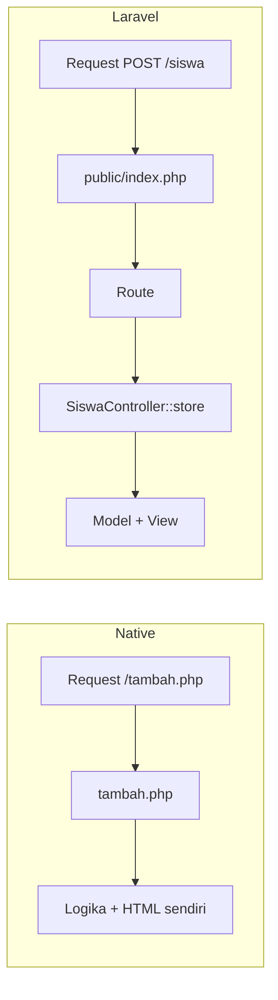

# Laravel dibanding PHP Native

Kamu sudah merasakan membangun aplikasi dengan PHP native dan mengetahui apa yang ditawarkan
Laravel. Sekarang saatnya membandingkan keduanya **secara langsung**, memakai satu aplikasi yang
sama: CRUD siswa. Tujuannya bukan memenangkan salah satu pihak, tetapi memahami apa yang
bertambah, apa yang berkurang, dan apa yang berubah ketika kamu berpindah ke Laravel.

## Tujuan Pembelajaran

Setelah menyelesaikan sub bab ini, kamu dapat:

- [ ] Membandingkan PHP native dan Laravel pada aspek routing, validasi, penyimpanan, struktur, konfigurasi, dan pengujian.
- [ ] Memetakan endpoint proyek siswa ke *resource route* Laravel.
- [ ] Mengenali kode berulang pada proyek siswa dan cara Laravel mengurangi pengulangannya.
- [ ] Menyebutkan hal yang bertambah rumit saat memakai Laravel.
- [ ] Menyusun rencana migrasi proyek PHP native ke Laravel secara bertahap.

## Prasyarat

- Sub bab [Arsitektur MVC](01-03-mvc-architecture.md) dan [Mengapa Menggunakan Laravel?](01-02-why-use-laravel.md).
- Proyek [Sistem Manajemen Siswa](../level-00/proyek-sistem-siswa.md) dari bab utama pertama, lengkap dengan
  folder `belajar-php/sistem-siswa`.
- PHP 8.3 atau lebih baru dan `curl` tersedia di terminal.

## Pengantar

Banyak pemula bertanya, "Kalau PHP native sudah bisa membuat aplikasi, mengapa belajar Laravel?"
Pertanyaan sebaliknya sama pentingnya: "Kalau Laravel serba ada, apakah belajar PHP native sia-sia?"
Jawabannya: keduanya berhubungan. Laravel ditulis dengan PHP, jadi semua yang kamu pelajari di bab
utama pertama adalah fondasi Laravel. Perbandingan ini membantu menempatkan Laravel dengan tepat.

## Penjelasan Konsep

### Perbandingan menurut aspek

| Aspek | PHP native (proyek siswa) | Laravel |
|---|---|---|
| **Routing** | URL ditentukan nama berkas (`tambah.php`) | Route didefinisikan eksplisit di `routes/web.php` |
| **Struktur proyek** | Rancangan sendiri | Struktur standar yang sama untuk semua proyek |
| **Tampilan** | Berkas PHP dengan `include`, escape manual dengan `e()` | Template Blade; `{{ }}` meng-escape otomatis |
| **Validasi** | Class `SiswaValidator` buatan sendiri | Aturan bawaan: `required`, `email`, `unique`, dan lainnya |
| **Penyimpanan** | Berkas JSON lewat `SiswaRepository` | Eloquent ORM dan database; skema dikelola migration |
| **Konfigurasi** | `config.php` tunggal | Folder `config/` dan berkas `.env` per lingkungan |
| **Keamanan** | Tanggung jawab penuh pengembang | Perlindungan bawaan (CSRF, escape, query terparameter) |
| **Pengujian** | Manual lewat browser dan `curl` | Dukungan Pest dan PHPUnit sejak awal |
| **Pekerjaan latar belakang** | Tidak tersedia | Queue dan scheduler |
| **Dependensi** | Composer | Composer (Laravel sendiri adalah paket Composer) |
| **Kebutuhan lingkungan** | PHP saja | PHP 8.3+ dan Composer |
| **Kurva belajar** | Rendah di awal | Lebih tinggi di awal, lebih ringan saat aplikasi membesar |

!!! tip "Analogi"
    PHP native seperti mengemudi mobil manual tanpa banyak fitur bantu: kamu mengendalikan semuanya
    dan tahu persis apa yang terjadi, tetapi harus mengurus semuanya sendiri. Laravel seperti mobil
    dengan fitur bantu lengkap: perjalanan jauh lebih nyaman, tetapi kamu perlu belajar membaca panel
    dan memahami fiturnya.

### Satu fitur, dua pendekatan: CRUD siswa

Proyek siswa memiliki enam kombinasi URL dan metode:

| # | Aksi | URL dan metode di proyek siswa | Berkas |
|---|---|---|---|
| 1 | Daftar | `GET /index.php` | `public/index.php` |
| 2 | Form tambah | `GET /tambah.php` | `public/tambah.php` |
| 3 | Simpan baru | `POST /tambah.php` | `public/tambah.php` |
| 4 | Form ubah | `GET /ubah.php?id=1` | `public/ubah.php` |
| 5 | Simpan perubahan | `POST /ubah.php?id=1` | `public/ubah.php` |
| 6 | Hapus | `POST /hapus.php` | `public/hapus.php` |

Laravel menyediakan **resource controller**. Sebuah `Route::resource` menghasilkan seluruh route CRUD
sekaligus. Dokumentasi resmi (contoh `photos`) memberi tabel berikut yang kita sesuaikan untuk `siswa`:

| Verb | URI | Action | Nama route | Padanan di proyek siswa |
|---|---|---|---|---|
| GET | `/siswa` | index | siswa.index | #1 daftar |
| GET | `/siswa/create` | create | siswa.create | #2 form tambah |
| POST | `/siswa` | store | siswa.store | #3 simpan baru |
| GET | `/siswa/{siswa}` | show | siswa.show | (belum ada) detail |
| GET | `/siswa/{siswa}/edit` | edit | siswa.edit | #4 form ubah |
| PUT/PATCH | `/siswa/{siswa}` | update | siswa.update | #5 simpan perubahan |
| DELETE | `/siswa/{siswa}` | destroy | siswa.destroy | #6 hapus |

Dalam Laravel, seluruh tabel itu didaftarkan dengan **satu baris** (ilustrasi, belum dijalankan; dibahas
di bab utama *Routing, Controller, and Request Handling*).

File: `routes/web.php`

```php-inline
use App\Http\Controllers\SiswaController;

Route::resource('siswa', SiswaController::class);
```

Perhatikan beberapa perbedaan konsep:

- URL **bersih** dan konsisten (`/siswa/1/edit`), tidak berakhiran `.php`.
- Metode HTTP bermakna: `PUT/PATCH` untuk ubah dan `DELETE` untuk hapus (form HTML memakai trik
  *method spoofing* yang dibahas nanti).
- Parameter `{siswa}` dapat dikaitkan langsung dengan model (*route model binding*). Dokumentasi menyebut
  bahwa bila model tidak ditemukan, respons **404 dibuat otomatis**. Pada proyek siswa kamu menulis
  pemeriksaan `$siswa === null` dan `http_response_code(404)` sendiri.

### Kode berulang pada proyek siswa

Baca kembali `tambah.php` dan `ubah.php` pada proyek siswa. Keduanya mengandung blok yang sangat
mirip:

| Bagian berulang | Ada di | Cara Laravel mengurangi pengulangan |
|---|---|---|
| Memuat `autoload` dan `config`, membuat repository dan validator | semua halaman | *Service container* dan *dependency injection* menyiapkan objek otomatis |
| Menyalin isian `$_POST` satu per satu ke `$data` | `tambah.php`, `ubah.php` | Objek `Request` dan hasil `validate()` |
| Pola "jika POST, validasi, simpan, redirect" | `tambah.php`, `ubah.php` | Method controller `store` dan `update` yang terpisah |
| Form HTML yang sama | `views/form.php` (sudah dipakai bersama) | Komponen/template Blade |
| Header dan footer | `views/layout/` (sudah dipakai bersama) | Layout Blade |

### Hal yang bertambah rumit di Laravel

Perbandingan yang jujur perlu menyebut sisi lain:

| Yang bertambah | Penjelasan |
|---|---|
| Jumlah konsep | Service container, facade, middleware, migration, dan lainnya |
| "Magic" | Banyak yang terjadi otomatis, sehingga sulit dilacak bila belum paham |
| Berkas dan folder | Satu fitur tersebar di beberapa berkas (route, controller, model, view, migration) |
| Ketergantungan versi | Aplikasi terikat pada rilis framework dan perlu pembaruan berkala |
| Persyaratan lingkungan | Butuh PHP 8.3+ dan Composer |
| Beban runtime | Lebih banyak kode dimuat per request dibanding skrip sederhana; pada aplikasi kecil tidak terasa, dan perlu diukur bila performa penting |

### Kapan PHP native masih masuk akal

- Skrip kecil sekali pakai atau halaman sederhana yang tidak akan berkembang.
- Alat internal pendek atau eksperimen belajar (seperti proyek siswa).
- Lingkungan yang tidak mendukung PHP 8.3 atau Composer.

### Hubungan keduanya

Laravel **bukan pengganti** PHP: ia adalah PHP dengan struktur dan alat tambahan. Class, namespace,
autoloading, Composer, exception, dan form handling yang kamu pelajari tetap kamu pakai setiap hari
di Laravel.

## Cara Kerja

Perubahan cara berpikir dari berkas ke route:



Pada PHP native, **nama berkas** menentukan apa yang dijalankan. Pada Laravel, **semua request
masuk lewat satu pintu** (`public/index.php`), lalu route yang menentukan kode mana yang dijalankan.

## Contoh Praktik

Kamu menguji perilaku proyek siswa lewat HTTP (seperti yang akan dilakukan pada aplikasi Laravel),
mencatat hasilnya, lalu membandingkannya dengan tabel resource route.

### Penjelasan Kode

Tidak ada kode aplikasi baru. Kamu memakai server pengembangan PHP dan `curl`:

| Perintah | Fungsi |
|---|---|
| `php -S localhost:8000 -t public` | Menjalankan proyek siswa dengan `public/` sebagai document root |
| `curl -i URL` | Meminta URL dan menampilkan baris status serta header |
| `curl -i -d "data" URL` | Mengirim `POST` dengan data form |

## Implementasi Langkah demi Langkah

### Langkah 1: jalankan proyek siswa

```bash
cd belajar-php/sistem-siswa
composer dump-autoload
php -S localhost:8000 -t public
```

Biarkan terminal ini terbuka.

### Langkah 2: uji endpoint dan catat statusnya

Di terminal lain (di Windows PowerShell tulis `curl.exe`):

```bash
curl -i http://localhost:8000/index.php
curl -i http://localhost:8000/tambah.php
curl -i -d "nim=20240001&nama=Budi&email=budi@contoh.id&jurusan=informatika" http://localhost:8000/tambah.php
curl -i "http://localhost:8000/ubah.php?id=9999"
curl -i http://localhost:8000/hapus.php
```

Salin hasilnya ke tabel catatan dengan kolom **permintaan**, **kode status**, **header penting**.

### Langkah 3: petakan ke resource route

Untuk setiap baris tabel catatanmu, tulis nama route Laravel yang sepadan (lihat tabel resource
route). Contoh: `GET /index.php` setara `GET /siswa` (`siswa.index`).

### Langkah 4: tandai kode berulang

Buka `public/tambah.php` dan `public/ubah.php` berdampingan. Beri warna atau tanda pada blok yang
hampir identik, dan tuliskan fitur Laravel yang akan menghilangkan pengulangan itu (lihat tabel
"Kode berulang").

### Langkah 5: susun rencana migrasi

Urutkan langkah memindahkan proyek siswa ke Laravel. Gunakan urutan kurikulum sebagai pegangan:

1. Membuat proyek Laravel dan memastikan berjalan.
2. Memindahkan routing menjadi route resource.
3. Memindahkan tampilan menjadi template Blade.
4. Memindahkan penyimpanan dari JSON ke database dengan migration dan Eloquent.
5. Mengganti validator buatan sendiri dengan aturan validasi bawaan.
6. Menambahkan login dan pengujian otomatis.

Tuliskan satu risiko untuk setiap langkah.

## Eksekusi dan Verifikasi

| Langkah | Cara memverifikasi |
|---|---|
| 1 | Server berjalan tanpa error; terminal menampilkan catatan request saat kamu menguji |
| 2 | Kelima perintah `curl` menghasilkan baris status; hasil dicatat |
| 3 | Setiap permintaan punya padanan nama route |
| 4 | Minimal tiga blok berulang teridentifikasi |
| 5 | Rencana migrasi memuat enam langkah dan risiko tiap langkah |

## Hasil yang Diharapkan

Dari Langkah 2, perkiraan hasil (diturunkan dari kode proyek siswa; cocokkan dengan hasilmu):

| Permintaan | Hasil yang diharapkan |
|---|---|
| `GET /index.php` | Status `200` dengan halaman daftar |
| `GET /tambah.php` | Status `200` dengan form kosong |
| `POST /tambah.php` (data valid) | Status berkelas `3xx` (umumnya `302`) dengan header `Location: index.php?pesan=tambah` |
| `GET /ubah.php?id=9999` | Status `404` dan teks `Siswa tidak ditemukan.` |
| `GET /hapus.php` | Status `405` dengan header `Allow: POST` |

Dari analisis, kamu seharusnya menyimpulkan bahwa Laravel menyediakan versi rapi dari pola yang
sudah kamu tulis sendiri (URL bersih, metode bermakna, 404 otomatis, kode berulang berkurang),
bukan sesuatu yang sama sekali asing.

## Kesalahan Umum dan Pemecahan Masalah

| Gejala | Penyebab | Cara mengenali | Solusi | Pencegahan |
|---|---|---|---|---|
| `Failed to open stream: vendor/autoload.php` | `composer dump-autoload` belum dijalankan | Folder `vendor/` tidak ada | Jalankan `composer dump-autoload` di `sistem-siswa` | Ikuti Langkah 1 berurutan |
| `404` pada semua URL | Server dijalankan tanpa `-t public` atau dari folder salah | Terminal menyebut document root yang berbeda | Jalankan dari `sistem-siswa` dengan `-t public` | Periksa folder dengan `pwd` |
| `curl` di PowerShell menampilkan format aneh | `curl` adalah alias cmdlet lain | Output berupa objek, bukan header | Tulis `curl.exe` | Gunakan `curl.exe` di Windows |
| Menyimpulkan "Laravel pasti lebih baik" | Membandingkan tanpa melihat biaya | Tabel hanya memuat keunggulan | Tambahkan kolom biaya dan keterbatasan | Gunakan bagian "Hal yang bertambah rumit" |
| Menyimpulkan "native cukup selamanya" | Mengabaikan pertumbuhan aplikasi | Menolak membandingkan fitur skala besar | Bayangkan 50 halaman dan 5 pengembang | Uji skenario skala |
| Bingung dengan nama route | Menyamakan nama route dengan URL | Mengira `siswa.index` adalah URL | Ingat: nama route adalah label; URL-nya `/siswa` | Lihat tabel resource route |

## Latihan Praktik

### Latihan dasar

**D1. Padankan istilah**
- *Masalah:* hubungkan konsep native dengan padanannya di Laravel.
- *Persyaratan:* buat tabel 8 baris: (misalnya) `tambah.php` → ?, `views/` → ?, `SiswaValidator` → ?,
  `config.php` → ?, `e()` → ?, `SiswaRepository` → ?, `hapus.php` → ?, `public/` → ?.
- *Perilaku yang diharapkan:* setiap baris punya padanan yang tepat dari tabel perbandingan.
- *Tujuan belajar:* membangun jembatan mental dari native ke Laravel.

**D2. Nama route**
- *Masalah:* tentukan nama route dan URL.
- *Persyaratan:* tulis URL dan nama route resource untuk resource `buku` (index, create, store, show,
  edit, update, destroy).
- *Perilaku yang diharapkan:* sesuai pola `buku.index`, `/buku/create`, dan seterusnya.
- *Tujuan belajar:* membaca pola resource route.

### Latihan implementasi

**I1. Peta migrasi rinci**
- *Masalah:* sebuah tim ingin memindahkan proyek siswa ke Laravel tanpa menghentikan pemakaian.
- *Persyaratan:* kembangkan rencana enam langkah di atas dengan kriteria "selesai" yang terukur untuk
  masing-masing langkah dan cara memverifikasinya.
- *Perilaku yang diharapkan:* rencana dapat dijalankan oleh orang lain tanpa bertanya.
- *Tujuan belajar:* merencanakan perubahan teknologi secara bertahap.

**I2. Analisis pengulangan**
- *Masalah:* temukan pengulangan yang bisa dihilangkan.
- *Persyaratan:* hitung berapa baris yang hampir sama antara `tambah.php` dan `ubah.php`; usulkan dua cara
  mengurangi pengulangan pada versi PHP native sendiri (tanpa Laravel).
- *Perilaku yang diharapkan:* usulan tidak mengubah perilaku aplikasi.
- *Tujuan belajar:* memahami bahwa refactoring bermanfaat dengan atau tanpa framework.

### Latihan tantangan

**T1. Esai keputusan**
- *Masalah:* seorang dosen membuat sistem absensi sederhana dan bertanya apakah perlu Laravel.
- *Persyaratan:* tulis analisis setengah halaman yang membandingkan PHP native dan Laravel untuk kasus ini
  menurut minimal lima aspek tabel perbandingan, lalu berikan rekomendasi dengan syarat-syaratnya.
- *Perilaku yang diharapkan:* rekomendasi berubah bila syarat berubah (misalnya jumlah pengguna dan rencana fitur).
- *Tujuan belajar:* memberi rekomendasi teknis yang kontekstual.
- *Catatan:* kerjakan mandiri; tidak ada kunci jawaban tunggal.

## Uji Pemahaman

1. Apa perbedaan utama cara menentukan "kode mana yang dijalankan" pada PHP native dan Laravel?
2. Berapa route yang dihasilkan satu `Route::resource`, dan apa saja?
3. Mengapa metode `PUT/PATCH/DELETE` bermakna dibanding semuanya memakai `POST`?
4. Apa yang dilakukan Laravel ketika model pada `{siswa}` tidak ditemukan?
5. Sebutkan tiga hal yang bertambah rumit saat memakai Laravel.
6. Mengapa belajar PHP native tidak sia-sia bagi pengguna Laravel?
7. Kapan PHP native masih masuk akal?
8. Mengapa migrasi sebaiknya bertahap?

??? success "Kunci jawaban singkat"
    1. Native: nama berkas; Laravel: route di satu pintu masuk.
    2. Tujuh: index, create, store, show, edit, update, destroy.
    3. Metode menyatakan maksud; membuat URL bersih dan perilaku jelas.
    4. Menjawab 404 secara otomatis (route model binding implisit).
    5. Jumlah konsep, banyak yang otomatis ("magic"), fitur tersebar di banyak berkas, versi, kebutuhan lingkungan.
    6. Laravel adalah PHP: class, namespace, Composer, exception semuanya dipakai.
    7. Skrip kecil sekali pakai, alat internal pendek, lingkungan terbatas.
    8. Mengurangi risiko, memudahkan verifikasi, aplikasi tetap bisa dipakai.

## Ringkasan

- PHP native memberi kendali penuh dengan tanggung jawab penuh; Laravel menyediakan struktur dan alat
  siap pakai dengan kurva belajar dan beban tambahan.
- Satu `Route::resource` menggantikan enam sampai tujuh berkas/route CRUD.
- Banyak pola di proyek siswa (404, redirect, validasi) ada versi baku di Laravel.
- Laravel adalah PHP; semua dasar yang kamu pelajari tetap berlaku.
- Pilih berdasarkan kebutuhan, dan migrasikan bertahap.

Selanjutnya: *Persyaratan Sistem Laravel*, yaitu apa yang harus tersedia sebelum Laravel dipasang.

## Referensi Resmi

- [Laravel: Resource Controllers](https://laravel.com/docs/13.x/controllers#resource-controllers)
- [Laravel: Routing](https://laravel.com/docs/13.x/routing)
- [Laravel: Route Model Binding](https://laravel.com/docs/13.x/routing#route-model-binding)
- [Laravel: Validation](https://laravel.com/docs/13.x/validation)
- [Laravel: Database Migrations](https://laravel.com/docs/13.x/migrations)
- [Laravel: Configuration](https://laravel.com/docs/13.x/configuration)
- [Laravel: Testing](https://laravel.com/docs/13.x/testing)
- [PHP Manual: Classes and Objects](https://www.php.net/manual/en/language.oop5.php)
