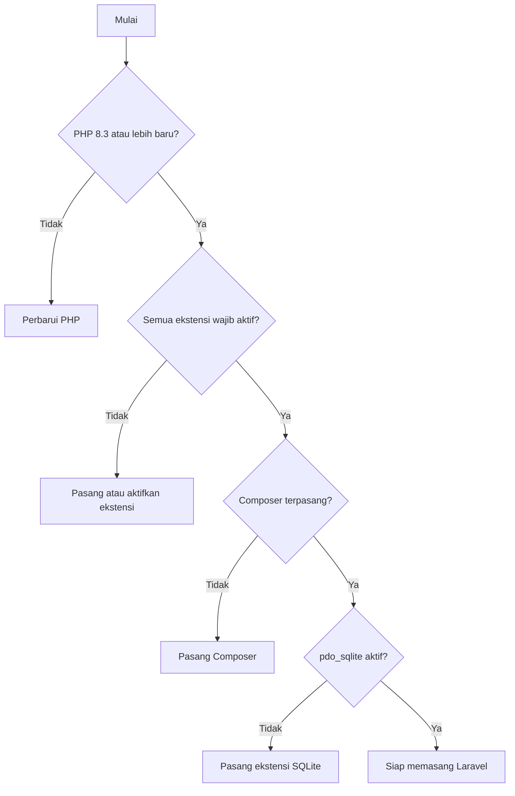

# Persyaratan Sistem Laravel

Sebelum memasang Laravel, pastikan komputermu memenuhi syaratnya. Memeriksa lebih dulu
menghemat waktu: pesan error saat pemasangan sering berasal dari PHP yang terlalu lama atau
ekstensi yang belum aktif. Pada sub bab ini kamu mengenali apa saja yang dibutuhkan dan
menulis skrip kecil untuk memeriksanya secara otomatis.

## Tujuan Pembelajaran

Setelah menyelesaikan sub bab ini, kamu dapat:

- [ ] Menyebutkan versi PHP minimum dan ekstensi PHP yang dibutuhkan Laravel 13.x.
- [ ] Membedakan kebutuhan wajib, yang dianjurkan, dan yang opsional.
- [ ] Memeriksa versi PHP, ekstensi, Composer, Git, dan Node.js dari terminal.
- [ ] Menulis skrip PHP untuk memeriksa persyaratan dan membaca hasilnya.
- [ ] Membaca dan memahami pesan error karena persyaratan tidak terpenuhi.

## Prasyarat

- Sub bab [Laravel dibanding PHP Native](01-04-laravel-vs-php-native.md).
- Bab utama Dasar Web dan PHP, terutama [Pemasangan PHP](../level-00/00-06-php-installation-and-development-environment.md)
  dan [Composer dan Manajemen Paket](../level-00/00-23-composer-and-package-management.md).
- Terminal Ubuntu (atau Bash). Pengguna macOS dan Windows dapat membaca bagian "Alternatif".

## Pengantar

Laravel adalah paket besar yang memanfaatkan banyak fitur PHP. Jika PHP-mu terlalu lama atau
kekurangan ekstensi, Composer akan menolak memasang, atau aplikasi gagal berjalan dengan pesan
yang membingungkan. Pengecekan 2-3 menit di awal mencegah masalah itu.

## Penjelasan Konsep

### Kebutuhan wajib

Menurut dokumentasi resmi Laravel 13.x:

| Kebutuhan | Keterangan |
|---|---|
| **PHP 8.3 atau lebih baru** | Laravel 13 mendukung PHP 8.3 sampai 8.5 |
| **Composer** | Mengelola paket dan autoloader |
| **Ekstensi PHP** | Ctype, cURL, DOM, Fileinfo, Filter, Hash, Mbstring, OpenSSL, PCRE, PDO, Session, Tokenizer, XML |

!!! tip "Analogi"
    Seperti memasak resep baru: kompor (PHP) harus menyala, dan bahan-bahan (ekstensi) harus lengkap.
    Memeriksa dapur sebelum mulai lebih baik daripada berhenti di tengah masakan.

**Ekstensi PHP** adalah modul tambahan yang memberi PHP kemampuan khusus, misalnya `mbstring` untuk teks
multibyte (UTF-8), `openssl` untuk enkripsi, dan `pdo` untuk akses database. Beberapa sudah termasuk
dalam PHP standar, sebagian lain harus dipasang terpisah di Linux.

### Kebutuhan database

Secara bawaan aplikasi baru memakai **SQLite**: sebuah berkas database sederhana, tanpa server
tambahan. Dokumentasi menjelaskan bahwa saat aplikasi dibuat, Laravel menyiapkan berkas
`database/database.sqlite` dan menjalankan migrasinya. Karena itu ekstensi SQLite untuk PDO harus
tersedia (`pdo_sqlite`).

Jika kamu memilih MySQL, MariaDB, atau PostgreSQL, ekstensi PDO untuk database itu (misalnya `pdo_mysql`)
dan server database-nya harus tersedia, lalu `.env` disesuaikan. Hal ini dibahas di bab utama
*Database dan Eloquent ORM*.

### Kebutuhan yang dianjurkan

| Alat | Kegunaan | Dibutuhkan kapan |
|---|---|---|
| **Git** | Mencatat riwayat proyek | Sejak awal |
| **Node.js dan npm** | Menjalankan Vite untuk mengompilasi CSS/JavaScript; kerangka aplikasi Laravel memakai `npm install` dan `npm run build` | Saat bekerja dengan aset frontend (bab utama Blade dan Frontend) |
| **Editor kode** | Menulis kode (mis. Visual Studio Code) | Sejak awal |
| **Laravel installer** | Perintah `laravel new` untuk membuat proyek | Pemasangan Laravel (sub bab berikutnya) |

Dokumentasi Vite pada Laravel menyebut Node.js (16+) dan NPM harus terpasang. Namun dokumentasi Artisan 13.x
menyatakan perintah `php artisan dev` (yang menjalankan server, antrean, log, dan Vite sekaligus) membutuhkan
**Node 22.13 atau lebih baru**. Karena itu pasang Node.js versi **LTS** terbaru dari situs resmi Node.js agar
memenuhi syarat tersebut.

### Kebutuhan opsional (nanti)

| Alat | Kegunaan | Bab utama |
|---|---|---|
| MySQL / PostgreSQL | Database produksi | Database dan Eloquent ORM |
| Redis | Cache dan antrean | Advanced Laravel Features, Performance |
| Nginx | Web server produksi | Deployment dan DevOps |
| Docker | Lingkungan terkontainerisasi | Deployment dan DevOps |

### Server web

Untuk belajar kamu tidak perlu memasang web server karena Laravel menyediakan server pengembangan
(dibahas di sub bab *Menjalankan Development Server*). Pada produksi, Laravel harus dilayani dari
**akar** direktori web (folder `public/`). Dokumentasi memperingatkan agar tidak menjalankannya dari
subfolder karena bisa mengekspos berkas sensitif.

### Alternatif: macOS dan Windows

Dokumentasi menyarankan **Laravel Herd** sebagai lingkungan PHP lengkap di macOS dan Windows (sudah
termasuk PHP, Nginx, dan perintah `php`, `composer`, dan `laravel`). Pengguna Linux dapat memakai
skrip `php.new` seperti pada sub bab pemasangan PHP.

## Cara Kerja

Urutan pemeriksaan sebelum memasang Laravel:



## Contoh Praktik

Kamu membuat skrip `cek-persyaratan.php` yang memeriksa versi PHP dan ekstensi, lalu menampilkan
laporan.

## Penjelasan Kode

| Bagian | Fungsi |
|---|---|
| `PHP_VERSION` | Konstanta berisi versi PHP yang menjalankan skrip |
| `version_compare($a, $b, ">=")` | Membandingkan dua nomor versi; hasil `bool` |
| `extension_loaded("nama")` | `true` bila ekstensi aktif (tidak peka huruf besar-kecil) |
| `str_repeat("=", 40)` | Membuat garis pemisah |
| `exit($kurang > 0 ? 1 : 0)` | Mengakhiri skrip dengan kode keluar: `0` berarti sukses, selain itu gagal |

## Implementasi Langkah demi Langkah

### Langkah 1: periksa alat dari terminal

```bash
php -v
composer -V
git --version
node -v
npm -v
```

Setiap perintah menampilkan nomor versi bila alatnya terpasang. `node` dan `npm` boleh belum ada
saat ini; keduanya baru dibutuhkan pada bab utama yang membahas aset frontend.

### Langkah 2: periksa daftar ekstensi

```bash
php -m
```

Perintah ini mencetak semua ekstensi yang aktif.

### Langkah 3: tulis skrip pemeriksa

Simpan di folder `belajar-php`:

```php title="belajar-php/cek-persyaratan.php"
<?php

const PHP_MINIMUM = "8.3.0";

$wajib = [
    "ctype", "curl", "dom", "fileinfo", "filter", "hash", "mbstring",
    "openssl", "pcre", "PDO", "session", "tokenizer", "xml",
];

$database = [
    "pdo_sqlite" => "SQLite (database bawaan Laravel)",
    "pdo_mysql" => "MySQL / MariaDB (opsional)",
];

$kurang = 0;

echo "Pemeriksaan persyaratan Laravel 13.x\n";
echo str_repeat("=", 40), "\n";

$phpOk = version_compare(PHP_VERSION, PHP_MINIMUM, ">=");
echo $phpOk ? "[OK]     " : "[KURANG] ", "PHP ", PHP_VERSION, " (minimal ", PHP_MINIMUM, ")\n";

if (!$phpOk) {
    $kurang++;
}

echo "\nEkstensi wajib:\n";

foreach ($wajib as $ekstensi) {
    $ada = extension_loaded($ekstensi);
    echo "  ", $ada ? "[OK]     " : "[KURANG] ", $ekstensi, "\n";

    if (!$ada) {
        $kurang++;
    }
}

echo "\nEkstensi database:\n";

foreach ($database as $ekstensi => $keterangan) {
    $ada = extension_loaded($ekstensi);
    echo "  ", $ada ? "[OK]     " : "[TIDAK ] ", $ekstensi, " - ", $keterangan, "\n";
}

echo str_repeat("=", 40), "\n";

if ($kurang === 0) {
    echo "Semua persyaratan wajib terpenuhi.\n";
} else {
    echo "Ada $kurang persyaratan wajib yang belum terpenuhi.\n";
}

exit($kurang > 0 ? 1 : 0);
```

### Langkah 4: jalankan dan baca hasilnya

```bash
cd belajar-php
php cek-persyaratan.php
echo $?
```

Perintah `echo $?` menampilkan kode keluar skrip terakhir.

### Langkah 5: uji skenario gagal

Ubah sementara `PHP_MINIMUM` menjadi `"99.0.0"` dan jalankan lagi, lalu kembalikan. Tambahkan juga satu
nama ekstensi palsu (misalnya `"ekstensi_palsu"`) ke daftar `$wajib`, jalankan, lalu hapus.

### Langkah 6: tambahkan ekstensi yang kurang (bila ada)

Di Ubuntu, ekstensi umum dipasang dengan `apt`, contohnya:

```bash
sudo apt install -y php-mbstring php-xml php-curl php-sqlite3
```

Setelah itu jalankan skrip pemeriksa lagi. Nama paket dapat berbeda antar rilis Ubuntu; jika perintah di atas
gagal, cari nama paket yang tepat di dokumentasi distribusi.

## Eksekusi dan Verifikasi

| Langkah | Cara memverifikasi |
|---|---|
| 1 | `php -v` menunjukkan 8.3 atau lebih tinggi; `composer -V` menunjukkan versi Composer |
| 2 | Daftar memuat ekstensi seperti `mbstring`, `openssl`, `PDO`, dan `tokenizer` |
| 3-4 | Skrip menampilkan laporan; `echo $?` mencetak `0` bila semua wajib terpenuhi |
| 5 | Dengan syarat palsu, laporan memuat `[KURANG]` dan `echo $?` mencetak `1` |
| 6 | Setelah memasang ekstensi, baris yang tadinya `[KURANG]` berubah menjadi `[OK]` |

## Hasil yang Diharapkan

Pada komputer yang memenuhi syarat, keluaran skrip berbentuk (nomor versi PHP dan status
ekstensi database bergantung pada sistemmu):

```text
Pemeriksaan persyaratan Laravel 13.x
========================================
[OK]     PHP 8.x.y (minimal 8.3.0)

Ekstensi wajib:
  [OK]     ctype
  [OK]     curl
  [OK]     dom
  [OK]     fileinfo
  [OK]     filter
  [OK]     hash
  [OK]     mbstring
  [OK]     openssl
  [OK]     pcre
  [OK]     PDO
  [OK]     session
  [OK]     tokenizer
  [OK]     xml

Ekstensi database:
  [OK]     pdo_sqlite - SQLite (database bawaan Laravel)
  [TIDAK ] pdo_mysql - MySQL / MariaDB (opsional)
========================================
Semua persyaratan wajib terpenuhi.
```

Ekstensi `pdo_mysql` boleh `[TIDAK ]` bila kamu belum memerlukan MySQL. Jika `pdo_sqlite` juga
`[TIDAK ]`, pasang ekstensi SQLite sebelum memasang Laravel, karena database bawaan memakainya. Keluaran
ini diturunkan dari kode di atas dan belum dijalankan oleh penulis materi; cocokkan dengan hasilmu.

## Kesalahan Umum dan Pemecahan Masalah

| Gejala | Penyebab | Cara mengenali | Solusi | Pencegahan |
|---|---|---|---|---|
| Composer menolak memasang karena versi PHP | PHP di bawah 8.3 | Pesan Composer menyebut versi PHP tidak memenuhi syarat | Perbarui PHP (lihat sub bab pemasangan PHP) | Jalankan skrip pemeriksa lebih dulu |
| Pesan "ext-xxx is missing" (nama ekstensi) | Ekstensi belum terpasang atau nonaktif | Skrip menandai `[KURANG]` | Pasang atau aktifkan ekstensi lalu jalankan ulang | Periksa daftar ekstensi di awal |
| `php -v` dan server web memakai PHP berbeda | Beberapa versi PHP terpasang | `which -a php` menampilkan lebih dari satu lokasi | Pastikan versi yang benar ada paling depan di `PATH` | Hapus versi lama yang tidak perlu |
| `could not find driver` saat database | `pdo_sqlite` atau `pdo_mysql` tidak aktif | Skrip menandai database `[TIDAK ]` | Pasang ekstensi database yang dipakai | Cek ekstensi database sebelum membuat proyek |
| `node: command not found` | Node.js belum terpasang | Perintah tidak dikenali | Pasang Node.js LTS dari situs resmi saat dibutuhkan | Pasang sebelum bab frontend |
| Perubahan `php.ini` tidak berlaku | Mengedit `php.ini` yang salah | `php --ini` menunjukkan berkas yang dipakai | Edit berkas yang ditampilkan `php --ini` | Gunakan `php --ini` sebelum mengedit |
| Skrip pemeriksa tidak jalan | Salah folder atau salah ketik | `Could not open input file` | `cd` ke folder skrip dan periksa nama | Periksa dengan `ls` |

## Latihan Praktik

### Latihan dasar

**D1. Catat lingkungan**
- *Masalah:* kamu perlu dokumen singkat tentang lingkungan kerjamu.
- *Persyaratan:* tulis versi PHP, Composer, Git, Node.js, dan sistem operasi.
- *Perilaku yang diharapkan:* setiap baris punya nomor versi, atau keterangan "belum terpasang".
- *Tujuan belajar:* membiasakan mencatat lingkungan sebelum bekerja.

**D2. Wajib atau opsional?**
- *Masalah:* klasifikasikan kebutuhan.
- *Persyaratan:* kelompokkan PHP 8.3, Redis, `mbstring`, Node.js, MySQL, dan Composer ke wajib, dianjurkan, atau
  opsional.
- *Perilaku yang diharapkan:* pengelompokan sesuai tabel pada bagian konsep.
- *Tujuan belajar:* membedakan prioritas kebutuhan.

### Latihan implementasi

**I1. Pemeriksa dengan format JSON**
- *Masalah:* hasil pemeriksaan ingin dibaca program lain.
- *Persyaratan:* ubah skrip agar mencetak hasil sebagai JSON (versi PHP, daftar ekstensi dengan status `true` atau
  `false`, dan status akhir) memakai `json_encode` dengan `JSON_PRETTY_PRINT`.
- *Perilaku yang diharapkan:* keluaran berupa JSON valid; kode keluar tetap `0` atau `1`.
- *Tujuan belajar:* memisahkan pengumpulan data dari tampilan.

**I2. Pemeriksa alat luar**
- *Masalah:* skrip juga perlu memeriksa Composer dan Git.
- *Persyaratan:* tambahkan pemeriksaan keberadaan `composer` dan `git` dengan menjalankan perintah `--version` dari PHP
  (cari fungsi yang sesuai di dokumentasi PHP) dan tampilkan hasilnya di laporan.
- *Perilaku yang diharapkan:* bila alat tidak ada, laporan menandainya `[KURANG]` tanpa membuat skrip error.
- *Tujuan belajar:* memeriksa program eksternal dengan aman.

### Latihan tantangan

**T1. Pemeriksa multi-versi**
- *Masalah:* sebuah tim memakai PHP 8.3 dan 8.4 berdampingan.
- *Persyaratan:* rancang cara agar skrip dapat dijalankan oleh tiap versi PHP (misalnya `php8.3 cek-persyaratan.php`)
  dan menampilkan ringkasan per versi.
- *Perilaku yang diharapkan:* satu laporan perbandingan yang menunjukkan versi mana yang siap untuk Laravel 13.
- *Tujuan belajar:* mengelola beberapa versi PHP.
- *Catatan:* kerjakan mandiri; cari perintah `update-alternatives` atau cara serupa bila perlu.

## Uji Pemahaman

1. Apa versi PHP minimum untuk Laravel 13.x, dan versi maksimum yang didukung menurut tabel rilis?
2. Sebutkan lima ekstensi PHP yang wajib.
3. Mengapa `pdo_sqlite` perlu diperiksa pada aplikasi baru?
4. Apa fungsi Composer dalam pemasangan Laravel?
5. Apa perbedaan kebutuhan wajib dan dianjurkan? Berikan contoh.
6. Apa fungsi `extension_loaded()`?
7. Mengapa Laravel tidak boleh dilayani dari subfolder web directory?
8. Apa arti kode keluar `0` dan `1` pada skrip pemeriksa?

??? success "Kunci jawaban singkat"
    1. Minimum 8.3; didukung sampai 8.5 menurut tabel rilis.
    2. Contoh: `ctype`, `curl`, `mbstring`, `openssl`, `tokenizer` (juga `dom`, `fileinfo`, `filter`, `hash`, `pcre`, `PDO`,
       `session`, `xml`).
    3. Database bawaan adalah SQLite.
    4. Mengunduh dan mengelola paket serta membuat autoloader.
    5. Wajib: tanpa itu Laravel tidak berjalan (PHP, ekstensi, Composer). Dianjurkan: memudahkan (Git, Node.js).
    6. Memeriksa apakah suatu ekstensi PHP aktif.
    7. Bisa mengekspos berkas sensitif; layani dari akar web directory (`public/`).
    8. `0` sukses, `1` ada persyaratan wajib yang belum terpenuhi.

## Ringkasan

- Laravel 13.x membutuhkan PHP 8.3 atau lebih baru, Composer, dan sejumlah ekstensi PHP.
- Aplikasi baru memakai SQLite, jadi `pdo_sqlite` perlu aktif.
- Git dan Node.js dianjurkan; Redis, MySQL, Nginx, dan Docker bersifat opsional untuk nanti.
- Skrip pemeriksa mengotomatiskan verifikasi versi dan ekstensi.
- Memeriksa lebih dulu mencegah error pemasangan yang membingungkan.

Selanjutnya: *Memasang Laravel*, yaitu memasang Laravel installer dan alat pendukungnya.

## Referensi Resmi

- [Laravel: Deployment (Server Requirements)](https://laravel.com/docs/13.x/deployment#server-requirements)
- [Laravel: Installation](https://laravel.com/docs/13.x/installation)
- [Laravel: Release Notes (dukungan PHP)](https://laravel.com/docs/13.x/releases)
- [Laravel: Vite (Installing Node)](https://laravel.com/docs/13.x/vite#installing-node)
- [PHP Manual: extension_loaded](https://www.php.net/manual/en/function.extension-loaded.php)
- [PHP Manual: version_compare](https://www.php.net/manual/en/function.version-compare.php)
- [Composer: Introduction](https://getcomposer.org/doc/00-intro.md)
- [Node.js: Download](https://nodejs.org/en/download/)
