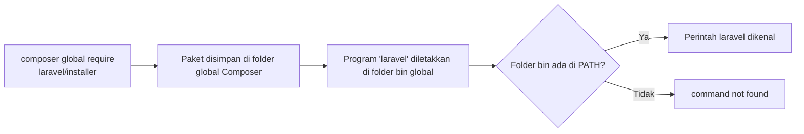
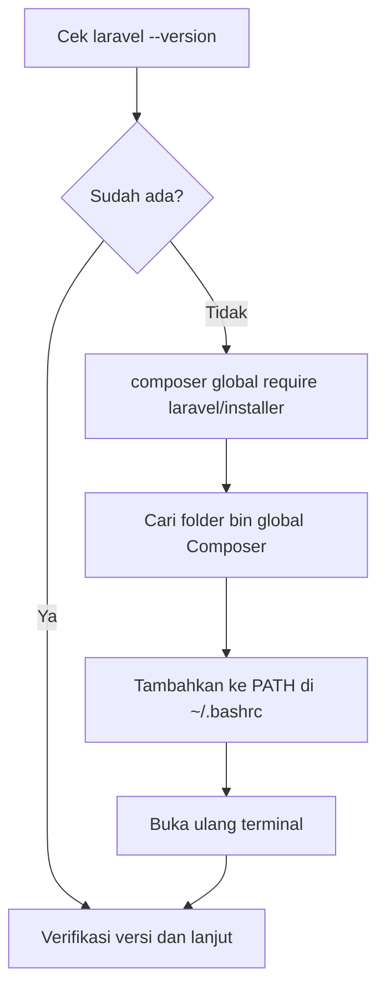

# Memasang Laravel

Sekarang lingkunganmu sudah diperiksa, saatnya memasang alat yang membuat proyek Laravel: **Laravel
installer**. Sub bab ini memasang dan memverifikasi installer di Ubuntu. Proyek Laravel pertamamu
dibuat pada sub bab berikutnya.

## Tujuan Pembelajaran

Setelah menyelesaikan sub bab ini, kamu dapat:

- [ ] Menjelaskan fungsi Laravel installer dan perbedaannya dengan framework Laravel itu sendiri.
- [ ] Memasang Laravel installer lewat `php.new` atau Composer.
- [ ] Mengatur `PATH` agar perintah `laravel` dapat dipanggil dari mana pun.
- [ ] Memverifikasi pemasangan dengan `laravel --version`.
- [ ] Memperbarui installer dan mendiagnosis masalah pemasangan yang umum.
- [ ] Menyebutkan alternatif pemasangan untuk macOS dan Windows.

## Prasyarat

- Sub bab [Persyaratan Sistem Laravel](01-05-laravel-system-requirements.md): `cek-persyaratan.php` menyatakan
  semua persyaratan wajib terpenuhi.
- PHP 8.3 atau lebih baru dan Composer berfungsi (`php -v`, `composer -V`).
- Terminal Ubuntu dengan koneksi internet.

## Pengantar

Untuk membuat proyek Laravel baru kamu butuh dua hal terpisah:

1. **Alat pembuat proyek** (Laravel installer): perintah `laravel new` yang menyiapkan folder proyek lengkap.
2. **Framework Laravel** itu sendiri: kode yang menjalankan aplikasi, yang diunduh otomatis ke dalam proyekmu
   ketika proyek dibuat.

Sub bab ini mengurus yang pertama. Menyiapkannya dengan benar sekarang membuat pembuatan proyek
berikutnya berjalan lancar.

## Penjelasan Konsep

### Laravel installer

**Laravel installer** adalah program baris perintah (CLI) yang menyediakan perintah `laravel`.
Dokumentasi resmi menyarankan perintah `laravel new nama-proyek` untuk membuat aplikasi baru dan
menawarkan pilihan awal (misalnya starter kit) saat proyek dibuat.

!!! tip "Analogi"
    Installer seperti **kontraktor** yang membangun rumah sesuai denah standar. Kamu cukup memanggil
    kontraktornya (`laravel new`), dan ia membawa bahan-bahan (framework) ke lokasi proyekmu.

### Tiga cara mendapatkan installer

| Cara | Untuk siapa | Hasil |
|---|---|---|
| **`php.new`** | Linux, macOS, Windows; belum punya PHP atau ingin semua sekaligus | Memasang PHP, Composer, dan Laravel installer |
| **Composer** (`composer global require laravel/installer`) | Sudah punya PHP dan Composer | Memasang installer saja |
| **Laravel Herd** | macOS dan Windows; ingin aplikasi grafis | PHP, Nginx, dan perintah `php`, `composer`, `laravel`, `node`, `npm` |

Dokumentasi menyebutkan ketiganya. Karena kamu sudah punya PHP dan Composer dari bab utama
sebelumnya, cara kedua yang paling relevan. Jika dulu kamu memasang PHP dengan `php.new`,
installer kemungkinan sudah ada.

### Cara kerja `composer global`

Perintah `composer global` memasang paket di folder khusus milik pengguna (bukan di dalam proyek).
Program yang disediakan paket itu diletakkan di folder `bin` global. Agar perintah `laravel` dikenal
terminal, folder tersebut harus masuk ke variabel lingkungan **`PATH`**.

**`PATH`** adalah daftar folder tempat terminal mencari program ketika kamu mengetik sebuah perintah.
Jika folder `bin` Composer tidak ada di `PATH`, terminal menjawab `command not found` meskipun installer
sudah terpasang.



### Keamanan pemasangan

- Pasang hanya paket resmi `laravel/installer`; periksa halamannya di Packagist dan GitHub resmi Laravel.
- Hindari `sudo composer global require ...`. Memasang sebagai `root` membuat folder milik `root` yang
  menyulitkan pembaruan dan dapat membahayakan keamanan.
- Seperti pada bab Pemasangan PHP: jangan langsung menjalankan skrip dari internet tanpa membacanya
  (`curl ... | bash`); unduh dulu, baca, baru jalankan.

## Cara Kerja

Urutan pemasangan yang akan kita lakukan:



## Contoh Praktik

Kamu memasang installer, mengatur `PATH`, dan memverifikasinya. Tidak ada proyek yang dibuat pada
sub bab ini.

## Penjelasan Kode

Perintah yang dipakai:

| Perintah | Fungsi |
|---|---|
| `laravel --version` | Menampilkan versi installer (bila sudah terpasang) |
| `composer global require laravel/installer` | Memasang installer secara global |
| `composer global config bin-dir --absolute` | Menampilkan jalur absolut folder `bin` global Composer |
| `echo $PATH` | Menampilkan isi `PATH` saat ini |
| `which -a laravel` | Menampilkan semua lokasi program `laravel` yang terdeteksi |
| `source ~/.bashrc` | Memuat ulang konfigurasi shell tanpa menutup terminal |

## Implementasi Langkah demi Langkah

### Langkah 1: periksa apakah installer sudah ada

```bash
laravel --version
```

- Jika menampilkan nomor versi (berawalan `Laravel Installer`), lanjut ke **Langkah 5**.
- Jika menampilkan `command not found`, lanjut ke Langkah 2.

### Langkah 2: pasang lewat Composer

```bash
composer global require laravel/installer
```

Composer mengunduh installer beserta dependensinya ke folder global milik pengguna. Jangan memakai
`sudo`.

### Langkah 3: temukan folder bin global

```bash
composer global config bin-dir --absolute
```

Perintah ini mencetak satu jalur absolut. Catat jalur itu; contoh bentuknya
`/home/nama/.config/composer/vendor/bin` (bagian `nama` dan lokasi persis bergantung pada sistem dan versi Composer).

### Langkah 4: tambahkan ke `PATH`

Ganti `JALUR_BIN` di bawah dengan jalur yang kamu catat pada Langkah 3, lalu jalankan:

```bash
echo 'export PATH="$PATH:JALUR_BIN"' >> ~/.bashrc
source ~/.bashrc
```

Baris `export PATH=...` menambahkan folder ke `PATH` setiap kali terminal baru dibuka, karena ditulis ke
`~/.bashrc`. Jika kamu memakai shell lain (misalnya Zsh), tulis ke `~/.zshrc`.

!!! warning "Jangan menyalin jalur contoh"
    Gunakan jalur yang dicetak oleh Langkah 3 di komputermu, bukan jalur contoh di halaman ini.
    Periksa baris yang ditambahkan dengan `tail -n 2 ~/.bashrc`.

### Langkah 5: verifikasi

```bash
laravel --version
which -a laravel
```

### Langkah 6: lihat perintah yang tersedia

```bash
laravel list
laravel new --help
```

`laravel list` menampilkan daftar perintah installer, dan `laravel new --help` menampilkan opsi
untuk membuat proyek (akan dipakai pada sub bab berikutnya). Kamu tidak perlu menghafalnya.

### Langkah 7: catat lingkungan

Buat berkas catatan `belajar-php/lingkungan.txt` berisi keluaran `php -v`, `composer -V`, `laravel --version`,
`git --version`, `node -v` (bila ada), serta nama dan versi sistem operasi (`lsb_release -a`). Catatan ini
berguna saat kamu perlu meminta bantuan.

## Eksekusi dan Verifikasi

| Langkah | Cara memverifikasi |
|---|---|
| 1 | Perintah menampilkan versi atau `command not found` |
| 2 | Composer selesai tanpa pesan error; paket `laravel/installer` terpasang |
| 3 | Satu jalur absolut tercetak |
| 4 | `tail -n 2 ~/.bashrc` menampilkan baris `export PATH=` dengan jalurmu; setelah `source`, `echo $PATH` memuat jalur itu |
| 5 | `laravel --version` menampilkan nomor versi installer; `which -a laravel` menampilkan lokasinya |
| 6 | `laravel list` menampilkan daftar perintah, termasuk `new` |
| 7 | Berkas `lingkungan.txt` berisi semua versi |

## Hasil yang Diharapkan

- `laravel --version` mencetak satu baris yang memuat nama installer dan nomor versinya (nomor persis bergantung
  rilis saat kamu memasang).
- `which -a laravel` mencetak satu atau lebih jalur. Jika ada dua jalur berbeda (misalnya dari `php.new` dan dari
  Composer), jalur pertama yang akan dipakai terminal.
- `laravel list` menampilkan perintah yang bisa dipakai, di antaranya `new`.

Keluaran tepat tidak ditulis di sini karena bergantung pada versi installer dan sistemmu; yang penting
perintah dikenal dan menampilkan versi.

## Kesalahan Umum dan Pemecahan Masalah

| Gejala | Penyebab | Cara mengenali | Solusi | Pencegahan |
|---|---|---|---|---|
| `laravel: command not found` | Folder bin global belum ada di `PATH` | `echo $PATH` tidak memuat jalur dari Langkah 3 | Tambahkan jalur ke `~/.bashrc`, lalu `source ~/.bashrc` atau buka ulang terminal | Ikuti Langkah 3 dan 4 |
| `composer: command not found` | Composer belum terpasang | Perintah tidak dikenal | Pasang Composer (lihat sub bab pemasangan PHP) | Periksa dengan `composer -V` |
| Composer menolak karena versi PHP atau ekstensi | Persyaratan tidak terpenuhi | Pesan menyebut versi PHP atau `ext-...` | Perbarui PHP atau pasang ekstensi; jalankan `cek-persyaratan.php` | Jalankan pemeriksa dulu |
| `Permission denied` saat menulis folder global | Folder global milik `root` karena pernah memakai `sudo` | `ls -ld` menunjukkan pemilik `root` | Perbaiki kepemilikan folder ke pengguna biasa; jangan memakai `sudo` untuk Composer | Jangan pernah `sudo composer global` |
| Gagal mengunduh | Koneksi atau DNS bermasalah | Pesan timeout atau *could not resolve host* | Periksa internet lalu ulangi | Pastikan internet stabil |
| Versi installer lama setelah pembaruan | Dua installer terpasang (php.new dan Composer) | `which -a laravel` menampilkan dua lokasi | Hapus salah satu atau atur urutan `PATH` | Pilih satu cara pemasangan |
| Perubahan `~/.bashrc` tidak berlaku | Terminal belum memuat ulang | `echo $PATH` belum berubah | `source ~/.bashrc` atau buka terminal baru | Selalu `source` setelah mengubah |
| Shell bukan Bash | Menulis ke berkas yang salah | `echo $SHELL` menunjukkan Zsh atau lainnya | Tulis ke berkas konfigurasi shell yang dipakai (mis. `~/.zshrc`) | Cek `echo $SHELL` dulu |

## Memperbarui Installer

| Cara pemasangan | Cara memperbarui |
|---|---|
| `php.new` | Jalankan ulang perintah `php.new` (menurut dokumentasi resmi) |
| Composer global | `composer global update laravel/installer` |
| Herd | Perbarui aplikasi Herd |

## Latihan Praktik

### Latihan dasar

**D1. Pasang dan verifikasi**
- *Masalah:* installer belum ada di komputermu.
- *Persyaratan:* pasang lewat Composer, atur `PATH`, dan tunjukkan bukti dengan `laravel --version` dan `which -a laravel`.
- *Perilaku yang diharapkan:* perintah `laravel` dikenal dari folder mana pun.
- *Tujuan belajar:* memasang alat CLI global dan memahami `PATH`.

**D2. Baca `PATH`**
- *Masalah:* kamu perlu tahu tempat terminal mencari program.
- *Persyaratan:* tampilkan `PATH` satu folder per baris (petunjuk: `tr` mengganti karakter).
- *Perilaku yang diharapkan:* daftar folder terlihat, dan folder bin Composer ada di dalamnya.
- *Tujuan belajar:* membaca variabel lingkungan.

### Latihan implementasi

**I1. Pemeriksa lengkap**
- *Masalah:* ingin satu perintah yang memeriksa semua alat.
- *Persyaratan:* tulis skrip Bash `cek-alat.sh` yang menampilkan versi PHP, Composer, Git, Laravel installer, dan Node
  (bila ada), dengan pesan jelas untuk alat yang tidak ditemukan (`command -v` dapat dipakai).
- *Perilaku yang diharapkan:* skrip tidak error saat alat tertentu tidak ada, dan kode keluarnya `1` bila PHP,
  Composer, atau installer tidak ada.
- *Tujuan belajar:* mengotomatiskan verifikasi lingkungan.

**I2. Dokumentasikan masalah**
- *Masalah:* temanmu mendapat `laravel: command not found`.
- *Persyaratan:* tulis panduan diagnosis lima langkah yang bisa diikuti pemula.
- *Perilaku yang diharapkan:* panduan memeriksa installer terpasang, folder bin, `PATH`, dan shell yang dipakai.
- *Tujuan belajar:* menyusun panduan pemecahan masalah.

### Latihan tantangan

**T1. Rencana pemasangan lintas OS**
- *Masalah:* sebuah kelas berisi pengguna Ubuntu, macOS, dan Windows.
- *Persyaratan:* buat panduan satu halaman yang memilih cara pemasangan (php.new, Composer, atau Herd) untuk tiap OS,
  beserta cara memverifikasi dan masalah yang mungkin muncul, merujuk dokumentasi 13.x.
- *Perilaku yang diharapkan:* setiap langkah dapat diverifikasi dengan perintah atau tampilan yang jelas.
- *Tujuan belajar:* membuat dokumentasi pemasangan untuk beragam lingkungan.
- *Catatan:* kerjakan mandiri; tidak ada kunci jawaban.

## Uji Pemahaman

1. Apa beda Laravel installer dan framework Laravel?
2. Sebutkan tiga cara mendapatkan installer dan kapan masing-masing cocok.
3. Apa itu `PATH` dan mengapa `laravel: command not found` bisa terjadi walau installer terpasang?
4. Apa fungsi `composer global config bin-dir --absolute`?
5. Mengapa tidak boleh memakai `sudo composer global require`?
6. Bagaimana memverifikasi bahwa pemasangan berhasil?
7. Bagaimana memperbarui installer yang dipasang lewat Composer?
8. Mengapa membaca skrip sebelum menjalankannya penting?

??? success "Kunci jawaban singkat"
    1. Installer adalah alat pembuat proyek (`laravel new`); framework adalah kode yang menjalankan aplikasi.
    2. `php.new` (semua sekaligus), Composer (sudah punya PHP dan Composer), Herd (macOS/Windows grafis).
    3. Daftar folder tempat terminal mencari program; folder bin Composer belum ada di `PATH`.
    4. Menampilkan jalur folder `bin` global Composer.
    5. Folder menjadi milik `root`, menyulitkan pembaruan, dan berisiko keamanan.
    6. `laravel --version` menampilkan versi.
    7. `composer global update laravel/installer`.
    8. Skrip dari internet bisa berbahaya; baca dulu isinya sebelum dijalankan.

## Ringkasan

- Laravel installer menyediakan perintah `laravel new` untuk membuat proyek baru.
- Dapatkan lewat `php.new`, Composer global, atau Herd; pilih satu cara.
- `PATH` menentukan program mana yang dikenal terminal; folder bin Composer harus ada di dalamnya.
- Verifikasi dengan `laravel --version`; hindari `sudo` untuk Composer global.
- Perbarui installer sesuai cara pemasangannya.

Selanjutnya: *Membuat Proyek Laravel*, yaitu memakai `laravel new` untuk membuat proyek pertamamu.

## Referensi Resmi

- [Laravel: Installation](https://laravel.com/docs/13.x/installation)
- [Laravel: Installing PHP and the Laravel Installer](https://laravel.com/docs/13.x/installation#installing-php)
- [Laravel Herd](https://herd.laravel.com)
- [Laravel Installer di GitHub](https://github.com/laravel/installer)
- [Laravel Installer di Packagist](https://packagist.org/packages/laravel/installer)
- [Composer: Command-line interface (global)](https://getcomposer.org/doc/03-cli.md)
- [php.new](https://php.new)
