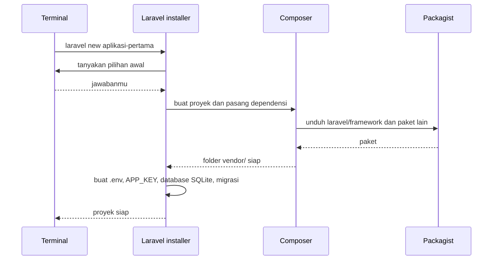

# Membuat Proyek Laravel

Saatnya membuat proyek Laravel pertamamu. Dengan satu perintah, `laravel new`, installer akan
mengunduh framework, menyiapkan struktur folder, membuat berkas konfigurasi, dan menyediakan database
SQLite. Sub bab ini membuat proyek bernama `aplikasi-pertama` dan memeriksa bahwa semuanya terbentuk dengan
benar. Menjalankannya di browser dikerjakan pada sub bab berikutnya.

## Tujuan Pembelajaran

Setelah menyelesaikan sub bab ini, kamu dapat:

- [ ] Membuat proyek Laravel baru dengan `laravel new`.
- [ ] Memilih jawaban yang tepat pada pertanyaan interaktif installer.
- [ ] Memeriksa bahwa proyek terbentuk dengan benar (folder, versi framework, database).
- [ ] Menjelaskan apa saja yang dibuat installer dan mengapa `.env` tidak boleh dibagikan atau di-commit.
- [ ] Mengatasi masalah umum saat membuat proyek.

## Prasyarat

- Sub bab [Memasang Laravel](01-06-installing-laravel.md): perintah `laravel --version` berfungsi.
- Persyaratan sistem terpenuhi (PHP 8.3+, ekstensi, Composer), termasuk `pdo_sqlite`.
- Koneksi internet yang stabil. Pembuatan proyek mengunduh banyak paket.
- Node.js dan npm **tidak wajib** sekarang; lihat catatan pada Langkah 3.

## Pengantar

Pada proyek siswa PHP native, kamu membuat folder, berkas konfigurasi, dan struktur sendiri. Dengan
Laravel, semua itu disiapkan installer sesuai denah standar yang sama untuk semua proyek Laravel. Karena
struktur baku itu, orang lain (dan alat bantu) langsung tahu di mana mencari sesuatu.

## Penjelasan Konsep

### Apa yang dilakukan `laravel new`

Saat dijalankan, installer:

1. Membuat folder baru dengan nama proyekmu.
2. Mengunduh kerangka aplikasi Laravel beserta seluruh paket yang dibutuhkan (lewat Composer) ke folder `vendor/`.
3. Membuat berkas `.env` dan menghasilkan kunci aplikasi (`APP_KEY`).
4. Menyiapkan database SQLite dan menjalankan migrasi bawaan (menurut dokumentasi).
5. Menanyakan beberapa pilihan awal, lalu menyiapkan sesuai jawabanmu.

!!! tip "Analogi"
    Seperti pindah ke rumah baru yang sudah dibangun kontraktor: dinding, listrik, dan air sudah ada, kamu tinggal
    menata perabot (kode aplikasimu).

### Pertanyaan interaktif installer

Installer menanyakan beberapa hal. Pertanyaan bisa berbeda antar versi installer, jadi baca setiap pertanyaan
dengan teliti. Pada versi saat materi ini ditulis, pertanyaan yang umum muncul dan pilihan yang kita anjurkan:

| Pertanyaan | Arti | Pilihan untuk belajar |
|---|---|---|
| Menggunakan starter kit? | Starter kit adalah kerangka aplikasi siap pakai dengan autentikasi dan antarmuka | **Tidak**, agar kamu belajar dari dasar |
| Frontend stack | Pilihan tumpukan tampilan: Blade (tanpa perancah tambahan), React, Svelte, Vue, Livewire | **Blade** |
| Testing framework | **Pest** atau **PHPUnit** untuk pengujian otomatis | **PHPUnit** (berbasis class seperti yang kamu pelajari) atau Pest; keduanya valid dan dibahas di bab pengujian |
| Laravel Boost | Alat tambahan untuk pengembangan dibantu AI | **Tidak** untuk saat ini |
| Database | Driver database aplikasi | **SQLite** (bawaan, tanpa server) |
| Instal dan build dependensi npm? | Menjalankan `npm install` dan `npm run build` untuk aset frontend | **Ya** jika Node.js sudah terpasang; **Tidak** jika belum |

Starter kit dan Boost bukan topik sub bab ini; keduanya diperkenalkan nanti. Memilih "tidak" sekarang
membuat proyek bersih dan mudah dipahami.

### Opsi baris perintah

Pertanyaan interaktif dapat dilewati dengan opsi. Beberapa opsi yang ada pada installer:

| Opsi | Fungsi |
|---|---|
| `--git` | Menginisialisasi repositori Git di proyek baru |
| `--database=sqlite` | Menentukan driver database (`mysql`, `mariadb`, `pgsql`, `sqlite`, `sqlsrv`) |
| `--pest` atau `--phpunit` | Memilih framework pengujian |
| `--no-boost` | Melewatkan Laravel Boost |
| `--no-node` | Melewatkan instalasi dan build npm |
| `--force` | Memaksa membuat proyek walau folder sudah ada |

Daftar lengkap tersedia lewat `laravel new --help`.

### Konvensi penamaan proyek

Nama proyek sebaiknya huruf kecil dengan tanda hubung (`aplikasi-pertama`), tanpa spasi. Nama ini menjadi
nama folder.

### Keamanan: berkas `.env`

Proyek baru memiliki berkas `.env` berisi pengaturan lingkungan, termasuk **kunci aplikasi** (`APP_KEY`) yang
dipakai untuk enkripsi. Dokumentasi resmi menegaskan bahwa `.env` tidak boleh di-commit ke Git karena dapat
membahayakan keamanan bila repositori jatuh ke pihak yang tidak berwenang. Kerangka aplikasi Laravel umumnya
sudah memasukkan `.env` ke `.gitignore`, tetapi tetap periksa sendiri.

## Cara Kerja



## Contoh Praktik

Kamu membuat folder kerja `belajar-laravel` dan proyek `aplikasi-pertama` di dalamnya, lalu memeriksa
hasilnya. Proyek ini adalah **proyek praktik** bab utama ini dan akan dipakai pada sub bab selanjutnya.

## Penjelasan Kode

Perintah yang dipakai:

| Perintah | Fungsi |
|---|---|
| `mkdir -p ~/belajar-laravel` | Membuat folder kerja di home |
| `laravel new aplikasi-pertama` | Membuat proyek baru dengan nama `aplikasi-pertama` |
| `ls -a` | Menampilkan isi folder, termasuk berkas tersembunyi seperti `.env` |
| `php artisan --version` | Menampilkan versi framework Laravel proyek |
| `php artisan about` | Menampilkan ringkasan lingkungan aplikasi |
| `git status` | Memeriksa status Git (jika proyek diinisialisasi dengan `--git`) |

## Implementasi Langkah demi Langkah

### Langkah 1: siapkan folder kerja

```bash
mkdir -p ~/belajar-laravel
cd ~/belajar-laravel
pwd
```

`pwd` harus menampilkan jalur folder `belajar-laravel` di home-mu. Buat proyek di dalam home, bukan di folder
sistem, agar tidak ada masalah izin.

### Langkah 2: buat proyek

```bash
laravel new aplikasi-pertama --git
```

Opsi `--git` menginisialisasi repositori Git sehingga kamu bisa langsung mencatat riwayat. Hasilnya adalah
folder `aplikasi-pertama`.

### Langkah 3: jawab pertanyaan installer

Baca tiap pertanyaan dan pilih sesuai tabel di bagian konsep: tanpa starter kit, Blade, framework pengujian
pilihanmu, Boost tidak, database SQLite.

Untuk pertanyaan tentang npm:

- Jika `node -v` dan `npm -v` bekerja, pilih **Ya** agar aset frontend dibuat sekarang.
- Jika belum terpasang, pilih **Tidak**. Kamu bisa menjalankannya nanti setelah memasang Node.js.

Proses dapat memakan waktu beberapa menit karena mengunduh paket. Biarkan sampai selesai dan perhatikan
bila ada pesan error di akhir.

### Langkah 4: periksa isi proyek

```bash
cd aplikasi-pertama
ls -a
```

Catat folder dan berkas yang kamu lihat. Beberapa yang seharusnya ada: `app`, `bootstrap`, `config`, `database`,
`public`, `resources`, `routes`, `storage`, `tests`, `vendor`, serta berkas `.env`, `composer.json`, dan
`artisan`. Fungsi tiap folder dibahas di sub bab *Struktur Direktori Laravel*.

### Langkah 5: verifikasi versi framework

```bash
php artisan --version
```

Perintah `php artisan` menjalankan alat baris perintah Laravel (dibahas di sub bab Artisan).

### Langkah 6: verifikasi database

```bash
ls -l database/
```

Periksa bahwa berkas `database.sqlite` ada. Ini database bawaan yang disiapkan installer.

### Langkah 7: lihat ringkasan lingkungan

```bash
php artisan about
```

Perintah ini menampilkan ringkasan: versi PHP dan Laravel, lingkungan (*environment*), mode *debug*, dan
konfigurasi database yang dipakai.

### Langkah 8: periksa `.env` dan Git

```bash
git status
git check-ignore -v .env
```

`git status` memeriksa kondisi repositori. `git check-ignore -v .env` menampilkan aturan `.gitignore` yang
mengabaikan `.env` bila ada. Jika `.env` tidak diabaikan, tambahkan ke `.gitignore` sebelum commit.

!!! warning "Jangan membagikan isi `.env`"
    Jangan menempelkan isi `.env` ke forum, obrolan, atau repositori publik. Berkas ini berisi kunci aplikasi dan,
    pada proyek nyata, kata sandi database dan kunci API.

### Langkah 9: catat di berkas lingkungan

Tambahkan ke catatan `belajar-php/lingkungan.txt` (atau berkas catatan barumu) nama proyek, lokasi folder,
versi framework dari Langkah 5, dan pilihan yang kamu ambil pada Langkah 3.

## Eksekusi dan Verifikasi

| Langkah | Cara memverifikasi |
|---|---|
| 1 | `pwd` menampilkan folder `belajar-laravel` |
| 2-3 | Installer selesai tanpa pesan error di akhir |
| 4 | Folder `aplikasi-pertama` berisi folder utama dan berkas `.env`, `composer.json`, `artisan` |
| 5 | `php artisan --version` menampilkan baris `Laravel Framework` diikuti nomor versi 13.x |
| 6 | Berkas `database.sqlite` ada di folder `database` |
| 7 | `php artisan about` menampilkan ringkasan tanpa error |
| 8 | `.env` tercatat diabaikan oleh Git |

## Hasil yang Diharapkan

- Folder `~/belajar-laravel/aplikasi-pertama` berisi proyek Laravel lengkap.
- `php artisan --version` menampilkan versi framework 13.x (nomor `13.x.y` persisnya bergantung rilis saat kamu
  membuat proyek).
- `database/database.sqlite` ada, sesuai penjelasan dokumentasi bahwa installer menyiapkan dan memigrasi
  database SQLite.
- Ringkasan `php artisan about` memuat versi PHP, versi Laravel, lingkungan lokal, dan driver database SQLite.
  Susunan teks persisnya bergantung versi, jadi yang penting tidak ada error.
- Repositori Git terinisialisasi dan `.env` tidak ikut dilacak.

Proyek belum dijalankan di browser; itu dikerjakan di sub bab *Menjalankan Development Server*. Keluaran di
atas diturunkan dari dokumentasi dan kode installer, dan belum dijalankan oleh penulis materi.

## Kesalahan Umum dan Pemecahan Masalah

| Gejala | Penyebab | Cara mengenali | Solusi | Pencegahan |
|---|---|---|---|---|
| `laravel: command not found` | Installer belum terpasang atau `PATH` salah | Perintah tidak dikenali | Ulangi sub bab Memasang Laravel | Verifikasi dengan `laravel --version` dulu |
| Installer menolak karena folder sudah ada | Nama proyek sudah dipakai | Pesan bahwa aplikasi sudah ada | Pakai nama lain, hapus folder lama dengan hati-hati, atau gunakan `--force` bila benar-benar yakin | Cek `ls` sebelum membuat |
| Error versi PHP atau `ext-...` saat pemasangan paket | Persyaratan tidak terpenuhi | Pesan Composer menyebut versi atau ekstensi | Jalankan `cek-persyaratan.php`, perbaiki, ulangi | Periksa persyaratan dulu |
| `could not find driver` | `pdo_sqlite` tidak aktif | Pesan error saat migrasi | Pasang ekstensi SQLite (`php-sqlite3` di Ubuntu), lalu ulangi | Cek `pdo_sqlite` di skrip pemeriksa |
| Gagal mengunduh atau waktu habis | Koneksi tidak stabil | Pesan timeout dari Composer | Periksa internet, ulangi perintah | Gunakan koneksi stabil |
| Pertanyaan npm gagal atau `npm: command not found` | Node.js belum terpasang | Pesan perintah tidak ditemukan | Pilih Tidak pada pertanyaan npm (atau opsi `--no-node`); pasang Node.js nanti | Pasang Node.js LTS sebelum bab frontend |
| `Permission denied` | Membuat proyek di folder yang tidak boleh ditulis | Pesan izin saat membuat folder | Pindah ke folder home dan ulangi | Selalu bekerja di home |
| Salah menjawab pertanyaan | Memilih starter kit atau stack berbeda | Folder berisi banyak berkas tambahan | Hapus folder proyek yang salah (periksa jalurnya) dan buat ulang | Baca pertanyaan sebelum memilih |

## Latihan Praktik

### Latihan dasar

**D1. Buat dan periksa**
- *Masalah:* kamu perlu membuktikan proyek terbentuk dengan benar.
- *Persyaratan:* tunjukkan keluaran `ls -a`, `php artisan --version`, dan `ls database/`.
- *Perilaku yang diharapkan:* ketiganya menunjukkan struktur yang dijelaskan di sub bab ini.
- *Tujuan belajar:* memverifikasi hasil pembuatan proyek.

**D2. Jelaskan pilihan**
- *Masalah:* temanmu bertanya mengapa kamu menjawab "tanpa starter kit".
- *Persyaratan:* tulis penjelasan tiga kalimat yang menjelaskan keputusan tiap pilihan awal.
- *Perilaku yang diharapkan:* alasan merujuk tujuan belajar dari dasar.
- *Tujuan belajar:* memahami konsekuensi pilihan awal.

### Latihan implementasi

**I1. Proyek kedua dengan opsi**
- *Masalah:* ingin membuat proyek percobaan tanpa menjawab pertanyaan.
- *Persyaratan:* buat proyek `percobaan` memakai opsi baris perintah (misalnya `--database=sqlite`, pilihan
  pengujian, `--no-boost`, `--no-node`) berdasarkan keluaran `laravel new --help`, tanpa pertanyaan interaktif
  yang tersisa jika memungkinkan.
- *Perilaku yang diharapkan:* proyek terbentuk dan `php artisan --version` berfungsi. Hapus proyek percobaan setelah
  selesai.
- *Tujuan belajar:* membaca opsi CLI dari bantuan resmi.

**I2. Bandingkan dengan proyek siswa**
- *Masalah:* kamu ingin tahu seberapa banyak yang disiapkan installer.
- *Persyaratan:* hitung jumlah folder tingkat atas dan jumlah berkas PHP proyek siswa PHP native (tanpa `vendor/`)
  dibanding proyek Laravel baru (tanpa `vendor/`); tulis tiga perbedaan struktur.
- *Perilaku yang diharapkan:* angka dan perbedaan yang nyata disertai perintah yang kamu pakai.
- *Tujuan belajar:* membandingkan struktur proyek.

### Latihan tantangan

**T1. Pembuatan proyek yang dapat diulang**
- *Masalah:* tim ingin semua anggota membuat proyek dengan pilihan yang sama.
- *Persyaratan:* tulis satu perintah `laravel new` (dengan opsi) dan skrip pendek `buat-proyek.sh` yang membuat proyek
  bernama dari argumen, lalu memeriksa versi framework dan keberadaan `database.sqlite`.
- *Perilaku yang diharapkan:* menjalankan skrip dua kali dengan nama berbeda menghasilkan dua proyek yang identik
  strukturnya.
- *Tujuan belajar:* mengotomatiskan penyiapan proyek.
- *Catatan:* kerjakan mandiri; tidak ada kunci jawaban.

## Uji Pemahaman

1. Apa yang dilakukan perintah `laravel new`?
2. Mengapa memilih "tanpa starter kit" dianjurkan saat belajar?
3. Database apa yang disiapkan secara bawaan, dan berkasnya di mana?
4. Apa isi dan bahaya berkas `.env`?
5. Bagaimana memverifikasi versi framework proyek?
6. Mengapa pertanyaan installer bisa berbeda antar versi?
7. Apa fungsi opsi `--git` dan `--force`?
8. Apa yang harus dilakukan jika pertanyaan npm muncul tetapi Node.js belum terpasang?

??? success "Kunci jawaban singkat"
    1. Membuat folder proyek, mengunduh framework dan paket, membuat `.env`, menyiapkan database SQLite dan migrasi,
       serta menyesuaikan pilihan awal.
    2. Agar kamu memahami fondasi sebelum memakai kerangka tambahan.
    3. SQLite; `database/database.sqlite`.
    4. Pengaturan lingkungan dan kunci aplikasi; tidak boleh di-commit atau dibagikan karena sensitif.
    5. `php artisan --version`.
    6. Installer berkembang dan menambah atau mengubah pilihan.
    7. `--git` menginisialisasi repositori Git; `--force` memaksa pembuatan walau folder sudah ada.
    8. Pilih Tidak (atau `--no-node`) dan jalankan npm nanti setelah Node.js terpasang.

## Ringkasan

- `laravel new nama-proyek` membuat proyek Laravel lengkap dengan satu perintah.
- Pilihan awal untuk belajar: tanpa starter kit, Blade, pengujian pilihanmu, tanpa Boost, SQLite.
- Hasilnya adalah folder dengan struktur standar, `.env`, database SQLite, dan folder `vendor/`.
- Verifikasi dengan `ls -a`, `php artisan --version`, dan `php artisan about`.
- `.env` bersifat rahasia dan tidak boleh di-commit atau dibagikan.

Selanjutnya: *Menjalankan Development Server*, yaitu membuka aplikasi di browser untuk pertama kali.

## Referensi Resmi

- [Laravel: Installation (Creating an Application)](https://laravel.com/docs/13.x/installation#creating-an-application)
- [Laravel: Initial Configuration](https://laravel.com/docs/13.x/installation#initial-configuration)
- [Laravel: Starter Kits](https://laravel.com/docs/13.x/starter-kits)
- [Laravel: Configuration (Environment Configuration)](https://laravel.com/docs/13.x/configuration#environment-configuration)
- [Laravel: Artisan Console](https://laravel.com/docs/13.x/artisan)
- [Laravel: Directory Structure](https://laravel.com/docs/13.x/structure)
- [Laravel Installer di GitHub](https://github.com/laravel/installer)
