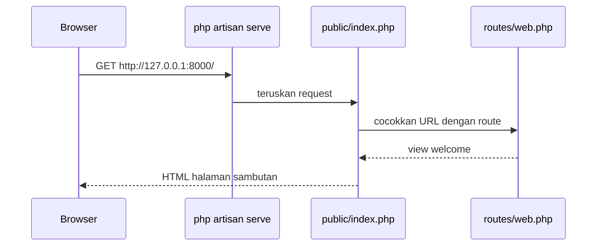
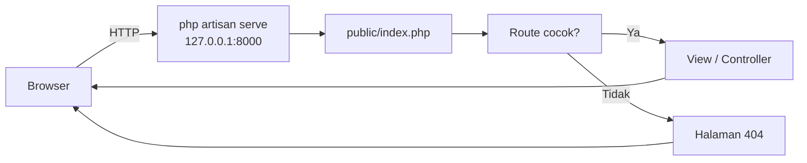

# Menjalankan Development Server

Proyek Laravel sudah ada, tetapi aplikasi baru "hidup" ketika dilayani oleh sebuah server dan bisa dibuka di
browser. Pada sub bab ini kamu menjalankan **development server** bawaan Laravel, membuka halaman sambutan,
menambah route pertamamu, dan memahami apa yang terjadi di terminal.

## Tujuan Pembelajaran

Setelah menyelesaikan sub bab ini, kamu dapat:

- [ ] Menjalankan dan menghentikan server dengan `php artisan serve`.
- [ ] Membuka aplikasi di browser dan membaca log request di terminal.
- [ ] Mengubah host dan port server, serta memahami apa yang terjadi bila port terpakai.
- [ ] Menambah route sederhana di `routes/web.php` dan mengujinya.
- [ ] Menjelaskan perbedaan development server dan server produksi.
- [ ] Menjelaskan fungsi `composer run dev`.
- [ ] Memeriksa kesehatan aplikasi lewat route `/up`.

## Prasyarat

- Sub bab [Membuat Proyek Laravel](01-07-creating-laravel-project.md): proyek `~/belajar-laravel/aplikasi-pertama`
  tersedia dan `php artisan --version` berfungsi.
- Browser dan terminal. Pemahaman route dasar dari proyek PHP native cukup; route Laravel dibahas lengkap di
  bab utama berikutnya.

## Pengantar

Pada proyek siswa kamu menjalankan `php -S localhost:8000 -t public`. Laravel menyediakan versi yang lebih
pintar dari ide yang sama: perintah `php artisan serve`. Server ini memakai server bawaan PHP di balik layar,
tetapi sudah dikonfigurasi untuk aplikasi Laravel, sehingga kamu tidak perlu mengingat opsi `-t public`.

## Penjelasan Konsep

### Development server

**Development server** adalah server ringan untuk mengembangkan aplikasi di komputermu sendiri. Perintah
`php artisan serve`, menurut deskripsinya di dalam kode framework, "melayani aplikasi dengan server pengembangan
PHP". Server ini:

- Menjawab request HTTP pada alamat lokal (`127.0.0.1`, juga dikenal sebagai `localhost`).
- Memakai port `8000` secara bawaan.
- Tidak memerlukan Nginx atau Apache.
- Menyala selama perintahnya berjalan di terminal; ketika kamu menghentikannya, aplikasi tidak lagi dapat diakses.

!!! tip "Analogi"
    Seperti membuka warung percobaan di depan rumah: cukup untuk menguji menu dan layanan, tetapi bukan restoran
    sungguhan yang siap melayani ribuan pelanggan.

!!! warning "Hanya untuk pengembangan"
    Development server tidak untuk produksi. Di produksi, aplikasi dilayani oleh web server seperti Nginx
    bersama PHP-FPM (dibahas di bab utama Deployment dan DevOps).

### Opsi `php artisan serve`

Berdasarkan definisi perintahnya pada framework 13.x:

| Opsi | Fungsi |
|---|---|
| `--host=` | Alamat tempat server melayani (bawaan `127.0.0.1`) |
| `--port=` | Port (bawaan `8000`) |
| `--tries=` | Jumlah maksimal port yang dicoba bila port terpakai (bawaan 10) |
| `--no-reload` | Tidak memuat ulang server ketika berkas `.env` berubah |

Bila port bawaan sedang dipakai dan kamu tidak menentukan `--port`, Laravel mencoba port berikutnya hingga batas
`--tries`. Jika kamu menentukan port sendiri, port itu dipakai apa adanya.

### `composer run dev`

Dokumentasi pemasangan menyebut `composer run dev`, yang menjalankan perintah Artisan `dev`. Menurut dokumentasi
Artisan 13.x, perintah `php artisan dev` menjalankan semua proses pengembangan dalam satu jendela terminal:

| Nama | Perintah |
|---|---|
| `server` | `php artisan serve` |
| `queue` | `php artisan queue:listen --tries=1 --timeout=0` |
| `logs` | `php artisan pail --timeout=0` |
| `vite` | `npm run dev` |

Perintah ini membutuhkan **Node 22.13 atau lebih baru** dan npm. Pada bab utama ini kita hanya memakai
`php artisan serve`, karena belum memakai aset frontend maupun antrean. `composer run dev` dan `php artisan dev`
dipakai kembali pada bab utama Blade dan Frontend. Penjelasan lengkapnya ada di sub bab *Artisan CLI*.

### Apa yang terjadi ketika halaman dibuka



Route bawaan di `routes/web.php` memetakan URL `/` ke view `welcome`:

File: `routes/web.php`

```php
<?php

use Illuminate\Support\Facades\Route;

Route::get('/', function () {
    return view('welcome');
});
```

| Bagian | Arti |
|---|---|
| `Route::get('/', ...)` | Route untuk request `GET` ke URL `/` |
| `function () { ... }` | Closure yang dijalankan saat route cocok |
| `view('welcome')` | Memuat tampilan `resources/views/welcome.blade.php` |

### Mode debug lokal

Berkas `.env` proyek baru berisi `APP_ENV=local`, `APP_DEBUG=true`, dan `APP_URL=http://localhost:8000`. Dengan
debug aktif, error ditampilkan lengkap untuk membantu pengembangan. Dokumentasi menegaskan bahwa di produksi nilai
`APP_DEBUG` harus `false`, karena menampilkan detail error dapat membocorkan informasi sensitif.

### Route kesehatan `/up`

Laravel menyediakan route `/up` secara bawaan. Dokumentasi menyebut route ini mengembalikan respons HTTP **200**
bila aplikasi berhasil menyala tanpa exception, dan **500** bila tidak. Route ini biasa dipakai untuk pemantauan di
produksi.

## Cara Kerja

Setiap request melewati urutan yang sama: browser → server → pintu masuk `public/index.php` → route → tanggapan.



Rincian proses di dalam Laravel dibahas di sub bab *Request Lifecycle*.

## Contoh Praktik

Kamu menjalankan server, membuka halaman sambutan, mengamati log, menguji `/up` dan halaman 404,
menambah route `/halo`, mengubah port, lalu mencatat perubahan di Git.

## Penjelasan Kode

Satu-satunya kode aplikasi yang kamu tulis adalah route kecil:

File: `routes/web.php`

```php-inline
Route::get('/halo', function () {
    return 'Halo dari Laravel!';
});
```

| Bagian | Penjelasan |
|---|---|
| `Route::get('/halo', ...)` | Mendaftarkan route `GET /halo` |
| `function () { ... }` | Closure yang dijalankan bila URL cocok |
| `return 'Halo dari Laravel!';` | Nilai kembalian diubah Laravel menjadi isi response |

Teks biasa yang dikembalikan akan dikirim sebagai isi halaman (status 200).

## Implementasi Langkah demi Langkah

### Langkah 1: masuk ke proyek dan jalankan server

```bash
cd ~/belajar-laravel/aplikasi-pertama
php artisan serve
```

Terminal tampak "menggantung": itu normal, artinya server sedang berjalan. Biarkan terbuka. Perhatikan
pesan di terminal; ia memuat alamat server (umumnya `http://127.0.0.1:8000`) dan petunjuk menghentikannya.

### Langkah 2: buka di browser

Buka alamat yang tertera di terminal, biasanya `http://127.0.0.1:8000`. Kamu akan melihat halaman sambutan Laravel.

### Langkah 3: amati log request

Muat ulang halaman beberapa kali dan perhatikan terminal. Setiap request yang masuk dicatat. Buka juga
`http://127.0.0.1:8000/tidak-ada` untuk melihat halaman 404, lalu lihat catatannya di terminal.

### Langkah 4: uji route kesehatan

Di terminal lain (di Windows PowerShell tulis `curl.exe`):

```bash
curl -i http://127.0.0.1:8000/up
```

### Langkah 5: tambahkan route baru

Buka `routes/web.php` dan tambahkan di bawah route yang ada:

```php-inline
Route::get('/halo', function () {
    return 'Halo dari Laravel!';
});
```

Simpan, **tanpa menghentikan server**, lalu buka `http://127.0.0.1:8000/halo` atau:

```bash
curl -i http://127.0.0.1:8000/halo
```

### Langkah 6: ubah port

Hentikan server dengan ++ctrl+c++ lalu jalankan:

```bash
php artisan serve --port=8080
```

Buka `http://127.0.0.1:8080`. Hentikan dengan ++ctrl+c++.

### Langkah 7: lihat perilaku port terpakai

Buka dua terminal. Di terminal pertama jalankan `php artisan serve`. Di terminal kedua, pada folder proyek yang
sama, jalankan `php artisan serve` lagi tanpa opsi port. Perhatikan alamat yang dipakai server kedua, lalu hentikan
keduanya dengan ++ctrl+c++.

### Langkah 8: catat perubahan di Git

```bash
git status
git add routes/web.php
git commit -m "Tambah route /halo"
git log --oneline
```

## Eksekusi dan Verifikasi

| Langkah | Cara memverifikasi |
|---|---|
| 1 | Terminal menampilkan alamat server dan tidak langsung kembali ke prompt |
| 2 | Browser menampilkan halaman sambutan Laravel |
| 3 | Terminal mencatat tiap request; `/tidak-ada` menampilkan halaman 404 |
| 4 | `curl -i` menampilkan status `200` |
| 5 | `/halo` menampilkan teks `Halo dari Laravel!` tanpa me-restart server |
| 6 | Aplikasi terbuka di port 8080 |
| 7 | Server kedua memakai port berbeda dari yang pertama |
| 8 | `git log --oneline` memuat commit "Tambah route /halo" |

## Hasil yang Diharapkan

- Server berjalan dan mencantumkan alamat lokal (nilai bawaan `127.0.0.1:8000`).
- Halaman utama menampilkan halaman sambutan Laravel.
- `/up` menjawab status `200`, sesuai penjelasan dokumentasi.
- `/tidak-ada` menjawab halaman 404.
- `/halo` menampilkan `Halo dari Laravel!`. Perubahan route terbaca tanpa me-restart server, karena setiap
  request memuat kode terbaru.
- Server kedua pada Langkah 7 memakai port berikutnya, sesuai perilaku `--tries` pada kode framework.

Teks persis yang dicetak terminal (misalnya format baris "Server running on ...") dapat berbeda antar versi
framework, jadi cocokkan alamatnya saja. Keluaran di atas diturunkan dari kode dan dokumentasi, dan belum dijalankan
oleh penulis materi.

## Kesalahan Umum dan Pemecahan Masalah

| Gejala | Penyebab | Cara mengenali | Solusi | Pencegahan |
|---|---|---|---|---|
| `Could not open input file: artisan` | Perintah dijalankan bukan di folder proyek | `ls` tidak menampilkan berkas `artisan` | `cd ~/belajar-laravel/aplikasi-pertama` | Cek folder dengan `pwd` |
| Browser: *This site can't be reached* | Server tidak berjalan atau port berbeda | Terminal tidak menampilkan server aktif | Jalankan `php artisan serve` dan buka alamat yang tertera | Baca alamat dari terminal |
| Halaman error dengan tulisan *could not find driver* | `pdo_sqlite` tidak aktif | Pesan menyebut driver | Pasang ekstensi SQLite dan ulangi | Jalankan `cek-persyaratan.php` |
| Port terpakai pada `--port=8080` | Program lain memakai port | Pesan tidak bisa melayani | Pilih port lain | Gunakan port bebas |
| Perubahan route tidak muncul | Berkas belum disimpan atau salah folder | `git diff` tidak menunjukkan perubahan | Simpan berkas di proyek yang benar | Cek `pwd` dan editor |
| Halaman error karena salah ketik PHP | Kesalahan sintaks | Pesan menunjuk berkas dan baris | Perbaiki sintaks (titik koma, kurung) | Baca pesan error baris yang disebut |
| Mengakses dari perangkat lain gagal | Server hanya melayani `127.0.0.1` | Ponsel tidak bisa membuka alamat laptop | Gunakan `--host=0.0.0.0` hanya di jaringan tepercaya | Pahami risikonya (lihat catatan) |
| `composer run dev` gagal | Node.js/npm belum terpasang atau dependensi belum dipasang | Pesan *npm: command not found* | Gunakan `php artisan serve`, atau pasang Node.js dan jalankan `npm install` | Pasang Node.js sebelum bab frontend |

!!! danger "Hati-hati dengan `--host=0.0.0.0`"
    Opsi ini membuat server dapat diakses dari perangkat lain di jaringan yang sama. Dengan `APP_DEBUG=true`,
    halaman error dapat menampilkan informasi sensitif. Gunakan hanya di jaringan yang kamu percaya dan jangan
    dibiarkan menyala tanpa pengawasan.

## Latihan Praktik

### Latihan dasar

**D1. Jalankan dan dokumentasikan**
- *Masalah:* buktikan aplikasi berjalan.
- *Persyaratan:* tulis alamat server, status `/up`, dan status `/tidak-ada` dari `curl -i`.
- *Perilaku yang diharapkan:* `/up` berstatus 200 dan `/tidak-ada` berstatus 404.
- *Tujuan belajar:* memverifikasi aplikasi lewat HTTP.

**D2. Route sapaan**
- *Masalah:* buat halaman sapaan tambahan.
- *Persyaratan:* tambahkan route `/tentang` yang menampilkan satu kalimat tentang aplikasimu.
- *Perilaku yang diharapkan:* halaman tampil tanpa me-restart server.
- *Tujuan belajar:* menambah route sederhana.

### Latihan implementasi

**I1. Route dengan nilai kembalian lain**
- *Masalah:* ingin route yang mengembalikan data terstruktur.
- *Persyaratan:* buat route `/info` yang mengembalikan array asosiatif (nama aplikasi dan nomor versi).
- *Perilaku yang diharapkan:* respons berformat JSON dengan header `Content-Type: application/json` (periksa dengan
  `curl -i`).
- *Tujuan belajar:* memahami bahwa array otomatis dikirim sebagai JSON.

**I2. Log dan debug**
- *Masalah:* ingin mengerti perbedaan tampilan error.
- *Persyaratan:* buat sengaja route dengan kesalahan (misalnya memanggil fungsi yang tidak ada), amati halaman error
  saat `APP_DEBUG=true`, ubah `APP_DEBUG=false` di `.env`, dan bandingkan. Kembalikan ke `true` setelah selesai.
- *Perilaku yang diharapkan:* halaman error rinci berubah menjadi halaman umum.
- *Tujuan belajar:* memahami arti `APP_DEBUG`.
- *Catatan:* perubahan `.env` memicu pemuatan ulang server (kecuali `--no-reload`).

### Latihan tantangan

**T1. Skrip pemeriksa server**
- *Masalah:* ingin memeriksa otomatis bahwa aplikasi sehat.
- *Persyaratan:* tulis skrip Bash yang menjalankan `php artisan serve` di latar belakang, menunggu beberapa detik, memeriksa
  status `/up` dengan `curl`, mencetak "SEHAT" atau "BERMASALAH", lalu menghentikan server.
- *Perilaku yang diharapkan:* skrip selalu menghentikan server dan memberi kode keluar sesuai hasil.
- *Tujuan belajar:* mengelola proses latar belakang dan pemeriksaan kesehatan.
- *Catatan:* kerjakan mandiri; tidak ada kunci jawaban.

## Uji Pemahaman

1. Apa fungsi `php artisan serve` dan apa alamat bawaannya?
2. Mengapa development server tidak boleh dipakai di produksi?
3. Apa yang dilakukan Laravel bila port 8000 sudah dipakai dan kamu tidak menentukan port?
4. Apa arti status 200 dan 500 pada route `/up`?
5. Mengapa kamu tidak perlu me-restart server setelah mengubah `routes/web.php`?
6. Apa risiko `--host=0.0.0.0` saat `APP_DEBUG=true`?
7. Apa beda `php artisan serve` dan `composer run dev`?
8. Berkas apa yang melayani URL `/` pada proyek baru?

??? success "Kunci jawaban singkat"
    1. Menjalankan server pengembangan untuk aplikasi; `http://127.0.0.1:8000`.
    2. Tidak dirancang untuk beban dan keamanan produksi; produksi memakai Nginx/Apache dan PHP-FPM.
    3. Mencoba port berikutnya sampai batas `--tries`.
    4. 200 jika aplikasi menyala tanpa exception; 500 jika tidak.
    5. Setiap request memuat kode terbaru.
    6. Perangkat lain dapat melihat halaman error yang rinci dan berpotensi membocorkan informasi.
    7. `serve` hanya server; `composer run dev` (yang memanggil `php artisan dev`) menjalankan beberapa proses (server, antrean, log, Vite) dan butuh Node 22.13+.
    8. `routes/web.php` memetakan `/` ke view `welcome` (`resources/views/welcome.blade.php`).

## Ringkasan

- `php artisan serve` menjalankan server pengembangan pada `127.0.0.1:8000` secara bawaan.
- Opsi `--host`, `--port`, `--tries`, dan `--no-reload` mengatur perilakunya.
- Route `/` menampilkan halaman sambutan; `/up` adalah route kesehatan (200 atau 500).
- Route baru di `routes/web.php` langsung terbaca tanpa me-restart server.
- `composer run dev` menjalankan beberapa proses dan membutuhkan Node.js.
- Server ini hanya untuk pengembangan; jangan buka ke jaringan tanpa pertimbangan keamanan.

Selanjutnya: *Struktur Direktori Laravel*, yaitu menelusuri isi folder proyek dan fungsi tiap bagiannya.

## Referensi Resmi

- [Laravel: Installation (Creating an Application)](https://laravel.com/docs/13.x/installation#creating-an-application)
- [Laravel: Deployment (The Health Route)](https://laravel.com/docs/13.x/deployment#the-health-route)
- [Laravel: Configuration (Debug Mode)](https://laravel.com/docs/13.x/configuration#debug-mode)
- [Laravel: Routing](https://laravel.com/docs/13.x/routing)
- [Laravel: Artisan Console](https://laravel.com/docs/13.x/artisan)
- [Laravel: Error Handling](https://laravel.com/docs/13.x/errors)
- [Laravel: Vite](https://laravel.com/docs/13.x/vite)
- [PHP Manual: Built-in web server](https://www.php.net/manual/en/features.commandline.webserver.php)
