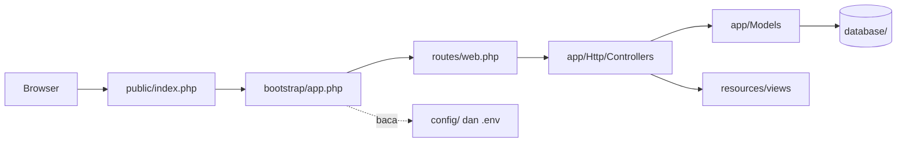

# Struktur Direktori Laravel

Proyek Laravel yang baru dibuat berisi belasan folder dan berkas. Pada proyek siswa kamu merancang
struktur sendiri; di Laravel strukturnya sudah baku. Mengetahui fungsi tiap folder membuatmu langsung tahu ke
mana harus menulis kode dan ke mana tidak boleh menyentuh.

## Tujuan Pembelajaran

Setelah menyelesaikan sub bab ini, kamu dapat:

- [ ] Menjelaskan fungsi folder utama proyek Laravel: `app`, `bootstrap`, `config`, `database`, `public`, `resources`, `routes`, `storage`, `tests`, dan `vendor`.
- [ ] Menjelaskan isi `app/Http`, `app/Models`, dan `app/Providers`, serta mengapa folder lain "baru muncul saat dibutuhkan".
- [ ] Menentukan lokasi yang tepat untuk berkas tertentu (controller, view, migration, dan seterusnya).
- [ ] Membedakan folder yang boleh diubah, yang dibuat otomatis, dan yang tidak boleh disentuh.
- [ ] Memetakan struktur proyek siswa PHP native ke struktur Laravel.
- [ ] Menjelaskan mengapa hanya folder `public` yang boleh diakses dari web.

## Prasyarat

- Sub bab [Membuat Proyek Laravel](01-07-creating-laravel-project.md) dan
  [Menjalankan Development Server](01-08-running-development-server.md): proyek
  `~/belajar-laravel/aplikasi-pertama` tersedia dan berjalan.
- Pemahaman [Namespace dan Autoloading](../level-00/00-22-namespace-and-autoloading.md) (PSR-4).
- [Arsitektur MVC](01-03-mvc-architecture.md).

## Pengantar

Struktur baku punya dua manfaat. Pertama, kamu cepat menemukan kode: controller selalu di tempat yang sama
pada setiap proyek Laravel. Kedua, framework tahu di mana mencari sesuatu, misalnya view dan berkas konfigurasi.
Dokumentasi menyebut struktur bawaan sebagai titik awal yang baik untuk aplikasi kecil maupun besar, dan Laravel
hampir tidak membatasi letak class selama Composer bisa melakukan *autoload*-nya.

## Penjelasan Konsep

### Gambaran tingkat atas

```text
aplikasi-pertama/
├── app/               kode utama aplikasi (namespace App)
├── bootstrap/         memulai (bootstrap) framework
├── config/            berkas konfigurasi
├── database/          migration, factory, seeder, dan database SQLite
├── public/            pintu masuk web (index.php) dan aset publik
├── resources/         view dan aset mentah (CSS, JavaScript)
├── routes/            definisi route
├── storage/           log, cache, sesi, dan berkas buatan aplikasi
├── tests/             pengujian otomatis
├── vendor/            paket Composer (termasuk framework)
├── .env               pengaturan lingkungan (rahasia)
├── artisan            alat baris perintah Laravel
├── composer.json      kebutuhan paket dan autoload
└── phpunit.xml        konfigurasi pengujian
```

Susunan di atas mengikuti dokumentasi dan kerangka aplikasi 13.x. Jumlah berkas konfigurasi tambahan
(mis. `package.json`, `vite.config.js`) bergantung pilihan saat membuat proyek.

### Folder utama

| Folder | Fungsi | Dibuat/diubah oleh |
|---|---|---|
| **`app/`** | Inti kode aplikasi; hampir semua class-mu ada di sini; di-*autoload* dengan PSR-4 di bawah namespace `App` | Kamu dan perintah Artisan `make:` |
| **`bootstrap/`** | Berisi `app.php` yang memulai framework (termasuk mendaftarkan route), dan `cache/` untuk berkas optimasi buatan framework | Framework |
| **`config/`** | Semua berkas konfigurasi (`app.php`, `database.php`, dan lainnya) | Kamu (sesuai kebutuhan) |
| **`database/`** | Migration, model factory, seeder, dan (opsional) berkas SQLite | Kamu dan Artisan |
| **`public/`** | `index.php` (pintu masuk semua request), serta gambar, JavaScript, dan CSS publik | Kamu (aset), jangan menambah kode aplikasi |
| **`resources/`** | View (Blade) dan aset mentah yang belum dikompilasi | Kamu |
| **`routes/`** | Definisi route: `web.php` dan `console.php` secara bawaan | Kamu |
| **`storage/`** | Log, template Blade terkompilasi, sesi berbasis berkas, cache berkas, dan berkas yang dibuat aplikasi | Framework dan aplikasi |
| **`tests/`** | Pengujian otomatis (`Feature`, `Unit`) | Kamu |
| **`vendor/`** | Dependensi Composer | Composer |

!!! tip "Analogi"
    Rumah dengan ruangan berfungsi jelas: `app` adalah ruang kerja, `resources` etalase tampilan, `routes` papan
    petunjuk di lobi, `config` panel pengaturan, `storage` gudang, `vendor` rak peralatan yang dipasok pihak lain,
    dan `public` satu-satunya pintu depan yang boleh dilewati tamu.

### Isi folder `app/`

Secara bawaan `app/` berisi tiga folder:

| Folder | Isi |
|---|---|
| `app/Http/` | Controller (dan nanti middleware serta form request); hampir semua logika penanganan request |
| `app/Models/` | Model Eloquent; bawaan hanya `User.php` |
| `app/Providers/` | Service provider (mis. `AppServiceProvider.php`), dibahas pada bab utama *Advanced Laravel Features* |

Folder lain muncul **hanya ketika dibutuhkan**, ketika kamu menjalankan perintah `make:` yang sesuai. Contoh dari
dokumentasi:

| Folder | Muncul setelah perintah | Isi |
|---|---|---|
| `app/Console/` | `make:command` | Perintah Artisan buatan sendiri |
| `app/Exceptions/` | `make:exception` | Exception khusus |
| `app/Events/`, `app/Listeners/` | `make:event`, `make:listener` | Event dan pendengarnya |
| `app/Jobs/` | `make:job` | Pekerjaan antrean |
| `app/Mail/`, `app/Notifications/` | `make:mail`, `make:notification` | Email dan notifikasi |
| `app/Policies/` | `make:policy` | Aturan otorisasi |
| `app/Rules/` | `make:rule` | Aturan validasi kustom |

Dokumentasi menyebut `Console` dan `Http` sebagai dua "pintu" ke inti aplikasi: HTTP dan CLI hanyalah cara memberi
perintah, sedangkan logika aplikasinya ada di tempat lain. Daftar perintah `make:` lengkap tersedia dengan
`php artisan list make`.

### Folder `routes/`

| Berkas | Fungsi |
|---|---|
| `web.php` | Route untuk antarmuka web; berada pada *middleware group* `web` (sesi, perlindungan CSRF, enkripsi cookie) |
| `console.php` | Perintah konsol berbasis closure dan penjadwalan tugas |

Berkas lain (`api.php`, `channels.php`) baru ada setelah memasang fitur terkait (`install:api`, `install:broadcasting`).

### Folder `database/`

Bawaan: `migrations/`, `factories/`, `seeders/`, dan berkas `database.sqlite`. Migration bawaan membuat tabel
pengguna, cache, dan antrean (*jobs*).

### Folder `storage/` dan `public/storage`

`storage/` terbagi menjadi `app/`, `framework/`, dan `logs/`. Berkas buatan pengguna yang harus publik (mis. foto
profil) disimpan di `storage/app/public`, lalu dibuatkan tautan simbolik `public/storage` dengan
`php artisan storage:link`. Pengaturan ini dibahas di bab utama *Advanced Laravel Features* (File Storage).

### Berkas di akar proyek

| Berkas | Fungsi |
|---|---|
| `artisan` | Titik masuk perintah `php artisan ...` |
| `composer.json` / `composer.lock` | Kebutuhan paket dan pemetaan autoload (`App\` ke `app/`) |
| `.env` | Pengaturan lingkungan; rahasia dan tidak di-commit |
| `.env.example` | Contoh `.env` tanpa rahasia; boleh di-commit |
| `.gitignore` | Daftar berkas yang tidak dilacak Git |
| `phpunit.xml` | Konfigurasi pengujian |
| `package.json`, `vite.config.js` | Konfigurasi aset frontend (jika ada) |

### Mana yang boleh diubah?

| Kelompok | Folder/berkas | Aturan |
|---|---|---|
| Kamu tulis dan ubah | `app/`, `routes/`, `resources/`, `database/` (migration/seeder), `tests/`, `config/` | Tempat kerja utama |
| Dibuat framework, jangan diedit manual | `storage/framework`, `bootstrap/cache` | Dihapus/dibuat ulang oleh perintah Artisan |
| **Jangan diedit** | `vendor/` | Diubah hanya lewat Composer; edit manual akan hilang saat pembaruan |
| Rahasia | `.env` | Jangan di-commit atau dibagikan |

### Keamanan struktur

- Web server harus menunjuk ke folder **`public/`** sebagai akar. Dokumentasi memperingatkan agar Laravel tidak
  dilayani dari subfolder web directory karena dapat mengekspos berkas sensitif.
- Alasannya jelas: `.env`, `config/`, `app/`, dan `storage/` tidak boleh bisa dibuka lewat URL. Hanya `public/`
  yang aman diakses publik.

### Padanan dengan proyek siswa

| Proyek siswa (PHP native) | Laravel |
|---|---|
| `public/` | `public/` |
| `src/Model`, `src/Repository` | `app/Models` (dan class pendukung di `app/`) |
| `public/tambah.php` dan sejenisnya (pengendali) | `app/Http/Controllers/` + route di `routes/web.php` |
| `views/` | `resources/views/` |
| `config.php` | `config/` dan `.env` |
| `data/siswa.json` | `database/` (SQLite) |
| `vendor/` | `vendor/` |

## Cara Kerja

Hubungan folder-folder utama ketika sebuah request datang:



`public/index.php` memuat autoloader dari `vendor/` dan menjalankan aplikasi yang dibangun oleh
`bootstrap/app.php`, yang mendaftarkan berkas route. Rincian lengkapnya ada di sub bab *Request Lifecycle*.

## Contoh Praktik

Kamu menelusuri proyek `aplikasi-pertama` secara langsung, membuat dua berkas dengan Artisan untuk melihat
bagaimana folder terbentuk "saat dibutuhkan", lalu membersihkannya.

## Penjelasan Kode

| Perintah | Fungsi |
|---|---|
| <code>find . -maxdepth 2 ... &#124; sort</code> | Mendaftar berkas dan folder sampai dua tingkat, tanpa folder besar |
| `ls -a` | Menampilkan isi folder termasuk berkas tersembunyi |
| `php artisan list make` | Mendaftar semua perintah pembuat berkas (`make:`) |
| `php artisan make:controller HaloController` | Membuat class controller di `app/Http/Controllers` |
| `php artisan make:exception DemoException` | Membuat class exception di `app/Exceptions` |
| `git status` | Menunjukkan berkas baru yang dibuat |

## Implementasi Langkah demi Langkah

### Langkah 1: telusuri folder tingkat atas

```bash
cd ~/belajar-laravel/aplikasi-pertama
ls -a
```

Cocokkan hasilnya dengan tabel folder utama. Folder `vendor/` ada jika dependensi sudah terpasang.

### Langkah 2: telusuri dua tingkat

```bash
find . -maxdepth 2 -not -path "./vendor*" -not -path "./.git/*" -not -path "./node_modules*" | sort
```

Opsi `-not -path` mengecualikan folder besar. Perhatikan isi `app/`, `config/`, `database/`, `resources/`,
`routes/`, dan `tests/`.

### Langkah 3: baca berkas penting

```bash
cat routes/web.php
cat public/index.php
ls config
```

Baca juga `app/Models/User.php` dan `app/Http/Controllers/Controller.php` dengan editor. Jangan mengubah apa pun.

### Langkah 4: lihat pemetaan autoload

Buka `composer.json` dan temukan bagian `autoload` > `psr-4`. Catat pemetaan namespace ke folder, lalu cocokkan
dengan namespace pada `app/Models/User.php`.

### Langkah 5: folder muncul saat dibutuhkan

```bash
ls app
php artisan make:controller HaloController
php artisan make:exception DemoException
ls app app/Http/Controllers
git status
```

Perhatikan folder `Exceptions` yang baru muncul di `app/` dan berkas `HaloController.php` di
`app/Http/Controllers/`.

### Langkah 6: bersihkan hasil percobaan

Periksa dulu apa yang akan dihapus, lalu hapus **hanya** berkas percobaan itu:

```bash
git status
rm app/Http/Controllers/HaloController.php
rm -r app/Exceptions
git status
```

!!! warning "Periksa jalur sebelum `rm`"
    `rm` tidak dapat dibatalkan. Pastikan kamu berada di folder `aplikasi-pertama` (`pwd`) dan perintah hanya
    menyebut dua jalur di atas.

### Langkah 7: buat peta direktori milikmu

Salin tabel padanan proyek siswa ke catatanmu, lalu tambahkan satu kolom "apa yang akan kutaruh di sini" untuk tiap
folder, berdasarkan pemahamanmu sendiri.

## Eksekusi dan Verifikasi

| Langkah | Cara memverifikasi |
|---|---|
| 1 | Folder utama pada tabel terlihat |
| 2 | Isi `app/` hanya `Http`, `Models`, `Providers`; `resources/views` memuat `welcome.blade.php` |
| 3 | `routes/web.php` memuat route `/` ke view `welcome`; `public/index.php` ada |
| 4 | Pemetaan `App\` ke `app/` ditemukan |
| 5 | Folder `app/Exceptions` dan berkas `HaloController.php` muncul, tercatat di `git status` |
| 6 | Setelah dibersihkan, `git status` kembali tidak menunjukkan berkas percobaan |
| 7 | Catatan peta direktori tersusun |

## Hasil yang Diharapkan

- Isi proyek sesuai dokumentasi: `app` (tiga folder bawaan), `bootstrap`, `config`, `database`, `public`, `resources`,
  `routes`, `storage`, `tests`, dan `vendor`.
- Berkas konfigurasi tambahan, daftar berkas di akar, dan isi `config/` dapat sedikit berbeda dari tabel karena
  bergantung versi kerangka aplikasi dan pilihanmu saat membuat proyek.
- Setelah Langkah 5, folder `app/Exceptions` ada; ini membuktikan klaim dokumentasi bahwa folder tertentu baru
  dibuat ketika dibutuhkan.
- Setelah Langkah 6, `git status` bersih seperti sebelum percobaan.

Daftar berkas pada kerangka 13.x di GitHub diperiksa saat menulis materi ini, tetapi keluaran perintah di komputermu belum
diuji oleh penulis; cocokkan dan catat perbedaannya.

## Kesalahan Umum dan Pemecahan Masalah

| Gejala | Penyebab | Cara mengenali | Solusi | Pencegahan |
|---|---|---|---|---|
| Menaruh controller di folder salah | Belum hafal struktur | Laravel tidak menemukan class | Pindahkan ke `app/Http/Controllers` dan samakan namespace | Gunakan `php artisan make:controller` |
| Mengedit `vendor/` | Ingin memperbaiki bug di paket | Perubahan hilang setelah `composer update` | Jangan edit; pakai fitur ekstensi framework atau laporkan bug | Anggap `vendor/` baca-saja |
| Meletakkan kode aplikasi di `public/` | Terbiasa dari PHP native | Berkas PHP baru di `public/` | Pindahkan logika ke `app/` dan route | Hanya aset dan `index.php` di `public/` |
| Folder `app/Jobs` (dan lainnya) tidak ada | Dibuat hanya saat dibutuhkan | `ls app` tidak menampilkannya | Jalankan perintah `make:job` | Pahami "folder muncul saat perlu" |
| `rm` menghapus berkas yang salah | Jalur salah atau di folder lain | `git status` menunjukkan berkas penting hilang | Pulihkan dengan `git restore <jalur>` | Periksa `pwd` dan jalur sebelum `rm` |
| `.env` ikut ter-commit | Tidak diabaikan | `git status` menampilkan `.env` | Tambahkan ke `.gitignore`, hapus dari indeks dengan `git rm --cached .env` | Cek `git check-ignore -v .env` |
| Server web menunjuk ke akar proyek, bukan `public/` | Konfigurasi web server salah | URL `/.env` dapat dibuka | Arahkan document root ke `public/` | Ikuti panduan deployment |

## Latihan Praktik

### Latihan dasar

**D1. Di mana kodenya?**
- *Masalah:* tentukan lokasi untuk berkas berikut.
- *Persyaratan:* tulis folder untuk: view daftar siswa, route `/siswa`, model `Siswa`, migration tabel siswa,
  controller `SiswaController`, dan berkas pengujian untuk siswa.
- *Perilaku yang diharapkan:* sesuai tabel folder utama.
- *Tujuan belajar:* menghafal lokasi dasar.

**D2. Bisa dibuka lewat web?**
- *Masalah:* tentukan folder yang aman diakses publik.
- *Persyaratan:* untuk `.env`, `config/app.php`, `public/index.php`, `storage/logs`, dan `public/favicon.ico`, nyatakan
  apakah boleh dapat dibuka lewat URL.
- *Perilaku yang diharapkan:* hanya yang berada di `public/` yang boleh.
- *Tujuan belajar:* memahami batas keamanan struktur.

### Latihan implementasi

**I1. Peta autoload**
- *Masalah:* buktikan hubungan namespace dan folder.
- *Persyaratan:* dari `composer.json`, tuliskan pemetaan PSR-4 dan tunjukkan tiga class dengan namespace dan jalur berkasnya.
- *Perilaku yang diharapkan:* setiap namespace cocok dengan jalur berkas.
- *Tujuan belajar:* menghubungkan struktur dengan autoloading.

**I2. Folder yang muncul saat dibutuhkan**
- *Masalah:* buktikan bahwa folder dibuat otomatis.
- *Persyaratan:* pilih dua perintah `make:` berbeda (lihat `php artisan list make`), jalankan, catat folder baru, lalu
  bersihkan dengan aman.
- *Perilaku yang diharapkan:* `git status` kembali bersih.
- *Tujuan belajar:* memahami bahwa struktur tumbuh bersama aplikasi.

### Latihan tantangan

**T1. Dokumentasi struktur untuk anggota baru**
- *Masalah:* tim membutuhkan panduan satu halaman untuk anggota baru.
- *Persyaratan:* tulis panduan yang memuat pohon direktori, fungsi tiap folder, tiga "jangan" (mis. jangan edit `vendor/`),
  dan alur satu request melewati folder-folder tersebut.
- *Perilaku yang diharapkan:* anggota baru dapat menemukan lokasi controller, view, dan route tanpa bertanya.
- *Tujuan belajar:* mengomunikasikan struktur proyek.
- *Catatan:* kerjakan mandiri; tidak ada kunci jawaban.

## Uji Pemahaman

1. Apa fungsi folder `public/` dan mengapa ia satu-satunya yang boleh diakses web?
2. Folder apa saja yang ada di `app/` secara bawaan?
3. Mengapa folder seperti `app/Jobs` tidak ada pada proyek baru?
4. Apa isi `routes/web.php` dan `routes/console.php`?
5. Mengapa tidak boleh mengedit `vendor/`?
6. Di mana controller, model, dan view diletakkan?
7. Apa fungsi `storage/` dan `bootstrap/cache`?
8. Bagaimana pemetaan namespace `App\` ke folder?

??? success "Kunci jawaban singkat"
    1. Berisi `index.php` dan aset publik; folder lain berisi kode dan rahasia yang tidak boleh terekspos.
    2. `Http`, `Models`, `Providers`.
    3. Folder dibuat saat perintah `make:` yang bersangkutan dijalankan.
    4. `web.php`: route web (middleware group `web`); `console.php`: perintah konsol dan penjadwalan.
    5. Diatur oleh Composer; perubahan manual akan hilang saat pembaruan.
    6. `app/Http/Controllers`, `app/Models`, `resources/views`.
    7. `storage/`: log, cache, sesi, berkas aplikasi; `bootstrap/cache`: berkas optimasi buatan framework.
    8. `App\` dipetakan ke `app/` lewat PSR-4 di `composer.json`.

## Ringkasan

- Struktur Laravel baku: `app`, `bootstrap`, `config`, `database`, `public`, `resources`, `routes`, `storage`, `tests`,
  `vendor`.
- Kode utamamu ada di `app/` (dengan `Http`, `Models`, `Providers` secara bawaan), `routes/`, `resources/`, dan
  `database/`.
- Folder lain di `app/` muncul ketika perintah `make:` dijalankan.
- Hanya `public/` yang boleh menjadi akar web; `.env` dan `vendor/` tidak boleh disentuh atau dibagikan.
- Pemetaan PSR-4 menghubungkan namespace `App\` dengan folder `app/`.

Selanjutnya: *Konfigurasi Laravel*, yaitu isi folder `config/` dan cara mengubah pengaturan.

## Referensi Resmi

- [Laravel: Directory Structure](https://laravel.com/docs/13.x/structure)
- [Laravel: Installation (Directory Configuration)](https://laravel.com/docs/13.x/installation#directory-configuration)
- [Laravel: Routing](https://laravel.com/docs/13.x/routing)
- [Laravel: Artisan Console](https://laravel.com/docs/13.x/artisan)
- [Laravel: File Storage](https://laravel.com/docs/13.x/filesystem)
- [Kerangka aplikasi Laravel 13.x di GitHub](https://github.com/laravel/laravel/tree/13.x)
- [PHP-FIG: PSR-4](https://www.php-fig.org/psr/psr-4/)
