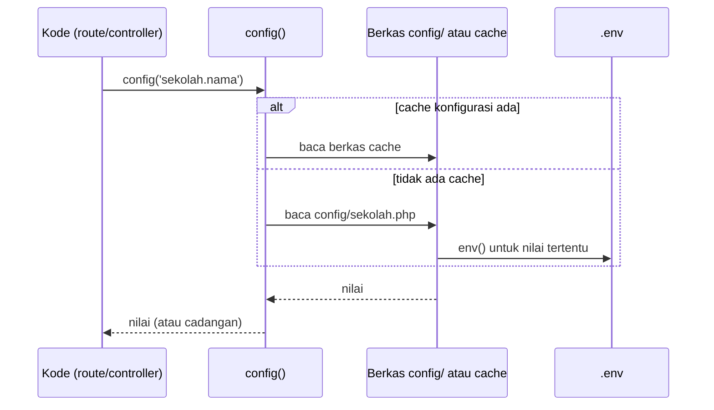

# Konfigurasi Laravel

Setiap aplikasi punya pengaturan: nama aplikasi, zona waktu, koneksi database, bahasa, dan banyak lagi. Pada
proyek siswa PHP native, semuanya ada di satu berkas `config.php`. Laravel menyediakan folder `config/` berisi
berkas-berkas konfigurasi terpisah, serta cara seragam untuk membacanya dari mana saja dengan fungsi `config()`.

## Tujuan Pembelajaran

Setelah menyelesaikan sub bab ini, kamu dapat:

- [ ] Menjelaskan fungsi folder `config/` dan bentuk berkas konfigurasi Laravel.
- [ ] Membaca nilai konfigurasi dengan fungsi `config()` dan sintaks "dot".
- [ ] Membuat berkas konfigurasi sendiri dan membacanya dari route.
- [ ] Menjelaskan bahwa perubahan konfigurasi saat runtime hanya berlaku pada request itu.
- [ ] Menjelaskan fungsi `config:cache` dan `config:clear`, serta akibat pada fungsi `env()`.
- [ ] Menampilkan konfigurasi dengan `php artisan config:show` dan `php artisan about`.

## Prasyarat

- Sub bab [Struktur Direktori Laravel](01-09-laravel-directory-structure.md).
- Proyek `~/belajar-laravel/aplikasi-pertama` dapat dijalankan dengan `php artisan serve`.
- Berkas yang mengembalikan array ([Include dan Require](../level-00/00-17-include-and-require.md)).

## Pengantar

Bayangkan nama aplikasi dipakai di dua puluh tempat. Jika ditulis langsung di setiap tempat, mengubahnya berarti
mencari dan mengganti dua puluh kali. Dengan konfigurasi terpusat, nilai ditulis sekali dan dibaca di mana saja.
Konfigurasi juga memudahkan perbedaan antara komputer lokal dan server produksi tanpa mengubah kode.

## Penjelasan Konsep

### Folder `config/`

Menurut dokumentasi, semua berkas konfigurasi framework disimpan di folder `config`, dan setiap opsi diberi
komentar penjelasan. Isi bawaan kerangka aplikasi 13.x:

| Berkas | Mengatur |
|---|---|
| `app.php` | Nama, lingkungan, mode debug, URL, zona waktu, bahasa, kunci aplikasi |
| `auth.php` | Autentikasi |
| `cache.php` | Cache |
| `database.php` | Koneksi database |
| `filesystems.php` | Penyimpanan berkas |
| `logging.php` | Log |
| `mail.php` | Pengiriman email |
| `queue.php` | Antrean |
| `services.php` | Kredensial layanan pihak ketiga |
| `session.php` | Sesi |

!!! tip "Analogi"
    Konfigurasi seperti **panel sekering dan saklar** rumah: pengaturan terkumpul di satu tempat, diberi label,
    dan setiap bagian rumah membaca dari sana, bukan masing-masing memegang sakelarnya sendiri.

### Bentuk berkas konfigurasi

Setiap berkas `config/*.php` adalah berkas PHP yang `return` sebuah array, persis pola yang kamu pakai di
`config.php` proyek siswa. Contoh potongan `config/app.php` (kerangka 13.x):

File: `config/app.php`

```php-inline
return [
    'name' => env('APP_NAME', 'Laravel'),
    'env' => env('APP_ENV', 'production'),
    'debug' => (bool) env('APP_DEBUG', false),
    'url' => env('APP_URL', 'http://localhost'),
    'timezone' => 'UTC',
    'locale' => env('APP_LOCALE', 'en'),
];
```

| Baris | Penjelasan |
|---|---|
| `'name' => env('APP_NAME', 'Laravel')` | Nilai diambil dari variabel lingkungan `APP_NAME` di `.env`; jika tidak ada, dipakai `'Laravel'` |
| `(bool) env('APP_DEBUG', false)` | Dipaksa menjadi `bool`; bawaannya `false` |
| `'timezone' => 'UTC'` | Nilai tetap yang ditulis langsung |

Fungsi `env()` hanya membaca nilai dari lingkungan dan dibahas penuh di sub bab *Environment Variables*. Di sini cukup
tahu: berkas konfigurasi boleh memakai `env()` untuk nilai yang berbeda antar lingkungan.

### Membaca konfigurasi: `config()`

Nilai dibaca dengan sintaks "dot": **nama berkas + titik + nama opsi** (opsi bersarang dipisah titik berikutnya).

```php-inline
$zona = config('app.timezone');                 // dari config/app.php
$default = config('database.default');          // dari config/database.php
$cadangan = config('app.tidak_ada', 'cadangan'); // nilai cadangan jika opsi tidak ada
```

Argumen kedua adalah nilai cadangan yang dikembalikan jika opsi tidak ditemukan. `Config::get('app.timezone')` dari
facade `Config` melakukan hal yang sama. Facade dibahas di bab utama *Advanced Laravel Features*.

Dokumentasi juga menyebut metode bertipe pada facade `Config` (`string`, `integer`, `float`, `boolean`, `array`,
`collection`) yang melempar exception bila tipe nilai tidak sesuai. Berguna untuk analisis statis.

### Mengubah konfigurasi saat runtime

```php-inline
config(['app.timezone' => 'America/Chicago']);
```

Perubahan ini hanya hidup selama **satu request**. Request berikutnya kembali membaca nilai dari berkas
konfigurasi. Cara yang benar mengubah pengaturan permanen adalah mengedit berkas konfigurasi (atau `.env`).

### Berkas konfigurasi buatan sendiri

Kamu boleh menambah berkas konfigurasi sendiri di `config/`, misalnya `config/sekolah.php`. Nama berkas menjadi
awalan sintaks dot: `config('sekolah.nama')`. Inilah padanan langsung `config.php` pada proyek siswa.

### Konfigurasi dan keamanan

- Berkas di `config/` ikut di-commit ke Git. **Jangan menulis rahasia** (kata sandi, kunci API) langsung di sana. Tempatkan
  rahasia di `.env` dan baca dengan `env()` dari berkas konfigurasi.
- Dokumentasi memperingatkan: di produksi `APP_DEBUG` (yang mengisi `app.debug`) harus `false`; bila `true`, nilai konfigurasi
  sensitif dapat bocor ke pengguna.

### Cache konfigurasi

Untuk mempercepat aplikasi di produksi, semua berkas konfigurasi dapat digabung menjadi satu berkas cache:

```bash
php artisan config:cache
php artisan config:clear
```

Poin penting dari dokumentasi:

- `config:cache` biasanya dijalankan saat **deployment**, dan **tidak** dijalankan saat pengembangan lokal karena
  konfigurasi sering berubah.
- Setelah cache dibuat, berkas `.env` **tidak dimuat lagi**. Akibatnya fungsi `env()` hanya mengembalikan variabel
  lingkungan tingkat sistem.
- Karena itu, panggil `env()` **hanya di dalam berkas `config/`**, dan di tempat lain gunakan `config()`.
- `config:clear` menghapus cache konfigurasi.

```mermaid
flowchart LR
    ENV[".env"] -->|env()| CF["config/*.php"]
    CF -->|config('berkas.opsi')| APP["Controller, view, dan lainnya"]
    CF -->|config:cache| CACHE["Berkas cache tunggal"]
    CACHE -->|dibaca saat produksi| APP
```

### Melihat konfigurasi

| Perintah | Fungsi |
|---|---|
| `php artisan about` | Ringkasan lingkungan, driver, dan konfigurasi aplikasi |
| `php artisan about --only=environment` | Hanya bagian tertentu |
| `php artisan config:show app` | Semua nilai di `config/app.php` |
| `php artisan config:show database` | Semua nilai di `config/database.php` |
| `php artisan config:publish` | Menyalin berkas konfigurasi yang tidak dipublikasikan secara bawaan (mis. `cors.php`, `view.php`) |

## Cara Kerja

Urutan saat aplikasi membaca satu nilai:



## Contoh Praktik

Kamu membaca konfigurasi bawaan, membuat `config/sekolah.php` (versi Laravel dari `config.php` proyek siswa),
menampilkannya lewat route, memahami perubahan saat runtime, dan mencoba efek cache konfigurasi.

## Penjelasan Kode

File: `config/sekolah.php`

```php
<?php

return [
    'nama' => 'Sekolah Latihan',
    'jurusan' => [
        'informatika' => 'Informatika',
        'sistem-informasi' => 'Sistem Informasi',
        'teknik-komputer' => 'Teknik Komputer',
    ],
];
```

| Bagian | Penjelasan |
|---|---|
| `return [ ... ];` | Berkas konfigurasi mengembalikan array |
| `'nama' => 'Sekolah Latihan'` | Dibaca dengan `config('sekolah.nama')` |
| `'jurusan' => [ ... ]` | Array bersarang; `config('sekolah.jurusan.informatika')` mengembalikan `Informatika` |

File: `routes/web.php`

```php-inline
Route::get('/konfigurasi', function () {
    return [
        'nama_aplikasi' => config('app.name'),
        'zona_waktu' => config('app.timezone'),
        'database' => config('database.default'),
        'sekolah' => config('sekolah.nama'),
        'jurusan' => config('sekolah.jurusan'),
        'tidak_ada' => config('sekolah.tidak_ada', 'nilai cadangan'),
    ];
});
```

Route mengembalikan array, yang otomatis dikirim sebagai JSON. Setiap entri membaca satu nilai konfigurasi.

## Implementasi Langkah demi Langkah

### Langkah 1: lihat konfigurasi bawaan

```bash
cd ~/belajar-laravel/aplikasi-pertama
ls config
php artisan config:show app
php artisan config:show database
```

Baca juga berkas `config/app.php` di editor dan cari opsi `name`, `env`, `debug`, `url`, `timezone`, dan `locale`.

### Langkah 2: buat berkas konfigurasi sendiri

Buat `config/sekolah.php` dengan isi pada bagian Penjelasan Kode.

### Langkah 3: baca dari route

Tambahkan route `/konfigurasi` pada `routes/web.php` (isi pada bagian Penjelasan Kode). Jalankan server:

```bash
php artisan serve
```

Di terminal lain:

```bash
curl -i http://127.0.0.1:8000/konfigurasi
```

### Langkah 4: ubah konfigurasi saat runtime

Tambahkan route berikut:

```php-inline
Route::get('/konfigurasi-sementara', function () {
    config(['sekolah.nama' => 'Nama Sementara']);

    return config('sekolah.nama');
});
```

Akses `/konfigurasi-sementara`, lalu `/konfigurasi`. Bandingkan nilai `sekolah` pada keduanya.

### Langkah 5: coba cache konfigurasi (percobaan terkendali)

Server tidak perlu dihentikan; jalankan perintah di terminal lain:

```bash
php artisan config:cache
```

Ubah `'nama' => 'Sekolah Latihan'` di `config/sekolah.php` menjadi `'Sekolah Baru'`, lalu akses `/konfigurasi` lagi. Kemudian:

```bash
php artisan config:clear
```

Akses `/konfigurasi` sekali lagi.

!!! warning "Jangan tinggalkan konfigurasi dalam keadaan ter-cache saat belajar"
    Pada pengembangan lokal, cache konfigurasi membuat perubahanmu tidak terbaca. Pastikan menjalankan
    `php artisan config:clear` di akhir percobaan.

### Langkah 6: rapikan dan catat di Git

Hapus route `/konfigurasi-sementara` (hanya percobaan). Simpan `config/sekolah.php` dan route `/konfigurasi`, lalu:

```bash
git add config/sekolah.php routes/web.php
git commit -m "Tambah config sekolah dan route /konfigurasi"
```

## Eksekusi dan Verifikasi

| Langkah | Cara memverifikasi |
|---|---|
| 1 | `config:show` mencetak nilai konfigurasi; `ls config` menampilkan berkas bawaan |
| 2 | Berkas `config/sekolah.php` ada |
| 3 | `curl -i` menampilkan status `200` dan JSON berisi enam kunci yang diharapkan |
| 4 | `/konfigurasi-sementara` mengembalikan `Nama Sementara`, tetapi `/konfigurasi` tetap `Sekolah Latihan` |
| 5 | Setelah `config:cache` nilai lama tetap tampil walau berkas diubah; setelah `config:clear` nilai baru tampil |
| 6 | `git log --oneline` memuat commit baru |

## Hasil yang Diharapkan

Respons `/konfigurasi` (nilai `nama_aplikasi` mengikuti `APP_NAME` di `.env`-mu):

```json
{
    "nama_aplikasi": "...",
    "zona_waktu": "UTC",
    "database": "sqlite",
    "sekolah": "Sekolah Latihan",
    "jurusan": {
        "informatika": "Informatika",
        "sistem-informasi": "Sistem Informasi",
        "teknik-komputer": "Teknik Komputer"
    },
    "tidak_ada": "nilai cadangan"
}
```

- `zona_waktu` dan `database` berasal dari nilai bawaan kerangka 13.x (`UTC` dan `sqlite`). Jika kamu mengubah
  `.env`, nilai `database` bisa berbeda.
- Pada Langkah 5, efek cache terlihat: nilai lama bertahan sampai `config:clear`.

Format JSON yang ditampilkan `curl` bisa rapat (satu baris) atau dirapikan, bergantung pada versi. Keluaran di atas
diturunkan dari kode dan dokumentasi, dan belum dijalankan oleh penulis materi; cocokkan dengan hasilmu.

## Kesalahan Umum dan Pemecahan Masalah

| Gejala | Penyebab | Cara mengenali | Solusi | Pencegahan |
|---|---|---|---|---|
| `config('sekolah.nama')` bernilai `null` | Salah nama berkas atau opsi, atau berkas belum menyimpan array | `config:show sekolah` kosong atau error | Periksa nama berkas (`sekolah.php`) dan kunci | Gunakan `config:show` untuk memeriksa |
| Perubahan konfigurasi tidak terbaca | Konfigurasi ter-cache | Nilai lama tetap tampil | `php artisan config:clear` | Jangan jalankan `config:cache` saat pengembangan |
| `env('APP_NAME')` di controller bernilai `null` setelah cache | `env()` dipakai di luar `config/` | Nilai `null` setelah `config:cache` | Pindahkan `env()` ke berkas `config/`, baca dengan `config()` | Panggil `env()` hanya di `config/` |
| Nilai `.env` berubah tetapi aplikasi tidak berubah | Cache konfigurasi atau server belum memuat ulang | Nilai lama bertahan | `config:clear`; `php artisan serve` memuat ulang saat `.env` berubah | Bersihkan cache setelah ubah `.env` |
| Rahasia ikut ter-commit | Menulis kata sandi di `config/*.php` | `git diff` menampilkan kata sandi | Pindah ke `.env`, ganti kata sandi yang terlanjur bocor | Rahasia hanya di `.env` |
| Berkas konfigurasi menimbulkan error sintaks | Titik koma/kurung hilang di berkas | Halaman error menyebut berkas di `config/` | Perbaiki sintaks | Jalankan `php -l config/sekolah.php` |
| `Array to string conversion` saat mencetak `config('sekolah.jurusan')` | Mencetak array dengan `echo` | Pesan error saat tampil di view | Gunakan opsi bersarang (`sekolah.jurusan.informatika`) atau iterasi | Periksa tipe nilai |

## Latihan Praktik

### Latihan dasar

**D1. Baca konfigurasi**
- *Masalah:* ingin tahu pengaturan aplikasimu.
- *Persyaratan:* gunakan `php artisan config:show app` dan catat nilai `name`, `env`, `debug`, `timezone`, dan `locale`.
- *Perilaku yang diharapkan:* nilai sesuai `.env` dan berkas konfigurasi.
- *Tujuan belajar:* membaca konfigurasi dengan Artisan.

**D2. Opsi bersarang**
- *Masalah:* ingin membaca satu jurusan saja.
- *Persyaratan:* buat route `/jurusan/informatika` yang mengembalikan `config('sekolah.jurusan.informatika')`.
- *Perilaku yang diharapkan:* menampilkan `Informatika`.
- *Tujuan belajar:* sintaks dot untuk opsi bersarang.

### Latihan implementasi

**I1. Berkas konfigurasi aplikasi siswa**
- *Masalah:* memindahkan `config.php` proyek siswa ke Laravel.
- *Persyaratan:* buat `config/siswa.php` berisi `nama_aplikasi`, daftar jurusan, dan batas maksimal karakter nama (100),
  lalu tampilkan lewat route `/pengaturan-siswa`.
- *Perilaku yang diharapkan:* JSON memuat ketiga pengaturan, dan opsi tak dikenal mengembalikan nilai cadangan.
- *Tujuan belajar:* memodelkan pengaturan aplikasi dalam konfigurasi.

**I2. Nilai dari lingkungan**
- *Masalah:* nama sekolah ingin berbeda antara komputer lokal dan server.
- *Persyaratan:* ubah `config/sekolah.php` agar `nama` memakai `env('SEKOLAH_NAMA', 'Sekolah Latihan')`, tambahkan
  `SEKOLAH_NAMA` ke `.env` dan `.env.example`, lalu verifikasi dengan `/konfigurasi`.
- *Perilaku yang diharapkan:* ubah nilai di `.env` mengubah hasil (setelah `config:clear` bila ter-cache).
- *Tujuan belajar:* menghubungkan `.env`, `config/`, dan `config()`.

### Latihan tantangan

**T1. Bukti masalah `env()` di luar konfigurasi**
- *Masalah:* buktikan mengapa `env()` tidak boleh dipakai di controller.
- *Persyaratan:* buat dua route, satu memakai `env('APP_NAME')` langsung dan satu memakai `config('app.name')`. Bandingkan
  hasilnya sebelum dan sesudah `config:cache`, jelaskan perbedaannya, lalu bersihkan cache.
- *Perilaku yang diharapkan:* route yang memakai `env()` kehilangan nilainya setelah cache; route `config()` tetap benar.
- *Tujuan belajar:* memahami dampak cache konfigurasi pada `env()`.
- *Catatan:* kerjakan mandiri; tidak ada kunci jawaban.

## Uji Pemahaman

1. Apa fungsi folder `config/`?
2. Bagaimana membaca opsi `timezone` dari `config/app.php`?
3. Apa fungsi argumen kedua pada `config('x.y', 'cadangan')`?
4. Berapa lama perubahan `config([...])` berlaku?
5. Apa yang dilakukan `php artisan config:cache`, dan kapan sebaiknya dijalankan?
6. Mengapa `env()` hanya boleh dipanggil di berkas `config/`?
7. Mengapa rahasia tidak boleh ditulis langsung di `config/*.php`?
8. Apa beda `php artisan about` dan `php artisan config:show app`?

??? success "Kunci jawaban singkat"
    1. Menyimpan semua pengaturan aplikasi dalam berkas terpisah.
    2. `config('app.timezone')`.
    3. Nilai yang dikembalikan jika opsi tidak ada.
    4. Hanya selama request yang sedang berjalan.
    5. Menggabungkan semua konfigurasi menjadi satu cache; saat deployment produksi, bukan saat pengembangan lokal.
    6. Setelah `config:cache`, `.env` tidak dimuat sehingga `env()` di luar `config/` mengembalikan `null` untuk variabel dari `.env`.
    7. Berkas `config/` ikut di-commit; rahasia harus di `.env` yang tidak dilacak Git.
    8. `about` memberi ringkasan lingkungan; `config:show` menampilkan semua nilai satu berkas konfigurasi.

## Ringkasan

- Pengaturan aplikasi ada di `config/*.php`; tiap berkas mengembalikan array.
- Baca dengan `config('berkas.opsi', 'cadangan')`; ubah saat runtime hanya berlaku pada satu request.
- Kamu boleh membuat berkas konfigurasi sendiri, misalnya `config/sekolah.php`.
- `config:cache` dipakai di produksi; setelahnya `.env` tidak dimuat, jadi `env()` hanya di berkas konfigurasi.
- Jangan menulis rahasia di `config/`; gunakan `.env`. `APP_DEBUG` harus `false` di produksi.

Selanjutnya: *Environment Variables*, yaitu isi dan cara kerja berkas `.env`.

## Referensi Resmi

- [Laravel: Configuration](https://laravel.com/docs/13.x/configuration)
- [Laravel: Accessing Configuration Values](https://laravel.com/docs/13.x/configuration#accessing-configuration-values)
- [Laravel: Configuration Caching](https://laravel.com/docs/13.x/configuration#configuration-caching)
- [Laravel: Configuration Publishing](https://laravel.com/docs/13.x/configuration#configuration-publishing)
- [Laravel: Debug Mode](https://laravel.com/docs/13.x/configuration#debug-mode)
- [Laravel: Facades](https://laravel.com/docs/13.x/facades)
- [Kerangka aplikasi Laravel 13.x: config/app.php](https://github.com/laravel/laravel/blob/13.x/config/app.php)
