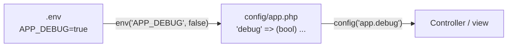
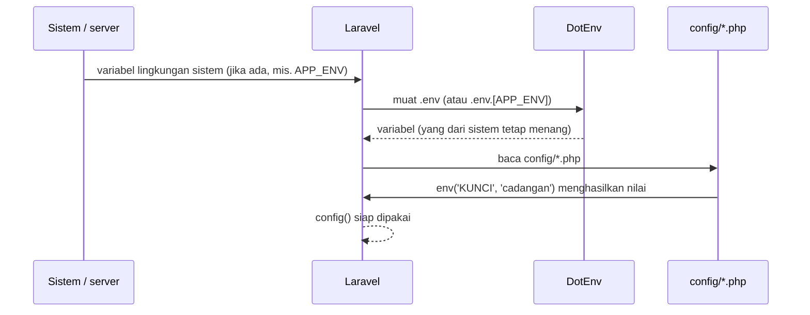

# Environment Variables

Aplikasi yang sama berjalan di tempat berbeda: laptopmu, laptop rekan, server pengujian, dan server produksi. Tiap
tempat butuh pengaturan berbeda, misalnya kata sandi database atau tampilan error. **Environment variables**
memungkinkan kode yang sama dipakai di mana-mana, dengan pengaturan yang berbeda per tempat. Di Laravel, pengaturan
itu ditulis di berkas `.env`.

## Tujuan Pembelajaran

Setelah menyelesaikan sub bab ini, kamu dapat:

- [ ] Menjelaskan fungsi berkas `.env`, `.env.example`, dan hubungannya dengan folder `config/`.
- [ ] Membaca isi `.env` tanpa membocorkan nilai rahasia.
- [ ] Menambah variabel baru dan membacanya lewat `env()` di berkas konfigurasi.
- [ ] Menjelaskan nilai khusus `.env` (`true`, `false`, `null`, `empty`) dan tipe hasilnya.
- [ ] Menentukan lingkungan aplikasi saat ini dengan `App::environment()`.
- [ ] Menjelaskan aturan keamanan `.env` dan fungsi `APP_KEY`.

## Prasyarat

- Sub bab [Konfigurasi Laravel](01-10-laravel-configuration.md): `config()`, `config/sekolah.php`, dan route `/konfigurasi`.
- Proyek `~/belajar-laravel/aplikasi-pertama` berjalan dengan `php artisan serve`.
- [Dasar Git dan GitHub](../level-00/00-24-git-and-github-fundamentals.md): `.gitignore` dan larangan commit rahasia.

## Pengantar

Pada proyek siswa PHP native, semua pengaturan ada di `config.php` yang ikut tersalin ke semua komputer. Jika di sana
ada kata sandi database, kata sandi itu ikut di Git. Laravel memisahkan dua hal:

- **Struktur pengaturan** (opsi apa saja yang ada) ada di `config/*.php` dan **boleh** di-commit.
- **Nilai pengaturan yang berbeda per lingkungan atau rahasia** ada di `.env` dan **tidak** di-commit.

## Penjelasan Konsep

### Berkas `.env`

Laravel memakai pustaka PHP **DotEnv** (`vlucas/phpdotenv`) untuk membaca berkas `.env` di akar proyek. Isinya baris
`NAMA=nilai`:

```ini
APP_NAME=Laravel
APP_ENV=local
APP_DEBUG=true
APP_URL=http://localhost:8000
DB_CONNECTION=sqlite
```

!!! tip "Analogi"
    `config/` adalah **formulir** dengan kolom-kolom pengaturan; `.env` adalah **isian** formulir itu untuk satu tempat.
    Formulir kosong boleh diperbanyak, tetapi isian pribadi tidak dibagikan.

Dokumentasi menjelaskan bahwa pada instalasi baru ada berkas `.env.example` yang memuat banyak variabel umum, dan
berkas itu otomatis disalin menjadi `.env` saat proses pemasangan.

### Dua berkas, dua peran

| Berkas | Isi | Di-commit ke Git? |
|---|---|---|
| `.env.example` | Daftar variabel dengan **nilai contoh/placeholder**, tanpa rahasia | **Ya** |
| `.env` | Nilai nyata untuk tempat ini, termasuk rahasia | **Tidak** |

`.env.example` memberi tahu rekan setim variabel apa saja yang dibutuhkan aplikasi. Setiap kali menambah variabel
baru, tambahkan juga ke `.env.example` dengan nilai contoh.

### Variabel yang sering ditemui

Berdasarkan `.env.example` kerangka 13.x:

| Variabel | Fungsi |
|---|---|
| `APP_NAME` | Nama aplikasi |
| `APP_ENV` | Lingkungan (mis. `local`, `staging`, `production`) |
| `APP_KEY` | Kunci enkripsi aplikasi (dibuat otomatis saat proyek dibuat) |
| `APP_DEBUG` | Menampilkan error rinci (`true` hanya di lokal) |
| `APP_URL` | URL dasar aplikasi |
| `DB_CONNECTION` | Driver database (bawaan `sqlite`) |
| `SESSION_DRIVER`, `CACHE_STORE`, `QUEUE_CONNECTION` | Tempat penyimpanan sesi, cache, dan antrean |
| `MAIL_MAILER` | Cara mengirim email (bawaan `log`: ditulis ke log, tidak benar-benar dikirim) |

Banyak variabel lain disiapkan untuk Redis, AWS, dan lainnya; kamu tidak perlu mengubahnya sekarang.

### Dari `.env` ke aplikasi

Nilai `.env` dibaca oleh fungsi `env()` **di dalam berkas `config/`**, lalu aplikasi membacanya lewat `config()`:



`env('KUNCI', 'cadangan')` mengembalikan nilai variabel; jika variabel tidak ada, nilai cadangan dipakai. Seperti dijelaskan
di sub bab sebelumnya, **jangan memanggil `env()` di luar `config/`** karena setelah `config:cache` `.env` tidak dimuat lagi.

### Tipe nilai

Semua nilai di `.env` pada dasarnya adalah **teks**. Dokumentasi mendefinisikan beberapa nilai khusus agar `env()` dapat
mengembalikan tipe lain:

| Isi di `.env` | Hasil `env()` |
|---|---|
| `true` atau `(true)` | `true` (bool) |
| `false` atau `(false)` | `false` (bool) |
| `null` atau `(null)` | `null` |
| `empty` atau `(empty)` | `''` (string kosong) |
| Angka seperti `50` | `"50"` (string, bukan `int`) |

Nilai yang mengandung spasi ditulis dalam tanda kutip ganda: `APP_NAME="Aplikasi Pertama"`. Karena angka tetap berupa string,
ubah tipenya di berkas konfigurasi bila perlu: `(int) env('BATAS_PESERTA', 50)`.

### Menentukan lingkungan saat ini

Lingkungan ditentukan oleh `APP_ENV`. Kode dapat memeriksanya lewat facade `App`:

```php
use Illuminate\Support\Facades\App;

App::environment();                       // mis. "local"
App::environment('local');                // true bila lokal
App::environment(['local', 'staging']);   // true bila salah satunya
```

Dokumentasi juga menyebut dua hal penting:

- Variabel `.env` dapat **ditimpa** oleh variabel lingkungan sistem atau server yang diberikan dari luar.
- Jika ada variabel `APP_ENV` dari luar (atau opsi `--env`), Laravel mencoba memuat berkas `.env.[APP_ENV]` (misalnya
  `.env.staging`) bila ada; jika tidak ada, `.env` biasa dimuat.

### Keamanan `.env`

- `.env` **tidak boleh di-commit**. Dokumentasi menjelaskan alasannya: tiap pengembang/server mungkin butuh pengaturan berbeda,
  dan jika repositori jatuh ke tangan penyusup, kredensial ikut terbuka. Kerangka aplikasi 13.x memasukkan `.env`,
  `.env.backup`, dan `.env.production` ke `.gitignore`.
- **`APP_KEY`** dipakai untuk enkripsi. Jangan dibagikan. Mengganti kunci akan membuat data terenkripsi yang lama (mis. cookie atau
  sesi terenkripsi) tidak bisa dibaca lagi.
- Hindari mengunggah tangkapan layar atau menempelkan isi `.env` ke forum dan obrolan.
- Untuk tim, dokumentasi menyediakan **enkripsi berkas lingkungan** (`php artisan env:encrypt`) sehingga berkas terenkripsi boleh
  masuk Git; kuncinya disimpan terpisah di pengelola kata sandi. Topik ini dibahas lagi pada bab Deployment.
- Di produksi: `APP_DEBUG=false` dan `APP_ENV=production`.

## Cara Kerja

Urutan saat aplikasi memulai:



## Contoh Praktik

Kamu melihat daftar variabel di `.env`, menambah variabel sendiri, mengamati tipe nilainya, memeriksa lingkungan, dan
menimpa `APP_ENV` dari luar. Praktik ini melanjutkan `config/sekolah.php` dan route `/konfigurasi` dari sub bab sebelumnya.

## Penjelasan Kode

File: `.env` (tambahkan di bagian bawah)

```ini
SEKOLAH_NAMA="Sekolah dari ENV"
FITUR_BETA=true
BATAS_PESERTA=50
CATATAN=null
NILAI_KOSONG=empty
```

File: `.env.example` (tambahkan placeholder, **tanpa** nilai rahasia)

```ini
SEKOLAH_NAMA="Sekolah Latihan"
FITUR_BETA=false
BATAS_PESERTA=50
```

File: `config/sekolah.php` (perbarui)

```php
<?php

return [
    'nama' => env('SEKOLAH_NAMA', 'Sekolah Latihan'),
    'fitur_beta' => env('FITUR_BETA', false),
    'batas_peserta' => env('BATAS_PESERTA'),
    'catatan' => env('CATATAN'),
    'kosong' => env('NILAI_KOSONG'),
    'jurusan' => [
        'informatika' => 'Informatika',
        'sistem-informasi' => 'Sistem Informasi',
        'teknik-komputer' => 'Teknik Komputer',
    ],
];
```

File: `routes/web.php` (tambahkan)

```php
use Illuminate\Support\Facades\App;

Route::get('/env-tipe', function () {
    $nilai = [
        'nama' => config('sekolah.nama'),
        'fitur_beta' => config('sekolah.fitur_beta'),
        'batas_peserta' => config('sekolah.batas_peserta'),
        'catatan' => config('sekolah.catatan'),
        'kosong' => config('sekolah.kosong'),
    ];

    return [
        'nilai' => $nilai,
        'tipe' => array_map('gettype', $nilai),
    ];
});

Route::get('/lingkungan', function () {
    return [
        'env' => App::environment(),
        'lokal' => App::environment('local'),
        'debug' => config('app.debug'),
    ];
});
```

| Bagian | Penjelasan |
|---|---|
| `env('SEKOLAH_NAMA', 'Sekolah Latihan')` | Nilai dari `.env`; jika tidak ada, dipakai nilai cadangan |
| `env('FITUR_BETA', false)` | `true`/`false` di `.env` menjadi bool |
| `env('BATAS_PESERTA')` | Tanpa cadangan: `null` jika variabel tidak ada; bila ada, berupa **string** |
| `array_map('gettype', $nilai)` | Memetakan setiap nilai ke nama tipenya |
| `App::environment()` | Mengembalikan nilai `APP_ENV` |

## Implementasi Langkah demi Langkah

### Langkah 1: lihat nama variabel (tanpa nilai)

```bash
cd ~/belajar-laravel/aplikasi-pertama
grep -v '^#' .env | grep -v '^$' | cut -d= -f1
```

Perintah ini hanya mencetak **nama** variabel, bukan nilainya, sehingga aman ditampilkan atau difoto. Perintah
`cut -d= -f1` mengambil bagian sebelum tanda `=`.

### Langkah 2: bandingkan `.env` dan `.env.example`

```bash
diff .env .env.example
```

Baris yang berbeda biasanya sedikit (misalnya `APP_KEY`, dan mungkin `APP_NAME`). Jika tidak ada keluaran, berarti
berkas identik.

### Langkah 3: pastikan `.env` diabaikan Git

```bash
git check-ignore -v .env
git status
```

### Langkah 4: tambah variabel dan baca lewat konfigurasi

Tambahkan variabel pada `.env` dan `.env.example`, perbarui `config/sekolah.php`, dan tambahkan route `/env-tipe`
sesuai bagian Penjelasan Kode. Jalankan server (`php artisan serve`) lalu:

```bash
curl -i http://127.0.0.1:8000/env-tipe
```

### Langkah 5: ubah nilai dan lihat perubahannya

Ubah `SEKOLAH_NAMA` di `.env` menjadi nilai lain, simpan, lalu minta `/env-tipe` lagi. Server `php artisan serve` memuat
ulang saat `.env` berubah, jadi biasanya tidak perlu di-restart. Jika nilai tidak berubah, jalankan
`php artisan config:clear` dan coba lagi.

### Langkah 6: periksa lingkungan

```bash
curl -i http://127.0.0.1:8000/lingkungan
```

### Langkah 7: timpa `APP_ENV` dari luar

Hentikan server (++ctrl+c++), jalankan dengan variabel lingkungan sistem, lalu periksa:

```bash
APP_ENV=staging php artisan serve
```

Di terminal lain:

```bash
curl -i http://127.0.0.1:8000/lingkungan
```

Hentikan server, lalu jalankan lagi tanpa awalan untuk kembali ke lingkungan `local`.

### Langkah 8: commit hanya yang aman

```bash
git status
git add .env.example config/sekolah.php routes/web.php
git commit -m "Tambah variabel lingkungan sekolah dan route env-tipe"
```

Pastikan `.env` **tidak** ada di daftar yang di-`add`.

## Eksekusi dan Verifikasi

| Langkah | Cara memverifikasi |
|---|---|
| 1 | Daftar nama variabel tercetak tanpa nilai |
| 2 | `diff` hanya menunjukkan beberapa perbedaan atau tidak ada |
| 3 | `git check-ignore -v .env` menampilkan aturan dari `.gitignore`; `.env` tidak tercantum di `git status` |
| 4 | `/env-tipe` mengembalikan JSON dengan `nilai` dan `tipe` |
| 5 | Perubahan `SEKOLAH_NAMA` terlihat di respons |
| 6 | `/lingkungan` menunjukkan `env` `local`, `lokal` `true`, `debug` `true` |
| 7 | Dengan `APP_ENV=staging`, `env` berubah menjadi `staging` dan `lokal` menjadi `false` |
| 8 | `git log --oneline` memuat commit tanpa `.env` |

## Hasil yang Diharapkan

Respons `/env-tipe` kira-kira:

```json
{
    "nilai": {
        "nama": "Sekolah dari ENV",
        "fitur_beta": true,
        "batas_peserta": "50",
        "catatan": null,
        "kosong": ""
    },
    "tipe": {
        "nama": "string",
        "fitur_beta": "boolean",
        "batas_peserta": "string",
        "catatan": "NULL",
        "kosong": "string"
    }
}
```

Perhatikan bahwa `batas_peserta` adalah **string** `"50"`, bukan bilangan; ubah dengan `(int) env(...)` di konfigurasi.
Respons `/lingkungan` pada kondisi normal: `env` `local`, `lokal` `true`, `debug` `true` (sesuai `.env` bawaan kerangka 13.x).
Pada Langkah 7 nilai `env` berubah menjadi `staging` karena variabel dari luar menimpa `.env`, sesuai penjelasan dokumentasi.
Susunan JSON bisa tampil rapat atau dirapikan. Keluaran di atas diturunkan dari dokumentasi dan kode, dan belum dijalankan
oleh penulis materi; cocokkan dengan hasilmu.

## Kesalahan Umum dan Pemecahan Masalah

| Gejala | Penyebab | Cara mengenali | Solusi | Pencegahan |
|---|---|---|---|---|
| Perubahan `.env` tidak berlaku | Konfigurasi ter-cache, atau server belum memuat ulang | Nilai lama bertahan | `php artisan config:clear` dan, bila perlu, restart server | Jangan `config:cache` di lokal |
| `env('X')` mengembalikan `null` di controller | `env()` dipakai di luar `config/` dan konfigurasi ter-cache | Nilai `null` hanya setelah cache | Pindahkan ke `config/` dan pakai `config()` | `env()` hanya di berkas konfigurasi |
| Nilai dengan spasi terpotong | Tidak diberi tanda kutip | Hanya kata pertama terbaca | `NAMA="dua kata"` | Beri kutip bila ada spasi |
| `"true"` dianggap teks | Menulis `"true"` bertanda kutip atau memakai nilai lain | `gettype` menunjukkan `string` | Tulis `true` tanpa kutip | Gunakan nilai khusus dokumentasi |
| Angka dari `.env` tidak bisa dibandingkan sebagai `int` | Nilai selalu string | `gettype` menunjukkan `string` | `(int) env('BATAS_PESERTA', 50)` | Cast di konfigurasi |
| `.env` ter-commit | Tidak diabaikan atau sudah telanjur dilacak | `git status` menampilkan `.env` | Tambah ke `.gitignore`, `git rm --cached .env`, **ganti semua rahasia** yang terlanjur bocor | Cek `git check-ignore -v .env` |
| Rekan setim tidak punya variabel baru | Lupa memperbarui `.env.example` | Aplikasi error di komputer rekan | Tambahkan variabel dengan placeholder ke `.env.example` | Perbarui kedua berkas bersamaan |
| `No application encryption key has been specified` | `APP_KEY` kosong | Error saat aplikasi dibuka | `php artisan key:generate` | Salin `.env.example` lalu buat kunci pada proyek baru |
| `APP_ENV=staging php artisan serve` tidak jalan | Perintah dijalankan di shell yang tidak mendukung sintaks | Pesan error sintaks | Gunakan Bash; atau ekspor variabel dengan `export APP_ENV=staging` | Pakai terminal Bash di Ubuntu |

## Latihan Praktik

### Latihan dasar

**D1. Baca lingkungan**
- *Masalah:* tampilkan lingkungan dan mode debug aplikasi.
- *Persyaratan:* buat route `/status` yang mengembalikan `App::environment()` dan `config('app.debug')`.
- *Perilaku yang diharapkan:* menampilkan `local` dan `true` pada kondisi normal.
- *Tujuan belajar:* membaca lingkungan dari kode.

**D2. Nilai berkutip**
- *Masalah:* nama dengan spasi terpotong.
- *Persyaratan:* tambahkan `NAMA_KEPALA="Budi Santoso"` ke `.env`, baca lewat konfigurasi, dan tampilkan di route.
- *Perilaku yang diharapkan:* `Budi Santoso` tampil utuh.
- *Tujuan belajar:* aturan penulisan nilai dengan spasi.

### Latihan implementasi

**I1. Pengaturan proyek siswa lewat `.env`**
- *Masalah:* memindahkan pengaturan proyek siswa ke lingkungan.
- *Persyaratan:* buat variabel `SISWA_MAKS_NAMA` (bilangan, bawaan 100) dan `SISWA_VALIDASI_KETAT` (bool, bawaan `false`) di `.env` dan
  `.env.example`, baca di `config/sekolah.php` dengan cast tipe yang tepat, dan tampilkan di route.
- *Perilaku yang diharapkan:* `maks_nama` bertipe integer dan `validasi_ketat` bertipe boolean.
- *Tujuan belajar:* cast tipe dan keselarasan `.env.example`.

**I2. Berkas lingkungan per lingkungan**
- *Masalah:* ingin pengaturan khusus `staging`.
- *Persyaratan:* buat `.env.staging` berisi `SEKOLAH_NAMA="Sekolah Staging"`, jalankan `APP_ENV=staging php artisan serve`, dan
  periksa apakah nilai itu terbaca. Pastikan `.env.staging` **tidak** ter-commit (tambahkan ke `.gitignore` bila belum).
- *Perilaku yang diharapkan:* nilai dari `.env.staging` terbaca pada lingkungan `staging` (sesuai dokumentasi), dan kembali ke
  `.env` pada lingkungan `local`.
- *Tujuan belajar:* memahami pemuatan `.env.[APP_ENV]`.

### Latihan tantangan

**T1. Panduan penyiapan untuk rekan setim**
- *Masalah:* rekan baru harus menjalankan proyek di komputernya.
- *Persyaratan:* tulis `PANDUAN-LINGKUNGAN.md` berisi langkah menyalin `.env.example` menjadi `.env`, membuat `APP_KEY`, mengisi variabel
  yang wajib, dan memverifikasi dengan `php artisan about`. Cantumkan apa yang **tidak boleh** dilakukan.
- *Perilaku yang diharapkan:* rekan dapat menjalankan proyek hanya dengan mengikuti panduan.
- *Tujuan belajar:* mendokumentasikan penyiapan lingkungan dengan aman.
- *Catatan:* kerjakan mandiri; tidak ada kunci jawaban.

## Uji Pemahaman

1. Apa beda `.env` dan `.env.example`? Mana yang di-commit?
2. Mengapa nilai rahasia tidak ditulis di `config/*.php`?
3. Apa hasil `env('FITUR_BETA')` bila `.env` berisi `FITUR_BETA=true`? Apa tipenya?
4. Mengapa `BATAS_PESERTA=50` menghasilkan string `"50"`, dan bagaimana mengubahnya menjadi `int`?
5. Bagaimana memeriksa apakah aplikasi sedang berjalan di lingkungan `production`?
6. Apa yang terjadi jika variabel sistem `APP_ENV` diberikan dari luar?
7. Apa fungsi `APP_KEY` dan mengapa tidak boleh dibagikan?
8. Mengapa `env()` hanya boleh dipanggil di `config/`?

??? success "Kunci jawaban singkat"
    1. `.env` berisi nilai nyata dan rahasia (tidak di-commit); `.env.example` berisi placeholder (di-commit).
    2. Berkas `config/` ikut di-commit sehingga rahasia akan bocor.
    3. `true` bertipe bool (boolean).
    4. Semua nilai `.env` adalah teks kecuali nilai khusus; gunakan `(int) env('BATAS_PESERTA', 50)`.
    5. `App::environment('production')`.
    6. Variabel dari luar menimpa `.env`, dan Laravel memuat `.env.[APP_ENV]` bila ada.
    7. Kunci enkripsi aplikasi; bila bocor, data terenkripsi dapat dibuka dan keamanan berkurang.
    8. Setelah `config:cache`, `.env` tidak dimuat sehingga `env()` di luar `config/` tidak mengembalikan nilai dari `.env`.

## Ringkasan

- `.env` menyimpan nilai per lingkungan dan rahasia; `.env.example` adalah contoh tanpa rahasia yang di-commit.
- `env()` dipanggil di `config/*.php`; di tempat lain gunakan `config()`.
- Nilai `.env` berupa string, kecuali `true`, `false`, `null`, dan `empty`; ubah tipe lain dengan cast.
- Lingkungan ditentukan `APP_ENV` dan dibaca dengan `App::environment()`; variabel dari luar menimpa `.env`.
- `.env` dan `APP_KEY` tidak boleh di-commit atau dibagikan; `APP_DEBUG=false` di produksi.

Selanjutnya: *Artisan CLI*, alat baris perintah yang sudah beberapa kali kamu gunakan.

## Referensi Resmi

- [Laravel: Configuration (Environment Configuration)](https://laravel.com/docs/13.x/configuration#environment-configuration)
- [Laravel: Environment Variable Types](https://laravel.com/docs/13.x/configuration#environment-variable-types)
- [Laravel: Determining the Current Environment](https://laravel.com/docs/13.x/configuration#determining-the-current-environment)
- [Laravel: Encrypting Environment Files](https://laravel.com/docs/13.x/configuration#encrypting-environment-files)
- [Laravel: Debug Mode](https://laravel.com/docs/13.x/configuration#debug-mode)
- [Laravel: Facades](https://laravel.com/docs/13.x/facades)
- [Kerangka aplikasi 13.x: .env.example](https://github.com/laravel/laravel/blob/13.x/.env.example)
- [vlucas/phpdotenv (pustaka DotEnv)](https://github.com/vlucas/phpdotenv)
