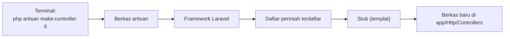

# Artisan CLI

Kamu sudah memakai `php artisan` berkali-kali: `serve`, `about`, `config:show`, dan `make:controller`. Sekarang
saatnya mengenal alat ini secara utuh. **Artisan** adalah antarmuka baris perintah (*command line interface*)
bawaan Laravel. Ia membuatkan kode, menjalankan tugas, dan memeriksa aplikasimu, sehingga kamu tidak perlu menulis
semuanya dari nol.

## Tujuan Pembelajaran

Setelah menyelesaikan sub bab ini, kamu dapat:

- [ ] Menjelaskan apa itu Artisan dan di mana ia berada.
- [ ] Menemukan perintah dan bantuan dengan `php artisan list` dan `php artisan help`.
- [ ] Membaca pola nama perintah (`kelompok:aksi`) dan mengenali kelompok yang sering dipakai.
- [ ] Membuat berkas dengan perintah `make:` dan membersihkan hasil percobaan dengan aman.
- [ ] Memakai Tinker untuk mencoba kode Laravel secara interaktif.
- [ ] Membuat perintah sederhana berbasis closure di `routes/console.php`.
- [ ] Menjelaskan fungsi `php artisan dev` dan kebutuhannya.

## Prasyarat

- Sub bab [Struktur Direktori Laravel](01-09-laravel-directory-structure.md) dan
  [Environment Variables](01-11-environment-variables.md).
- Proyek `~/belajar-laravel/aplikasi-pertama` dengan Git yang bersih (`git status` tanpa perubahan belum disimpan).
- Terminal Bash di folder proyek.

## Pengantar

Banyak pekerjaan pengembangan bersifat berulang dan berpola: membuat controller, membuat tabel, membersihkan cache,
mencoba satu baris kode. Menulis semuanya manual lambat dan rawan salah ketik pada struktur folder. Artisan mengerjakannya
dengan satu perintah, dan karena hasilnya mengikuti konvensi, kode yang dibuat otomatis langsung berada di tempat yang
benar dengan namespace yang benar.

## Penjelasan Konsep

### Apa itu Artisan?

Menurut dokumentasi, Artisan adalah antarmuka baris perintah yang disertakan Laravel. Ia berupa skrip bernama `artisan`
di akar aplikasi. Kamu menjalankannya lewat PHP:

```bash
php artisan <perintah> [argumen] [--opsi]
```

!!! tip "Analogi"
    Artisan seperti **asisten bengkel** yang mengerti istilah teknis: kamu cukup menyebut "buatkan controller bernama X",
    dan ia menaruh berkas yang benar di tempat yang benar tanpa kamu mengetik kerangkanya.

### Menemukan perintah dan bantuan

| Perintah | Fungsi |
|---|---|
| `php artisan list` | Mendaftar semua perintah yang tersedia |
| `php artisan help <perintah>` | Menampilkan bantuan: deskripsi, argumen, dan opsi sebuah perintah |
| `php artisan <perintah> --help` | Sama dengan `help`, dengan gaya penulisan lain |
| `php artisan list make` | Hanya perintah di kelompok `make` |
| `php artisan --version` | Menampilkan versi framework |

Contoh bantuan: `php artisan help migrate`.

### Pola nama perintah

Perintah bernama `kelompok:aksi`. Kelompok yang sering muncul pada proyek Laravel:

| Kelompok | Contoh | Fungsi |
|---|---|---|
| `make:` | `make:controller`, `make:model`, `make:migration`, `make:exception` | Membuat berkas kode dari templat (*stub*) |
| `migrate` | `migrate`, `migrate:rollback`, `migrate:status` | Mengelola skema database |
| `route:` | `route:list` | Melihat route |
| `config:` | `config:show`, `config:cache`, `config:clear` | Mengelola konfigurasi |
| `queue:` | `queue:listen` | Antrean |
| lainnya | `serve`, `about`, `tinker`, `test`, `dev` | Beragam fungsi |

Dokumentasi menyatakan banyak class di `app/` dapat dibuat lewat perintah `make:`, dan semua perintah itu dapat dilihat dengan
`php artisan list make`.

### Argumen dan opsi

- **Argumen**: nilai yang wajib atau opsional setelah nama perintah. Contoh: `HaloController` pada
  `php artisan make:controller HaloController`.
- **Opsi**: pengaturan tambahan diawali `--` (atau `-` untuk singkatan). Contoh: `php artisan serve --port=8080`.

### Perintah `make:` dan templat

Perintah `make:` menghasilkan berkas dari **stub** (templat). Contoh:

```bash
php artisan make:controller HaloController
```

membuat `app/Http/Controllers/HaloController.php` dengan namespace dan kerangka class yang benar. Jika ingin mengubah templatnya,
dokumentasi menyediakan `php artisan stub:publish` yang menyalin stub ke folder `stubs` di proyekmu.

### Tinker: REPL Laravel

**REPL** (*Read-Eval-Print Loop*) adalah konsol interaktif: kamu mengetik satu baris kode PHP, ia dijalankan, hasilnya ditampilkan.
**Laravel Tinker** adalah REPL untuk Laravel yang menjalankan kode di konteks aplikasimu. Dokumentasi menyatakan semua aplikasi
Laravel menyertakan Tinker secara bawaan.

```bash
php artisan tinker
```

Di dalam Tinker kamu dapat mengakses model, konfigurasi, dan helper Laravel tanpa membuat route atau berkas. Keluar dengan `exit` atau
++ctrl+d++. Tinker hanya mengizinkan sebagian kecil perintah Artisan di dalamnya (misalnya `migrate`, `optimize`, `env`).

!!! warning "Tinker menjalankan kode sungguhan"
    Tinker bekerja pada aplikasi dan database yang sedang aktif. Perintah yang mengubah atau menghapus data akan benar-benar
    mengubah atau menghapus data. Gunakan hati-hati, terutama di lingkungan selain lokal.

### Perintah closure di `routes/console.php`

Selain class, perintah bisa dibuat dengan **closure** di `routes/console.php` memakai `Artisan::command`, seperti route berbasis closure.
Perintah bawaan `inspire` ditulis begini:

File: `routes/console.php`

```php-inline
use Illuminate\Foundation\Inspiring;
use Illuminate\Support\Facades\Artisan;

Artisan::command('inspire', function () {
    $this->comment(Inspiring::quote());
})->purpose('Display an inspiring quote');
```

| Bagian | Penjelasan |
|---|---|
| `Artisan::command('inspire', function () {...})` | Mendaftarkan perintah bernama `inspire` |
| `$this->comment(...)` | Mencetak teks berwarna ke terminal; `$this` terikat ke instance perintah |
| `->purpose('...')` | Deskripsi yang tampil di `php artisan list` |

Perintah yang lebih besar dibuat sebagai class (`make:command`), dibahas pada bab utama *Professional Laravel Architecture*.

### `php artisan dev`

Dokumentasi 13.x menjelaskan perintah `dev` yang menjalankan semua proses pengembangan di satu terminal: server pengembangan (`serve`),
*queue worker*, penelusuran log (Pail), dan kompilasi aset Vite. Perintah ini membutuhkan **Node 22.13 atau lebih baru**. Kita memakainya kembali
pada bab utama Blade dan Frontend.

## Cara Kerja



Berkas `artisan` memulai aplikasi, mencari perintah yang cocok di daftar, lalu menjalankannya. Perintah `make:` mengisi templat dengan namamu dan
menulis hasilnya ke folder yang sesuai.

## Contoh Praktik

Kamu menjelajah daftar perintah, membaca bantuan, membuat dua berkas demo dengan `make:` lalu membersihkannya, menjalankan Tinker, dan membuat
perintah closure `sapa`.

## Penjelasan Kode

File: `routes/console.php` (tambahkan di bawah perintah `inspire`)

```php-inline
Artisan::command('sapa {nama}', function (string $nama) {
    $this->info("Halo, {$nama}! Selamat belajar Laravel.");
})->purpose('Menyapa seseorang dengan namanya');
```

| Bagian | Penjelasan |
|---|---|
| `'sapa {nama}'` | Nama perintah `sapa` dengan satu argumen wajib `nama` (sintaks seperti route) |
| `function (string $nama)` | Argumen diteruskan ke closure |
| `$this->info(...)` | Mencetak teks informasi |
| `->purpose(...)` | Deskripsi di daftar perintah |

## Implementasi Langkah demi Langkah

### Langkah 1: jelajahi perintah

```bash
cd ~/belajar-laravel/aplikasi-pertama
php artisan list
php artisan help migrate
php artisan list make
php artisan --version
```

Catat lima perintah yang menarik minatmu dan kelompoknya.

### Langkah 2: coba perintah bawaan sederhana

```bash
php artisan inspire
php artisan about --only=environment
php artisan route:list
```

`route:list` menampilkan route aplikasi. Pada proyek baru, kamu akan melihat setidaknya route `/` dan `/up`.

### Langkah 3: buat berkas demo dengan `make:`

```bash
git status --short
php artisan make:controller DemoController
php artisan make:model DemoModel
git status --short
```

Perhatikan berkas baru: `app/Http/Controllers/DemoController.php` dan `app/Models/DemoModel.php`. Buka keduanya di editor dan
amati namespace, nama class, dan kerangka yang dibuat otomatis.

### Langkah 4: bersihkan berkas demo

Periksa dulu, lalu hapus hanya berkas yang kamu buat:

```bash
git status --short
rm app/Http/Controllers/DemoController.php app/Models/DemoModel.php
git status --short
```

!!! warning "Periksa sebelum menghapus"
    Pastikan `pwd` adalah folder `aplikasi-pertama` dan hanya dua berkas di atas yang dihapus. `rm` tidak dapat dibatalkan.

### Langkah 5: coba Tinker

```bash
php artisan tinker
```

Di dalam Tinker ketik satu per satu:

```php-inline
config('app.name')
app()->version()
\Illuminate\Support\Str::slug('Belajar Laravel Itu Menyenangkan')
\App\Models\User::count()
now()->format('d-m-Y')
exit
```

### Langkah 6: buat perintah closure

Tambahkan perintah `sapa` pada `routes/console.php`, lalu:

```bash
php artisan list
php artisan help sapa
php artisan sapa Budi
php artisan sapa
```

Perintah terakhir sengaja tanpa argumen untuk melihat bagaimana Artisan menanggapi argumen yang kurang.

### Langkah 7: catat di Git

```bash
git add routes/console.php
git commit -m "Tambah perintah Artisan sapa"
```

## Eksekusi dan Verifikasi

| Langkah | Cara memverifikasi |
|---|---|
| 1 | `list` menampilkan banyak perintah terkelompok; `help migrate` menampilkan deskripsi dan opsi |
| 2 | `inspire` mencetak kutipan; `route:list` menampilkan route |
| 3 | Dua berkas baru muncul di `git status --short` |
| 4 | Setelah `rm`, `git status --short` bersih kembali |
| 5 | Tinker menampilkan hasil tiap baris; `exit` kembali ke terminal |
| 6 | `sapa Budi` mencetak sapaan; `help sapa` memuat deskripsi; `sapa` tanpa argumen menampilkan pesan argumen kurang |
| 7 | `git log --oneline` memuat commit baru |

## Hasil yang Diharapkan

- `php artisan list` menampilkan puluhan perintah, di antaranya `serve`, `tinker`, `route:list`, dan kelompok `make`.
- `php artisan make:controller DemoController` membuat berkas controller dengan namespace `App\Http\Controllers`; perintah `make:model`
  membuat model di `app/Models`.
- Di Tinker:
    - `config('app.name')` menampilkan nilai `APP_NAME`.
    - `app()->version()` menampilkan versi framework 13.x.
    - `Str::slug('Belajar Laravel Itu Menyenangkan')` menghasilkan `belajar-laravel-itu-menyenangkan`.
    - `User::count()` menghasilkan `0` pada proyek baru (tabel pengguna ada dan masih kosong).
- `php artisan sapa Budi` mencetak `Halo, Budi! Selamat belajar Laravel.`
- `php artisan sapa` tanpa argumen menghasilkan pesan bahwa argumen `nama` kurang (teks persisnya mengikuti versi).

Tampilan hasil Tinker (misalnya awalan `= ` atau tanda kutip) dapat berbeda antar versi. Keluaran di atas diturunkan dari dokumentasi dan kode,
dan belum dijalankan oleh penulis materi; cocokkan dengan hasilmu.

## Kesalahan Umum dan Pemecahan Masalah

| Gejala | Penyebab | Cara mengenali | Solusi | Pencegahan |
|---|---|---|---|---|
| `Could not open input file: artisan` | Bukan di folder proyek | `ls` tidak menampilkan `artisan` | `cd` ke folder proyek | Cek `pwd` |
| `Command "xyz" is not defined` | Salah ketik atau perintah belum ada | Artisan menyarankan perintah mirip | Cek ejaan dengan `php artisan list` | Gunakan `list` dan tab completion |
| `Class "X" already exists` saat `make:` | Berkas dengan nama sama sudah ada | Pesan menyebut class sudah ada | Pakai nama lain atau hapus yang lama | Periksa `ls` sebelum membuat |
| Berkas dibuat di tempat tak terduga | Menyertakan namespace/subfolder pada nama | Jalur berkas berbeda dari perkiraan | Baca bantuan `help make:...` untuk format nama | Buka `help` sebelum memakai |
| Tinker mati dengan error kode | Sintaks PHP salah | Pesan *Parse error* di Tinker | Ketik ulang dengan sintaks benar | Uji potongan kecil |
| Tinker mengubah data nyata | Menjalankan perintah yang menulis ke database | Data berubah setelah Tinker | Pulihkan dari cadangan; hindari di non-lokal | Gunakan hanya pada database lokal |
| Perintah closure tidak muncul di `list` | Berkas `routes/console.php` salah atau belum disimpan | `sapa` tidak ada di daftar | Periksa sintaks dan simpan | Jalankan `php -l routes/console.php` |
| `php artisan dev` gagal | Node.js belum terpasang atau versinya di bawah 22.13 | Pesan Node atau npm | Pasang Node.js yang memenuhi syarat, atau gunakan `php artisan serve` | Cek `node -v` dulu |
| Menghapus berkas salah dengan `rm` | Jalur keliru | `git status` menunjukkan berkas penting hilang | `git restore <jalur>` | Periksa jalur sebelum `rm` |

## Latihan Praktik

### Latihan dasar

**D1. Jelajahi bantuan**
- *Masalah:* ingin tahu opsi sebuah perintah.
- *Persyaratan:* tampilkan bantuan `make:controller` dan catat tiga opsi beserta artinya.
- *Perilaku yang diharapkan:* ketiga opsi tercatat dengan penjelasan singkat.
- *Tujuan belajar:* membaca bantuan Artisan.

**D2. Peta perintah**
- *Masalah:* kelompokkan perintah.
- *Persyaratan:* dari `php artisan list`, tuliskan lima kelompok dan masing-masing dua perintah beserta fungsinya.
- *Perilaku yang diharapkan:* tabel yang sesuai dengan keluaran `list` di komputermu.
- *Tujuan belajar:* mengenali pola `kelompok:aksi`.

### Latihan implementasi

**I1. Perintah `hitung`**
- *Masalah:* ingin perintah yang menjumlahkan dua bilangan.
- *Persyaratan:* buat perintah closure `hitung {a} {b}` di `routes/console.php` yang mencetak `a + b = hasil`. Beri deskripsi dengan `purpose`.
- *Perilaku yang diharapkan:* `php artisan hitung 3 4` mencetak `3 + 4 = 7`.
- *Tujuan belajar:* argumen pada perintah closure.

**I2. Eksplorasi dengan Tinker**
- *Masalah:* ingin mencoba helper tanpa membuat route.
- *Persyaratan:* di Tinker, uji lima ekspresi berbeda (misalnya `collect([1,2,3])->sum()`, `Str::upper('halo')`, `config('database.default')`, `now()->addDays(7)->format('d-m-Y')`)
  dan catat hasilnya.
- *Perilaku yang diharapkan:* setiap ekspresi menghasilkan nilai yang bisa kamu jelaskan.
- *Tujuan belajar:* memakai Tinker untuk eksperimen cepat.

### Latihan tantangan

**T1. Perintah laporan lingkungan**
- *Masalah:* tim ingin satu perintah yang meringkas kondisi proyek.
- *Persyaratan:* buat perintah `lingkungan:ringkas` (closure) yang mencetak nama aplikasi, lingkungan (`app.env`), status debug, driver database, dan versi PHP
  (`PHP_VERSION`) dalam format rapi. Pastikan **tidak** mencetak `APP_KEY` atau nilai rahasia lain.
- *Perilaku yang diharapkan:* keluaran jelas, tidak memuat rahasia, dan perintah muncul di `list`.
- *Tujuan belajar:* merancang perintah yang berguna dan aman.
- *Catatan:* kerjakan mandiri; tidak ada kunci jawaban.

## Uji Pemahaman

1. Apa itu Artisan dan di mana letak berkasnya?
2. Bagaimana melihat semua perintah, dan bantuan sebuah perintah?
3. Apa arti pola `make:controller`?
4. Apa itu Tinker dan apa risikonya?
5. Apa beda argumen dan opsi?
6. Bagaimana mendefinisikan perintah closure?
7. Apa yang dijalankan `php artisan dev`, dan apa syarat Node-nya?
8. Mengapa hasil `make:` langsung berada di folder dan namespace yang benar?

??? success "Kunci jawaban singkat"
    1. CLI bawaan Laravel; berkas `artisan` di akar proyek.
    2. `php artisan list`; `php artisan help <perintah>` atau `<perintah> --help`.
    3. Kelompok `make` dan aksi `controller`: membuat class controller.
    4. REPL untuk menjalankan kode Laravel interaktif; risikonya mengubah data nyata.
    5. Argumen: nilai posisi setelah nama perintah; opsi: pengaturan berawalan `--`.
    6. `Artisan::command('nama {argumen}', function (...) { ... })` di `routes/console.php`.
    7. Server, antrean, log (Pail), dan Vite; Node 22.13 atau lebih baru.
    8. Karena perintah `make:` memakai stub yang mengikuti konvensi folder dan namespace.

## Ringkasan

- Artisan adalah CLI Laravel (`php artisan ...`); `list` dan `help` adalah titik awal.
- Nama perintah berpola `kelompok:aksi`; `make:` membuat kode dari stub.
- Tinker adalah REPL Laravel untuk eksperimen cepat; gunakan hati-hati.
- Perintah sederhana dapat dibuat dengan closure di `routes/console.php`.
- `php artisan dev` menjalankan semua proses pengembangan dan membutuhkan Node 22.13+.

Selanjutnya: *Request Lifecycle*, perjalanan sebuah request di dalam Laravel.

## Referensi Resmi

- [Laravel: Artisan Console](https://laravel.com/docs/13.x/artisan)
- [Laravel: Tinker (REPL)](https://laravel.com/docs/13.x/artisan#tinker)
- [Laravel: Closure Commands](https://laravel.com/docs/13.x/artisan#closure-commands)
- [Laravel: The Dev Command](https://laravel.com/docs/13.x/artisan#the-dev-command)
- [Laravel: Stub Customization](https://laravel.com/docs/13.x/artisan#stub-customization)
- [Laravel: Routing (route:list)](https://laravel.com/docs/13.x/routing#listing-your-routes)
- [Laravel Tinker di GitHub](https://github.com/laravel/tinker)
