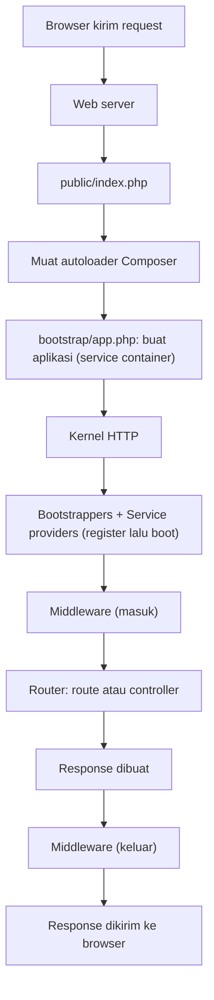
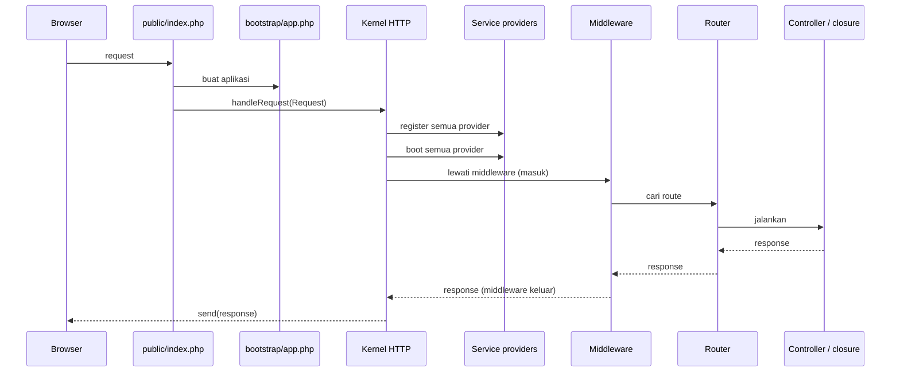

# Request Lifecycle

Selama beberapa sub bab kamu menulis route dan melihat halaman muncul di browser. Tetapi apa yang sebenarnya terjadi
antara "browser mengirim request" dan "halaman tampil"? Memahami **siklus hidup request** (*request lifecycle*) membuat
Laravel terasa tidak lagi "ajaib", dan membantumu menebak di mana sebuah masalah terjadi.

## Tujuan Pembelajaran

Setelah menyelesaikan sub bab ini, kamu dapat:

- [ ] Menjelaskan urutan perjalanan sebuah request dari `public/index.php` sampai response dikirim.
- [ ] Menjelaskan peran *application/service container*, *kernel*, *service provider*, *middleware*, dan *router*.
- [ ] Membedakan metode `register` dan `boot` pada service provider.
- [ ] Menemukan berkas yang berperan di tiap tahap (`public/index.php`, `bootstrap/app.php`, `bootstrap/providers.php`, `routes/web.php`).
- [ ] Membuktikan urutan eksekusi dengan menuliskan jejak ke berkas log.
- [ ] Menjelaskan bagaimana response kembali ke browser.

## Prasyarat

- Sub bab [Arsitektur MVC](01-03-mvc-architecture.md), [Struktur Direktori Laravel](01-09-laravel-directory-structure.md),
  dan [Artisan CLI](01-12-artisan-cli.md).
- [Request dan Response](../level-00/00-04-request-and-response.md) dari bab utama pertama.
- Proyek `~/belajar-laravel/aplikasi-pertama` berjalan dengan `php artisan serve`.

## Pengantar

Dokumentasi resmi menyatakan bahwa memahami cara kerja sebuah alat membuatmu lebih percaya diri memakainya. Tujuan sub bab ini
adalah memberi gambaran tingkat tinggi. Jika beberapa istilah belum langsung dimengerti, itu wajar; pemahamanmu akan
bertambah di bab-bab selanjutnya.

## Penjelasan Konsep

### Gambaran besar



!!! tip "Analogi"
    Seperti perjalanan surat di kantor pos: surat masuk lewat **loket tunggal** (`index.php`), petugas menyiapkan meja dan alat
    (bootstrapping dan provider), surat diperiksa petugas keamanan (middleware), dikirim ke bagian yang tepat (router dan controller),
    lalu jawaban kembali lewat pemeriksaan yang sama sebelum dikirim.

### Langkah 1: titik masuk `public/index.php`

Dokumentasi: semua request ke aplikasi Laravel masuk lewat `public/index.php`; web server diatur untuk mengarahkan semuanya ke sana.
Berkas ini hampir tidak berisi logika, hanya titik awal yang memuat sisa framework.

File: `public/index.php` (kerangka 13.x)

```php
<?php

use Illuminate\Foundation\Application;
use Illuminate\Http\Request;

define('LARAVEL_START', microtime(true));

// Determine if the application is in maintenance mode...
if (file_exists($maintenance = __DIR__.'/../storage/framework/maintenance.php')) {
    require $maintenance;
}

// Register the Composer autoloader...
require __DIR__.'/../vendor/autoload.php';

// Bootstrap Laravel and handle the request...
/** @var Application $app */
$app = require_once __DIR__.'/../bootstrap/app.php';

$app->handleRequest(Request::capture());
```

| Bagian | Fungsi |
|---|---|
| `define('LARAVEL_START', microtime(true))` | Mencatat waktu mulai |
| Pemeriksaan `maintenance.php` | Jika aplikasi dalam mode pemeliharaan, tampilkan itu dulu |
| `require ... vendor/autoload.php` | Memuat autoloader Composer (yang kamu pelajari di bab utama pertama) |
| `require_once ... bootstrap/app.php` | Membuat dan mengembalikan instance aplikasi |
| `Request::capture()` | Membungkus request HTTP yang masuk menjadi objek `Request` |
| `$app->handleRequest(...)` | Menyerahkan request ke aplikasi untuk ditangani |

### Langkah 2: membuat aplikasi (service container)

`bootstrap/app.php` membuat instance aplikasi dan mengonfigurasi routing, middleware, dan penanganan exception
(kerangka 13.x):

File: `bootstrap/app.php`

```php
return Application::configure(basePath: dirname(__DIR__))
    ->withRouting(
        web: __DIR__.'/../routes/web.php',
        commands: __DIR__.'/../routes/console.php',
        health: '/up',
    )
    ->withMiddleware(function (Middleware $middleware): void {
        //
    })
    ->withExceptions(function (Exceptions $exceptions): void {
        // ...
    })->create();
```

Menurut dokumentasi, tindakan pertama Laravel adalah membuat instance aplikasi sekaligus **service container**, yaitu
wadah yang mengelola objek dan ketergantungannya (dibahas pada sub bab *Gambaran Service Container*). Bagian `withRouting`
inilah yang memberi tahu aplikasi di mana berkas route berada.

### Langkah 3: kernel

Request kemudian diteruskan ke **kernel** HTTP (atau kernel konsol, bila berasal dari perintah Artisan) melalui metode
`handleRequest` (atau `handleCommand`). Kernel adalah pusat tempat semua request mengalir, dan dokumentasi menggambarkannya sebagai
"kotak hitam": kamu memberinya `Request` dan ia mengembalikan `Response`.

Sebelum request diproses, kernel menjalankan **bootstrappers**: menyiapkan penanganan error, pencatatan log (*logging*), pendeteksian
lingkungan aplikasi (yang membaca `.env`), dan tugas awal lain yang tidak perlu kamu ubah.

### Langkah 4: service provider

Salah satu tugas bootstrapping terpenting adalah memuat **service provider**, yaitu class yang menyiapkan komponen framework (database,
antrean, validasi, routing, dan lainnya). Urutannya (dari dokumentasi):

1. Laravel membuat instance setiap provider.
2. Metode **`register`** dipanggil pada **semua** provider.
3. Setelah semuanya terdaftar, metode **`boot`** dipanggil pada setiap provider.

| Metode | Tugas | Aturan |
|---|---|---|
| `register()` | Mendaftarkan sesuatu ke service container | Jangan memakai layanan lain di sini karena belum tentu terdaftar |
| `boot()` | Menjalankan penyiapan setelah semua terdaftar | Aman memakai layanan lain |

Alasan dua tahap: provider boleh bergantung pada layanan apa pun saat `boot`, karena semua binding sudah terdaftar. Hampir setiap fitur
besar Laravel disiapkan lewat provider.

Daftar provider aplikasi buatanmu ada di `bootstrap/providers.php`, dan provider bawaan proyek yang boleh kamu ubah ada di `app/Providers`:

File: `bootstrap/providers.php`

```php
<?php

use App\Providers\AppServiceProvider;

return [
    AppServiceProvider::class,
];
```

`AppServiceProvider` secara bawaan hampir kosong; tempat yang baik untuk menaruh penyiapan khas aplikasimu.

### Langkah 5: middleware dan routing

Setelah bootstrapping selesai, `Request` diserahkan ke **router** yang mencari route cocok dan menjalankannya. Di sepanjang jalan,
request melewati **middleware**: penyaring yang memeriksa atau memodifikasi request. Contoh dari dokumentasi:

- Middleware autentikasi: jika pengguna belum login, diarahkan ke halaman login; jika sudah, request dilanjutkan.
- Middleware yang berlaku untuk semua route, misalnya `PreventRequestsDuringMaintenance`.
- Middleware khusus route atau grup route tertentu.

Kernel juga menjalankan middleware yang menangani sesi, mode pemeliharaan, dan verifikasi token CSRF. Jika request lolos, route atau method
controller dijalankan.

### Langkah 6: menyelesaikan

Response yang dikembalikan route atau controller **bergerak balik** melewati middleware (memberi kesempatan memeriksa atau memodifikasinya),
dikembalikan oleh kernel ke `handleRequest`, lalu dikirim ke browser lewat metode `send`.

### Pemetaan dengan pengalaman PHP native

| Tahap Laravel | Padanan di proyek siswa |
|---|---|
| `public/index.php` | `public/index.php`, `tambah.php`, dan lainnya (satu berkas per halaman) |
| Muat autoloader | `require vendor/autoload.php` di setiap halaman |
| Aplikasi dan container | Membuat `$repository` dan `$validator` di tiap halaman |
| Middleware | Pemeriksaan manual (mis. metode `POST`) di tiap berkas |
| Router | Nama berkas menentukan halaman |
| `Request` / `Response` | `$_GET`, `$_POST`, `header()`, `echo` |

Pada proyek siswa, setiap halaman mengulang tahap-tahap itu. Laravel menjadikannya **satu jalur bersama** untuk semua request.

## Cara Kerja



## Contoh Praktik

Kamu membuktikan urutan `register`, `boot`, lalu route dengan menulis jejak ke berkas log. Jejak itu menunjukkan urutan nyata sebuah request
di dalam aplikasimu.

## Penjelasan Kode

File: `app/Providers/AppServiceProvider.php` (ubah sementara)

```php
public function register(): void
{
    logger('1. register: provider didaftarkan');
}

public function boot(): void
{
    logger('2. boot: provider dijalankan');
}
```

File: `routes/web.php` (tambahkan sementara)

```php
Route::get('/jejak', function () {
    logger('3. route: closure dijalankan');

    return 'Lihat storage/logs/laravel.log';
});
```

| Bagian | Penjelasan |
|---|---|
| `logger('...')` | Fungsi bantu yang menulis pesan tingkat *debug* ke log |
| `register()` | Metode provider yang dipanggil pertama |
| `boot()` | Metode provider yang dipanggil setelah semua provider terdaftar |
| `Route::get('/jejak', ...)` | Route percobaan yang ikut menulis jejak |

Pada konfigurasi bawaan, log ditulis ke `storage/logs/laravel.log` (channel `single`).

## Implementasi Langkah demi Langkah

### Langkah 1: baca titik masuk

```bash
cd ~/belajar-laravel/aplikasi-pertama
cat public/index.php
cat bootstrap/app.php
cat bootstrap/providers.php
```

Cocokkan tiap baris dengan penjelasan pada bagian konsep.

### Langkah 2: tambahkan jejak

Ubah `app/Providers/AppServiceProvider.php` dan tambahkan route `/jejak` seperti pada Penjelasan Kode.

### Langkah 3: kosongkan log dan jalankan server

```bash
: > storage/logs/laravel.log
php artisan serve
```

Perintah `: > berkas` mengosongkan isi berkas (membuatnya bila belum ada).

### Langkah 4: kirim satu request

Di terminal lain:

```bash
curl -i http://127.0.0.1:8000/jejak
```

### Langkah 5: baca log

```bash
cat storage/logs/laravel.log
```

### Langkah 6: pahami hasilnya

Cari tiga baris jejak dan catat urutannya. Lalu kirim request kedua ke `/jejak` dan cari tahu apakah `register` dan `boot` tertulis lagi.

### Langkah 7: bersihkan percobaan

Kembalikan `AppServiceProvider.php` ke isi semula (`git restore app/Providers/AppServiceProvider.php`), hapus route `/jejak` dari
`routes/web.php`, lalu:

```bash
git status
```

## Eksekusi dan Verifikasi

| Langkah | Cara memverifikasi |
|---|---|
| 1 | Kamu bisa menunjuk baris yang membuat aplikasi, mengambil `Request`, dan memanggil `handleRequest` |
| 2 | Perubahan tersimpan di dua berkas |
| 3 | Server berjalan dan log kosong |
| 4 | `curl -i` menampilkan status `200` dan teks `Lihat storage/logs/laravel.log` |
| 5 | Log memuat tiga pesan jejak |
| 6 | Urutan: pesan `1. register`, `2. boot`, lalu `3. route` |
| 7 | `git status` menunjukkan tidak ada perubahan tersisa pada percobaan |

## Hasil yang Diharapkan

Isi `storage/logs/laravel.log` setelah satu request kira-kira berisi tiga baris berformat
`[tanggal-waktu] local.DEBUG: ...` dengan urutan:

```text
[...] local.DEBUG: 1. register: provider didaftarkan
[...] local.DEBUG: 2. boot: provider dijalankan
[...] local.DEBUG: 3. route: closure dijalankan
```

Urutan ini membuktikan bahwa `register` selalu lebih dulu daripada `boot`, dan keduanya terjadi sebelum route dijalankan, sesuai
penjelasan dokumentasi. Pada setiap request baru, aplikasi dimulai ulang sehingga ketiga baris tertulis lagi. Bagian tanggal-waktu dan
format baris persisnya bergantung konfigurasi log. Keluaran di atas diturunkan dari dokumentasi dan kode, dan belum dijalankan oleh
penulis materi; cocokkan dengan hasilmu.

## Kesalahan Umum dan Pemecahan Masalah

| Gejala | Penyebab | Cara mengenali | Solusi | Pencegahan |
|---|---|---|---|---|
| Log kosong atau tidak ada | Berkas log tidak dapat ditulis, atau `LOG_CHANNEL` diubah | `storage/logs/laravel.log` tidak muncul | Pastikan folder `storage` dapat ditulis oleh pengguna; periksa `.env` | Periksa izin folder `storage` |
| Jejak muncul dua kali pada satu request | Request kedua (mis. permintaan `favicon.ico` oleh browser) | Banyak baris `register` dan `boot` | Gunakan `curl` agar hanya satu request | Uji dengan `curl` |
| `Permission denied` menulis log | Izin folder `storage/logs` | Pesan *failed to open stream* | Perbaiki kepemilikan folder untuk pengguna biasa; jangan memakai `sudo` untuk menjalankan server | Jalankan server sebagai pengguna biasa |
| Menaruh logika berat di `register()` | Salah paham tahap | Error memakai layanan yang belum terdaftar | Pindahkan ke `boot()` | Ingat: `register` hanya mendaftarkan |
| Perubahan provider tidak berpengaruh | Provider tidak terdaftar | Class tidak ada di `bootstrap/providers.php` | Daftarkan di `bootstrap/providers.php` | Gunakan `make:provider` bila membuat provider baru |
| Percobaan tertinggal di kode | Lupa membersihkan | `git status` menunjukkan perubahan | `git restore` dan hapus route percobaan | Selalu jalankan Langkah 7 |
| Mengira `index.php` berisi logika aplikasi | Salah paham | Mencari route di `index.php` | Ingat bahwa `index.php` hanya titik awal | Baca bagian "Langkah 1" |

## Latihan Praktik

### Latihan dasar

**D1. Urutkan tahap**
- *Masalah:* susun urutan perjalanan request.
- *Persyaratan:* urutkan dengan benar: router, autoloader, middleware (masuk), `public/index.php`, service provider, kernel, response dikirim, `bootstrap/app.php`.
- *Perilaku yang diharapkan:* urutan sesuai diagram gambaran besar.
- *Tujuan belajar:* menghafal urutan lifecycle.

**D2. Peran berkas**
- *Masalah:* tentukan berkas untuk setiap tugas.
- *Persyaratan:* tulis berkas yang bertanggung jawab atas: titik masuk, pembuatan aplikasi, daftar provider, dan definisi route web.
- *Perilaku yang diharapkan:* `public/index.php`, `bootstrap/app.php`, `bootstrap/providers.php`, `routes/web.php`.
- *Tujuan belajar:* menghubungkan konsep dengan berkas.

### Latihan implementasi

**I1. Jejak lengkap**
- *Masalah:* ingin melihat lebih banyak tahap.
- *Persyaratan:* tambahkan jejak di `routes/web.php` untuk dua route berbeda, kirim request ke keduanya, dan jelaskan mengapa `register`
  dan `boot` tertulis di setiap request.
- *Perilaku yang diharapkan:* log memuat pasangan `register` dan `boot` per request.
- *Tujuan belajar:* memahami bahwa PHP memulai aplikasi pada setiap request.

**I2. Provider sendiri**
- *Masalah:* ingin memisahkan penyiapan khusus.
- *Persyaratan:* buat provider dengan `php artisan make:provider JejakServiceProvider`, daftarkan di `bootstrap/providers.php` (periksa apakah perintah
  sudah melakukannya otomatis), tambahkan jejak di `register` dan `boot`, dan buktikan urutannya relatif terhadap `AppServiceProvider`.
- *Perilaku yang diharapkan:* kedua provider tampil dalam urutan sesuai daftar.
- *Tujuan belajar:* membuat dan mendaftarkan provider.
- *Catatan:* bersihkan semua percobaan setelah selesai.

### Latihan tantangan

**T1. Peta lifecycle untuk proyek siswa**
- *Masalah:* jelaskan lifecycle kepada rekan yang baru belajar.
- *Persyaratan:* gambar diagram (Mermaid atau tangan) satu halaman yang memetakan setiap tahap lifecycle Laravel ke bagian proyek siswa PHP native
  yang sepadan, dan tandai tahap yang tidak ada padanannya.
- *Perilaku yang diharapkan:* rekan dapat menjelaskan ulang urutan tanpa membaca dokumentasi.
- *Tujuan belajar:* mengomunikasikan lifecycle.
- *Catatan:* kerjakan mandiri; tidak ada kunci jawaban.

## Uji Pemahaman

1. Berkas apa yang menjadi titik masuk semua request?
2. Apa yang dilakukan `bootstrap/app.php`?
3. Apa fungsi kernel HTTP?
4. Apa beda `register` dan `boot` pada service provider, dan mengapa dipisah?
5. Apa itu middleware dan berikan dua contoh tugasnya?
6. Ke mana response bergerak setelah dibuat oleh controller?
7. Di mana daftar provider aplikasi berada?
8. Mengapa log menunjukkan `register` dan `boot` pada setiap request?

??? success "Kunci jawaban singkat"
    1. `public/index.php`.
    2. Membuat instance aplikasi (service container) dan mengonfigurasi routing, middleware, dan exception.
    3. Menerima `Request`, menjalankan bootstrappers dan middleware, dan mengembalikan `Response`.
    4. `register` mendaftarkan ke container; `boot` berjalan setelah semuanya terdaftar sehingga aman memakai layanan lain.
    5. Penyaring request/response; contoh: autentikasi, verifikasi CSRF, sesi, mode pemeliharaan.
    6. Kembali melewati middleware (keluar), ke kernel, lalu dikirim ke browser dengan `send`.
    7. `bootstrap/providers.php`.
    8. Aplikasi PHP dimulai ulang setiap request.

## Ringkasan

- Semua request masuk lewat `public/index.php`, yang memuat autoloader dan `bootstrap/app.php`.
- `Request` diserahkan ke kernel, yang menjalankan bootstrappers, service provider (`register` lalu `boot`), dan middleware.
- Router mencocokkan route dan menjalankan controller; response kembali melewati middleware lalu dikirim ke browser.
- Provider menyiapkan hampir semua fitur framework; milikmu ada di `app/Providers` dan terdaftar di `bootstrap/providers.php`.
- Aplikasi dimulai ulang pada setiap request.

Selanjutnya: *Gambaran Service Container*, yaitu wadah yang mengelola objek dan ketergantungannya.

## Referensi Resmi

- [Laravel: Request Lifecycle](https://laravel.com/docs/13.x/lifecycle)
- [Laravel: Service Providers](https://laravel.com/docs/13.x/providers)
- [Laravel: Middleware](https://laravel.com/docs/13.x/middleware)
- [Laravel: Logging](https://laravel.com/docs/13.x/logging)
- [Laravel: Helpers (`logger`)](https://laravel.com/docs/13.x/helpers)
- [Laravel: Directory Structure](https://laravel.com/docs/13.x/structure)
- [Kerangka aplikasi 13.x: public/index.php](https://github.com/laravel/laravel/blob/13.x/public/index.php)
