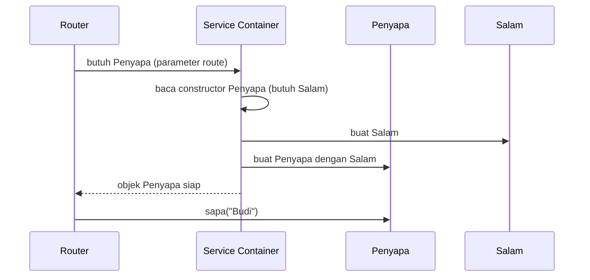

# Gambaran Service Container

Pada proyek siswa, setiap halaman membuat sendiri objek yang dibutuhkan: `new SiswaRepository(...)`, lalu
`new SiswaValidator($repository, ...)`. Semakin besar aplikasi, urusan "siapa membuat apa" makin merepotkan.
Laravel menyelesaikannya dengan **service container**, yang membuat objek dan mengisi ketergantungannya secara
otomatis. Sub bab ini memberi gambaran dasarnya; pembahasan mendalam ada di bab utama *Advanced Laravel Features*.

## Tujuan Pembelajaran

Setelah menyelesaikan sub bab ini, kamu dapat:

- [ ] Menjelaskan apa itu *dependency* dan *dependency injection*.
- [ ] Menjelaskan fungsi service container dan alasan ia memudahkan pengembangan.
- [ ] Memanfaatkan *zero configuration resolution*: menaruh class sebagai parameter route atau constructor.
- [ ] Mengikat interface ke implementasi (`bind`) dan memahami `singleton`.
- [ ] Meminta objek dari container dengan `app()`.
- [ ] Menjelaskan kapan kamu perlu (dan tidak perlu) berinteraksi langsung dengan container.

## Prasyarat

- Sub bab [Request Lifecycle](01-13-request-lifecycle.md): service provider, `register`, dan `boot`.
- Bab utama Dasar Web dan PHP: [Class dan Objek](../level-00/00-19-classes-and-objects.md),
  [Pewarisan, Enkapsulasi, Polimorfisme](../level-00/00-20-inheritance-encapsulation-polymorphism.md) (interface),
  dan [Namespace dan Autoloading](../level-00/00-22-namespace-and-autoloading.md).
- Proyek `~/belajar-laravel/aplikasi-pertama` berjalan.

## Pengantar

Perhatikan potongan dari proyek siswa:

```php
$repository = new SiswaRepository($config["berkas_data"]);
$validator = new SiswaValidator($repository, $config["jurusan"]);
```

`SiswaValidator` **membutuhkan** `SiswaRepository` untuk bekerja. Kebutuhan seperti ini disebut *dependency*
(ketergantungan). Kamu harus membuat objek ketergantungannya sendiri di setiap halaman, dan setiap kali konstruktor
berubah, semua halaman ikut diubah. Container mengambil alih pekerjaan itu.

## Penjelasan Konsep

### Dependency dan dependency injection

- **Dependency**: objek lain yang dibutuhkan sebuah class agar bisa bekerja.
- **Dependency injection** (DI): ketergantungan itu **disuntikkan** dari luar, lewat constructor (atau metode lain), bukan dibuat
  sendiri di dalam class.

Menurut dokumentasi, *dependency injection* pada dasarnya berarti ketergantungan class "disuntikkan" ke dalam class lewat
constructor atau, dalam beberapa kasus, metode "setter".

```php
class Penyapa
{
    public function __construct(private Salam $salam) {}   // Salam disuntikkan dari luar
}
```

Manfaatnya: kode lebih mudah diuji (ketergantungan bisa diganti tiruan) dan lebih mudah diubah (implementasi bisa ditukar).

!!! tip "Analogi"
    Restoran yang memesan bahan dari pemasok: koki tidak menanam sendiri sayurannya. Ia menerima bahan dari luar. **Container**
    adalah bagian pengadaan yang memastikan setiap koki mendapat bahan yang tepat tanpa mereka harus mengurusnya.

### Apa itu service container?

Menurut dokumentasi, **service container** adalah alat untuk mengelola ketergantungan class dan melakukan dependency injection. Ia:

1. Mengetahui cara **membuat** objek (misalnya dengan membaca tipe parameter constructor).
2. **Menyuntikkan** ketergantungan secara otomatis.
3. Dapat diatur untuk menukar implementasi (mengikat interface ke class tertentu).

Container sudah kamu temui tanpa sadar: pada sub bab Request Lifecycle, langkah pertama Laravel adalah membuat aplikasi sekaligus container.

### Zero configuration resolution

Jika sebuah class tidak punya ketergantungan, atau hanya bergantung pada class konkret lain (bukan interface), container tidak perlu
diberi tahu cara membuatnya. Ia memakai *reflection* (membaca tipe parameter) untuk menyelesaikannya otomatis. Dokumentasi menyebut ini
sebagai fitur yang membuatmu bisa memakai DI tanpa berkas konfigurasi yang bengkak.

Contoh dari dokumentasi: class `Service` bisa langsung dipakai sebagai parameter route tanpa pendaftaran apa pun.

```php
Route::get('/', function (Service $service) {
    // $service sudah berisi objek Service
});
```

Banyak class di Laravel otomatis menerima ketergantungannya lewat container, termasuk **controller**, *event listener*, *middleware*,
dan metode `handle` pada *job*. Itu sebabnya parameter `Request $request` di route dan controller langsung terisi.

### Kapan berinteraksi langsung dengan container?

Dokumentasi menyebut bahwa berkat injeksi otomatis dan facade, kamu sering membangun aplikasi tanpa pernah mengikat atau meminta sesuatu dari
container secara manual. Ada dua situasi umum yang membutuhkannya:

1. Kamu membuat class yang **mengimplementasikan interface** dan ingin menaruh *interface* itu sebagai type-hint: container harus diberi tahu
   implementasi mana yang dipakai (`bind`).
2. Kamu menulis **paket** Laravel untuk dibagikan.

### Mengikat (`bind`) dan singleton

Pengikatan dilakukan di dalam service provider, dalam metode `register`, lewat `$this->app`:

| Cara | Arti |
|---|---|
| `$this->app->bind(Interface::class, Implementasi::class)` | Setiap kali `Interface` diminta, berikan `Implementasi` (objek baru tiap kali) |
| `$this->app->bind(Kelas::class, function (Application $app) { ... })` | Membuat objek dengan cara khusus |
| `$this->app->singleton(Kelas::class, ...)` | Dibuat **sekali**; permintaan berikutnya mengembalikan objek yang sama |

Dokumentasi menyebut tidak perlu mengikat class yang tidak bergantung pada interface, karena container dapat membuatnya sendiri dengan
reflection.

### Meminta objek dari container

Di luar provider, ada dua cara umum:

```php
use Illuminate\Support\Facades\App;

$a = App::make(Penyapa::class);   // lewat facade
$b = app(Penyapa::class);         // lewat fungsi bantu app()
```

Tetapi dokumentasi menekankan bahwa **cara utama** adalah menaruh type-hint di constructor class yang di-resolve container (controller, middleware,
dan lainnya). Meminta langsung lewat `app()` adalah jalan keluar, bukan kebiasaan utama.

### Mengapa ini penting bagi proyek siswa?

| Proyek siswa (manual) | Dengan container |
|---|---|
| Setiap halaman membuat `$repository` lalu `$validator` | Cukup type-hint `SiswaValidator` di parameter; container membuat `SiswaRepository` yang dibutuhkan |
| Mengganti penyimpanan JSON ke database berarti mengubah banyak halaman | Ubah satu `bind` di provider |
| Pengujian sulit karena objek dibuat di dalam | Objek mudah diganti tiruan |

## Cara Kerja



Container membaca tipe parameter constructor, membuat ketergantungan lebih dulu, lalu merangkai semuanya.

## Contoh Praktik

Kamu membuat dua class kecil yang saling bergantung dan melihat container menyuntikkannya otomatis. Kemudian kamu memakai interface,
mengikatnya di provider, menukar implementasinya, dan membuktikan perbedaan `bind` dan `singleton`.

## Penjelasan Kode

File: `app/Services/Salam.php`

```php
<?php

namespace App\Services;

class Salam
{
    public function awalan(): string
    {
        return 'Halo';
    }
}
```

File: `app/Services/Penyapa.php`

```php
<?php

namespace App\Services;

class Penyapa
{
    public function __construct(private Salam $salam) {}

    public function sapa(string $nama): string
    {
        return $this->salam->awalan() . ", {$nama}!";
    }
}
```

File: `routes/web.php`

```php
use App\Services\Penyapa;

Route::get('/sapa/{nama}', function (Penyapa $penyapa, string $nama) {
    return $penyapa->sapa($nama);
});
```

| Bagian | Penjelasan |
|---|---|
| `Penyapa::__construct(private Salam $salam)` | `Penyapa` bergantung pada `Salam` |
| `function (Penyapa $penyapa, string $nama)` | Parameter pertama dari container; `{nama}` dari URL, ditaruh **setelah** ketergantungan |
| Tidak ada `new` | Container yang membuat `Salam` lalu `Penyapa` |

Bagian interface dan binding:

File: `app/Contracts/PenyimpanSiswa.php`

```php
<?php

namespace App\Contracts;

interface PenyimpanSiswa
{
    /** @return string[] */
    public function semua(): array;
}
```

File: `app/Services/PenyimpanSementara.php`

```php
<?php

namespace App\Services;

use App\Contracts\PenyimpanSiswa;

class PenyimpanSementara implements PenyimpanSiswa
{
    public function semua(): array
    {
        return ['Budi', 'Sari', 'Andi'];
    }
}
```

File: `app/Providers/AppServiceProvider.php` (metode `register`)

```php
use App\Contracts\PenyimpanSiswa;
use App\Services\ObjekTunggal;
use App\Services\PenyimpanSementara;

public function register(): void
{
    $this->app->bind(PenyimpanSiswa::class, PenyimpanSementara::class);
    $this->app->singleton(ObjekTunggal::class);
}
```

File: `routes/web.php`

```php
use App\Contracts\PenyimpanSiswa;
use App\Services\ObjekBiasa;
use App\Services\ObjekTunggal;

Route::get('/daftar-siswa', function (PenyimpanSiswa $penyimpan) {
    return $penyimpan->semua();
});

Route::get('/singleton', function () {
    return [
        'biasa_sama' => app(ObjekBiasa::class) === app(ObjekBiasa::class),
        'tunggal_sama' => app(ObjekTunggal::class) === app(ObjekTunggal::class),
    ];
});
```

`ObjekBiasa` dan `ObjekTunggal` adalah class kosong di `app/Services/`:

```php
<?php

namespace App\Services;

class ObjekBiasa
{
}
```

(Isi `ObjekTunggal` sama, dengan nama class `ObjekTunggal`.)

| Bagian | Penjelasan |
|---|---|
| `interface PenyimpanSiswa` | Kontrak: siapa pun yang menyimpan siswa harus punya method `semua()` |
| `bind(PenyimpanSiswa::class, PenyimpanSementara::class)` | Beri tahu container: bila diminta `PenyimpanSiswa`, buat `PenyimpanSementara` |
| `singleton(ObjekTunggal::class)` | Objek dibuat sekali lalu dipakai ulang |
| `app(ObjekBiasa::class) === app(ObjekBiasa::class)` | Membandingkan identitas objek dari dua permintaan berbeda |

Tanpa `bind`, meminta interface akan gagal karena container tidak tahu class konkret mana yang harus dibuat.

## Implementasi Langkah demi Langkah

### Langkah 1: buat class dengan Artisan

```bash
cd ~/belajar-laravel/aplikasi-pertama
php artisan make:class Services/Salam
php artisan make:class Services/Penyapa
```

Perintah `make:class` membuat class kosong di `app/Services/`. Isi kedua berkas sesuai bagian Penjelasan Kode. Kamu juga boleh membuat berkas
secara manual di editor.

### Langkah 2: route dengan injeksi otomatis

Tambahkan route `/sapa/{nama}`, jalankan `php artisan serve`, lalu:

```bash
curl -i http://127.0.0.1:8000/sapa/Budi
```

### Langkah 3: interface dan binding

```bash
php artisan make:interface Contracts/PenyimpanSiswa
php artisan make:class Services/PenyimpanSementara
```

Isi berkas, ubah `register()` di `AppServiceProvider`, dan tambahkan route `/daftar-siswa`:

```bash
curl -i http://127.0.0.1:8000/daftar-siswa
```

### Langkah 4: lihat kegagalan tanpa binding

Beri komentar sementara pada baris `bind(...)` di `register()`, lalu minta `/daftar-siswa` lagi. Catat pesan error di respons atau di
`storage/logs/laravel.log`. Aktifkan kembali `bind`.

### Langkah 5: tukar implementasi

Buat `app/Services/PenyimpanLain.php` yang juga mengimplementasikan `PenyimpanSiswa` dan mengembalikan daftar nama berbeda. Ganti satu
argumen pada `bind(...)` menjadi `PenyimpanLain::class`, lalu minta `/daftar-siswa` lagi. Route tidak diubah.

### Langkah 6: bandingkan `bind` dan `singleton`

Buat `ObjekBiasa` dan `ObjekTunggal`, tambahkan binding `singleton` dan route `/singleton`:

```bash
curl -i http://127.0.0.1:8000/singleton
```

### Langkah 7: bersihkan atau simpan

Untuk contoh Services yang akan berguna di bab berikutnya, kamu boleh menyimpannya. Percobaan `ObjekBiasa`, `ObjekTunggal`, dan route
`/singleton` sebaiknya dihapus. Catat perubahan yang dipertahankan:

```bash
git status
git add app routes
git commit -m "Contoh service container: Penyapa dan PenyimpanSiswa"
```

## Eksekusi dan Verifikasi

| Langkah | Cara memverifikasi |
|---|---|
| 1-2 | `/sapa/Budi` menjawab status `200` dengan teks `Halo, Budi!` |
| 3 | `/daftar-siswa` mengembalikan `["Budi","Sari","Andi"]` |
| 4 | Tanpa `bind`, aplikasi gagal dengan pesan bahwa interface tidak dapat di-instansiasi |
| 5 | `/daftar-siswa` menampilkan daftar dari implementasi baru tanpa mengubah route |
| 6 | `/singleton` mengembalikan `biasa_sama` `false` dan `tunggal_sama` `true` |
| 7 | `git log --oneline` memuat commit baru |

## Hasil yang Diharapkan

```text
GET /sapa/Budi        -> Halo, Budi!
GET /daftar-siswa     -> ["Budi","Sari","Andi"]
GET /singleton        -> {"biasa_sama":false,"tunggal_sama":true}
```

- `/sapa/Budi` bekerja tanpa satu pun `new Salam()` atau `new Penyapa()` di route: container yang membuatnya.
- `/daftar-siswa` bekerja hanya setelah `bind`. Tanpa pengikatan, container tidak tahu implementasi interface mana yang dipakai dan melempar error
  (teks persisnya mengikuti versi).
- Hasil `/singleton`: dua kali `app(ObjekBiasa::class)` menghasilkan dua objek berbeda, sedangkan `ObjekTunggal` menghasilkan objek yang sama.

Format JSON dapat rapat atau dirapikan. Keluaran di atas diturunkan dari dokumentasi dan kode, dan belum dijalankan oleh penulis materi; cocokkan dengan
hasilmu.

## Kesalahan Umum dan Pemecahan Masalah

| Gejala | Penyebab | Cara mengenali | Solusi | Pencegahan |
|---|---|---|---|---|
| Error "Target [Interface] is not instantiable" | Interface diminta tanpa `bind` | Pesan menyebut interface | Tambahkan `bind(Interface::class, Implementasi::class)` di `register()` | Setiap interface yang di-type-hint perlu diikat |
| `Class "App\Services\Salam" not found` | Namespace atau jalur berkas salah | Pesan class not found | Samakan namespace dengan lokasi berkas (PSR-4) | Gunakan `make:class` |
| Parameter route tertukar posisi | Ketergantungan ditaruh setelah parameter URL | Nilai tak sesuai atau error tipe | Taruh ketergantungan sebelum parameter route | Ikuti urutan: ketergantungan dulu, lalu parameter route |
| Mengikat di tempat yang salah | `bind` di `boot()` yang dipanggil setelah sebagian layanan dipakai | Binding tidak berlaku saat dibutuhkan | Letakkan binding di `register()` | Ingat: `register` untuk binding |
| Menyangka container selalu mengembalikan objek yang sama | `bind` membuat objek baru tiap kali | `===` bernilai `false` | Gunakan `singleton` bila perlu satu instance | Pahami beda `bind` dan `singleton` |
| Terlalu sering memakai `app()` | Menjadikan container pencarian objek di mana-mana | Banyak `app(...)` di controller | Gunakan type-hint di constructor atau parameter | Jadikan `app()` pilihan terakhir |
| `make:interface` tidak dikenal | Perintah tidak ada di versi tertentu | Artisan menyatakan perintah tidak ditemukan | Buat berkas manual atau periksa `php artisan list make` | Cek `php artisan list make` dulu |
| Percobaan tertinggal di kode | Lupa membersihkan | `git status` menunjukkan berkas percobaan | Hapus berkas yang tidak perlu | Jalankan Langkah 7 |

## Latihan Praktik

### Latihan dasar

**D1. Jelaskan dengan analogi**
- *Masalah:* jelaskan DI kepada temanmu.
- *Persyaratan:* tulis penjelasan tiga kalimat dengan analogi buatanmu sendiri.
- *Perilaku yang diharapkan:* temanmu paham bahwa ketergantungan diberikan dari luar.
- *Tujuan belajar:* mengungkapkan konsep DI dengan bahasa sederhana.

**D2. Rantai tiga class**
- *Masalah:* ingin melihat container merangkai lebih dari dua class.
- *Persyaratan:* buat `Pembuka` yang bergantung pada `Salam`, dan `Sambutan` yang bergantung pada `Pembuka`; route `/sambutan/{nama}` yang
  hanya type-hint `Sambutan`.
- *Perilaku yang diharapkan:* tiga class terangkai tanpa satu pun `new`.
- *Tujuan belajar:* memahami resolusi berantai.

### Latihan implementasi

**I1. Padanan repository siswa**
- *Masalah:* meniru pola proyek siswa di Laravel.
- *Persyaratan:* buat interface `SiswaRepositoryInterface` (metode `semua()` dan `cari(int $id)`), implementasi `RepositoriArray` dengan data tetap, bind di provider, dan route
  `/siswa/{id}` yang type-hint interface lalu mengembalikan data siswa atau 404.
- *Perilaku yang diharapkan:* route bekerja; mengganti implementasi hanya mengubah `bind`.
- *Tujuan belajar:* memakai interface dan binding pada kasus nyata.

**I2. Menghitung instance**
- *Masalah:* ingin membuktikan perilaku `singleton` lebih ketat.
- *Persyaratan:* buat class `Penghitung` dengan properti `jumlah` dan metode `tambah()`; sebagai `singleton`, route `/hitung` memanggil `tambah()` lalu
  menampilkan `jumlah`. Bandingkan hasilnya antar dua request dan jelaskan mengapa jumlah tidak bertambah antar request.
- *Perilaku yang diharapkan:* nilai selalu kembali dari awal pada tiap request (aplikasi dimulai ulang tiap request).
- *Tujuan belajar:* membedakan masa hidup singleton (per request) dari penyimpanan permanen.

### Latihan tantangan

**T1. Membuktikan manfaat untuk pengujian**
- *Masalah:* tunjukkan mengapa DI memudahkan penggantian objek.
- *Persyaratan:* buat dua implementasi `PenyimpanSiswa` (asli dan tiruan), ganti lewat satu baris `bind`, dan jelaskan bagaimana cara ini dipakai nanti di pengujian otomatis.
- *Perilaku yang diharapkan:* route tidak berubah saat implementasi diganti.
- *Tujuan belajar:* menghubungkan DI dengan pengujian.
- *Catatan:* kerjakan mandiri; tidak ada kunci jawaban.

## Uji Pemahaman

1. Apa itu dependency dan dependency injection?
2. Apa fungsi service container?
3. Apa arti zero configuration resolution?
4. Kapan kamu perlu memakai `bind`?
5. Apa beda `bind` dan `singleton`?
6. Di metode mana binding biasanya didaftarkan, dan mengapa?
7. Mengapa type-hint di constructor lebih disarankan daripada `app()`?
8. Mengapa parameter route harus ditaruh setelah ketergantungan?

??? success "Kunci jawaban singkat"
    1. Dependency: objek lain yang dibutuhkan class; DI: ketergantungan disuntikkan dari luar (biasanya lewat constructor).
    2. Mengelola ketergantungan class dan menyuntikkannya otomatis.
    3. Container dapat membuat class tanpa konfigurasi bila ia tidak punya ketergantungan atau hanya bergantung pada class konkret.
    4. Saat type-hint interface (perlu memberi tahu implementasinya), atau saat membuat paket.
    5. `bind`: objek baru tiap diminta; `singleton`: dibuat sekali dan dipakai ulang.
    6. `register()` di service provider, agar semua binding tersedia sebelum `boot()`.
    7. Ketergantungan terlihat jelas dan mudah diganti/diuji; `app()` menyembunyikannya.
    8. Agar nilai dari URL diisi ke parameter yang tepat setelah container mengisi ketergantungan.

## Ringkasan

- *Dependency injection* memberi class objek yang dibutuhkannya dari luar; service container melakukannya otomatis.
- Class konkret bisa langsung di-type-hint di route, controller, dan sejenisnya (zero configuration resolution).
- Interface perlu diikat ke implementasi dengan `bind` di `register()`; `singleton` membuat satu instance.
- `app()` dan `App::make()` meminta objek dari container, tetapi type-hint adalah cara utama.
- Container membuat kode lebih fleksibel dan mudah diuji; kamu akan memakainya terus di bab-bab berikutnya.

Selanjutnya: *Konfigurasi Aplikasi*, yaitu pengaturan inti aplikasi di `config/app.php`.

## Referensi Resmi

- [Laravel: Service Container](https://laravel.com/docs/13.x/container)
- [Laravel: Zero Configuration Resolution](https://laravel.com/docs/13.x/container#zero-configuration-resolution)
- [Laravel: Binding Interfaces to Implementations](https://laravel.com/docs/13.x/container#binding-interfaces-to-implementations)
- [Laravel: Binding a Singleton](https://laravel.com/docs/13.x/container#binding-a-singleton)
- [Laravel: Service Providers](https://laravel.com/docs/13.x/providers)
- [Laravel: Contracts](https://laravel.com/docs/13.x/contracts)
- [Laravel: Helpers (`app`)](https://laravel.com/docs/13.x/helpers)
- [PHP Manual: Interfaces](https://www.php.net/manual/en/language.oop5.interfaces.php)
