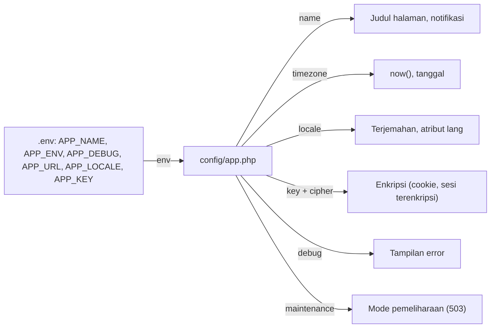

# Konfigurasi Aplikasi

Di sub bab *Konfigurasi Laravel* kamu mengenal cara kerja folder `config/`, dan di sub bab *Environment Variables* kamu mengenal `.env`.
Sekarang kita membedah satu berkas yang paling penting: **`config/app.php`**, yaitu pengaturan inti aplikasi. Kamu akan tahu arti tiap opsinya,
mana yang aman diubah, dan apa efeknya pada aplikasi.

## Tujuan Pembelajaran

Setelah menyelesaikan sub bab ini, kamu dapat:

- [ ] Menjelaskan arti opsi di `config/app.php`: `name`, `env`, `debug`, `url`, `timezone`, `locale`, `fallback_locale`, `faker_locale`, `cipher`, `key`, `previous_keys`, dan `maintenance`.
- [ ] Mengubah nama aplikasi, zona waktu, dan bahasa serta mengamati efeknya.
- [ ] Menjelaskan fungsi `APP_KEY` dan cara membuat kunci tanpa mengubah berkas.
- [ ] Mengaktifkan dan menonaktifkan mode pemeliharaan (*maintenance mode*).
- [ ] Menyebutkan konfigurasi yang wajib berbeda di produksi.

## Prasyarat

- Sub bab [Konfigurasi Laravel](01-10-laravel-configuration.md), [Environment Variables](01-11-environment-variables.md),
  dan [Request Lifecycle](01-13-request-lifecycle.md).
- Proyek `~/belajar-laravel/aplikasi-pertama` berjalan dengan `php artisan serve`.
- Git yang bersih (`git status` tanpa perubahan belum disimpan).

## Pengantar

Hampir semua aplikasi membutuhkan jawaban atas pertanyaan dasar: *Apa namanya? Di lingkungan apa ia berjalan? Zona waktu dan bahasa apa yang dipakai?
Bagaimana data sensitif dienkripsi? Apa yang terjadi saat aplikasi sedang diperbarui?* Di Laravel, jawabannya terkumpul di `config/app.php`.

## Penjelasan Konsep

### Isi `config/app.php`

Berikut opsi pada kerangka aplikasi 13.x beserta sumber nilainya dan artinya:

| Opsi | Nilai bawaan | Sumber | Fungsi |
|---|---|---|---|
| `name` | `Laravel` | `APP_NAME` | Nama aplikasi, dipakai di notifikasi dan tampilan |
| `env` | `production` | `APP_ENV` | Nama lingkungan (`local`, `staging`, `production`) |
| `debug` | `false` | `APP_DEBUG` | Menampilkan error rinci bila `true` |
| `url` | `http://localhost` | `APP_URL` | URL dasar, dipakai terutama oleh Artisan saat membuat URL |
| `timezone` | `UTC` | tertulis langsung | Zona waktu aplikasi |
| `locale` | `en` | `APP_LOCALE` | Bahasa utama |
| `fallback_locale` | `en` | `APP_FALLBACK_LOCALE` | Bahasa cadangan jika terjemahan tidak ada |
| `faker_locale` | `en_US` | `APP_FAKER_LOCALE` | Bahasa data palsu (untuk pengujian dan seeder) |
| `cipher` | `AES-256-CBC` | tertulis langsung | Algoritma enkripsi |
| `key` | kosong | `APP_KEY` | Kunci enkripsi aplikasi |
| `previous_keys` | daftar kosong | `APP_PREVIOUS_KEYS` | Kunci lama (untuk rotasi kunci) |
| `maintenance.driver` | `file` | `APP_MAINTENANCE_DRIVER` | Cara menyimpan status pemeliharaan |
| `maintenance.store` | `database` | `APP_MAINTENANCE_STORE` | Penyimpanan cache bila driver `cache` |

Nilai bawaan di tabel adalah nilai cadangan di `config/app.php`; nilai sebenarnya di proyekmu dapat ditimpa oleh `.env`. Misalnya `.env`
proyek baru berisi `APP_ENV=local`, `APP_DEBUG=true`, dan `APP_URL=http://localhost:8000`.

### Nama, lingkungan, debug, dan URL

- **`name`**: kerangka Laravel memakainya, misalnya pada judul halaman sambutan (`<title>`).
- **`env`**: `local` saat mengembangkan. Kode dapat memeriksanya dengan `App::environment()` (sub bab Environment Variables).
- **`debug`**: dokumentasi menegaskan bahwa di produksi harus `false`; bila `true`, nilai konfigurasi sensitif dapat terekspos kepada pengguna.
- **`url`**: dipakai Artisan agar URL yang dihasilkan di luar web (mis. dari perintah terjadwal) benar.

### Zona waktu

`timezone` menentukan zona waktu yang dipakai aplikasi, termasuk fungsi `now()` dan penyimpanan tanggal. Nilai bawaan `UTC` adalah pilihan aman
yang umum untuk menyimpan data; kamu dapat mengubahnya menjadi nama zona resmi, misalnya `Asia/Jakarta`. Nilai ini tertulis langsung di berkas
sehingga diubah dengan mengedit `config/app.php`.

!!! tip "Analogi"
    Zona waktu seperti **jam dinding kantor**. Semua catatan memakai jam yang sama; jika jamnya diganti, angka yang tertulis pada catatan baru ikut
    berubah, padahal peristiwa yang dicatat sama.

### Bahasa (locale)

Dokumentasi lokalisasi menjelaskan bahwa bahasa bawaan aplikasi tersimpan pada opsi `locale` di `config/app.php`, yang biasanya diatur lewat `APP_LOCALE`.
Ada juga `fallback_locale` yang dipakai bila bahasa utama tidak memiliki terjemahan sebuah teks. Bahasa dapat diubah untuk satu request lewat
`App::setLocale('id')`.

Perlu diingat bahwa kerangka aplikasi bawaan tidak menyertakan folder `lang/`. Berkas terjemahan buatanmu dibuat dengan `php artisan lang:publish`. Lokalisasi
penuh dibahas di bab utama *Advanced Laravel Features*.

### Kunci aplikasi dan enkripsi

- **`key`** (`APP_KEY`) dipakai layanan enkripsi Laravel. Dokumentasi menyatakan kunci ini harus diatur sebelum memakai enkripsi, dan nilainya dibuat otomatis
  saat proyek dibuat.
- **`cipher`** menentukan algoritma, `AES-256-CBC` secara bawaan.
- **`previous_keys`** (`APP_PREVIOUS_KEYS`) memungkinkan *rotasi kunci*: daftar kunci lama yang dipakai untuk membaca data yang dienkripsi sebelum kunci diganti.
  Dokumentasi menjelaskan bahwa nilainya berupa daftar dipisah koma.

!!! danger "Perlakukan APP_KEY sebagai rahasia"
    `APP_KEY` tidak boleh di-commit atau dibagikan. Mengganti kunci pada aplikasi yang sudah berjalan membuat data terenkripsi lama (misalnya cookie) tidak
    terbaca kecuali kunci lama didaftarkan di `APP_PREVIOUS_KEYS`. Karena itu perintah `php artisan key:generate` tanpa opsi **mengubah** `.env`; gunakan opsi
    `--show` bila hanya ingin melihat contoh kunci.

### Mode pemeliharaan

Saat aplikasi diperbarui, kamu bisa "menutupnya" sementara. Menurut dokumentasi, pada mode pemeliharaan sebuah tampilan khusus ditampilkan untuk semua request,
dan sebuah exception HTTP dengan status **503** dilempar.

| Perintah | Fungsi |
|---|---|
| `php artisan down` | Mengaktifkan mode pemeliharaan |
| `php artisan up` | Menonaktifkannya |
| `php artisan down --refresh=15` | Mengirim header `Refresh` agar browser memuat ulang tiap 15 detik |
| `php artisan down --retry=60` | Mengatur header `Retry-After` |
| `php artisan down --secret="token"` | Memberi pintu masuk khusus: mengunjungi `/token` menerbitkan cookie agar bisa melewati mode pemeliharaan |

Secara bawaan status pemeliharaan disimpan di berkas (`storage/framework/maintenance.php`), yang diperiksa oleh `public/index.php` pada awal setiap request.
Karena berbasis berkas, `php artisan down` harus dijalankan di setiap server. Untuk beberapa server, atur `APP_MAINTENANCE_DRIVER=cache` dan pilih penyimpanan cache
bersama.

### Yang wajib berbeda di produksi

| Opsi | Lokal | Produksi |
|---|---|---|
| `APP_ENV` | `local` | `production` |
| `APP_DEBUG` | `true` | **`false`** |
| `APP_URL` | `http://localhost:8000` | URL asli situs |
| `APP_KEY` | Dibuat saat proyek dibuat | Unik, rahasia, dan konsisten |
| `timezone` | `UTC` atau pilihan tim | Konsisten dengan lingkungan lain |

## Cara Kerja



## Contoh Praktik

Kamu membaca seluruh `config/app.php`, mengubah nama aplikasi, zona waktu, dan bahasa untuk melihat efeknya langsung, mencoba mode pemeliharaan, dan melihat contoh
kunci tanpa mengubah `.env`.

## Penjelasan Kode

File: `routes/web.php` (route percobaan sementara)

```php
use Illuminate\Support\Facades\App;

Route::get('/pengaturan', function () {
    return [
        'nama' => config('app.name'),
        'lingkungan' => config('app.env'),
        'debug' => config('app.debug'),
        'zona_waktu' => config('app.timezone'),
        'sekarang' => now()->format('Y-m-d H:i:s'),
        'sekarang_utc' => now('UTC')->format('Y-m-d H:i:s'),
        'bahasa' => App::getLocale(),
        'bahasa_cadangan' => config('app.fallback_locale'),
    ];
});

Route::get('/bahasa-sementara', function () {
    App::setLocale('id');

    return App::getLocale();
});
```

| Bagian | Penjelasan |
|---|---|
| `now()` | Waktu sekarang pada zona waktu aplikasi (`app.timezone`) |
| `now('UTC')` | Waktu sekarang pada zona UTC, sebagai pembanding |
| `App::getLocale()` | Bahasa aktif untuk request ini |
| `App::setLocale('id')` | Mengubah bahasa hanya untuk request ini |

## Implementasi Langkah demi Langkah

### Langkah 1: baca seluruh `config/app.php`

```bash
cd ~/belajar-laravel/aplikasi-pertama
php artisan config:show app
```

Buka juga `config/app.php` di editor dan bandingkan dengan tabel opsi. Catat opsi mana yang dibaca dari `.env` dan mana yang tertulis langsung.

### Langkah 2: tambahkan route percobaan

Tambahkan route `/pengaturan` dan `/bahasa-sementara` pada `routes/web.php`, lalu jalankan:

```bash
php artisan serve
```

Di terminal lain:

```bash
curl http://127.0.0.1:8000/pengaturan
```

Catat nilai `zona_waktu`, `sekarang`, dan `sekarang_utc`.

### Langkah 3: ubah zona waktu

Ubah `'timezone' => 'UTC'` pada `config/app.php` menjadi `'timezone' => 'Asia/Jakarta'`, simpan, lalu minta `/pengaturan` lagi. Bandingkan `sekarang` dengan
`sekarang_utc`. Kembalikan nilainya ke `UTC` setelah selesai.

### Langkah 4: ubah nama aplikasi

Ubah baris `APP_NAME` pada `.env` menjadi `APP_NAME="Aplikasi Pertama"`, simpan, lalu:

```bash
curl -s http://127.0.0.1:8000/ | grep -i "<title>"
curl http://127.0.0.1:8000/pengaturan
```

Jika nilai belum berubah, jalankan `php artisan config:clear` dan coba lagi.

### Langkah 5: ubah bahasa

Tambahkan `APP_LOCALE=id` pada `.env` (ganti baris `APP_LOCALE=en` bila ada), lalu:

```bash
curl -s http://127.0.0.1:8000/ | grep -i "<html"
curl http://127.0.0.1:8000/pengaturan
curl http://127.0.0.1:8000/bahasa-sementara
```

Kembalikan `APP_LOCALE` ke `en` setelah selesai.

### Langkah 6: mode pemeliharaan

Dengan server berjalan, di terminal lain:

```bash
php artisan down
curl -i http://127.0.0.1:8000/
php artisan up
curl -i http://127.0.0.1:8000/
```

Selama `down`, buka alamat di browser untuk melihat tampilan pemeliharaan. Jalankan `php artisan up` sebelum melanjutkan.

### Langkah 7: lihat contoh kunci tanpa mengubah `.env`

```bash
php artisan key:generate --show
```

Opsi `--show` hanya mencetak kunci baru dan **tidak** mengubah berkas. Jangan menjalankan `key:generate` tanpa `--show` pada aplikasi yang datanya
terenkripsi.

### Langkah 8: bersihkan

Kembalikan `.env` (nama, bahasa) sesuai keinginan, pastikan `config/app.php` kembali `UTC`, hapus route percobaan, lalu:

```bash
git status
git diff
```

Jika ada perubahan yang ingin dipertahankan (misalnya `APP_NAME` pada `.env`), ingat bahwa `.env` tidak dilacak Git.

## Eksekusi dan Verifikasi

| Langkah | Cara memverifikasi |
|---|---|
| 1 | Kamu bisa menunjuk opsi yang bersumber dari `.env` dan yang tertulis langsung |
| 2 | `/pengaturan` mengembalikan JSON dengan delapan kunci |
| 3 | Dengan `Asia/Jakarta`, `sekarang` lebih maju tujuh jam dari `sekarang_utc` |
| 4 | Judul `<title>` pada halaman utama dan nilai `nama` berubah |
| 5 | Atribut `lang` pada `<html>` dan nilai `bahasa` menjadi `id`; `/bahasa-sementara` mengembalikan `id` |
| 6 | Selama `down`, status `503`; setelah `up`, status `200` |
| 7 | Satu kunci acak tercetak; `.env` tidak berubah (`diff` terhadap sebelumnya) |
| 8 | Tidak ada perubahan tak sengaja pada berkas yang dilacak |

## Hasil yang Diharapkan

Respons `/pengaturan` kira-kira (nilai waktu dan nama berbeda di komputermu):

```json
{
    "nama": "Aplikasi Pertama",
    "lingkungan": "local",
    "debug": true,
    "zona_waktu": "Asia/Jakarta",
    "sekarang": "2026-11-01 14:30:00",
    "sekarang_utc": "2026-11-01 07:30:00",
    "bahasa": "id",
    "bahasa_cadangan": "en"
}
```

- Selisih `sekarang` dan `sekarang_utc` sama dengan selisih zona waktu yang kamu atur (Asia/Jakarta adalah UTC+7).
- `<title>` pada halaman sambutan mengikuti `APP_NAME` dan atribut `lang` mengikuti `APP_LOCALE`, karena tampilan sambutan membaca keduanya
  (`config('app.name')` dan `app()->getLocale()`).
- Pada mode pemeliharaan, status HTTP `503` (menurut dokumentasi). Tampilan pemeliharaan dapat berbeda antar versi.
- `key:generate --show` mencetak kunci berawalan `base64:` (bentuk umum kunci Laravel); nilainya acak setiap kali.

Keluaran di atas diturunkan dari dokumentasi dan kode, dan belum dijalankan oleh penulis materi. Cocokkan dengan hasilmu, dan catat perbedaannya.

## Kesalahan Umum dan Pemecahan Masalah

| Gejala | Penyebab | Cara mengenali | Solusi | Pencegahan |
|---|---|---|---|---|
| Nama aplikasi tidak berubah | Konfigurasi ter-cache atau `.env` salah ketik | Nilai lama tetap | `php artisan config:clear`, periksa ejaan `APP_NAME` | Jangan `config:cache` saat pengembangan |
| Nilai dengan spasi terpotong | Tidak diberi tanda kutip | Hanya kata pertama terbaca | `APP_NAME="Aplikasi Pertama"` | Beri kutip bila ada spasi |
| Zona waktu salah ketik | Nama zona tidak valid | Error atau waktu tidak berubah | Gunakan nama resmi seperti `Asia/Jakarta` | Cek daftar zona waktu PHP |
| Aplikasi tetap 503 setelah selesai | Lupa menjalankan `php artisan up` | Semua halaman menampilkan pemeliharaan | `php artisan up` | Jalankan `up` segera setelah selesai |
| `APP_DEBUG=true` di produksi | Salah konfigurasi | Halaman error menampilkan rincian | Atur `false` | Periksa checklist produksi |
| Data terenkripsi tidak bisa dibuka setelah ganti kunci | `APP_KEY` diganti | Error dekripsi atau sesi hilang | Tambahkan kunci lama ke `APP_PREVIOUS_KEYS` | Jangan sembarangan menjalankan `key:generate` |
| Bahasa tidak berubah teksnya | Tidak ada folder `lang/` | Teks tetap dalam bahasa Inggris | Siapkan terjemahan dengan `php artisan lang:publish` (dibahas nanti) | Pahami bahwa `locale` hanya memilih bahasa, bukan menyediakan terjemahan |
| `APP_URL` salah menghasilkan tautan aneh | Nilai tidak sesuai alamat sebenarnya | Tautan dari Artisan mengarah ke host lain | Perbarui `APP_URL` | Samakan dengan URL situs |
| Mengedit `config/app.php` tetapi lupa mengembalikan | Percobaan tertinggal | `git diff` menunjukkan perubahan | `git restore config/app.php` | Selalu jalankan Langkah 8 |

## Latihan Praktik

### Latihan dasar

**D1. Peta opsi**
- *Masalah:* ingin tahu asal setiap opsi.
- *Persyaratan:* buat tabel semua opsi `config/app.php` proyekmu dengan kolom "dari `.env`" atau "tertulis langsung".
- *Perilaku yang diharapkan:* tabel sesuai isi berkas.
- *Tujuan belajar:* membaca konfigurasi inti.

**D2. Nama aplikasi**
- *Masalah:* nama aplikasi ingin sesuai proyek.
- *Persyaratan:* ubah `APP_NAME` menjadi nama proyekmu dan tunjukkan perubahannya pada judul halaman sambutan.
- *Perilaku yang diharapkan:* `<title>` menampilkan nama baru.
- *Tujuan belajar:* menghubungkan `.env`, konfigurasi, dan tampilan.

### Latihan implementasi

**I1. Dua zona waktu**
- *Masalah:* tim berada di dua zona waktu.
- *Persyaratan:* buat route `/waktu` yang menampilkan waktu sekarang di `Asia/Jakarta`, `Asia/Makassar`, dan `Asia/Jayapura` memakai `now('zona')`, dan jelaskan selisihnya.
- *Perilaku yang diharapkan:* selisih sesuai zona (UTC+7, UTC+8, dan UTC+9).
- *Tujuan belajar:* bekerja dengan zona waktu.

**I2. Mode pemeliharaan dengan token**
- *Masalah:* tim ingin tetap bisa mengakses aplikasi saat pemeliharaan.
- *Persyaratan:* jalankan `php artisan down --secret="rahasia-latihan"`, buktikan halaman lain 503, kunjungi `/rahasia-latihan` di browser, dan pastikan sekarang bisa
  mengakses aplikasi. Akhiri dengan `php artisan up`.
- *Perilaku yang diharapkan:* cookie bypass memungkinkan akses normal.
- *Tujuan belajar:* memakai mode pemeliharaan dengan bypass.

### Latihan tantangan

**T1. Daftar periksa siap-produksi**
- *Masalah:* tim membutuhkan daftar yang memastikan konfigurasi dasar siap produksi.
- *Persyaratan:* tulis `CHECKLIST-PRODUKSI.md` yang memuat tiap opsi `config/app.php` penting, nilai yang diharapkan di produksi, risikonya bila salah, dan perintah
  untuk memverifikasinya (misalnya `php artisan about`). Cantumkan juga apa yang tidak boleh ada di repositori.
- *Perilaku yang diharapkan:* rekan dapat memeriksa konfigurasi server tanpa membaca dokumentasi panjang.
- *Tujuan belajar:* merangkum konfigurasi kritis.
- *Catatan:* kerjakan mandiri; tidak ada kunci jawaban.

## Uji Pemahaman

1. Apa fungsi `config/app.php`?
2. Opsi mana yang tertulis langsung (bukan dari `.env`) pada kerangka 13.x?
3. Apa efek mengubah `timezone` pada `now()`?
4. Apa beda `locale` dan `fallback_locale`?
5. Apa fungsi `APP_KEY` dan mengapa tidak boleh dibagikan?
6. Apa yang dilakukan `php artisan down` dan status HTTP apa yang dihasilkan?
7. Apa fungsi `key:generate --show`?
8. Sebutkan tiga konfigurasi yang harus berbeda di produksi.

??? success "Kunci jawaban singkat"
    1. Mengatur pengaturan inti aplikasi: nama, lingkungan, debug, URL, zona waktu, bahasa, kunci enkripsi, dan pemeliharaan.
    2. `timezone` dan `cipher`; opsi lain seperti `name`, `locale`, dan `key` dibaca dari `.env`.
    3. `now()` mengembalikan waktu pada zona waktu yang diatur.
    4. `locale`: bahasa utama; `fallback_locale`: bahasa cadangan bila terjemahan tidak ada.
    5. Kunci enkripsi; jika bocor, data terenkripsi dan keamanan terancam.
    6. Mengaktifkan mode pemeliharaan; status 503.
    7. Mencetak kunci acak tanpa mengubah berkas.
    8. Contoh: `APP_ENV=production`, `APP_DEBUG=false`, `APP_URL` yang benar, `APP_KEY` unik.

## Ringkasan

- `config/app.php` memuat pengaturan inti: nama, lingkungan, debug, URL, zona waktu, bahasa, enkripsi, dan pemeliharaan.
- Sebagian opsi dibaca dari `.env` (mis. `APP_NAME`, `APP_LOCALE`); `timezone` dan `cipher` tertulis langsung.
- `timezone` memengaruhi `now()`; `locale` memengaruhi bahasa; `name` tampil di halaman sambutan.
- `APP_KEY` adalah rahasia; gunakan `key:generate --show` untuk sekadar melihat contoh.
- Mode pemeliharaan (`down` dan `up`) menghasilkan status 503; di produksi, `APP_DEBUG` harus `false`.

Dengan ini seluruh sub bab pada bab utama **Pengantar Laravel** selesai. Berikutnya adalah proyek praktik *Aplikasi Laravel Pertama*.

## Referensi Resmi

- [Laravel: Configuration](https://laravel.com/docs/13.x/configuration)
- [Laravel: Debug Mode](https://laravel.com/docs/13.x/configuration#debug-mode)
- [Laravel: Maintenance Mode](https://laravel.com/docs/13.x/configuration#maintenance-mode)
- [Laravel: Localization](https://laravel.com/docs/13.x/localization)
- [Laravel: Encryption](https://laravel.com/docs/13.x/encryption)
- [Laravel: Helpers (`now`)](https://laravel.com/docs/13.x/helpers)
- [Kerangka aplikasi 13.x: config/app.php](https://github.com/laravel/laravel/blob/13.x/config/app.php)
- [Daftar zona waktu PHP](https://www.php.net/manual/en/timezones.php)
