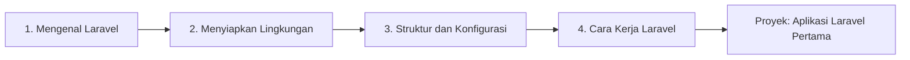

# Peta Belajar: Pengantar Laravel

Bab utama ini memperkenalkan Laravel dari awal: apa itu framework, cara memasangnya, isi folder
proyek, konfigurasi, perintah Artisan, dan perjalanan sebuah request. Setelah menyelesaikannya,
kamu memiliki aplikasi Laravel pertama yang berjalan dan paham struktur dasarnya.

## Tujuan Pembelajaran

Setelah menyelesaikan bab utama ini, kamu dapat:

- [ ] Memasang Laravel 13.x dan membuat proyek baru.
- [ ] Menjalankan server pengembangan dan membuka aplikasi di browser.
- [ ] Menjelaskan fungsi folder dan berkas utama pada proyek Laravel.
- [ ] Mengatur konfigurasi dan *environment variables* dengan aman.
- [ ] Memakai perintah Artisan yang umum.
- [ ] Menjelaskan alur dasar sebuah request di Laravel.

## Prasyarat

- Bab utama [Dasar Web dan PHP](../level-00/index.md), terutama OOP, namespace, Composer, dan Git.
- PHP 8.3 atau lebih baru dan Composer terpasang.

## Gambaran Besar

## Peta Per Tahap

### Tahap 1: Mengenal Laravel

| Sub bab | Yang kamu pelajari | Status |
|---|---|---|
| [Mengenal Laravel](01-01-introduction-to-laravel.md) | Framework, fitur, versi, dan ekosistem | Draf |
| [Mengapa Menggunakan Laravel?](01-02-why-use-laravel.md) | Alasan, biaya, dan kapan tidak memilih Laravel | Draf |
| [Arsitektur MVC](01-03-mvc-architecture.md) | Model, View, Controller | Draf |
| [Laravel dibanding PHP Native](01-04-laravel-vs-php-native.md) | Perbandingan langsung dan rencana migrasi | Draf |

### Tahap 2: Menyiapkan Lingkungan

| Sub bab | Yang kamu pelajari | Status |
|---|---|---|
| [Persyaratan Sistem Laravel](01-05-laravel-system-requirements.md) | PHP, ekstensi, alat bantu | Draf |
| [Memasang Laravel](01-06-installing-laravel.md) | Installer dan Composer | Draf |
| [Membuat Proyek Laravel](01-07-creating-laravel-project.md) | Proyek baru dengan `laravel new` | Draf |
| [Menjalankan Development Server](01-08-running-development-server.md) | Aplikasi di browser | Draf |

### Tahap 3: Struktur dan Konfigurasi

| Sub bab | Yang kamu pelajari | Status |
|---|---|---|
| [Struktur Direktori Laravel](01-09-laravel-directory-structure.md) | Fungsi folder utama | Draf |
| [Konfigurasi Laravel](01-10-laravel-configuration.md) | Folder `config` dan fungsi `config()` | Draf |
| [Environment Variables](01-11-environment-variables.md) | Berkas `.env` dan `env()` | Draf |
| [Artisan CLI](01-12-artisan-cli.md) | Perintah terminal Laravel dan Tinker | Draf |

### Tahap 4: Cara Kerja Laravel

| Sub bab | Yang kamu pelajari | Status |
|---|---|---|
| [Request Lifecycle](01-13-request-lifecycle.md) | Perjalanan sebuah request | Draf |
| [Gambaran Service Container](01-14-service-container-overview.md) | Cara Laravel mengelola objek | Draf |
| [Konfigurasi Aplikasi](01-15-application-configuration.md) | Pengaturan inti di `config/app.php` | Draf |

### Proyek Praktik

| Proyek | Hasil akhir | Status |
|---|---|---|
| [Aplikasi Laravel Pertama](proyek-aplikasi-pertama.md) | Aplikasi kecil dengan konfigurasi, container, route, dan Artisan | Draf |

## Kriteria Penyelesaian

- [ ] Berhasil memasang Laravel.
- [ ] Memahami struktur direktori Laravel.
- [ ] Mampu menjalankan perintah Artisan yang umum.
- [ ] Memahami siklus hidup aplikasi secara dasar.

## Cara Belajar yang Disarankan

1. Pastikan bab utama sebelumnya sudah kamu kuasai, terutama OOP, namespace, dan Composer.
2. Selalu buka dokumentasi Laravel versi **13.x** saat mencari referensi.
3. Catat tabel pemetaan "pekerjaan manual ↔ fitur Laravel" yang dimulai di sub bab pertama.
4. Ketik dan jalankan sendiri setiap contoh setelah Laravel terpasang.

!!! info "Status materi"
    Seluruh sub bab dan proyek praktik pada bab utama ini sudah tersedia dan berstatus **DRAFT**.

## Referensi Resmi

- [Laravel Documentation (13.x)](https://laravel.com/docs/13.x/installation)
- [Laravel Release Notes](https://laravel.com/docs/13.x/releases)
