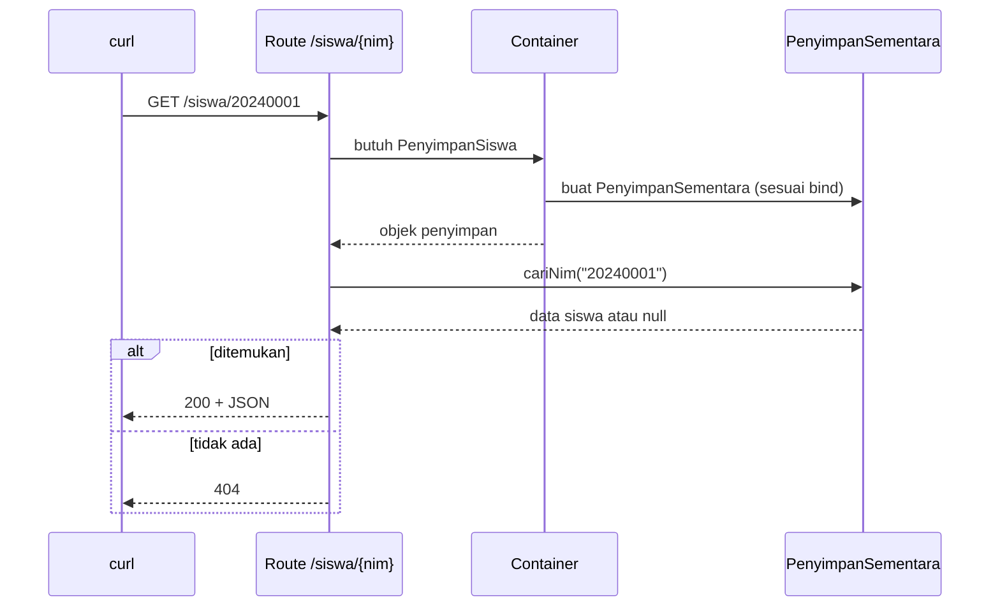

# Proyek Praktik: Aplikasi Laravel Pertama

Selamat, kamu sudah menyelesaikan seluruh sub bab **Pengantar Laravel**. Pada proyek ini semua yang kamu pelajari dipakai bersama
untuk menyelesaikan satu aplikasi Laravel kecil: **Aplikasi Laravel Pertama**. Hasilnya adalah versi Laravel dari kerangka
Sistem Manajemen Siswa: konfigurasi dari `config/` dan `.env`, data yang disediakan lewat *service container*, beberapa route, satu perintah
Artisan buatanmu sendiri, dan sebuah skrip verifikasi otomatis.

## Tujuan Pembelajaran

Setelah menyelesaikan proyek ini, kamu dapat:

- [ ] Menyusun aplikasi Laravel kecil yang berjalan dari proyek hasil `laravel new`.
- [ ] Menempatkan kode pada folder yang tepat (`config`, `app/Contracts`, `app/Services`, `routes`).
- [ ] Memakai `config()`, `.env`, dan berkas konfigurasi sendiri.
- [ ] Memakai service container: mengikat interface ke implementasi dan menyuntikkannya ke route dan perintah Artisan.
- [ ] Membuat perintah Artisan berbasis closure.
- [ ] Memverifikasi aplikasi secara otomatis dengan skrip `curl`.
- [ ] Mengelola proyek dengan Git dan tidak membocorkan `.env`.

## Prasyarat

Proyek ini memakai seluruh sub bab bab utama **Pengantar Laravel**:
[Membuat Proyek Laravel](01-07-creating-laravel-project.md), [Menjalankan Development Server](01-08-running-development-server.md),
[Struktur Direktori Laravel](01-09-laravel-directory-structure.md), [Konfigurasi Laravel](01-10-laravel-configuration.md),
[Environment Variables](01-11-environment-variables.md), [Artisan CLI](01-12-artisan-cli.md),
[Request Lifecycle](01-13-request-lifecycle.md), [Gambaran Service Container](01-14-service-container-overview.md),
dan [Konfigurasi Aplikasi](01-15-application-configuration.md).

Lingkungan: PHP 8.3 atau lebih baru, Composer, Laravel installer, dan proyek `~/belajar-laravel/aplikasi-pertama` yang dibuat pada sub bab
Membuat Proyek Laravel, serta terminal Bash.

## Pengantar

Pada bab utama pertama kamu membuat aplikasi siswa dengan PHP native: banyak pekerjaan infrastruktur ditulis sendiri. Di sini kita membuat padanan
kerangkanya di Laravel dan memperhatikan apa yang sekarang disediakan framework: struktur folder, konfigurasi, container, Artisan, dan routing.

Kita **belum** memakai fitur yang baru dipelajari di bab utama berikutnya: controller, Blade, database, dan validasi form. Route di sini cukup
mengembalikan teks atau JSON. Itu disengaja; fokus proyek ini adalah fondasi.

## Penjelasan Konsep

### Persyaratan aplikasi

| Kode | Persyaratan |
|---|---|
| R1 | Halaman `/` bawaan Laravel tetap berfungsi |
| R2 | `/tentang` menampilkan nama aplikasi dan nama sekolah dari konfigurasi |
| R3 | `/jurusan` menampilkan daftar jurusan dari `config/sekolah.php` (JSON) |
| R4 | `/siswa` menampilkan daftar siswa (JSON) dari penyimpan data yang disuntikkan container |
| R5 | `/siswa/{nim}` menampilkan satu siswa, atau 404 bila tidak ada |
| R6 | `/status` menampilkan lingkungan, debug, zona waktu, versi Laravel, dan versi PHP |
| R7 | Nama sekolah dapat diubah lewat `.env` (`SEKOLAH_NAMA`) |
| R8 | Perintah `php artisan siswa:ringkas` menampilkan jumlah siswa per jurusan |
| R9 | Skrip `verifikasi.sh` memeriksa status HTTP semua route secara otomatis |
| R10 | `.env` tidak masuk Git; `.env.example` mencantumkan variabel baru |

### Rancangan

```mermaid
flowchart LR
    B[Browser / curl] --> R["routes/web.php"]
    R -->|"type-hint PenyimpanSiswa"| C["Service container"]
    C -->|bind di AppServiceProvider| I["App\Contracts\PenyimpanSiswa"]
    I --> S["App\Services\PenyimpanSementara"]
    R -->|config()| K["config/sekolah.php"]
    K -->|env| E[".env"]
    A["php artisan siswa:ringkas"] --> C
```

Keputusan desain penting:

| Keputusan | Alasan |
|---|---|
| Data dibungkus interface `PenyimpanSiswa` | Nanti implementasinya diganti penyimpan database tanpa mengubah route |
| Binding di `AppServiceProvider::register()` | Binding didaftarkan sebelum `boot()` (lihat Request Lifecycle) |
| Data berupa array statis | Database baru dipelajari di bab utama berikutnya |
| Nama sekolah dari `env()` di `config/sekolah.php` | `env()` hanya dipanggil di berkas konfigurasi |
| Route berupa closure | Controller dipelajari di bab utama berikutnya |

### Keamanan

- `.env` tidak di-commit; `.env.example` hanya berisi placeholder.
- `/status` menampilkan versi PHP dan Laravel serta mode debug. Informasi itu berguna saat belajar, tetapi **di produksi sebaiknya tidak dibuka ke publik** karena
  membantu penyerang. Catat ini sebagai pekerjaan sebelum rilis.
- `APP_DEBUG=true` hanya untuk lokal.

## Cara Kerja



## Contoh Praktik

### Struktur akhir (berkas yang kamu tambah atau ubah)

```text
aplikasi-pertama/
├── .env                       (ubah, tidak di-commit)
├── .env.example               (ubah)
├── app/
│   ├── Contracts/
│   │   └── PenyimpanSiswa.php        (baru)
│   ├── Providers/
│   │   └── AppServiceProvider.php    (ubah)
│   └── Services/
│       └── PenyimpanSementara.php    (baru)
├── config/
│   └── sekolah.php                   (baru/ubah)
├── routes/
│   ├── console.php                   (ubah)
│   └── web.php                       (ubah)
├── verifikasi.sh                     (baru)
└── CATATAN-PROYEK.md                 (baru)
```

## Penjelasan Kode

### Konfigurasi dan variabel lingkungan

File: `config/sekolah.php`

```php
<?php

return [
    'nama' => env('SEKOLAH_NAMA', 'Sekolah Latihan'),
    'jurusan' => [
        'informatika' => 'Informatika',
        'sistem-informasi' => 'Sistem Informasi',
        'teknik-komputer' => 'Teknik Komputer',
    ],
];
```

File: `.env` (tambahkan) dan `.env.example` (tambahkan):

```ini
SEKOLAH_NAMA="Sekolah Latihan"
```

`config/sekolah.php` membaca `SEKOLAH_NAMA` lewat `env()` dengan nilai cadangan. Seluruh aplikasi lain membacanya lewat `config('sekolah.nama')`.

### Kontrak dan implementasi

File: `app/Contracts/PenyimpanSiswa.php`

```php
<?php

namespace App\Contracts;

interface PenyimpanSiswa
{
    /**
     * @return array<int, array{nim: string, nama: string, jurusan: string}>
     */
    public function semua(): array;

    /**
     * @return array{nim: string, nama: string, jurusan: string}|null
     */
    public function cariNim(string $nim): ?array;
}
```

File: `app/Services/PenyimpanSementara.php`

```php
<?php

namespace App\Services;

use App\Contracts\PenyimpanSiswa;

class PenyimpanSementara implements PenyimpanSiswa
{
    /**
     * @var array<int, array{nim: string, nama: string, jurusan: string}>
     */
    private array $data = [
        ['nim' => '20240001', 'nama' => 'Budi', 'jurusan' => 'informatika'],
        ['nim' => '20240002', 'nama' => 'Sari', 'jurusan' => 'sistem-informasi'],
        ['nim' => '20240003', 'nama' => 'Andi', 'jurusan' => 'informatika'],
        ['nim' => '20240004', 'nama' => 'Dewi', 'jurusan' => 'teknik-komputer'],
    ];

    public function semua(): array
    {
        return $this->data;
    }

    public function cariNim(string $nim): ?array
    {
        foreach ($this->data as $siswa) {
            if ($siswa['nim'] === $nim) {
                return $siswa;
            }
        }

        return null;
    }
}
```

| Bagian | Penjelasan |
|---|---|
| `interface PenyimpanSiswa` | Kontrak: setiap penyimpan siswa wajib punya `semua()` dan `cariNim()` |
| `?array` | Mengembalikan array atau `null` jika tidak ditemukan |
| `private array $data` | Data contoh statis sementara |
| Docblock `@return` | Dokumentasi bentuk array, membantu pembaca dan editor |

### Binding di service provider

File: `app/Providers/AppServiceProvider.php`

```php
<?php

namespace App\Providers;

use App\Contracts\PenyimpanSiswa;
use App\Services\PenyimpanSementara;
use Illuminate\Support\ServiceProvider;

class AppServiceProvider extends ServiceProvider
{
    /**
     * Register any application services.
     */
    public function register(): void
    {
        $this->app->bind(PenyimpanSiswa::class, PenyimpanSementara::class);
    }

    /**
     * Bootstrap any application services.
     */
    public function boot(): void
    {
        //
    }
}
```

### Route

File: `routes/web.php`

```php
<?php

use App\Contracts\PenyimpanSiswa;
use Illuminate\Support\Facades\App;
use Illuminate\Support\Facades\Route;

Route::get('/', function () {
    return view('welcome');
});

Route::get('/tentang', function () {
    return config('app.name') . ' - ' . config('sekolah.nama');
});

Route::get('/jurusan', function () {
    return config('sekolah.jurusan');
});

Route::get('/siswa', function (PenyimpanSiswa $penyimpan) {
    return $penyimpan->semua();
});

Route::get('/siswa/{nim}', function (PenyimpanSiswa $penyimpan, string $nim) {
    $siswa = $penyimpan->cariNim($nim);

    abort_if($siswa === null, 404);

    return $siswa;
});

Route::get('/status', function () {
    return [
        'aplikasi' => config('app.name'),
        'lingkungan' => App::environment(),
        'debug' => config('app.debug'),
        'zona_waktu' => config('app.timezone'),
        'versi_laravel' => app()->version(),
        'versi_php' => PHP_VERSION,
    ];
});
```

| Bagian | Penjelasan |
|---|---|
| `function (PenyimpanSiswa $penyimpan)` | Container menyuntikkan objek sesuai `bind`; tanpa `new` |
| `function (PenyimpanSiswa $penyimpan, string $nim)` | Ketergantungan dulu, lalu parameter route `{nim}` |
| `abort_if($siswa === null, 404)` | Menghentikan proses dan menjawab 404 jika siswa tidak ditemukan (penanganan error dibahas di bab utama berikutnya) |
| `return $siswa;` | Array otomatis dikirim sebagai JSON |
| `app()->version()` | Versi framework yang berjalan |

### Perintah Artisan

File: `routes/console.php` (tambahkan di bawah perintah `inspire`)

```php-inline
use App\Contracts\PenyimpanSiswa;

Artisan::command('siswa:ringkas', function (PenyimpanSiswa $penyimpan) {
    $semua = $penyimpan->semua();

    $this->info('Ringkasan siswa');
    $this->line('Total: ' . count($semua));

    foreach (config('sekolah.jurusan') as $kode => $nama) {
        $jumlah = count(array_filter($semua, fn (array $siswa) => $siswa['jurusan'] === $kode));

        $this->line("- {$nama}: {$jumlah}");
    }
})->purpose('Menampilkan jumlah siswa per jurusan');
```

Closure perintah juga menerima ketergantungan dari container, sama seperti route (dibahas di sub bab Artisan CLI).

### Skrip verifikasi

File: `verifikasi.sh`

```bash
#!/usr/bin/env bash

BASE="${1:-http://127.0.0.1:8000}"
gagal=0

cek() {
    local jalur="$1"
    local harapan="$2"
    local kode

    kode=$(curl -s -o /dev/null -w '%{http_code}' "$BASE$jalur")

    if [ "$kode" = "$harapan" ]; then
        echo "[OK]     $jalur -> $kode"
    else
        echo "[GAGAL]  $jalur -> $kode (harapan $harapan)"
        gagal=1
    fi
}

cek / 200
cek /tentang 200
cek /jurusan 200
cek /siswa 200
cek /siswa/20240001 200
cek /siswa/99999999 404
cek /status 200
cek /up 200
cek /tidak-ada 404

exit $gagal
```

| Bagian | Penjelasan |
|---|---|
| `BASE="${1:-http://127.0.0.1:8000}"` | Alamat dasar dari argumen pertama, atau nilai bawaan |
| `curl -s -o /dev/null -w '%{http_code}'` | Meminta URL tanpa menampilkan isi, hanya mencetak kode status |
| `cek jalur harapan` | Membandingkan kode status sebenarnya dengan yang diharapkan |
| `exit $gagal` | Kode keluar 0 bila semua lolos, 1 bila ada yang gagal |

## Implementasi Langkah demi Langkah

### Langkah 1: periksa kondisi awal

```bash
cd ~/belajar-laravel/aplikasi-pertama
git status
php artisan --version
```

Jika ada sisa percobaan dari sub bab sebelumnya (route `/konfigurasi`, `/jejak`, class `Penyapa`, dan sebagainya), kamu boleh mempertahankan atau
menghapusnya. Untuk proyek ini, `routes/web.php` dan `AppServiceProvider.php` akan **diganti seluruhnya** dengan isi di atas. Jika kamu ingin menyimpan percobaan,
buat commit terlebih dahulu.

### Langkah 2: tambahkan konfigurasi dan variabel lingkungan

Buat atau ganti `config/sekolah.php`. Tambahkan `SEKOLAH_NAMA` pada `.env` dan `.env.example` (hapus baris `SEKOLAH_NAMA` lama bila sudah ada).

### Langkah 3: buat kontrak dan implementasi

```bash
php artisan make:interface Contracts/PenyimpanSiswa
php artisan make:class Services/PenyimpanSementara
```

Isi kedua berkas sesuai bagian Penjelasan Kode.

### Langkah 4: daftarkan binding

Ubah `register()` pada `AppServiceProvider.php`.

### Langkah 5: ganti route

Ganti isi `routes/web.php` dengan versi proyek.

### Langkah 6: tambahkan perintah Artisan

Tambahkan `siswa:ringkas` pada `routes/console.php`, lalu:

```bash
php artisan list
php artisan siswa:ringkas
```

### Langkah 7: jalankan server dan uji manual

```bash
php artisan serve
```

Di terminal lain:

```bash
curl -i http://127.0.0.1:8000/tentang
curl -i http://127.0.0.1:8000/jurusan
curl -i http://127.0.0.1:8000/siswa
curl -i http://127.0.0.1:8000/siswa/20240001
curl -i http://127.0.0.1:8000/siswa/99999999
curl -i http://127.0.0.1:8000/status
```

### Langkah 8: skrip verifikasi

Buat `verifikasi.sh` dan jalankan (server harus berjalan):

```bash
bash verifikasi.sh
echo $?
```

### Langkah 9: uji perubahan lewat `.env`

Ubah `SEKOLAH_NAMA` di `.env` menjadi nama lain, simpan, lalu minta `/tentang` lagi. Jika nilai tidak berubah, jalankan `php artisan config:clear`.

### Langkah 10: dokumentasikan

Buat `CATATAN-PROYEK.md` berisi: tujuan proyek, cara menjalankan (`php artisan serve`), daftar route beserta fungsinya, cara menjalankan `verifikasi.sh`, dan daftar variabel `.env`
yang diperlukan.

### Langkah 11: kelola dengan Git

```bash
git status
git check-ignore -v .env
git add -A
git status
git commit -m "Proyek Aplikasi Laravel Pertama"
git log --oneline
```

Pastikan `.env` tidak ikut ter-commit (tidak ada dalam daftar `git status` setelah `git add`).

## Eksekusi dan Verifikasi

| # | Persyaratan | Cara memverifikasi |
|---|---|---|
| R1 | `/` berfungsi | `curl -i /` berstatus `200` |
| R2 | `/tentang` | Teks memuat `config('app.name')` dan nama sekolah |
| R3 | `/jurusan` | JSON tiga jurusan |
| R4 | `/siswa` | JSON empat siswa |
| R5 | `/siswa/{nim}` | `20240001` mengembalikan Budi (200), `99999999` berstatus 404 |
| R6 | `/status` | JSON dengan enam kunci |
| R7 | Nama dari `.env` | Mengubah `SEKOLAH_NAMA` mengubah `/tentang` |
| R8 | `siswa:ringkas` | Mencetak total dan jumlah per jurusan |
| R9 | `verifikasi.sh` | Semua baris `[OK]`, `echo $?` mencetak `0` |
| R10 | `.env` aman | `git check-ignore -v .env` menunjukkan aturan `.gitignore`; `.env.example` memuat `SEKOLAH_NAMA` |

## Hasil yang Diharapkan

`php artisan siswa:ringkas`:

```text
Ringkasan siswa
Total: 4
- Informatika: 2
- Sistem Informasi: 1
- Teknik Komputer: 1
```

`GET /siswa/20240001`:

```json
{"nim":"20240001","nama":"Budi","jurusan":"informatika"}
```

`bash verifikasi.sh`:

```text
[OK]     / -> 200
[OK]     /tentang -> 200
[OK]     /jurusan -> 200
[OK]     /siswa -> 200
[OK]     /siswa/20240001 -> 200
[OK]     /siswa/99999999 -> 404
[OK]     /status -> 200
[OK]     /up -> 200
[OK]     /tidak-ada -> 404
```

`GET /status` mengembalikan JSON dengan kunci `aplikasi`, `lingkungan` (`local`), `debug` (`true`), `zona_waktu`, `versi_laravel` (13.x), dan `versi_php` (8.3+); nilai
persisnya bergantung komputermu. Susunan JSON dapat rapat atau dirapikan. Keluaran ini diturunkan dari kode dan dokumentasi, dan belum dijalankan oleh penulis materi;
catat setiap perbedaan yang kamu temukan.

## Kesalahan Umum dan Pemecahan Masalah

| Gejala | Penyebab | Cara mengenali | Solusi | Pencegahan |
|---|---|---|---|---|
| `Target [App\Contracts\PenyimpanSiswa] is not instantiable` | `bind` belum didaftarkan atau salah | Pesan menyebut interface | Periksa `register()` dan namespace pada `bind` | Setiap interface yang di-type-hint harus diikat |
| `Class "App\Services\PenyimpanSementara" not found` | Namespace atau lokasi berkas salah | Pesan class not found | Samakan namespace dengan folder (`app/Services`) | Gunakan `make:class` |
| `/siswa/99999999` menjawab 200 atau error | `abort_if` salah atau tidak ada | Status bukan 404 | Periksa kondisi `$siswa === null` dan `abort_if` | Uji dengan `verifikasi.sh` |
| `siswa:ringkas` tidak muncul di `list` | Salah ketik di `routes/console.php` | Perintah tidak ada | Periksa sintaks dan `php -l routes/console.php` | Jalankan `php artisan list` setelah mengubah |
| Nama sekolah tidak berubah | Konfigurasi ter-cache atau server belum memuat ulang | Nilai lama tetap | `php artisan config:clear` | Jangan jalankan `config:cache` saat pengembangan |
| `verifikasi.sh` menyatakan `000` | Server tidak berjalan | Kode status `000` | Jalankan `php artisan serve` | Mulai server sebelum verifikasi |
| `Permission denied` saat menjalankan `./verifikasi.sh` | Berkas belum executable | Pesan izin | Jalankan dengan `bash verifikasi.sh` | Gunakan `bash` |
| `.env` terlacak Git | Terlanjur di-add sebelum diabaikan | `git status` menampilkan `.env` | `git rm --cached .env` dan cek `.gitignore` | `git check-ignore -v .env` sebelum commit |
| Routing mengembalikan halaman HTML error | Sintaks PHP salah di `routes/web.php` | Pesan error menyebut baris | Perbaiki sintaks | Jalankan `php -l routes/web.php` |

## Latihan Praktik

### Latihan dasar

**D1. Siswa kelima**
- *Masalah:* data siswa bertambah.
- *Persyaratan:* tambahkan satu siswa pada `PenyimpanSementara` dengan jurusan yang sudah ada.
- *Perilaku yang diharapkan:* `/siswa` memuat lima siswa dan `siswa:ringkas` menunjukkan total 5 beserta jumlah jurusan yang benar.
- *Tujuan belajar:* mengubah data tanpa menyentuh route.

**D2. Route sapaan**
- *Masalah:* ingin halaman sambutan teks sederhana.
- *Persyaratan:* tambahkan `/sapa/{nama}` yang mengembalikan `Halo, {nama}! Selamat datang di {nama sekolah}.`
- *Perilaku yang diharapkan:* nama sekolah berasal dari konfigurasi.
- *Tujuan belajar:* menggabungkan parameter route dan konfigurasi.

### Latihan implementasi

**I1. Penyimpan kedua**
- *Masalah:* data kini ingin dibaca dari sumber lain.
- *Persyaratan:* buat `PenyimpanLain` yang mengimplementasikan `PenyimpanSiswa` dengan data berbeda, lalu ganti satu baris `bind`. Tidak boleh ada perubahan di route.
- *Perilaku yang diharapkan:* `/siswa` dan `siswa:ringkas` memakai data baru.
- *Tujuan belajar:* membuktikan manfaat interface dan container.

**I2. Filter jurusan**
- *Masalah:* ingin menampilkan siswa satu jurusan.
- *Persyaratan:* tambahkan route `/jurusan/{kode}/siswa` yang mengembalikan siswa jurusan itu, atau 404 bila kode jurusan tidak ada di `config('sekolah.jurusan')`.
  Tambahkan juga pemeriksaan di `verifikasi.sh`.
- *Perilaku yang diharapkan:* kode valid mengembalikan JSON; kode tak dikenal 404.
- *Tujuan belajar:* menggabungkan konfigurasi, container, dan penanganan 404.

### Latihan tantangan

**T1. Perintah Artisan dengan argumen**
- *Masalah:* staf ingin mencari siswa dari terminal.
- *Persyaratan:* buat perintah `siswa:cari {nim}` yang mencetak data siswa atau pesan "Siswa tidak ditemukan." dengan kode keluar tidak nol bila tidak ada
  (cari cara mengembalikan kode keluar di dokumentasi Artisan).
- *Perilaku yang diharapkan:* `php artisan siswa:cari 20240001` mencetak data Budi; nim yang tidak ada menghasilkan pesan dan `echo $?` bukan `0`.
- *Tujuan belajar:* argumen perintah dan kode keluar.

**T2. Mode produksi simulasi**
- *Masalah:* `/status` tidak boleh terbuka di produksi.
- *Persyaratan:* ubah `/status` agar hanya mengembalikan data bila `App::environment('local')`, selain itu 404. Buktikan dengan
  `APP_ENV=production php artisan serve` (dan `APP_DEBUG=false`) lalu `curl -i /status`.
- *Perilaku yang diharapkan:* lokal 200, produksi 404.
- *Tujuan belajar:* membatasi informasi sensitif berdasarkan lingkungan.
- *Catatan:* kerjakan mandiri; tidak ada kunci jawaban.

## Uji Pemahaman

1. Mengapa data dibungkus interface `PenyimpanSiswa`, bukan langsung array di route?
2. Di mana `bind` didaftarkan dan mengapa di metode `register`?
3. Mengapa `env()` hanya dipanggil di `config/sekolah.php`?
4. Apa yang membuat parameter `PenyimpanSiswa $penyimpan` pada route terisi tanpa `new`?
5. Bagaimana skrip `verifikasi.sh` menentukan lulus atau gagal?
6. Mengapa `.env` tidak di-commit sedangkan `.env.example` di-commit?
7. Mengapa `/status` perlu dipertimbangkan sebelum rilis produksi?
8. Sebutkan tiga hal yang dulu kamu tulis manual di proyek siswa dan kini disediakan Laravel.

??? success "Kunci jawaban singkat"
    1. Agar sumber data bisa diganti tanpa mengubah route dan lebih mudah diuji.
    2. `register()` di `AppServiceProvider`, karena binding harus sudah ada sebelum `boot()` dan sebelum request diproses.
    3. Setelah `config:cache`, `.env` tidak dimuat sehingga `env()` di luar `config/` tidak bisa diandalkan.
    4. Service container membaca type-hint dan membuat objek sesuai `bind`.
    5. Membandingkan kode status HTTP dengan yang diharapkan dan mengakhiri dengan kode keluar 0 atau 1.
    6. `.env` berisi nilai nyata dan rahasia; `.env.example` hanya contoh tanpa rahasia.
    7. Menampilkan versi dan mode debug dapat membantu penyerang.
    8. Misalnya routing, struktur folder, konfigurasi terpusat, autoload, dan CLI (Artisan).

## Ringkasan

- Kamu membangun aplikasi Laravel kecil yang memakai konfigurasi, `.env`, service container, route, dan Artisan.
- Interface `PenyimpanSiswa` dan `bind` memisahkan route dari sumber data.
- Skrip `verifikasi.sh` memeriksa semua route secara otomatis lewat status HTTP.
- Praktik keamanan: `.env` tidak di-commit, `/status` dibatasi untuk lokal, debug hanya untuk pengembangan.
- Fondasi ini dipakai di bab utama berikutnya: **Routing, Controller, dan Request Handling**.

Bab utama **Pengantar Laravel** selesai. Berikutnya adalah mempelajari routing dan controller secara menyeluruh.

## Referensi Resmi

- [Laravel: Installation](https://laravel.com/docs/13.x/installation)
- [Laravel: Directory Structure](https://laravel.com/docs/13.x/structure)
- [Laravel: Configuration](https://laravel.com/docs/13.x/configuration)
- [Laravel: Service Container](https://laravel.com/docs/13.x/container)
- [Laravel: Artisan Console (Closure Commands)](https://laravel.com/docs/13.x/artisan#closure-commands)
- [Laravel: Routing](https://laravel.com/docs/13.x/routing)
- [Laravel: Error Handling (abort)](https://laravel.com/docs/13.x/errors)
- [Laravel: Request Lifecycle](https://laravel.com/docs/13.x/lifecycle)
