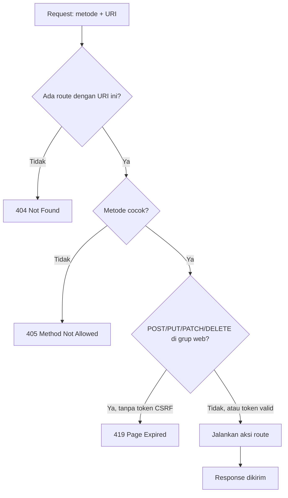
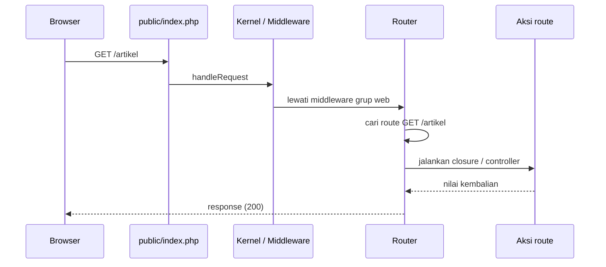

# Pengantar Routing

Setiap kali kamu mengetik alamat di browser, aplikasi harus memutuskan kode mana yang menjawab. Pada proyek siswa PHP native, keputusan itu
ditentukan oleh nama berkas (`tambah.php`). Laravel memakai cara yang lebih fleksibel: **routing**. Sub bab ini memperkenalkan
konsep routing, anatomi sebuah route, tempat route ditulis, dan cara memeriksanya. Penulisan route lebih rinci dibahas pada sub bab berikutnya.

## Tujuan Pembelajaran

Setelah menyelesaikan sub bab ini, kamu dapat:

- [ ] Menjelaskan apa itu routing dan masalah yang diselesaikannya.
- [ ] Menyebutkan tiga komponen sebuah route: metode HTTP, URI, dan aksi.
- [ ] Menjelaskan fungsi `routes/web.php`, `routes/console.php`, dan `routes/api.php`, serta cara Laravel memuatnya.
- [ ] Menjelaskan perbedaan 404, 405, dan 419 pada request ke route.
- [ ] Memakai `php artisan route:list` beserta opsinya untuk memeriksa route.
- [ ] Menambah route sederhana dan mengamati dampaknya.

## Prasyarat

- Bab utama [Pengantar Laravel](../level-01/index.md), terutama [Request Lifecycle](../level-01/01-13-request-lifecycle.md)
  dan [Artisan CLI](../level-01/01-12-artisan-cli.md).
- [HTTP dan HTTPS](../level-00/00-03-http-https-fundamentals.md) serta [Request dan Response](../level-00/00-04-request-and-response.md).
- Laravel installer dan terminal Bash.

## Pengantar

Bayangkan aplikasi toko online dengan alamat seperti `/produk`, `/produk/12`, `/keranjang`, dan `/pesanan/baru`. Tiap alamat harus
dihubungkan ke kode yang tepat. Jika hubungan itu tersebar di nama berkas dan struktur folder, mengubah satu URL berarti memindahkan berkas.
Dengan routing, hubungan itu **ditulis eksplisit di satu tempat**, sehingga URL bisa diubah tanpa memindahkan kode.

## Penjelasan Konsep

### Apa itu routing?

**Routing** adalah proses mencocokkan request yang masuk dengan kode yang harus menjawabnya. Hasil pencocokan itu disebut **route**. Dokumentasi resmi
menyebut bentuk route paling dasar sebagai URI ditambah closure: cara yang sangat sederhana dan ekspresif untuk menentukan perilaku tanpa berkas konfigurasi
yang rumit.

!!! tip "Analogi"
    Papan petunjuk di bandara. Penumpang (request) membaca tujuan ("Gerbang B7"), dan papan mengarahkannya ke lokasi yang benar. Jika tujuan tidak ada di
    papan, penumpang diberi tahu bahwa tempat itu tidak ditemukan (404).

### Anatomi sebuah route

Sebuah route terdiri dari tiga bagian:

```php-inline
Route::get('/artikel', function () {
    return 'Daftar artikel';
});
```

| Bagian | Pada contoh | Arti |
|---|---|---|
| **Metode HTTP** | `get` | Jenis request yang dilayani (`GET`, `POST`, dan lainnya) |
| **URI** | `'/artikel'` | Alamat yang dicocokkan |
| **Aksi** | `function () { ... }` | Kode yang dijalankan bila cocok: closure, atau method controller |

`Route` adalah *facade* yang memberikan akses ke router Laravel. Berkas yang memakainya perlu `use Illuminate\Support\Facades\Route;` (sudah ada di
`routes/web.php` bawaan).

Nilai yang dikembalikan aksi menjadi isi response: teks biasa menjadi halaman teks, array otomatis menjadi JSON, dan `view(...)` menghasilkan HTML. Jenis response dibahas
rinci di sub bab Objek Response.

### Berkas route dan cara dimuat

Menurut dokumentasi, semua route didefinisikan di folder `routes`, dan berkas-berkasnya dimuat otomatis sesuai konfigurasi di `bootstrap/app.php`:

File: `bootstrap/app.php` (kerangka 13.x)

```php-inline
->withRouting(
    web: __DIR__.'/../routes/web.php',
    commands: __DIR__.'/../routes/console.php',
    health: '/up',
)
```

| Berkas | Fungsi | Catatan |
|---|---|---|
| `routes/web.php` | Route untuk antarmuka web | Berada pada *middleware group* `web`: sesi, perlindungan CSRF, enkripsi cookie |
| `routes/console.php` | Perintah konsol berbasis closure | Bukan route HTTP; "titik masuk" lewat terminal |
| `routes/api.php` | Route API stateless | Tidak ada secara bawaan; dibuat dengan `php artisan install:api`, otomatis berawalan `/api` |
| `health: '/up'` | Route kesehatan | Didaftarkan lewat `withRouting`, bukan lewat `web.php` |

Untuk sebagian besar aplikasi, kamu mulai dengan menulis route di `routes/web.php`. Route di berkas itu dapat diakses dengan membuka URL-nya di browser.

### Cara router mencocokkan request



- **404**: tidak ada route yang cocok dengan URI.
- **405**: URI cocok dengan sebuah route, tetapi metode HTTP request tidak terdaftar untuk URI itu.
- **419**: request `POST`, `PUT`, `PATCH`, atau `DELETE` pada route web ditolak karena token CSRF tidak ada atau tidak valid. Dokumentasi menyatakan bahwa
  form yang menuju route tersebut harus menyertakan token CSRF, jika tidak request ditolak.

Dokumentasi juga memberi catatan urutan: bila beberapa route berbagi URI yang sama, route dengan metode spesifik (`get`, `post`, dan sebagainya) harus
didefinisikan sebelum `any`, `match`, dan `redirect`, supaya request cocok dengan route yang tepat. Artinya urutan penulisan route dapat berpengaruh.

Kode status 405 dan 419 adalah perilaku umum framework; teks halaman error persisnya bergantung versi dan mode debug.

### Melihat semua route: `route:list`

```bash
php artisan route:list
```

| Opsi | Fungsi |
|---|---|
| `-v` | Menampilkan juga middleware tiap route |
| `-vv` | Menampilkan middleware dengan grupnya diperluas |
| `--path=artikel` | Hanya route yang URI-nya memuat `artikel` |
| `--except-vendor` | Menyembunyikan route dari paket pihak ketiga |
| `--only-vendor` | Hanya route dari paket pihak ketiga |

Tabelnya menampilkan metode, URI, nama, dan aksi tiap route. Pada proyek baru, kamu akan melihat setidaknya route `/` dan `/up`; route lain bisa ada
karena konfigurasi (misalnya disk penyimpanan `local` yang menyajikan berkas lewat `storage/{path}`).

### Konvensi penamaan URI

Ini konvensi umum (bukan aturan framework):

| Konvensi | Contoh |
|---|---|
| Huruf kecil, kata dipisah tanda hubung | `/artikel-populer` |
| Kata benda, bukan kata kerja | `/artikel` bukan `/ambil-artikel` |
| Bentuk jamak untuk kumpulan | `/artikel`, `/artikel/12` |
| Perubahan data lewat metode HTTP, bukan lewat nama URI | `POST /artikel` bukan `GET /buat-artikel` |

### Keamanan routing

- Jangan memakai `GET` untuk aksi yang mengubah atau menghapus data: tautan dapat terbuka tanpa disengaja atau dipicu situs lain.
- Route di `routes/web.php` untuk `POST`, `PUT`, `PATCH`, dan `DELETE` dilindungi CSRF; jangan mematikannya tanpa alasan kuat.
- Hati-hati dengan route percobaan (mis. `/debug`) yang menampilkan informasi sensitif; hapus sebelum rilis.

## Cara Kerja



Router adalah bagian dari alur yang sudah kamu kenal di Request Lifecycle: setelah bootstrapping dan middleware, request diserahkan ke router untuk dikirim ke route yang cocok.

## Contoh Praktik

Kamu membuat proyek `portal-artikel`, memeriksa route bawaannya, menambah tiga route, dan mengamati kode status 200, 404, 405, dan 419.
Proyek ini dipakai sepanjang bab utama Routing, Controller, dan Request Handling.

## Penjelasan Kode

File: `routes/web.php` (tambahkan di bawah route bawaan)

```php-inline
Route::get('/artikel', function () {
    return 'Daftar artikel';
});

Route::get('/artikel/baru', function () {
    return 'Form artikel baru';
});

Route::post('/artikel/simpan', function () {
    return 'Artikel disimpan';
});
```

| Route | Metode dan URI | Fungsi |
|---|---|---|
| 1 | `GET /artikel` | Menampilkan teks daftar artikel |
| 2 | `GET /artikel/baru` | Menampilkan teks form |
| 3 | `POST /artikel/simpan` | Hanya melayani `POST`; dipakai untuk mengamati 405 dan 419 |

## Implementasi Langkah demi Langkah

### Langkah 1: buat proyek

```bash
cd ~/belajar-laravel
laravel new portal-artikel --git
```

Jawab pertanyaan installer seperti pada sub bab Membuat Proyek Laravel (tanpa starter kit, Blade, pengujian pilihanmu, tanpa Boost, SQLite, dan npm hanya bila
Node.js sudah terpasang). Lalu:

```bash
cd portal-artikel
php artisan --version
```

### Langkah 2: periksa route bawaan

```bash
php artisan route:list
php artisan route:list -v
php artisan route:list --path=up
```

Catat jumlah route dan kolom yang ditampilkan. Pada `-v`, perhatikan middleware yang menempel pada route `/`.

### Langkah 3: baca berkas route

```bash
cat routes/web.php
cat bootstrap/app.php
```

Temukan baris `withRouting(...)` dan cocokkan dengan tabel berkas route.

### Langkah 4: tambah tiga route

Tambahkan route pada Penjelasan Kode ke `routes/web.php`, lalu:

```bash
php artisan route:list --path=artikel
```

### Langkah 5: jalankan dan uji

```bash
php artisan serve
```

Di terminal lain (di Windows PowerShell tulis `curl.exe`):

```bash
curl -i http://127.0.0.1:8000/artikel
curl -i http://127.0.0.1:8000/artikel/baru
curl -i http://127.0.0.1:8000/artikell
curl -i http://127.0.0.1:8000/artikel/simpan
curl -i -X POST http://127.0.0.1:8000/artikel/simpan
```

Catat kode status tiap perintah.

### Langkah 6: pahami hasilnya

Cocokkan tiap kode status dengan alur pencocokan: URI tidak ada, URI ada tetapi metode salah, dan `POST` tanpa token CSRF.

### Langkah 7: catat di Git

```bash
git add routes/web.php
git commit -m "Tambah route artikel awal"
git log --oneline
```

## Eksekusi dan Verifikasi

| Langkah | Cara memverifikasi |
|---|---|
| 1 | `php artisan --version` menampilkan Laravel Framework 13.x |
| 2 | `route:list` menampilkan route `/` dan `/up` (mungkin ditambah route lain) |
| 3 | Kamu bisa menunjuk `withRouting` dan tiga argumennya |
| 4 | `route:list --path=artikel` menampilkan tiga route |
| 5 | Kelima `curl` menghasilkan baris status |
| 6 | Hasil sesuai tabel pada bagian Hasil yang Diharapkan |
| 7 | `git log --oneline` memuat commit baru |

## Hasil yang Diharapkan

| Permintaan | Kode status | Penjelasan |
|---|---|---|
| `GET /artikel` | `200` | Route cocok; isi `Daftar artikel` |
| `GET /artikel/baru` | `200` | Isi `Form artikel baru` |
| `GET /artikell` | `404` | Tidak ada route dengan URI itu |
| `GET /artikel/simpan` | `405` | URI ada, tetapi hanya untuk `POST` |
| `POST /artikel/simpan` (tanpa token) | `419` | Ditolak oleh perlindungan CSRF pada grup `web` |

`route:list --path=artikel` menampilkan tiga baris, dengan metode `GET|HEAD` untuk dua route pertama (Laravel otomatis melayani `HEAD` untuk route `GET`) dan
`POST` untuk yang ketiga. Format tabel persisnya bergantung versi. Kode status ini diturunkan dari dokumentasi dan perilaku framework, dan belum dijalankan
oleh penulis materi; cocokkan dengan hasilmu.

## Kesalahan Umum dan Pemecahan Masalah

| Gejala | Penyebab | Cara mengenali | Solusi | Pencegahan |
|---|---|---|---|---|
| Route baru menghasilkan 404 | Salah ketik URI atau berkas belum tersimpan | `route:list --path=...` tidak menampilkannya | Periksa ejaan URI dan simpan berkas | Selalu cek dengan `route:list` |
| Mendapat 405 padahal route ada | Metode request tidak sama dengan metode route | Header `Allow` menunjukkan metode yang diizinkan | Gunakan metode yang benar | Baca kolom metode di `route:list` |
| Mendapat 419 pada `POST` | Token CSRF tidak ada | Pesan *Page Expired* | Sertakan `@csrf` pada form (dibahas di bab Blade); di `curl` kirim token yang valid | Ingat: route web melindungi `POST`/`PUT`/`PATCH`/`DELETE` |
| Perubahan route tidak muncul | Cache route ada | `route:list` tidak memuat route baru | `php artisan route:clear` | Jangan `route:cache` saat pengembangan |
| `Class "Route" not found` | Lupa `use Illuminate\Support\Facades\Route;` | Pesan error | Tambahkan `use` di atas berkas | Pertahankan baris `use` bawaan |
| Parse error di `routes/web.php` | Titik koma atau kurung hilang | Halaman error menunjuk baris | Perbaiki sintaks | Jalankan `php -l routes/web.php` |
| Dua route berurusan dengan URI sama dan hasilnya aneh | Urutan atau tumpang tindih | Route yang dijalankan bukan yang diharapkan | Periksa urutan; metode spesifik sebelum `any`/`match`/`redirect` | Hindari URI ganda |
| `curl` di PowerShell tampil aneh | `curl` adalah alias cmdlet lain | Output berupa objek | Tulis `curl.exe` | Gunakan `curl.exe` di Windows |

## Latihan Praktik

### Latihan dasar

**D1. Baca `route:list`**
- *Masalah:* ingin mengetahui route aplikasi.
- *Persyaratan:* jalankan `php artisan route:list -v`, lalu tuliskan metode, URI, dan middleware untuk setiap route.
- *Perilaku yang diharapkan:* tabel catatan sesuai keluaran perintah.
- *Tujuan belajar:* membaca daftar route.

**D2. Tebak kode status**
- *Masalah:* prediksi hasil sebelum menjalankan.
- *Persyaratan:* untuk lima permintaan berikut tulis prediksi kode status (200/404/405/419), lalu uji dengan `curl -i`: `GET /`, `GET /up`, `GET /artikel/simpan`,
  `POST /`, dan `GET /tidak-ada`.
- *Perilaku yang diharapkan:* prediksi sesuai alur pencocokan; selisih dijelaskan.
- *Tujuan belajar:* memahami logika pencocokan route.

### Latihan implementasi

**I1. Halaman statis**
- *Masalah:* portal butuh halaman informasi.
- *Persyaratan:* tambahkan route `GET /tentang`, `GET /kontak`, dan `GET /kebijakan-privasi` yang masing-masing mengembalikan satu kalimat. Pastikan URI memakai huruf kecil dan tanda hubung.
- *Perilaku yang diharapkan:* ketiganya berstatus 200 dan tampil di `route:list --path`.
- *Tujuan belajar:* menerapkan konvensi penamaan URI.

**I2. Route kesehatan kustom**
- *Masalah:* pemantau ingin alamat `/status` bukan `/up`.
- *Persyaratan:* ubah argumen `health` pada `withRouting` di `bootstrap/app.php` menjadi `/status`, buktikan `/status` berstatus 200 dan `/up` 404, lalu kembalikan ke `/up`.
- *Perilaku yang diharapkan:* `route:list` menampilkan URI baru.
- *Tujuan belajar:* memahami cara berkas route dan route kesehatan didaftarkan.

### Latihan tantangan

**T1. Peta route portal artikel**
- *Masalah:* sebelum menulis kode, tim ingin rancangan URL.
- *Persyaratan:* buat tabel rancangan route untuk portal artikel (daftar, detail, buat, simpan, ubah, perbarui, hapus), lengkap dengan metode HTTP, URI, dan tujuan tiap route,
  mengikuti konvensi di atas. Jelaskan metode mana yang aman diakses lewat tautan dan mana yang harus lewat form.
- *Perilaku yang diharapkan:* rancangan konsisten dan tidak memakai `GET` untuk mengubah data.
- *Tujuan belajar:* merancang URL sebelum implementasi.
- *Catatan:* kerjakan mandiri; tidak ada kunci jawaban.

## Uji Pemahaman

1. Apa itu routing dan mengapa Laravel memisahkannya dari nama berkas?
2. Sebutkan tiga komponen sebuah route.
3. Apa perbedaan `routes/web.php`, `routes/console.php`, dan `routes/api.php`?
4. Di mana Laravel memuat berkas route?
5. Kapan request menghasilkan 404, 405, dan 419?
6. Apa fungsi opsi `-v` dan `--path` pada `route:list`?
7. Mengapa `GET` tidak cocok untuk menghapus data?
8. Apa yang terjadi pada urutan route yang berbagi URI?

??? success "Kunci jawaban singkat"
    1. Mencocokkan request dengan kode; URL bisa diubah tanpa memindahkan berkas.
    2. Metode HTTP, URI, dan aksi.
    3. `web.php`: route web (sesi, CSRF); `console.php`: perintah konsol; `api.php`: route API stateless (dibuat dengan `install:api`).
    4. Di `bootstrap/app.php` lewat `withRouting`.
    5. 404: URI tidak ada; 405: URI ada tapi metode tidak cocok; 419: `POST`/`PUT`/`PATCH`/`DELETE` di grup `web` tanpa token CSRF valid.
    6. `-v` menampilkan middleware; `--path` memfilter berdasarkan potongan URI.
    7. `GET` bisa terpicu tanpa sengaja (tautan, prefetch, situs lain).
    8. Metode spesifik harus didefinisikan sebelum `any`, `match`, dan `redirect`.

## Ringkasan

- Routing mencocokkan request (metode + URI) dengan aksi; route ditulis eksplisit di berkas route.
- `routes/web.php` untuk web (middleware `web`, CSRF), `routes/console.php` untuk perintah, `routes/api.php` untuk API (dibuat dengan `install:api`).
- Hasil pencocokan: 404 (URI tidak ada), 405 (metode salah), 419 (CSRF gagal), atau aksi dijalankan.
- `php artisan route:list` adalah alat utama untuk memeriksa route.
- Rancang URL secara konsisten dan jangan memakai `GET` untuk mengubah data.

Selanjutnya: *Routing Dasar*, yaitu menulis route untuk berbagai metode HTTP, redirect, dan view.

## Referensi Resmi

- [Laravel: Routing](https://laravel.com/docs/13.x/routing)
- [Laravel: The Default Route Files](https://laravel.com/docs/13.x/routing#the-default-route-files)
- [Laravel: Listing Your Routes](https://laravel.com/docs/13.x/routing#listing-your-routes)
- [Laravel: Routing Customization](https://laravel.com/docs/13.x/routing#routing-customization)
- [Laravel: CSRF Protection](https://laravel.com/docs/13.x/csrf)
- [Laravel: Request Lifecycle](https://laravel.com/docs/13.x/lifecycle)
