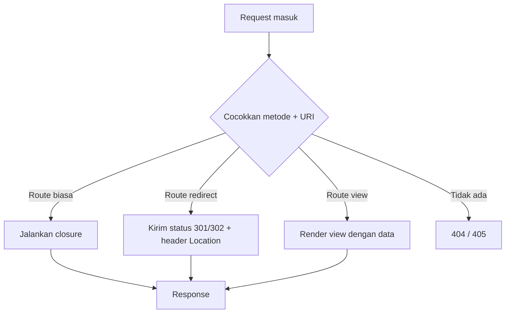

# Routing Dasar

Sub bab sebelumnya menjelaskan konsep routing. Sekarang kamu menulis route secara nyata: route untuk setiap metode HTTP, route yang melayani
beberapa metode sekaligus, route pengalihan (*redirect*), route yang langsung menampilkan tampilan (*view*), dan route yang menerima objek `Request`.
Semuanya dikerjakan pada proyek `portal-artikel`.

## Tujuan Pembelajaran

Setelah menyelesaikan sub bab ini, kamu dapat:

- [ ] Menulis route untuk metode `GET`, `POST`, `PUT`, `PATCH`, `DELETE`, dan `OPTIONS`.
- [ ] Memakai `Route::match` dan `Route::any` serta mengetahui kapan sebaiknya dihindari.
- [ ] Membuat route pengalihan dengan `Route::redirect` dan `Route::permanentRedirect`.
- [ ] Membuat route tampilan dengan `Route::view`.
- [ ] Menerima objek `Request` pada closure route lewat *dependency injection*.
- [ ] Menjelaskan mengapa form `POST` pada route web membutuhkan token CSRF.
- [ ] Memeriksa hasil dengan `route:list` dan `curl`.

## Prasyarat

- Sub bab [Pengantar Routing](02-01-introduction-to-routing.md): anatomi route, `route:list`, dan kode status 404/405/419.
- Proyek `~/belajar-laravel/portal-artikel` yang dibuat pada sub bab sebelumnya, dengan tiga route `/artikel`.
- [Gambaran Service Container](../level-01/01-14-service-container-overview.md) untuk memahami injeksi `Request`.

## Pengantar

Pada sub bab pertama, semua route memakai `Route::get`. Aplikasi nyata memakai berbagai metode HTTP: `GET` untuk membaca, `POST` untuk membuat,
`PUT` atau `PATCH` untuk mengubah, dan `DELETE` untuk menghapus. Laravel juga menyediakan jalan pintas untuk dua kebutuhan yang sangat umum:
mengalihkan satu URL ke URL lain, dan menampilkan sebuah halaman tanpa logika.

## Penjelasan Konsep

### Route paling dasar: URI dan closure

Dokumentasi menyatakan route paling dasar menerima sebuah URI dan sebuah closure, tanpa berkas konfigurasi yang rumit:

```php-inline
use Illuminate\Support\Facades\Route;

Route::get('/salam', function () {
    return 'Halo dari Laravel';
});
```

Nilai yang dikembalikan closure menjadi isi response (teks, array menjadi JSON, atau tampilan).

### Metode router

Router mendaftarkan route untuk metode HTTP apa pun:

```php-inline
Route::get($uri, $callback);
Route::post($uri, $callback);
Route::put($uri, $callback);
Route::patch($uri, $callback);
Route::delete($uri, $callback);
Route::options($uri, $callback);
Route::query($uri, $callback);
```

| Metode | Biasa dipakai untuk |
|---|---|
| `get` | Membaca data / menampilkan halaman |
| `post` | Membuat data baru |
| `put`, `patch` | Mengubah data (`put` mengganti seluruhnya, `patch` sebagian) |
| `delete` | Menghapus data |
| `options` | Menanyakan metode yang diizinkan (sering dipakai browser untuk pemeriksaan awal lintas-asal) |
| `query` | Menjawab verba HTTP `QUERY`, yang memungkinkan klien mengirim isi (*body*) untuk sebuah kueri; tersedia di dokumentasi 13.x |

Dokumentasi menambahkan bahwa route `QUERY` pada grup `web` juga terkena perlindungan CSRF.

### Beberapa metode sekaligus: `match` dan `any`

```php-inline
Route::match(['get', 'post'], '/kontak', function () {
    // ...
});

Route::any('/ping', function () {
    // ...
});
```

- `Route::match([...])` melayani daftar metode yang kamu sebut.
- `Route::any` melayani **semua** metode HTTP, termasuk `QUERY`.

Dokumentasi memberi aturan urutan: jika beberapa route berbagi URI yang sama, route dengan metode spesifik (`get`, `post`, `put`, `patch`, `delete`, `options`, `query`)
harus didefinisikan **sebelum** `any`, `match`, dan `redirect`, supaya request cocok dengan route yang benar.

!!! tip "Pilih yang spesifik"
    `any` menerima segala metode sehingga membuka lebih banyak kemungkinan daripada yang kamu perlukan. Gunakan metode spesifik kecuali memang butuh `any`.

### Route pengalihan (`redirect`)

Pengalihan dibuat dengan satu baris, tanpa closure atau controller:

```php-inline
Route::redirect('/lama', '/baru');
Route::redirect('/lama', '/baru', 301);
Route::permanentRedirect('/lama', '/baru');
```

| Pemanggilan | Status | Arti |
|---|---|---|
| `Route::redirect('/lama', '/baru')` | `302` | Pengalihan sementara (bawaan) |
| `Route::redirect('/lama', '/baru', 301)` | `301` | Pengalihan permanen (argumen ketiga) |
| `Route::permanentRedirect('/lama', '/baru')` | `301` | Jalan pintas pengalihan permanen |

Parameter bernama `destination` dan `status` dicadangkan Laravel pada route pengalihan sehingga tidak boleh dipakai sebagai nama parameter.

### Route tampilan (`view`)

Jika route hanya perlu menampilkan view, gunakan `Route::view`. Argumen pertama URI, kedua nama view, dan ketiga (opsional) data untuk view:

```php-inline
Route::view('/selamat-datang', 'welcome');
Route::view('/halo', 'welcome', ['name' => 'Taylor']);
```

Nama parameter `view`, `data`, `status`, dan `headers` dicadangkan pada route tampilan. View dibahas lengkap di bab utama Blade; di sini kita memakai view `welcome`
bawaan.

### Injeksi dependency pada closure route

Seperti dijelaskan di Gambaran Service Container, closure route dapat menaruh type-hint ketergantungan. Contoh paling umum adalah `Illuminate\Http\Request`
untuk mengakses request saat ini:

```php-inline
use Illuminate\Http\Request;

Route::get('/pengguna', function (Request $request) {
    // ...
});
```

Laravel menyuntikkan objek request secara otomatis. Penjelasan lengkap objek `Request` ada di sub bab *Objek Request*.

### CSRF pada form

Form HTML yang menuju route `POST`, `PUT`, `PATCH`, atau `DELETE` di `routes/web.php` harus menyertakan token CSRF, kalau tidak request ditolak (status `419`).
Dokumentasi memberi contoh dengan direktif Blade `@csrf`:

```html
<form method="POST" action="/profil">
    @csrf
    ...
</form>
```

(Contoh ini ilustrasi untuk dibaca; Blade dibahas di bab utama berikutnya.) Perlu diingat bahwa browser hanya mengirim `GET` dan `POST` dari form biasa; metode lain
dikirim dengan teknik yang disebut *method spoofing* (dibahas di bab Blade).

### Ringkasan pemilihan

| Kebutuhan | Pilihan |
|---|---|
| Menampilkan halaman | `Route::get` |
| Menerima data form baru | `Route::post` |
| Mengubah/menghapus data | `Route::put` / `Route::patch` / `Route::delete` |
| Satu URI untuk beberapa metode tertentu | `Route::match` |
| Memindahkan URL lama ke URL baru | `Route::redirect` / `Route::permanentRedirect` |
| Halaman statis dari view | `Route::view` |

## Cara Kerja



Route `redirect` dan `view` hanyalah bentuk singkat dari route biasa yang mengembalikan `redirect(...)` atau `view(...)`.

## Contoh Praktik

Kamu menambah delapan route pada `portal-artikel`, memeriksa semuanya dengan `route:list`, dan menguji perilakunya dengan `curl`, termasuk
pengalihan, route tampilan, dan injeksi `Request`.

## Penjelasan Kode

File: `routes/web.php` (tambahkan di bawah route yang sudah ada)

```php
<?php

use Illuminate\Http\Request;
use Illuminate\Support\Facades\Route;

Route::put('/artikel/ubah', function () {
    return 'Artikel diubah';
});

Route::delete('/artikel/hapus', function () {
    return 'Artikel dihapus';
});

Route::options('/artikel', function () {
    return 'Opsi artikel';
});

Route::match(['get', 'post'], '/kontak', function () {
    return 'Halaman kontak';
});

Route::any('/ping', function () {
    return 'pong';
});

Route::redirect('/beranda', '/');

Route::permanentRedirect('/home', '/');

Route::view('/selamat-datang', 'welcome');

Route::get('/info-request', function (Request $request) {
    return [
        'metode' => $request->method(),
        'path' => $request->path(),
        'url' => $request->fullUrl(),
    ];
});
```

(Berkas aslinya sudah memiliki `<?php` dan `use` di atas; tambahkan hanya `use Illuminate\Http\Request;` bila belum ada, dan salin route-nya.)

| Route | Penjelasan |
|---|---|
| `Route::put('/artikel/ubah', ...)` | Hanya melayani `PUT` |
| `Route::delete('/artikel/hapus', ...)` | Hanya melayani `DELETE` |
| `Route::options('/artikel', ...)` | Melayani `OPTIONS` pada URI yang juga punya route `GET` |
| `Route::match(['get', 'post'], '/kontak', ...)` | Melayani `GET` dan `POST` |
| `Route::any('/ping', ...)` | Melayani semua metode |
| `Route::redirect('/beranda', '/')` | `302` ke `/` |
| `Route::permanentRedirect('/home', '/')` | `301` ke `/` |
| `Route::view('/selamat-datang', 'welcome')` | Menampilkan view `welcome` |
| `function (Request $request)` | Container menyuntikkan objek request |
| `$request->method()`, `->path()`, `->fullUrl()` | Metode HTTP, path tanpa host, dan URL lengkap request |

## Implementasi Langkah demi Langkah

### Langkah 1: tambahkan route

Buka `routes/web.php` pada `portal-artikel` dan tambahkan route di atas. Pastikan baris `use Illuminate\Http\Request;` ada di bagian atas berkas.

### Langkah 2: periksa pendaftaran route

```bash
cd ~/belajar-laravel/portal-artikel
php artisan route:list --path=artikel
php artisan route:list --except-vendor
```

Perhatikan kolom metode. Route `any` akan menampilkan banyak metode sekaligus.

### Langkah 3: jalankan server

```bash
php artisan serve
```

### Langkah 4: uji route yang mudah

Di terminal lain (di Windows PowerShell tulis `curl.exe`):

```bash
curl -i http://127.0.0.1:8000/kontak
curl -i http://127.0.0.1:8000/ping
curl -i http://127.0.0.1:8000/info-request
curl -I http://127.0.0.1:8000/artikel
curl -i -X OPTIONS http://127.0.0.1:8000/artikel
```

Opsi `-I` mengirim `HEAD` dan hanya menampilkan header.

### Langkah 5: uji pengalihan dan route tampilan

```bash
curl -i http://127.0.0.1:8000/beranda
curl -i http://127.0.0.1:8000/home
curl -i http://127.0.0.1:8000/selamat-datang
```

Perhatikan kode status dan header `Location` pada dua pengalihan. Ikuti pengalihan otomatis dengan opsi `-L`:

```bash
curl -iL http://127.0.0.1:8000/beranda
```

### Langkah 6: uji metode yang dilindungi CSRF

```bash
curl -i -X POST http://127.0.0.1:8000/kontak
curl -i -X PUT http://127.0.0.1:8000/kontak
curl -i -X PUT http://127.0.0.1:8000/artikel/ubah
curl -i -X DELETE http://127.0.0.1:8000/artikel/hapus
curl -i http://127.0.0.1:8000/artikel/ubah
```

Catat kode status tiap perintah dan jelaskan perbedaannya.

### Langkah 7: catat di Git

```bash
git add routes/web.php
git commit -m "Tambah route dasar: metode HTTP, redirect, dan view"
```

## Eksekusi dan Verifikasi

| Langkah | Cara memverifikasi |
|---|---|
| 1 | `php -l routes/web.php` menyatakan tidak ada kesalahan sintaks |
| 2 | `route:list` menampilkan route baru dengan metode yang benar |
| 3 | Server berjalan |
| 4 | Setiap `curl` menghasilkan baris status |
| 5 | Dua pengalihan berstatus 3xx dengan header `Location`; `/selamat-datang` berstatus 200 |
| 6 | Hasil sesuai tabel hasil yang diharapkan |
| 7 | `git log --oneline` memuat commit baru |

## Hasil yang Diharapkan

| Permintaan | Status | Catatan |
|---|---|---|
| `GET /kontak` | `200` | Isi `Halaman kontak` |
| `GET /ping` | `200` | Isi `pong` |
| `GET /info-request` | `200` | JSON berisi `metode` `GET`, `path` `info-request`, dan `url` lengkap |
| `HEAD /artikel` (`curl -I`) | `200` | Header saja tanpa isi; Laravel otomatis melayani `HEAD` untuk route `GET` |
| `OPTIONS /artikel` | `200` | Isi `Opsi artikel` (permintaan baca seperti `OPTIONS` umumnya tidak diperiksa CSRF) |
| `GET /beranda` | `302` | Header `Location` menuju `/` |
| `GET /home` | `301` | Pengalihan permanen ke `/` |
| `GET /selamat-datang` | `200` | Halaman sambutan Laravel (sama dengan `/`) |
| `POST /kontak` | `419` | Route cocok, ditolak CSRF |
| `PUT /kontak` | `405` | `/kontak` hanya melayani `GET` dan `POST` |
| `PUT /artikel/ubah` | `419` | Route cocok, ditolak CSRF |
| `DELETE /artikel/hapus` | `419` | Route cocok, ditolak CSRF |
| `GET /artikel/ubah` | `405` | URI ada, tetapi hanya `PUT` |

Nilai `Location` bisa berupa URL absolut (misalnya `http://127.0.0.1:8000`) atau relatif, bergantung versi. Format tabel `route:list` untuk route `any` juga bergantung versi. Hasil
di atas diturunkan dari dokumentasi dan perilaku framework, dan belum dijalankan oleh penulis materi; cocokkan dengan hasilmu.

## Kesalahan Umum dan Pemecahan Masalah

| Gejala | Penyebab | Cara mengenali | Solusi | Pencegahan |
|---|---|---|---|---|
| `Class "Illuminate\Http\Request" not found` / `Request` tidak dikenal | Lupa `use` | Pesan error menyebut `Request` | Tambahkan `use Illuminate\Http\Request;` | Periksa `use` di atas berkas |
| Route `any` menjalankan aksi untuk metode tak terduga | `any` menerima semua metode | `route:list` menampilkan banyak metode | Pakai `match` atau metode spesifik | Hindari `any` kecuali perlu |
| Route spesifik tak pernah dipakai | Didefinisikan setelah `any`/`match`/`redirect` pada URI yang sama | Route yang jalan bukan yang diharapkan | Pindahkan route spesifik ke atas | Ikuti aturan urutan dokumentasi |
| `419` pada `POST`/`PUT`/`DELETE` | Tidak ada token CSRF | Pesan *Page Expired* | Sertakan `@csrf` pada form | Jangan mematikan CSRF tanpa alasan |
| `405` padahal route ada | Metode request tidak terdaftar | Header `Allow` | Gunakan metode yang benar | Baca kolom metode di `route:list` |
| Pengalihan berputar tanpa henti | Dua route saling mengalihkan | `curl -L` melaporkan terlalu banyak pengalihan | Periksa tujuan pengalihan | Uji dengan `curl -i` sebelum memakai `-L` |
| Parameter bernama `status`/`destination` pada redirect gagal | Nama dicadangkan | Perilaku aneh atau error | Ganti nama parameter | Hindari nama dicadangkan (`view`, `data`, `status`, `headers`, `destination`) |
| `View [welcome] not found` | View tidak ada | Pesan error view | Pastikan `resources/views/welcome.blade.php` ada | Jangan hapus view bawaan |
| Perubahan route tidak muncul | Cache route | `route:list` tidak memuat route baru | `php artisan route:clear` | Jangan `route:cache` saat pengembangan |

## Latihan Praktik

### Latihan dasar

**D1. Pilih metodenya**
- *Masalah:* tentukan metode untuk tiap aksi.
- *Persyaratan:* untuk aksi (a) menampilkan daftar artikel, (b) menyimpan artikel baru, (c) mengganti seluruh isi artikel, (d) mengubah judul saja, dan (e) menghapus artikel,
  tulis metode HTTP yang tepat dan alasannya.
- *Perilaku yang diharapkan:* `GET`, `POST`, `PUT`, `PATCH`, `DELETE` dengan alasan sesuai.
- *Tujuan belajar:* memetakan aksi ke metode HTTP.

**D2. Pengalihan lama ke baru**
- *Masalah:* alamat `/berita` diganti menjadi `/artikel`.
- *Persyaratan:* buat pengalihan permanen dari `/berita` ke `/artikel`, dan buktikan status serta header `Location` dengan `curl -i`.
- *Perilaku yang diharapkan:* status `301` dan tujuan `/artikel`.
- *Tujuan belajar:* memakai `Route::permanentRedirect`.

### Latihan implementasi

**I1. Halaman statis dari view**
- *Masalah:* portal butuh halaman statis tanpa logika.
- *Persyaratan:* buat `/tentang` dengan `Route::view('/tentang', 'welcome', ['name' => 'Portal Artikel'])` dan `/kontak-kami` dengan `Route::view`. Jelaskan mengapa `Route::view`
  lebih ringkas daripada closure yang mengembalikan `view(...)`.
- *Perilaku yang diharapkan:* kedua URI berstatus 200 dan tampil di `route:list`.
- *Tujuan belajar:* memakai route tampilan.

**I2. Menyelidiki request**
- *Masalah:* ingin melihat informasi request saat debugging.
- *Persyaratan:* perluas `/info-request` agar juga mengembalikan `ip` (`$request->ip()`) dan `userAgent` (`$request->userAgent()`), lalu bandingkan hasilnya antara browser dan
  `curl`. Hapus route ini sebelum rilis dan jelaskan alasannya.
- *Perilaku yang diharapkan:* `userAgent` berbeda antara browser dan `curl`.
- *Tujuan belajar:* memakai `Request` dan menyadari risiko route diagnostik.

### Latihan tantangan

**T1. Peta metode lengkap**
- *Masalah:* tim ingin dokumentasi singkat perilaku semua metode terhadap satu URI.
- *Persyaratan:* untuk URI `/uji` daftarkan `get`, `post`, `put`, `patch`, `delete`, dan `options` dengan teks berbeda; uji tiap metode dengan `curl` dan buat tabel status
  hasilnya, lalu jelaskan seluruh perbedaan status (mengapa ada 200 dan 419).
- *Perilaku yang diharapkan:* tabel konsisten dengan aturan CSRF untuk metode pengubah.
- *Tujuan belajar:* memahami interaksi routing dan CSRF.
- *Catatan:* kerjakan mandiri; tidak ada kunci jawaban.

## Uji Pemahaman

1. Apa bentuk route paling dasar di Laravel?
2. Apa beda `put` dan `patch`?
3. Apa yang dilakukan `Route::match` dan `Route::any`, dan kapan `any` sebaiknya dihindari?
4. Bagaimana membuat pengalihan permanen, dan apa status HTTP-nya?
5. Apa fungsi `Route::view`?
6. Mengapa closure route bisa menerima parameter `Request`?
7. Mengapa `POST` ke route web tanpa token berstatus 419?
8. Apa aturan urutan route yang berbagi URI?

??? success "Kunci jawaban singkat"
    1. URI ditambah closure, mis. `Route::get('/salam', function () { ... })`.
    2. `put` mengganti seluruh data; `patch` mengubah sebagian.
    3. `match` melayani daftar metode tertentu; `any` semua metode. Hindari `any` karena membuka metode yang tidak diperlukan.
    4. `Route::permanentRedirect(...)` atau `Route::redirect(..., 301)`; status 301.
    5. Menampilkan view langsung tanpa closure atau controller.
    6. Service container menyuntikkan objek yang di-type-hint.
    7. Perlindungan CSRF menolak request pengubah tanpa token yang valid.
    8. Route dengan metode spesifik didefinisikan sebelum `any`, `match`, dan `redirect`.

## Ringkasan

- Route dasar: `Route::metode($uri, $closure)`; tersedia `get`, `post`, `put`, `patch`, `delete`, `options`, dan `query`.
- `match` melayani beberapa metode tertentu; `any` melayani semua (hindari bila tak perlu); route spesifik ditulis sebelum `any`/`match`/`redirect`.
- `Route::redirect` dan `Route::permanentRedirect` membuat pengalihan; `Route::view` menampilkan view tanpa logika.
- Closure route dapat menerima `Request` dan ketergantungan lain dari container.
- Route web yang mengubah data dilindungi CSRF (status `419` tanpa token).

Selanjutnya: *Parameter Route*, yaitu menangkap bagian URL seperti ID artikel.

## Referensi Resmi

- [Laravel: Routing (Basic Routing)](https://laravel.com/docs/13.x/routing#basic-routing)
- [Laravel: Available Router Methods](https://laravel.com/docs/13.x/routing#available-router-methods)
- [Laravel: Redirect Routes](https://laravel.com/docs/13.x/routing#redirect-routes)
- [Laravel: View Routes](https://laravel.com/docs/13.x/routing#view-routes)
- [Laravel: Dependency Injection (routes)](https://laravel.com/docs/13.x/routing#dependency-injection)
- [Laravel: CSRF Protection](https://laravel.com/docs/13.x/csrf)
- [Laravel: Service Container](https://laravel.com/docs/13.x/container)
