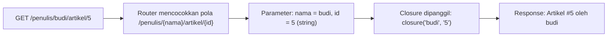

# Parameter Route

Route seperti `/artikel` selalu menampilkan hal yang sama. Padahal aplikasi nyata membutuhkan alamat yang berubah-ubah: `/artikel/12`, `/artikel/45`, `/penulis/budi`.
Menulis satu route untuk setiap artikel mustahil. **Parameter route** memungkinkan satu route menangkap bagian URL yang berubah dan
meneruskannya ke kodemu sebagai variabel.

## Tujuan Pembelajaran

Setelah menyelesaikan sub bab ini, kamu dapat:

- [ ] Membuat route dengan satu atau beberapa parameter memakai `{nama}`.
- [ ] Menerima nilai parameter pada closure dan menjelaskan bahwa pencocokan berdasarkan **urutan**, bukan nama variabel.
- [ ] Menyebutkan aturan penulisan nama parameter.
- [ ] Menempatkan parameter route dengan benar bersama ketergantungan dari container.
- [ ] Mengatur urutan route statis dan dinamis agar tidak saling menimpa.
- [ ] Menjelaskan mengapa parameter selalu berupa teks dan mengapa nilainya tidak boleh dipercaya.
- [ ] Mencegah XSS saat menampilkan nilai parameter.

## Prasyarat

- Sub bab [Routing Dasar](02-02-basic-routing.md) dan proyek `~/belajar-laravel/portal-artikel`.
- [Penanganan Form PHP](../level-00/00-16-php-form-handling.md): input pengguna tidak boleh dipercaya, serta fungsi `htmlspecialchars`.
- Terminal Bash dan `curl`.

## Pengantar

Pada proyek siswa PHP native, kamu membaca `?id=1` dengan `$_GET["id"]`. Laravel menawarkan bentuk yang lebih bersih: `/artikel/1`. Bagian `1` ditangkap oleh
parameter route dan diberikan ke closure. Hasilnya, URL lebih mudah dibaca dan lebih mudah diingat.

## Penjelasan Konsep

### Parameter wajib

Bungkus bagian URL yang berubah dengan kurung kurawal. Menurut dokumentasi, closure menerimanya sebagai argumen:

```php-inline
Route::get('/artikel/{id}', function (string $id) {
    return 'Detail artikel #' . $id;
});
```

| Bagian | Arti |
|---|---|
| `{id}` | Penanda: tangkap bagian URL ini |
| `function (string $id)` | Nilai yang ditangkap diteruskan sebagai argumen `$id` |
| `/artikel/12` | `$id` berisi teks `"12"` |

!!! tip "Analogi"
    `{id}` adalah **kolom kosong pada formulir**. Alamat `/artikel/12` mengisi kolom itu dengan `12`, dan closure menerimanya.

Parameter bersifat **wajib**: `/artikel` (tanpa bagian terakhir) tidak cocok dengan route `/artikel/{id}`. Parameter opsional dibahas di sub bab berikutnya.

### Beberapa parameter

Satu route boleh memuat banyak parameter:

```php-inline
Route::get('/penulis/{nama}/artikel/{id}', function (string $nama, string $id) {
    return "Artikel #{$id} oleh {$nama}";
});
```

Dokumentasi memberi contoh dengan dua parameter, `/posts/{post}/comments/{comment}`.

### Nilai diteruskan berdasarkan urutan

Parameter route disuntikkan ke closure atau controller **berdasarkan urutannya**. Nama variabel pada closure tidak harus sama dengan nama di URI. Contoh yang
menunjukkannya:

```php-inline
Route::get('/tukar/{pertama}/{kedua}', function (string $kedua, string $pertama) {
    return $kedua . '-' . $pertama;
});
```

Untuk `/tukar/A/B`, argumen pertama closure (bernama `$kedua`) berisi `A` dan argumen kedua (`$pertama`) berisi `B`, sehingga hasilnya `A-B`. Agar kode mudah dibaca,
samakan urutan dan nama parameter closure dengan URI.

### Aturan nama parameter

Menurut dokumentasi, nama parameter selalu berada di dalam `{}` dan harus berupa huruf alfabet; garis bawah (`_`) juga boleh. Karena itu `{id}`, `{nama}`, dan
`{artikel_id}` valid, sedangkan `{artikel-id}` (memakai tanda hubung) tidak.

### Parameter dan dependency injection

Closure boleh menerima objek dari container sekaligus parameter route. Dokumentasi menyarankan **menaruh parameter route setelah ketergantungan**:

```php-inline
use Illuminate\Http\Request;

Route::get('/sapa/{nama}', function (Request $request, string $nama) {
    return 'Halo, ' . e($nama);
});
```

`Request` disuntikkan container, sedangkan `$nama` diisi dari URI.

### Nilai parameter selalu berupa teks

Semua parameter tiba sebagai `string`, termasuk angka. Untuk perhitungan, ubah tipenya sendiri, misalnya `(int) $id`. Ingat dari Level 00: `(int) "abc"` bernilai `0`
tanpa peringatan, jadi jangan menganggap konversi sebagai validasi.

### Parameter tidak boleh dipercaya

Nilai parameter berasal dari URL yang bisa diketik siapa saja, sama seperti input form. Dua risiko utama:

1. **XSS (Cross-Site Scripting)**: bila nilai ditampilkan ke halaman tanpa di-*escape*. Laravel mengirim teks yang dikembalikan closure sebagai `text/html`, sehingga
   `/sapa/<b>tebal</b>` yang dikembalikan apa adanya akan ditafsirkan browser sebagai HTML. Gunakan helper `e()` (pembungkus `htmlspecialchars` yang tersedia di framework; ia tidak dibahas di halaman dokumentasi helper) atau
   template Blade, yang meng-escape otomatis.
2. **Nilai tak terduga**: parameter `{id}` menerima `abc` atau teks apa pun selain `/`. Membatasi format parameter dengan batasan (*constraint*) dibahas di sub bab
   *Batasan Route*.

### Urutan route statis dan dinamis

Route dinamis seperti `/artikel/{id}` cocok dengan hampir semua teks setelah `/artikel/`, termasuk kata `baru`. Jika route dinamis ditulis **sebelum** route
statis `/artikel/baru`, route dinamis dapat menangkap request itu lebih dulu. Prinsip aman: **tulis route statis sebelum route dinamis**
yang berpotensi bentrok. Gunakan `php artisan route:list` untuk memeriksa urutan.

## Cara Kerja



## Contoh Praktik

Pada `portal-artikel` kamu menambah tiga route berparameter, membuktikan bahwa nilai diteruskan berdasarkan urutan, menemukan bug urutan route,
dan memperbaiki celah XSS pada route sapaan.

## Penjelasan Kode

File: `routes/web.php` (tambahkan di bawah route `/artikel/baru`, `/artikel/simpan`, dan lainnya)

```php-inline
Route::get('/artikel/{id}', function (string $id) {
    return 'Detail artikel #' . $id;
});

Route::get('/penulis/{nama}/artikel/{id}', function (string $nama, string $id) {
    return "Artikel #{$id} oleh {$nama}";
});

Route::get('/tukar/{pertama}/{kedua}', function (string $kedua, string $pertama) {
    return $kedua . '-' . $pertama;
});

Route::get('/sapa/{nama}', function (Request $request, string $nama) {
    return 'Halo, ' . $nama;
});
```

| Route | Penjelasan |
|---|---|
| `/artikel/{id}` | Satu parameter; ditaruh **setelah** `/artikel/baru` agar tidak menimpanya |
| `/penulis/{nama}/artikel/{id}` | Dua parameter; `{nama}` sebagai argumen pertama, `{id}` kedua |
| `/tukar/{pertama}/{kedua}` | Menunjukkan bahwa penyuntikan berdasarkan urutan, bukan nama |
| `/sapa/{nama}` | Versi awal yang **rentan XSS**, akan diperbaiki pada Langkah 6 |

## Implementasi Langkah demi Langkah

### Langkah 1: tambahkan route

Pastikan `use Illuminate\Http\Request;` ada di bagian atas `routes/web.php` (dari sub bab sebelumnya), lalu tambahkan route di atas **setelah** route `/artikel/baru`.

```bash
cd ~/belajar-laravel/portal-artikel
php artisan route:list --path=artikel
php artisan route:list --path=penulis
```

Perhatikan bahwa URI di tabel menampilkan `{id}` dan `{nama}`.

### Langkah 2: jalankan dan uji nilai parameter

```bash
php artisan serve
```

Di terminal lain (di Windows PowerShell tulis `curl.exe`):

```bash
curl -i http://127.0.0.1:8000/artikel/12
curl -i http://127.0.0.1:8000/artikel/baru
curl -i http://127.0.0.1:8000/artikel/abc
curl -i http://127.0.0.1:8000/penulis/budi/artikel/5
curl -i http://127.0.0.1:8000/tukar/A/B
curl -i http://127.0.0.1:8000/artikel
```

### Langkah 3: uji URI yang tidak cocok

```bash
curl -i http://127.0.0.1:8000/penulis/budi
curl -i http://127.0.0.1:8000/artikel/12/ekstra
```

Catat kode statusnya dan jelaskan mengapa tidak cocok.

### Langkah 4: temukan bug urutan route

Pindahkan **sementara** blok `Route::get('/artikel/{id}', ...)` ke atas route `/artikel/baru`, simpan, lalu:

```bash
curl -i http://127.0.0.1:8000/artikel/baru
```

Bandingkan hasilnya dengan Langkah 2, lalu kembalikan blok ke bawah route `/artikel/baru`.

### Langkah 5: uji XSS pada route sapaan

Karakter khusus perlu di-*encode* di URL. Gunakan `%3Cb%3Etebal%3C%2Fb%3E` untuk `<b>tebal</b>`:

```bash
curl -i "http://127.0.0.1:8000/sapa/%3Cb%3Etebal%3C%2Fb%3E"
```

Perhatikan header `Content-Type` dan isi respons. Kemudian buka alamat yang sama di browser.

### Langkah 6: perbaiki dengan `e()`

Ubah route sapaan menjadi:

```php-inline
Route::get('/sapa/{nama}', function (Request $request, string $nama) {
    return 'Halo, ' . e($nama);
});
```

Uji ulang perintah Langkah 5 dan bandingkan isi respons.

### Langkah 7: catat di Git

```bash
git add routes/web.php
git commit -m "Tambah route berparameter"
```

## Eksekusi dan Verifikasi

| Langkah | Cara memverifikasi |
|---|---|
| 1 | `route:list` menampilkan URI dengan `{id}` dan `{nama}` |
| 2 | Hasil sesuai tabel hasil yang diharapkan |
| 3 | Dua URI menghasilkan `404` |
| 4 | Dengan route dinamis di atas, `/artikel/baru` tidak lagi menampilkan teks form |
| 5 | `Content-Type` berupa `text/html` dan isi memuat tag `<b>` mentah |
| 6 | Isi memuat `&lt;b&gt;tebal&lt;/b&gt;` (ter-escape) |
| 7 | `git log --oneline` memuat commit baru |

## Hasil yang Diharapkan

| Permintaan | Status | Isi |
|---|---|---|
| `GET /artikel/12` | `200` | `Detail artikel #12` |
| `GET /artikel/baru` | `200` | `Form artikel baru` (route statis menang karena ditulis lebih dulu) |
| `GET /artikel/abc` | `200` | `Detail artikel #abc` (belum ada validasi format) |
| `GET /penulis/budi/artikel/5` | `200` | `Artikel #5 oleh budi` |
| `GET /tukar/A/B` | `200` | `A-B` |
| `GET /artikel` | `200` | `Daftar artikel` (route tanpa parameter) |
| `GET /penulis/budi` | `404` | Parameter `{id}` dan segmen `artikel` tidak ada |
| `GET /artikel/12/ekstra` | `404` | Tidak ada route dengan segmen tambahan |

Pada Langkah 4, bila route dinamis berada di atas, `/artikel/baru` kemungkinan menghasilkan `Detail artikel #baru` alih-alih `Form artikel baru`; bila hasilmu berbeda,
catat dan jelaskan. Pada Langkah 5, respons route yang rentan memuat `<b>tebal</b>` apa adanya dengan `Content-Type: text/html`; setelah perbaikan, isinya `Halo, &lt;b&gt;tebal&lt;/b&gt;`.
Hasil ini diturunkan dari dokumentasi dan perilaku framework, dan belum dijalankan oleh penulis materi.

## Kesalahan Umum dan Pemecahan Masalah

| Gejala | Penyebab | Cara mengenali | Solusi | Pencegahan |
|---|---|---|---|---|
| `404` padahal parameter diisi | URI request tidak sesuai pola | `route:list` menunjukkan pola berbeda | Samakan jumlah dan urutan segmen | Periksa pola di `route:list` |
| `/artikel/baru` menampilkan "Detail artikel #baru" | Route dinamis ditulis sebelum route statis | Route statis tidak pernah tercapai | Pindahkan route statis ke atas | Statis dulu, dinamis kemudian |
| Nilai tertukar di closure | Menganggap pencocokan berdasarkan nama | Hasil tidak sesuai harapan | Samakan urutan argumen dengan urutan di URI | Beri nama dan urutan yang sama |
| Error karena nama parameter memuat `-` | Nama tidak valid | Route tidak terdaftar atau error | Ganti dengan huruf dan garis bawah (`{artikel_id}`) | Ikuti aturan penamaan |
| Hasil perhitungan `0` dari input non-angka | `(int) "abc"` bernilai 0 tanpa peringatan | `/hitung/abc/1` memberi hasil aneh | Validasi format parameter (sub bab Batasan Route) | Jangan mengandalkan casting sebagai validasi |
| Skrip tertanam tampil di halaman | Nilai parameter dicetak tanpa escape | Tag HTML ikut terbaca browser | Gunakan `e($nilai)` atau Blade `{{ }}` | Escape setiap nilai dari pengguna |
| `Undefined variable $request` | Tidak menaruh type-hint `Request` | Pesan variabel tidak terdefinisi | Tambahkan `Request $request` dan `use` | Gunakan type-hint |
| Karakter khusus di URL tidak terbaca | Tidak di-*encode* | Pemisahan URL aneh | Encode karakter (`%3C` untuk `<`, dan sebagainya) | Gunakan URL-encoding saat menguji |
| Perubahan route tidak muncul | Cache route | `route:list` lama | `php artisan route:clear` | Jangan `route:cache` saat pengembangan |

## Latihan Praktik

### Latihan dasar

**D1. Detail penulis**
- *Masalah:* portal butuh halaman profil penulis.
- *Persyaratan:* buat `GET /penulis/{nama}` yang mengembalikan `Profil penulis: {nama}` dengan nama ter-escape memakai `e()`.
- *Perilaku yang diharapkan:* `/penulis/budi` menampilkan `Profil penulis: budi`, dan nama berisi tag HTML tampil sebagai teks.
- *Tujuan belajar:* parameter tunggal dan escape.

**D2. Kategori dan artikel**
- *Masalah:* artikel dikelompokkan dalam kategori.
- *Persyaratan:* buat `GET /kategori/{kategori}/artikel/{id}` yang mengembalikan `Kategori {kategori}, artikel #{id}`.
- *Perilaku yang diharapkan:* kedua nilai tampil sesuai urutan URI.
- *Tujuan belajar:* beberapa parameter.

### Latihan implementasi

**I1. Kalkulator lewat URL**
- *Masalah:* ingin menjumlahkan dua bilangan dari URL.
- *Persyaratan:* buat `GET /jumlah/{a}/{b}` yang mengembalikan `a + b = hasil` dengan `(int)`. Uji dengan `/jumlah/3/4` dan `/jumlah/abc/4`, lalu jelaskan hasil yang kedua
  dan mengapa itu menjadi alasan membutuhkan batasan route.
- *Perilaku yang diharapkan:* `3 + 4 = 7`; kasus non-angka menghasilkan hasil menyesatkan (`0 + 4 = 4`).
- *Tujuan belajar:* menyadari bahaya mengandalkan casting.

**I2. Urutan route**
- *Masalah:* ingin route `/artikel/populer` bersama `/artikel/{id}`.
- *Persyaratan:* tambahkan `/artikel/populer` di posisi yang benar dan buktikan dengan `curl` bahwa `/artikel/populer` dan `/artikel/12` masing-masing menghasilkan
  respons yang tepat. Lalu salah posisikan dengan sengaja, amati dampaknya, dan perbaiki.
- *Perilaku yang diharapkan:* urutan benar menghasilkan `populer` dan `12` sesuai, urutan salah membuat `/artikel/populer` ditangkap `{id}`.
- *Tujuan belajar:* mengelola urutan route.

### Latihan tantangan

**T1. Audit keamanan parameter**
- *Masalah:* tim ingin memastikan tidak ada route yang rentan XSS.
- *Persyaratan:* periksa semua route di `routes/web.php`; untuk setiap route yang mencetak parameter, tulis apakah sudah aman, perbaiki yang belum, dan tulis
  pengujian `curl` (dengan karakter khusus yang di-encode) yang membuktikan perbaikannya.
- *Perilaku yang diharapkan:* tidak ada route yang mencetak parameter tanpa escape.
- *Tujuan belajar:* mengaudit kode terhadap XSS.
- *Catatan:* kerjakan mandiri; tidak ada kunci jawaban.

## Uji Pemahaman

1. Bagaimana menulis route yang menangkap ID artikel dari URL?
2. Apa tipe data nilai parameter route, dan bagaimana mengubahnya?
3. Bagaimana Laravel mencocokkan parameter dengan argumen closure?
4. Apa aturan nama parameter route?
5. Di mana parameter route diletakkan bila closure juga menerima objek dari container?
6. Mengapa route statis harus ditulis sebelum route dinamis yang bentrok?
7. Mengapa mencetak parameter tanpa `e()` berbahaya?
8. Mengapa `(int) $id` tidak dapat dianggap sebagai validasi?

??? success "Kunci jawaban singkat"
    1. `Route::get('/artikel/{id}', function (string $id) { ... });`
    2. `string`; ubah sendiri, misalnya `(int) $id`.
    3. Berdasarkan urutan, bukan nama variabel.
    4. Huruf alfabet dan garis bawah, di dalam `{}`.
    5. Setelah ketergantungan.
    6. Route dinamis dapat menangkap request yang seharusnya untuk route statis bila ditulis lebih dulu.
    7. Teks bisa berisi HTML/skrip yang dieksekusi browser (XSS).
    8. `(int) "abc"` bernilai 0 tanpa peringatan sehingga data tidak valid lolos.

## Ringkasan

- Parameter route ditulis `{nama}` dan diteruskan ke closure sebagai argumen, berdasarkan **urutan**.
- Nama parameter berupa huruf dan garis bawah; nilainya selalu `string`.
- Taruh parameter setelah ketergantungan dari container.
- Tulis route statis sebelum route dinamis yang bentrok; periksa dengan `route:list`.
- Nilai parameter tidak tepercaya: escape saat menampilkan (`e()`), dan batasi format dengan batasan route (sub bab berikutnya dan *Batasan Route*).

Selanjutnya: *Parameter Route Opsional*, yaitu parameter yang boleh tidak ada.

## Referensi Resmi

- [Laravel: Route Parameters](https://laravel.com/docs/13.x/routing#route-parameters)
- [Laravel: Required Parameters](https://laravel.com/docs/13.x/routing#required-parameters)
- [Laravel: Parameters and Dependency Injection](https://laravel.com/docs/13.x/routing#parameters-and-dependency-injection)
- [Kode sumber helper `e()` (Illuminate/Support/helpers.php)](https://github.com/laravel/framework/blob/13.x/src/Illuminate/Support/helpers.php)
- [Laravel: Blade (Displaying Data)](https://laravel.com/docs/13.x/blade#displaying-data)
- [OWASP: Cross Site Scripting (XSS)](https://owasp.org/www-community/attacks/xss/)
