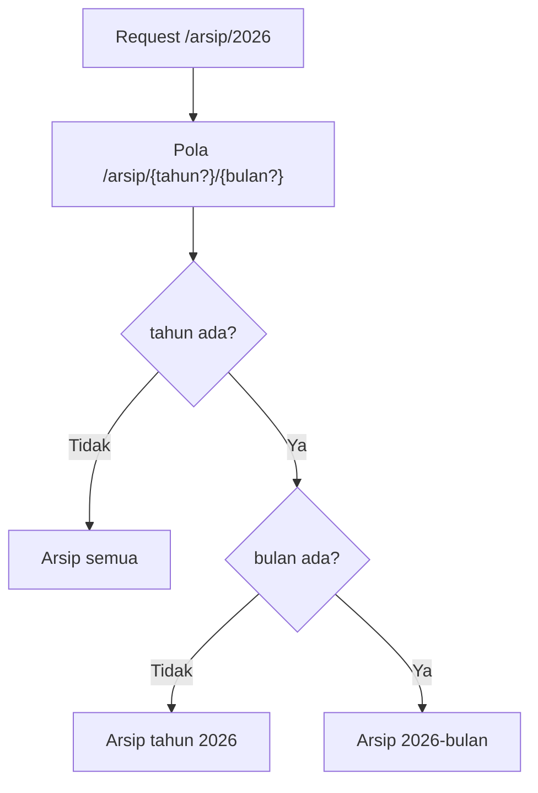

# Parameter Route Opsional

Tidak semua bagian URL wajib ada. Halaman `/arsip` boleh menampilkan semua arsip, sedangkan `/arsip/2026` menampilkan arsip tahun tertentu.
Daripada membuat dua route yang hampir sama, kamu bisa memakai **parameter route opsional**: bagian URL yang boleh ada, boleh tidak.

## Tujuan Pembelajaran

Setelah menyelesaikan sub bab ini, kamu dapat:

- [ ] Menulis parameter opsional dengan tanda `?` setelah nama parameter.
- [ ] Memberi nilai bawaan pada argumen closure agar route tetap berfungsi tanpa parameter.
- [ ] Memakai lebih dari satu parameter opsional dan memahami keterbatasannya.
- [ ] Membedakan kapan memakai parameter di path dan kapan memakai *query string*.
- [ ] Menghindari tabrakan antara route opsional dan route dinamis lain.
- [ ] Meng-escape nilai parameter opsional sebelum ditampilkan.

## Prasyarat

- Sub bab [Parameter Route](02-03-route-parameters.md): parameter wajib, urutan penyuntikan, dan XSS.
- Proyek `~/belajar-laravel/portal-artikel` berjalan dengan `php artisan serve`.
- [Pernyataan Kondisional](../level-00/00-11-conditional-statements.md) dan operator `??` dari bab utama pertama.

## Pengantar

Pada sub bab sebelumnya, `/artikel/{id}` mewajibkan ID. Kini bayangkan beberapa kebutuhan lain:

- `/halo` dan `/halo/Budi`: sapaan, dengan nama yang boleh tidak disebut.
- `/arsip`, `/arsip/2026`, dan `/arsip/2026/11`: arsip semua, per tahun, atau per bulan.
- `/artikel/halaman` dan `/artikel/halaman/3`: halaman pertama secara bawaan.

Satu route dengan parameter opsional menyelesaikan semuanya, selama kodenya siap menangani ketiadaan nilai.

## Penjelasan Konsep

### Parameter opsional: `{nama?}`

Menurut dokumentasi, parameter opsional ditandai dengan `?` setelah nama parameter, dan variabel closure **harus diberi nilai bawaan**:

```php-inline
Route::get('/halo/{nama?}', function (?string $nama = null) {
    return 'Halo, ' . ($nama ?? 'Tamu') . '!';
});
```

| Bagian | Arti |
|---|---|
| `{nama?}` | Parameter `nama` boleh tidak ada pada URL |
| `?string $nama = null` | Tipe nullable dan nilai bawaan `null` bila tidak diberikan |
| `$nama ?? 'Tamu'` | Nilai cadangan bila `$nama` `null` (operator `??` dari Level 00) |

Dokumentasi memberi dua contoh: bawaan `null` atau bawaan berupa nilai langsung seperti `'John'`. Keduanya sah:

```php-inline
Route::get('/halo/{nama?}', function (?string $nama = 'Tamu') {
    return 'Halo, ' . $nama . '!';
});
```

!!! tip "Analogi"
    Seperti formulir dengan kolom "nama panggilan (opsional)": kalau dikosongkan, petugas memakai isian bawaan.

!!! warning "Nilai bawaan wajib ada"
    Jika parameter ditandai `?` tetapi argumen closure tidak punya nilai bawaan, PHP melempar error argumen kurang ketika parameter tidak diisi.
    Selalu pasangkan `{nama?}` dengan `= nilai` pada closure.

### Lebih dari satu parameter opsional

```php-inline
Route::get('/arsip/{tahun?}/{bulan?}', function (?string $tahun = null, ?string $bulan = null) {
    // ...
});
```

Perilakunya:

| URL | `$tahun` | `$bulan` |
|---|---|---|
| `/arsip` | `null` | `null` |
| `/arsip/2026` | `"2026"` | `null` |
| `/arsip/2026/11` | `"2026"` | `"11"` |

Parameter opsional berurutan diisi dari kiri ke kanan: kamu tidak bisa memberi `$bulan` tanpa `$tahun`.

!!! note "Letakkan parameter opsional di akhir"
    Praktik aman: parameter opsional berada **di akhir** URI, setelah semua segmen wajib. Menaruh segmen statis atau parameter wajib setelah parameter opsional membuat
    pencocokan membingungkan.

### Path atau query string?

| Gunakan **path** (`/arsip/2026`) | Gunakan **query string** (`/artikel?halaman=2&urut=terbaru`) |
|---|---|
| Menunjuk **sumber daya** tertentu (identitas) | Menyaring, mengurutkan, atau membagi halaman |
| Nilainya lazimnya wajib bagi sumber daya itu | Nilainya opsional dan jumlahnya bisa banyak |
| Contoh: `/artikel/12`, `/penulis/budi` | Contoh: `?cari=laravel`, `?halaman=3` |

Parameter opsional di path cocok untuk satu atau dua tingkat yang jelas (arsip tahun/bulan). Untuk filter bebas, query string (dibaca dengan objek `Request`, sub bab
*Objek Request*) lebih fleksibel.

### Tabrakan dengan route lain

Route opsional memperluas pola yang cocok, sehingga mudah bertabrakan dengan route dinamis lain. Contoh: jika `/artikel/{id}` ditulis **sebelum**
`/artikel/halaman/{n?}`, maka URL `/artikel/halaman` (tanpa `{n}`) dapat tertangkap `/artikel/{id}` dengan `id = "halaman"`. Solusinya sama seperti sebelumnya: tulis route yang
lebih spesifik lebih dulu, dan periksa dengan `php artisan route:list`.

### Keamanan

- Nilai opsional tetap berasal dari URL: **escape** sebelum ditampilkan (`e()`), dan jangan dipercaya sebagai angka sungguhan.
- Nilai bawaan jangan berisi rahasia atau pengaturan sensitif, karena kode yang menangani "tidak ada nilai" dijalankan untuk siapa saja yang membuka URL tanpa parameter.
- Batasan format (misalnya tahun hanya 4 digit) dibahas di sub bab *Batasan Route*; sebelum itu, validasi manual diperlukan.

## Cara Kerja



Router mengisi parameter yang ada dengan nilai dari URL; sisanya memakai nilai bawaan closure.

## Contoh Praktik

Pada `portal-artikel` kamu membuat tiga route dengan parameter opsional, menguji semua kombinasi URL, menemukan tabrakan dengan `/artikel/{id}`, dan memperbaikinya.

## Penjelasan Kode

File: `routes/web.php` (tambahkan route berikut; letakkan `/artikel/halaman/{n?}` **setelah** `/artikel/{id}` dahulu untuk eksperimen)

```php-inline
Route::get('/halo/{nama?}', function (?string $nama = null) {
    return 'Halo, ' . e($nama ?? 'Tamu') . '!';
});

Route::get('/arsip/{tahun?}/{bulan?}', function (?string $tahun = null, ?string $bulan = null) {
    if ($tahun === null) {
        return 'Arsip semua';
    }

    if ($bulan === null) {
        return 'Arsip tahun ' . e($tahun);
    }

    return 'Arsip ' . e($tahun) . '-' . e($bulan);
});

Route::get('/artikel/halaman/{n?}', function (string $n = '1') {
    return 'Daftar artikel, halaman ' . e($n);
});
```

| Route | Penjelasan |
|---|---|
| `/halo/{nama?}` | Satu parameter opsional dengan nilai bawaan `null` dan `e()` untuk keamanan |
| `/arsip/{tahun?}/{bulan?}` | Dua parameter opsional; cabang `if` menangani tiga kondisi |
| `/artikel/halaman/{n?}` | Nilai bawaan langsung `'1'` (tanpa `null`) |

## Implementasi Langkah demi Langkah

### Langkah 1: tambahkan route

Pastikan route `/artikel/{id}` dari sub bab sebelumnya masih ada. Tambahkan tiga route di atas **di bawahnya**.

```bash
cd ~/belajar-laravel/portal-artikel
php artisan route:list --path=halo
php artisan route:list --path=arsip
php artisan route:list --path=halaman
```

Perhatikan tanda `?` pada URI di tabel.

### Langkah 2: jalankan dan uji

```bash
php artisan serve
```

Di terminal lain (di Windows PowerShell tulis `curl.exe`):

```bash
curl -i http://127.0.0.1:8000/halo
curl -i http://127.0.0.1:8000/halo/Budi
curl -i http://127.0.0.1:8000/arsip
curl -i http://127.0.0.1:8000/arsip/2026
curl -i http://127.0.0.1:8000/arsip/2026/11
curl -i http://127.0.0.1:8000/artikel/halaman/3
```

### Langkah 3: temukan tabrakan

```bash
curl -i http://127.0.0.1:8000/artikel/halaman
```

Bandingkan isi respons dengan harapanmu (`Daftar artikel, halaman 1`).

### Langkah 4: perbaiki urutan

Pindahkan blok `Route::get('/artikel/halaman/{n?}', ...)` ke **atas** `Route::get('/artikel/{id}', ...)`, simpan, lalu ulangi:

```bash
curl -i http://127.0.0.1:8000/artikel/halaman
curl -i http://127.0.0.1:8000/artikel/12
```

### Langkah 5: uji keamanan

```bash
curl -i "http://127.0.0.1:8000/halo/%3Cb%3Etebal%3C%2Fb%3E"
```

Periksa bahwa isi respons ter-escape. Lalu buat versi tanpa `e()` sementara, uji ulang, dan bandingkan.

### Langkah 6: uji URL yang tidak sah

```bash
curl -i http://127.0.0.1:8000/arsip/2026/11/05
curl -i http://127.0.0.1:8000/halo/Budi/Santoso
```

Catat kode statusnya.

### Langkah 7: catat di Git

```bash
git add routes/web.php
git commit -m "Tambah route dengan parameter opsional"
```

## Eksekusi dan Verifikasi

| Langkah | Cara memverifikasi |
|---|---|
| 1 | `route:list` menampilkan `{nama?}`, `{tahun?}/{bulan?}`, dan `{n?}` |
| 2 | Hasil sesuai tabel hasil yang diharapkan |
| 3 | `/artikel/halaman` kemungkinan menampilkan `Detail artikel #halaman` (tabrakan) |
| 4 | Setelah dipindah, `/artikel/halaman` menampilkan `Daftar artikel, halaman 1` dan `/artikel/12` tetap benar |
| 5 | Isi memuat `&lt;b&gt;tebal&lt;/b&gt;` |
| 6 | Kedua URL menghasilkan `404` |
| 7 | `git log --oneline` memuat commit baru |

## Hasil yang Diharapkan

| Permintaan | Status | Isi |
|---|---|---|
| `GET /halo` | `200` | `Halo, Tamu!` |
| `GET /halo/Budi` | `200` | `Halo, Budi!` |
| `GET /arsip` | `200` | `Arsip semua` |
| `GET /arsip/2026` | `200` | `Arsip tahun 2026` |
| `GET /arsip/2026/11` | `200` | `Arsip 2026-11` |
| `GET /artikel/halaman/3` | `200` | `Daftar artikel, halaman 3` |
| `GET /artikel/halaman` (urutan salah) | `200` | `Detail artikel #halaman` (tertangkap `/artikel/{id}`) |
| `GET /artikel/halaman` (urutan benar) | `200` | `Daftar artikel, halaman 1` |
| `GET /arsip/2026/11/05` | `404` | Segmen berlebih |
| `GET /halo/Budi/Santoso` | `404` | Segmen berlebih |

Respons `/halo/%3Cb%3Etebal%3C%2Fb%3E` berisi `Halo, &lt;b&gt;tebal&lt;/b&gt;!`. Hasil ini diturunkan dari dokumentasi dan perilaku framework, dan belum dijalankan oleh penulis
materi; cocokkan dengan hasilmu, dan catat perbedaannya terutama pada Langkah 3.

## Kesalahan Umum dan Pemecahan Masalah

| Gejala | Penyebab | Cara mengenali | Solusi | Pencegahan |
|---|---|---|---|---|
| `Too few arguments to function {closure}()` / error argumen | Parameter `?` tanpa nilai bawaan pada closure | Error saat URL tanpa parameter dibuka | Beri nilai bawaan: `?string $nama = null` | Selalu pasangkan `{x?}` dengan `= nilai` |
| `null` tercetak sebagai teks kosong | Lupa menangani ketiadaan nilai | Sapaan terlihat `Halo, !` | Pakai `??` atau cabang `if` | Rencanakan perilaku saat nilai tidak ada |
| `/artikel/halaman` menampilkan detail artikel | Tabrakan dengan `/artikel/{id}` | Isi respons "Detail artikel #halaman" | Tulis route spesifik lebih dulu | Cek urutan dengan `route:list` |
| Parameter kedua tidak terbaca ketika yang pertama kosong | Parameter diisi dari kiri ke kanan | `/arsip//11` tidak sesuai harapan | Jangan melewati parameter; desain URL berurutan | Gunakan query string untuk filter bebas |
| Parameter opsional di tengah URI membingungkan | Segmen setelahnya ikut menjadi ambigu | Pencocokan tak terduga | Pindahkan parameter opsional ke akhir | Letakkan opsional di ujung |
| XSS pada nilai opsional | Nilai tidak di-escape | Tag HTML tampil mentah | Gunakan `e()` | Escape setiap nilai dari URL |
| Nilai bawaan salah tipe | Mis. `string $n = 1` tanpa nullable/tipe sesuai | Error tipe | Gunakan nilai bawaan dengan tipe sesuai: `string $n = '1'` | Samakan tipe dan nilai bawaan |
| Perubahan route tidak muncul | Cache route | `route:list` lama | `php artisan route:clear` | Jangan `route:cache` saat pengembangan |

## Latihan Praktik

### Latihan dasar

**D1. Salam dengan nilai bawaan**
- *Masalah:* ingin sapaan dengan nilai bawaan langsung.
- *Persyaratan:* ubah `/halo/{nama?}` agar memakai `string $nama = 'Pembaca'` tanpa operator `??`, dan tetap men-escape nama.
- *Perilaku yang diharapkan:* `/halo` menampilkan `Halo, Pembaca!`.
- *Tujuan belajar:* nilai bawaan pada argumen closure.

**D2. Halaman dengan nomor halaman**
- *Masalah:* daftar artikel dibagi per halaman.
- *Persyaratan:* buat `/berita/halaman/{n?}` yang menampilkan `Berita, halaman {n}`, bawaan `1`.
- *Perilaku yang diharapkan:* `/berita/halaman` menampilkan halaman 1 dan `/berita/halaman/4` menampilkan halaman 4.
- *Tujuan belajar:* parameter opsional bernilai bawaan.

### Latihan implementasi

**I1. Laporan per kategori opsional**
- *Masalah:* laporan bisa dilihat semua kategori atau satu kategori.
- *Persyaratan:* buat `/laporan/{kategori?}` yang menampilkan `Laporan semua kategori` bila kosong, atau `Laporan kategori {kategori}` (ter-escape). Tambahkan juga
  pemeriksaan sederhana: bila `kategori` bukan salah satu dari `teknologi`, `olahraga`, `budaya`, jawab dengan `abort(404)`.
- *Perilaku yang diharapkan:* kategori yang tak dikenal menghasilkan 404.
- *Tujuan belajar:* menggabungkan parameter opsional dan validasi manual.

**I2. Bandingkan path dan query string**
- *Masalah:* tim berdebat tentang desain URL pencarian.
- *Persyaratan:* buat dua route, `/cari/{kata?}` (path) dan `/cari-q` yang membaca `?kata=` dengan `$request->query('kata', '')`. Uji keduanya dengan kata berisi spasi
  dan karakter khusus, lalu tulis tiga perbedaan perilaku yang kamu amati.
- *Perilaku yang diharapkan:* kamu dapat menjelaskan kapan memilih masing-masing.
- *Tujuan belajar:* memilih path atau query string.

### Latihan tantangan

**T1. Rancang URL arsip yang aman**
- *Masalah:* arsip artikel harus menerima tahun dan bulan, tetapi hanya angka yang masuk akal.
- *Persyaratan:* rancang `/arsip/{tahun?}/{bulan?}` yang memvalidasi manual: tahun 4 digit antara 2000 dan 2100, bulan 1 sampai 12; di luar itu `abort(404)`. Tunjukkan
  tabel pengujian `curl` (valid dan tidak valid), lalu jelaskan bagaimana batasan route (sub bab berikutnya) akan menyederhanakan kode ini.
- *Perilaku yang diharapkan:* `/arsip/2026/13` dan `/arsip/abc` menghasilkan 404.
- *Tujuan belajar:* merancang parameter opsional yang aman.
- *Catatan:* kerjakan mandiri; tidak ada kunci jawaban.

## Uji Pemahaman

1. Bagaimana menandai parameter route sebagai opsional?
2. Mengapa closure harus memberi nilai bawaan pada parameter opsional?
3. Apa beda `?string $nama = null` dan `string $nama = 'Tamu'`?
4. Bagaimana nilai terisi pada `/arsip/{tahun?}/{bulan?}` untuk URL `/arsip/2026`?
5. Mengapa parameter opsional sebaiknya di akhir URI?
6. Kapan sebaiknya memakai query string dibanding parameter opsional di path?
7. Mengapa `/artikel/halaman` dapat tertangkap `/artikel/{id}`, dan bagaimana mencegahnya?
8. Mengapa nilai parameter opsional tetap harus di-escape?

??? success "Kunci jawaban singkat"
    1. Tambahkan `?` setelah nama: `{nama?}`.
    2. Jika URL tanpa parameter, argumen closure tidak terisi sehingga error argumen kurang.
    3. Yang pertama nullable dengan bawaan `null`; yang kedua tipe `string` dengan bawaan `'Tamu'`.
    4. `$tahun = "2026"`, `$bulan = null`.
    5. Agar pencocokan segmen setelahnya tidak ambigu.
    6. Untuk filter, pencarian, urutan, atau pagination yang bebas dan opsional.
    7. Pola `/artikel/{id}` cocok dengan `halaman`; tulis route spesifik lebih dulu.
    8. Nilai berasal dari URL sehingga bisa berisi HTML/skrip (XSS).

## Ringkasan

- Parameter opsional ditulis `{nama?}` dan **harus** punya nilai bawaan pada argumen closure.
- Beberapa parameter opsional diisi dari kiri ke kanan; letakkan di akhir URI.
- Path untuk identitas sumber daya, query string untuk filter dan pagination.
- Route opsional mudah bertabrakan dengan route dinamis lain; periksa urutan dengan `route:list`.
- Escape nilai opsional dan validasi formatnya (batasan route akan dibahas pada sub bab *Batasan Route*).

Selanjutnya: *Named Route*, yaitu memberi nama pada route agar URL tidak perlu ditulis berulang.

## Referensi Resmi

- [Laravel: Optional Parameters](https://laravel.com/docs/13.x/routing#parameters-optional-parameters)
- [Laravel: Route Parameters](https://laravel.com/docs/13.x/routing#route-parameters)
- [Laravel: Regular Expression Constraints](https://laravel.com/docs/13.x/routing#parameters-regular-expression-constraints)
- [Laravel: HTTP Requests (Retrieving Input)](https://laravel.com/docs/13.x/requests#retrieving-input)
- [PHP Manual: Null coalescing operator](https://www.php.net/manual/en/language.operators.comparison.php)
