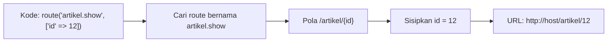

# Named Route

Sejauh ini kamu menulis alamat seperti `'/artikel'` langsung di kode. Bayangkan alamat itu dipakai di dua puluh tempat (menu, tautan, pengalihan, email), lalu tim memutuskan
mengubahnya menjadi `/berita`. Kamu harus mencari dan mengganti dua puluh tempat, dan satu yang terlewat berarti tautan rusak. **Named route** menyelesaikannya dengan memberi
nama pada route, lalu membuat URL dari nama itu.

## Tujuan Pembelajaran

Setelah menyelesaikan sub bab ini, kamu dapat:

- [ ] Memberi nama pada route dengan `->name()`.
- [ ] Membuat URL dari nama route dengan `route()`, termasuk dengan parameter dan *query string*.
- [ ] Membuat pengalihan ke route bernama dengan `redirect()->route()` dan `to_route()`.
- [ ] Memeriksa route yang sedang aktif dengan `routeIs()`.
- [ ] Menerapkan konvensi penamaan `sumber.aksi` dan menjaga nama tetap unik.
- [ ] Menjelaskan manfaat route bernama untuk perawatan dan keamanan.

## Prasyarat

- Sub bab [Parameter Route](02-03-route-parameters.md) dan [Parameter Route Opsional](02-04-optional-route-parameters.md).
- Proyek `~/belajar-laravel/portal-artikel` dengan route `/artikel`, `/artikel/baru`, dan `/artikel/{id}`.
- Pemahaman redirect dari [Routing Dasar](02-02-basic-routing.md).

## Pengantar

Alamat URL bisa berubah, tetapi **maksud** sebuah route biasanya tetap: "halaman daftar artikel", "halaman detail artikel". Memberi nama pada maksud itu
memisahkan kode yang membutuhkan tautan dari alamat sebenarnya. Kodenya berkata "berikan URL untuk `artikel.index`", dan Laravel yang mencari alamatnya.

## Penjelasan Konsep

### Memberi nama pada route

Menurut dokumentasi, nama diberikan dengan merantai metode `name` pada definisi route:

```php-inline
Route::get('/user/profile', function () {
    // ...
})->name('profile');
```

Nama juga bisa diberikan pada route yang menuju controller. Dokumentasi memberi peringatan: **nama route harus selalu unik**.

!!! tip "Analogi"
    Nama route seperti **kontak di ponsel**. Kamu memanggil "Budi", bukan menghafal nomornya. Jika nomor Budi berganti, panggilannya tetap "Budi".

### Membuat URL dari nama

Fungsi bantu `route()` menghasilkan URL dari nama, dan `redirect()->route()` atau `to_route()` membuat pengalihan:

```php-inline
$url = route('profile');

return redirect()->route('profile');

return to_route('profile');
```

### Route bernama dengan parameter

Jika route punya parameter, berikan nilainya sebagai argumen kedua berupa array. Laravel menyisipkannya ke posisi yang benar:

```php-inline
Route::get('/user/{id}/profile', function (string $id) {
    // ...
})->name('profile');

$url = route('profile', ['id' => 1]);
```

Pasangan kunci-nilai tambahan di array otomatis ditambahkan sebagai **query string**:

```php-inline
$url = route('profile', ['id' => 1, 'photos' => 'yes']);

// http://example.com/user/1/profile?photos=yes
```

Fungsi `route()` memiliki argumen ketiga `$absolute` (bawaan `true`). Dengan `false`, hasilnya URL relatif seperti `/user/1/profile`, bukan URL lengkap.

### Memeriksa route yang sedang aktif

Dokumentasi menyediakan `routeIs` pada objek `Request` untuk memeriksa apakah request cocok dengan route bernama tertentu, dan mendukung pola dengan `*`:

```php-inline
if ($request->routeIs('admin.*')) {
    // ...
}
```

Dokumentasi route juga menunjukkan `named()` pada objek route (`$request->route()->named('profile')`), biasanya dipakai di middleware. Penggunaan yang umum: menandai menu
yang sedang aktif.

### Konvensi penamaan

Konvensi yang umum, selaras dengan nama route resource controller di dokumentasi (`photos.index`, `photos.show`, dan seterusnya):

| Pola | Contoh |
|---|---|
| `sumber.aksi` | `artikel.index`, `artikel.show`, `artikel.create`, `artikel.store` |
| Huruf kecil, dipisah titik | `admin.pengguna.index` |
| Nama menjelaskan maksud, bukan URL | `artikel.show`, bukan `artikel-12` |

### Manfaat

| Manfaat | Penjelasan |
|---|---|
| Perawatan | Mengubah URL cukup di satu tempat |
| Keterbacaan | `route('artikel.show', ['id' => 12])` jelas maksudnya |
| Keamanan | Tujuan redirect berasal dari daftar route sendiri, bukan dari teks pengguna |
| Refactoring | Nama tetap walau URI atau controller berubah |

!!! warning "Jangan mengalihkan ke alamat dari input pengguna"
    Mengalihkan ke URL yang diambil mentah dari input (misalnya `?kembali=...`) membuka celah *open redirect*, yaitu pengguna dibawa ke situs jahat lewat tautan
    yang tampak sah. Alihkan ke route bernama milik aplikasimu sendiri, dan periksa nilai apa pun dari pengguna sebelum dipakai.

### Melihat nama route

`php artisan route:list` menampilkan kolom nama. Beberapa opsi yang tersedia di perintah `route:list`:

| Opsi | Fungsi |
|---|---|
| `--name=artikel` | Hanya route yang namanya memuat `artikel` |
| `--method=GET` | Hanya route dengan metode tertentu |
| `--json` | Keluaran dalam format JSON |
| `--sort=name` | Mengurutkan berdasarkan nama |

## Cara Kerja



Laravel menyimpan daftar nama route saat aplikasi memuat berkas route. Pemanggilan `route()` mencari nama itu, mengisi parameter, dan menghasilkan URL dengan host dari request saat ini.

## Contoh Praktik

Di `portal-artikel` kamu memberi nama pada route artikel, menghasilkan URL lewat satu route diagnostik, membuat pengalihan bernama, memeriksa route aktif, lalu membuktikan manfaat
perawatan dengan mengubah URI satu route tanpa menyentuh kode yang memakai namanya.

## Penjelasan Kode

File: `routes/web.php` (beri nama pada route yang sudah ada dan tambahkan route baru)

```php-inline
Route::get('/artikel', function () {
    return 'Daftar artikel';
})->name('artikel.index');

Route::get('/artikel/baru', function () {
    return 'Form artikel baru';
})->name('artikel.create');

Route::post('/artikel/simpan', function () {
    return 'Artikel disimpan';
})->name('artikel.store');

Route::get('/artikel/{id}', function (string $id) {
    return 'Detail artikel #' . $id;
})->name('artikel.show');

Route::get('/artikel/{id}/info', function (Request $request, string $id) {
    return [
        'nama_route' => $request->route()->getName(),
        'dalam_artikel' => $request->routeIs('artikel.*'),
    ];
})->name('artikel.info');

Route::get('/peta-url', function () {
    return [
        'daftar' => route('artikel.index'),
        'detail' => route('artikel.show', ['id' => 12]),
        'dengan_query' => route('artikel.index', ['halaman' => 2, 'urut' => 'terbaru']),
        'relatif' => route('artikel.show', ['id' => 12], false),
    ];
});

Route::get('/ke-daftar', function () {
    return to_route('artikel.index');
});
```

(Ubah definisi route yang sudah ada dengan menambahkan `->name(...)`. Jangan menggandakan route yang sama; bila route `/artikel`, `/artikel/baru`, `/artikel/simpan`, dan `/artikel/{id}`
sudah ada, cukup tambahkan rantai `->name(...)`.)

| Bagian | Penjelasan |
|---|---|
| `->name('artikel.index')` | Memberi nama unik pada route |
| `route('artikel.show', ['id' => 12])` | Menghasilkan URL dengan `{id}` diisi `12` |
| `route('artikel.index', ['halaman' => 2, ...])` | Argumen berlebih menjadi query string |
| `route(..., false)` | URL relatif tanpa host |
| `to_route('artikel.index')` | Pengalihan ke route bernama |
| `$request->route()->getName()` | Nama route yang sedang melayani request |
| `$request->routeIs('artikel.*')` | `true` bila nama route diawali `artikel.` |

## Implementasi Langkah demi Langkah

### Langkah 1: beri nama pada route artikel

Edit `routes/web.php` sehingga empat route artikel yang sudah ada diberi nama seperti pada Penjelasan Kode, lalu tambahkan tiga route baru
(`artikel.info`, `/peta-url`, dan `/ke-daftar`).

```bash
cd ~/belajar-laravel/portal-artikel
php artisan route:list --name=artikel
```

### Langkah 2: jalankan dan periksa URL yang dihasilkan

```bash
php artisan serve
```

Di terminal lain (di Windows PowerShell tulis `curl.exe`):

```bash
curl -i http://127.0.0.1:8000/peta-url
curl -i http://127.0.0.1:8000/ke-daftar
curl -i http://127.0.0.1:8000/artikel/12/info
```

### Langkah 3: buktikan manfaat perawatan

Ubah **hanya** URI route `artikel.index` dari `'/artikel'` menjadi `'/berita'`, simpan, lalu:

```bash
curl -i http://127.0.0.1:8000/peta-url
curl -i http://127.0.0.1:8000/ke-daftar
curl -i http://127.0.0.1:8000/berita
```

Perhatikan bahwa `route('artikel.index')` dan `to_route(...)` tidak perlu diubah. Kembalikan URI ke `'/artikel'` setelah selesai.

### Langkah 4: coba kesalahan umum

Tambahkan sementara route berikut dan akses:

```php-inline
Route::get('/uji-salah-nama', fn () => route('tidak.ada'));
Route::get('/uji-salah-param', fn () => route('artikel.show'));
```

```bash
curl -i http://127.0.0.1:8000/uji-salah-nama
curl -i http://127.0.0.1:8000/uji-salah-param
```

Catat pesan error masing-masing, lalu hapus kedua route percobaan.

### Langkah 5: periksa dengan `route:list`

```bash
php artisan route:list --name=artikel
php artisan route:list --name=artikel --json
php artisan route:list --sort=name
```

### Langkah 6: catat di Git

```bash
git add routes/web.php
git commit -m "Beri nama pada route artikel dan tambah route diagnostik"
```

## Eksekusi dan Verifikasi

| Langkah | Cara memverifikasi |
|---|---|
| 1 | `route:list --name=artikel` menampilkan kolom nama `artikel.index`, `artikel.create`, `artikel.store`, `artikel.show`, dan `artikel.info` |
| 2 | `/peta-url` mengembalikan JSON empat URL; `/ke-daftar` menjawab pengalihan |
| 3 | Setelah URI diubah ke `/berita`, URL pada `/peta-url` dan pengalihan ikut berubah tanpa mengubah kode lain |
| 4 | Dua route percobaan menampilkan pesan error yang berbeda |
| 5 | Keluaran daftar, JSON, dan urutan nama sesuai |
| 6 | `git log --oneline` memuat commit baru |

## Hasil yang Diharapkan

Respons `/peta-url` (host mengikuti alamat yang kamu pakai):

```json
{
    "daftar": "http://127.0.0.1:8000/artikel",
    "detail": "http://127.0.0.1:8000/artikel/12",
    "dengan_query": "http://127.0.0.1:8000/artikel?halaman=2&urut=terbaru",
    "relatif": "/artikel/12"
}
```

| Permintaan | Hasil |
|---|---|
| `GET /ke-daftar` | Status 3xx (umumnya `302`) dengan header `Location` ke URL `artikel.index` |
| `GET /artikel/12/info` | JSON `{"nama_route":"artikel.info","dalam_artikel":true}` |
| `GET /peta-url` setelah URI diubah ke `/berita` | Semua URL `artikel.index` menjadi `.../berita` |
| `GET /uji-salah-nama` | Error `Route [tidak.ada] not defined.` (teks mengikuti versi) |
| `GET /uji-salah-param` | Error bahwa parameter wajib untuk route itu kurang (teks mengikuti versi) |

Susunan JSON bisa rapat atau dirapikan. Keluaran ini diturunkan dari dokumentasi dan kode framework, dan belum dijalankan oleh penulis materi; cocokkan dengan hasilmu.

## Kesalahan Umum dan Pemecahan Masalah

| Gejala | Penyebab | Cara mengenali | Solusi | Pencegahan |
|---|---|---|---|---|
| `Route [x] not defined.` | Nama salah ketik atau route belum diberi nama | Pesan menyebut nama | Cek `route:list --name=` dan ejaan | Salin nama dari `route:list` |
| Error parameter kurang saat `route()` | Parameter wajib tidak diberikan | Pesan menyebut parameter yang hilang | Sertakan array parameter: `route('artikel.show', ['id' => 12])` | Lihat pola URI di `route:list` |
| URL berisi query string tak terduga | Memberi kunci array yang bukan parameter route | `?kunci=nilai` muncul | Periksa nama kunci sesuai nama parameter | Samakan nama kunci dengan `{parameter}` |
| Dua route bernama sama | Nama tidak unik | Satu route tidak pernah dipakai lewat nama itu | Beri nama unik | Ikuti konvensi `sumber.aksi` |
| `routeIs` selalu `false` | Pola nama tidak cocok, atau route tak bernama | Nama route `null` | Beri nama route; periksa pola `*` | Cetak `$request->route()->getName()` untuk debugging |
| Redirect membawa pengguna ke situs lain | Tujuan diambil dari input | Parameter `?kembali=` dipakai langsung | Alihkan ke route bernama sendiri | Jangan mengalihkan ke URL tak tepercaya |
| `route()` menghasilkan host salah | Host berasal dari request/konfigurasi | URL memuat host tak diinginkan | Periksa `APP_URL` untuk konteks konsol dan host request untuk web | Pakai `route(..., false)` bila perlu URL relatif |
| Nama yang diubah tidak diperbarui di kode | Nama dipakai sebagai teks di banyak tempat | Banyak error `not defined` setelah ganti nama | Cari ejaan lama di seluruh proyek | Hindari mengganti nama tanpa pencarian menyeluruh |

## Latihan Praktik

### Latihan dasar

**D1. Beri nama pada route statis**
- *Masalah:* route informasi belum bernama.
- *Persyaratan:* beri nama `tentang`, `kontak`, dan `kebijakan` pada route halaman statis yang kamu buat sebelumnya, dan tunjukkan namanya dengan `route:list`.
- *Perilaku yang diharapkan:* ketiga nama tampil di kolom nama.
- *Tujuan belajar:* memberi nama route.

**D2. URL dari nama**
- *Masalah:* butuh URL detail artikel nomor 7 di kode.
- *Persyaratan:* tulis ekspresi `route(...)` yang menghasilkan URL itu, versi absolut dan relatif.
- *Perilaku yang diharapkan:* `http://host/artikel/7` dan `/artikel/7`.
- *Tujuan belajar:* membuat URL dengan parameter.

### Latihan implementasi

**I1. Menu navigasi dari nama route**
- *Masalah:* menu situs tak boleh memakai alamat mentah.
- *Persyaratan:* buat route `/menu` yang mengembalikan array tautan menu (daftar, buat, tentang) hanya memakai `route(...)`. Ubah satu URI dan buktikan menu ikut berubah.
- *Perilaku yang diharapkan:* menu tetap benar setelah URI diubah, tanpa menyentuh kode menu.
- *Tujuan belajar:* memisahkan kode dari URL.

**I2. Penanda menu aktif**
- *Masalah:* menu aktif perlu disorot.
- *Persyaratan:* buat route `/menu-aktif` yang menerima `Request` dan mengembalikan array `['artikel' => ..., 'tentang' => ...]` berisi `true`/`false` memakai `routeIs`, lalu uji
  dengan memanggilnya dari berbagai route bernama.
- *Perilaku yang diharapkan:* nilai `true` hanya untuk kelompok route yang sedang diakses.
- *Tujuan belajar:* memakai `routeIs` dan pola `*`.

### Latihan tantangan

**T1. Daftar nama route yang konsisten**
- *Masalah:* tim membutuhkan skema nama untuk portal artikel yang bisa dipakai bertahun-tahun.
- *Persyaratan:* rancang tabel nama route untuk resource artikel dan penulis (index, create, store, show, edit, update, destroy), jelaskan konvensinya, dan tulis skrip
  Bash singkat yang memeriksa (lewat `php artisan route:list --json`) bahwa semua route aplikasi punya nama yang unik dan mengikuti pola `sumber.aksi`.
- *Perilaku yang diharapkan:* skrip melaporkan route tanpa nama atau nama ganda.
- *Tujuan belajar:* menegakkan konvensi dengan otomasi.
- *Catatan:* kerjakan mandiri; tidak ada kunci jawaban.

## Uji Pemahaman

1. Apa fungsi `->name()` pada route?
2. Bagaimana membuat URL dari nama route berparameter?
3. Apa yang terjadi pada pasangan array tambahan di `route('x', [...])`?
4. Apa beda `redirect()->route('x')` dan `to_route('x')`?
5. Apa fungsi `$request->routeIs('artikel.*')`?
6. Mengapa nama route harus unik?
7. Apa manfaat route bernama untuk perawatan dan keamanan?
8. Apa bahaya mengalihkan ke URL yang berasal dari input pengguna?

??? success "Kunci jawaban singkat"
    1. Memberi nama pada route agar URL dan pengalihan dapat dibuat dari nama itu.
    2. `route('artikel.show', ['id' => 12])`.
    3. Ditambahkan sebagai query string pada URL.
    4. Hasil keduanya sama (pengalihan ke route bernama); `to_route` adalah jalan pintas yang lebih ringkas.
    5. Memeriksa apakah nama route request cocok dengan pola (`artikel.index`, `artikel.show`, dan seterusnya).
    6. Nama dipakai untuk mencari route; nama ganda membuat satu route tak terjangkau.
    7. URL berubah di satu tempat; tujuan redirect berasal dari daftar route sendiri.
    8. Open redirect: pengguna dapat dibawa ke situs berbahaya lewat tautan yang tampak sah.

## Ringkasan

- `->name('sumber.aksi')` memberi nama unik pada route.
- `route('nama', ['parameter' => nilai])` membuat URL; argumen berlebih menjadi query string; argumen ketiga `false` menghasilkan URL relatif.
- `redirect()->route()` dan `to_route()` membuat pengalihan; `routeIs()` memeriksa route aktif.
- Konvensi `sumber.aksi` selaras dengan route resource controller.
- Route bernama memudahkan perawatan dan mengurangi risiko *open redirect*.

Selanjutnya: *Grup Route*, yaitu mengelompokkan route yang berbagi pengaturan.

## Referensi Resmi

- [Laravel: Named Routes](https://laravel.com/docs/13.x/routing#named-routes)
- [Laravel: Generating URLs to Named Routes](https://laravel.com/docs/13.x/routing#generating-urls-to-named-routes)
- [Laravel: Inspecting the Current Route](https://laravel.com/docs/13.x/routing#inspecting-the-current-route)
- [Laravel: Inspecting the Request Path and Method (`routeIs`)](https://laravel.com/docs/13.x/requests#inspecting-the-request-path)
- [Laravel: URL Generation](https://laravel.com/docs/13.x/urls)
- [OWASP: Unvalidated Redirects and Forwards](https://cheatsheetseries.owasp.org/cheatsheets/Unvalidated_Redirects_and_Forwards_Cheat_Sheet.html)
