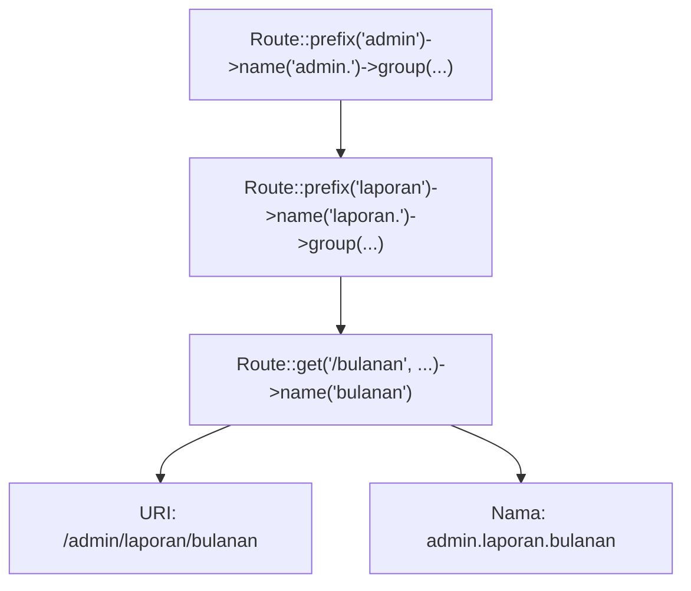

# Grup Route

Ketika aplikasi tumbuh, banyak route berbagi ciri yang sama: semuanya berawalan `/admin`, namanya berawalan `admin.`, atau semuanya melewati pemeriksaan login. Menulis ciri yang
sama berulang di setiap route melelahkan dan rawan tidak konsisten. **Grup route** memungkinkan kamu menulis ciri itu sekali untuk banyak route.

## Tujuan Pembelajaran

Setelah menyelesaikan sub bab ini, kamu dapat:

- [ ] Membuat grup route dengan `Route::...->group(function () { ... })`.
- [ ] Menyebutkan atribut yang dapat dibagikan grup: middleware, controller, domain, prefix, dan prefix nama.
- [ ] Memakai prefix nama (`->name('admin.')`) dan memahami penulisan titik.
- [ ] Membuat grup bersarang dan memprediksi hasil penggabungan atributnya.
- [ ] Menjelaskan mengapa grup `admin` tidak otomatis membuat halaman aman.
- [ ] Memeriksa hasil grup dengan `route:list`.

## Prasyarat

- Sub bab [Named Route](02-05-named-routes.md): `->name()` dan konvensi `sumber.aksi`.
- Proyek `~/belajar-laravel/portal-artikel` dengan route artikel bernama.
- [Fungsi](../level-00/00-14-functions.md) (closure) dari bab utama pertama.

## Pengantar

Bayangkan area admin portal artikel dengan sepuluh halaman. Tanpa grup, setiap route ditulis seperti ini:

```php-inline
Route::get('/admin/artikel', ...)->name('admin.artikel.index');
Route::get('/admin/artikel/baru', ...)->name('admin.artikel.create');
Route::get('/admin/pengguna', ...)->name('admin.pengguna.index');
```

Awalan `/admin` dan `admin.` terulang di setiap baris. Jika awalan diganti menjadi `/panel`, kamu harus mengedit semua baris. Dengan grup, awalan ditulis sekali.

## Penjelasan Konsep

### Apa itu grup route?

Menurut dokumentasi, grup route memungkinkan kamu **berbagi atribut route**, seperti middleware, ke banyak route tanpa mendefinisikannya di setiap route. Bentuk dasarnya:
panggil metode atribut pada `Route`, lalu `->group(function () { ... })` yang berisi route-route anggota grup.

```php-inline
Route::prefix('admin')->name('admin.')->group(function () {
    Route::get('/pengguna', function () {
        // ...
    })->name('pengguna.index');
});
```

!!! tip "Analogi"
    Grup route seperti **map folder**: semua berkas di dalamnya mewarisi label folder, dan mengubah label folder mengubah semuanya sekaligus.

### Atribut yang dapat dibagikan

| Metode | Fungsi | Dibahas rinci pada |
|---|---|---|
| `middleware([...])` | Menerapkan middleware ke semua route anggota | *Middleware Route* |
| `controller(Class::class)` | Menetapkan controller bersama; route cukup menyebut nama metodenya | Bab *Controller* |
| `domain('{akun}.example.com')` | Menangani subdomain, dengan bagian subdomain sebagai parameter | Dokumentasi resmi |
| `prefix('admin')` | Menambah awalan ke URI semua route anggota | *Prefix Route* |
| `name('admin.')` | Menambah awalan ke nama semua route anggota | Sub bab ini |

Beberapa atribut bisa dirangkai sebelum `->group(...)`, misalnya `Route::prefix('admin')->name('admin.')->group(...)`.

### Prefix nama

Metode `name` pada grup menambahkan awalan pada nama setiap route anggota. Dokumentasi menekankan bahwa awalan ditambahkan **persis seperti yang kamu tulis**, sehingga kamu perlu menyertakan
titik di akhir:

```php-inline
Route::name('admin.')->group(function () {
    Route::get('/users', function () {
        // Nama route menjadi "admin.users"
    })->name('users');
});
```

Tanpa titik (`->name('admin')`), nama menjadi `adminusers`, yang jarang dimaksudkan.

### Grup bersarang

Grup boleh berada di dalam grup lain. Dokumentasi menjelaskan bahwa grup bersarang mencoba menggabungkan atribut dengan grup induk secara cerdas:

| Atribut | Perilaku penggabungan |
|---|---|
| Middleware dan kondisi `where` | **Digabung** |
| Nama dan prefix | **Ditambahkan** (dirangkai berurutan) |
| Pemisah namespace dan garis miring pada prefix URI | Ditambahkan otomatis di tempat yang tepat |

Contoh:

```php-inline
Route::prefix('admin')->name('admin.')->group(function () {
    Route::prefix('laporan')->name('laporan.')->group(function () {
        Route::get('/bulanan', function () {
            // URI: /admin/laporan/bulanan
            // Nama: admin.laporan.bulanan
        })->name('bulanan');
    });
});
```

### Keamanan: awalan bukan perlindungan

!!! danger "URL `/admin` tidak otomatis aman"
    Awalan seperti `admin` hanya mengubah alamat. Siapa pun yang menebak `/admin/pengguna` dapat membukanya kecuali kamu menambahkan perlindungan nyata, yaitu
    **middleware autentikasi dan otorisasi** pada grup (dibahas di sub bab *Middleware Route* dan bab utama Keamanan). Jangan mengandalkan nama atau awalan yang
    "sulit ditebak" sebagai pengaman.

### Kapan membuat grup?

| Situasi | Saran |
|---|---|
| Tiga route atau lebih berbagi awalan, middleware, atau controller | Buat grup |
| Hanya satu atau dua route | Biasanya tidak perlu grup |
| Atribut berbeda-beda per route | Jangan memaksakan grup |

## Cara Kerja



Saat berkas route dimuat, Laravel menjalankan closure grup dengan atribut grup aktif, lalu setiap route yang didefinisikan di dalamnya mewarisi atribut tersebut.

## Contoh Praktik

Di `portal-artikel` kamu membuat area admin lewat grup bertingkat, memeriksa URI dan nama hasilnya, mengubah awalan dengan satu perubahan, dan melihat akibat menghilangkan titik pada prefix nama.

## Penjelasan Kode

File: `routes/web.php` (tambahkan di bagian bawah)

```php-inline
Route::prefix('admin')->name('admin.')->group(function () {
    Route::get('/artikel', function () {
        return 'Admin: daftar artikel';
    })->name('artikel.index');

    Route::get('/artikel/baru', function () {
        return 'Admin: form artikel baru';
    })->name('artikel.create');

    Route::get('/pengguna', function () {
        return 'Admin: daftar pengguna';
    })->name('pengguna.index');

    Route::prefix('laporan')->name('laporan.')->group(function () {
        Route::get('/bulanan', function () {
            return 'Laporan bulanan';
        })->name('bulanan');

        Route::get('/tahunan', function () {
            return 'Laporan tahunan';
        })->name('tahunan');
    });
});
```

| Route | URI | Nama |
|---|---|---|
| Daftar artikel | `/admin/artikel` | `admin.artikel.index` |
| Form artikel baru | `/admin/artikel/baru` | `admin.artikel.create` |
| Daftar pengguna | `/admin/pengguna` | `admin.pengguna.index` |
| Laporan bulanan | `/admin/laporan/bulanan` | `admin.laporan.bulanan` |
| Laporan tahunan | `/admin/laporan/tahunan` | `admin.laporan.tahunan` |

Perhatikan bahwa di dalam grup, URI ditulis relatif (`/artikel`) dan nama relatif (`artikel.index`); grup menambahkan `/admin` dan `admin.`. Grup bersarang menambahkan
`laporan` dan `laporan.` lagi.

## Implementasi Langkah demi Langkah

### Langkah 1: tulis grup

Tambahkan kode di atas ke `routes/web.php`, lalu:

```bash
cd ~/belajar-laravel/portal-artikel
php -l routes/web.php
php artisan route:list --path=admin
php artisan route:list --name=admin
```

### Langkah 2: jalankan dan uji

```bash
php artisan serve
```

Di terminal lain (di Windows PowerShell tulis `curl.exe`):

```bash
curl -i http://127.0.0.1:8000/admin/artikel
curl -i http://127.0.0.1:8000/admin/artikel/baru
curl -i http://127.0.0.1:8000/admin/pengguna
curl -i http://127.0.0.1:8000/admin/laporan/bulanan
curl -i http://127.0.0.1:8000/artikel
curl -i http://127.0.0.1:8000/admin
```

### Langkah 3: buat URL dari nama bersarang

Tambahkan route diagnostik sementara:

```php-inline
Route::get('/peta-admin', function () {
    return [
        'artikel' => route('admin.artikel.index'),
        'laporan_bulanan' => route('admin.laporan.bulanan'),
    ];
});
```

```bash
curl -i http://127.0.0.1:8000/peta-admin
```

### Langkah 4: ubah awalan sekali untuk semua

Ubah `Route::prefix('admin')` pada grup terluar menjadi `Route::prefix('panel')`, simpan, lalu:

```bash
php artisan route:list --path=panel
curl -i http://127.0.0.1:8000/panel/artikel
curl -i http://127.0.0.1:8000/admin/artikel
curl -i http://127.0.0.1:8000/peta-admin
```

Perhatikan bahwa nama route tidak berubah sehingga `/peta-admin` mengembalikan URL berawalan `panel`. Kembalikan ke `admin` setelah selesai.

### Langkah 5: lihat akibat titik yang hilang

Ubah `->name('admin.')` menjadi `->name('admin')` pada grup terluar, simpan, dan jalankan:

```bash
php artisan route:list --name=admin
```

Catat nama route yang dihasilkan, lalu kembalikan titiknya.

### Langkah 6: pikirkan keamanan

Buka `/admin/pengguna` dari `curl` tanpa kredensial apa pun. Tuliskan satu kalimat tentang apa yang kurang agar halaman ini aman. Jawabannya dibahas di sub bab *Middleware Route*.

### Langkah 7: bersihkan dan catat di Git

Hapus route `/peta-admin`, lalu:

```bash
git add routes/web.php
git commit -m "Tambah grup route admin"
```

## Eksekusi dan Verifikasi

| Langkah | Cara memverifikasi |
|---|---|
| 1 | `route:list --path=admin` menampilkan lima route berawalan `admin/`; `--name=admin` menampilkan namanya |
| 2 | Hasil sesuai tabel hasil yang diharapkan |
| 3 | `/peta-admin` mengembalikan URL berdasarkan nama bersarang |
| 4 | Setelah prefix menjadi `panel`, URI berubah dan `/admin/artikel` menjadi `404` |
| 5 | Nama berubah menjadi `adminartikel.index` dan sejenisnya |
| 6 | Kamu menyadari bahwa halaman terbuka tanpa autentikasi |
| 7 | `git log --oneline` memuat commit baru |

## Hasil yang Diharapkan

| Permintaan | Status | Isi |
|---|---|---|
| `GET /admin/artikel` | `200` | `Admin: daftar artikel` |
| `GET /admin/artikel/baru` | `200` | `Admin: form artikel baru` |
| `GET /admin/pengguna` | `200` | `Admin: daftar pengguna` |
| `GET /admin/laporan/bulanan` | `200` | `Laporan bulanan` |
| `GET /artikel` | `200` | `Daftar artikel` (route publik tidak terpengaruh) |
| `GET /admin` | `404` | Tidak ada route dengan URI `/admin` saja |

`/peta-admin` mengembalikan JSON yang memuat `.../admin/artikel` dan `.../admin/laporan/bulanan` (atau `.../panel/...` setelah Langkah 4). Pada Langkah 5, nama route menjadi
`adminartikel.index`, `adminartikel.create`, `adminpengguna.index`, dan seterusnya. Hasil ini diturunkan dari dokumentasi dan perilaku framework, dan belum dijalankan oleh penulis materi;
cocokkan dengan hasilmu.

## Kesalahan Umum dan Pemecahan Masalah

| Gejala | Penyebab | Cara mengenali | Solusi | Pencegahan |
|---|---|---|---|---|
| Nama route `adminartikel.index` | Prefix nama tanpa titik | `route:list` menampilkan nama menyatu | Tulis `->name('admin.')` | Selalu sertakan titik di akhir |
| URI ganda seperti `/admin/admin/artikel` | Menulis `admin` di grup dan di dalam route | URI di `route:list` berlebih | Hapus awalan dari route anggota | Tulis URI relatif di dalam grup |
| `404` pada route di dalam grup | Lupa awalan grup saat mengakses | `route:list` menunjukkan URI lengkap | Akses dengan awalan grup | Periksa `route:list --path` |
| Route di dalam grup tidak terdaftar | Closure grup tidak ditutup benar atau error sintaks | `route:list` tidak memuatnya | Periksa kurung `});` | Jalankan `php -l routes/web.php` |
| `Route [x] not defined` | Nama tanpa prefix grup | Memanggil `artikel.index` padahal namanya `admin.artikel.index` | Sertakan prefix nama lengkap | Cek nama di `route:list --name` |
| Mengira area admin sudah terlindungi | Awalan dianggap pengaman | Halaman terbuka tanpa login | Tambahkan middleware autentikasi | Ingat: grup bukan keamanan |
| Konflik nama setelah menyalin grup | Nama yang sama di dua grup | Satu route tak terjangkau lewat nama | Gunakan prefix nama berbeda | Jaga nama tetap unik |
| Perubahan grup tidak muncul | Cache route | `route:list` lama | `php artisan route:clear` | Jangan `route:cache` saat pengembangan |

## Latihan Praktik

### Latihan dasar

**D1. Grup tunggal**
- *Masalah:* route kategori berbagi awalan.
- *Persyaratan:* buat grup `Route::prefix('kategori')->name('kategori.')->group(...)` dengan route `/` (daftar) dan `/populer`, lalu tunjukkan URI dan namanya di `route:list`.
- *Perilaku yang diharapkan:* `/kategori` dan `/kategori/populer`, bernama `kategori.index` dan `kategori.populer`.
- *Tujuan belajar:* memakai prefix URI dan prefix nama.

**D2. Prediksi sebelum menjalankan**
- *Masalah:* tebak hasil grup bersarang.
- *Persyaratan:* untuk `Route::prefix('a')->name('a.')->group(fn () => Route::prefix('b')->name('b.')->group(fn () => Route::get('/c', ...)->name('d')))`
  tulis URI dan nama hasilnya, lalu verifikasi dengan `route:list`.
- *Perilaku yang diharapkan:* `/a/b/c` dengan nama `a.b.d`.
- *Tujuan belajar:* memahami penambahan prefix pada grup bersarang.

### Latihan implementasi

**I1. Area penulis**
- *Masalah:* penulis butuh area sendiri.
- *Persyaratan:* buat grup `penulis` dengan route dasbor, daftar artikel milik penulis, dan form artikel baru, lengkap dengan nama yang konsisten. Pastikan tidak ada URI atau nama yang bentrok dengan area admin.
- *Perilaku yang diharapkan:* tiga route berawalan `/penulis` dan nama berawalan `penulis.`.
- *Tujuan belajar:* merancang beberapa area berdampingan.

**I2. Ganti awalan**
- *Masalah:* tim ingin mengganti `/admin` menjadi `/manajemen`.
- *Persyaratan:* lakukan penggantian dengan satu perubahan, jelaskan apa yang berubah dan apa yang tidak (URI vs nama), dan tuliskan satu risiko (misalnya tautan lama yang rusak), serta cara mengurangi risikonya
  (misalnya dengan pengalihan permanen dari URI lama).
- *Perilaku yang diharapkan:* URI baru berfungsi dan URI lama dialihkan.
- *Tujuan belajar:* mengelola perubahan URL dengan aman.

### Latihan tantangan

**T1. Audit struktur route**
- *Masalah:* file route tim sudah panjang dan penuh duplikasi.
- *Persyaratan:* ambil seluruh `routes/web.php`, kelompokkan route yang berbagi awalan atau pola nama menjadi grup, pastikan `route:list` sebelum dan sesudah menghasilkan daftar URI dan nama yang
  **persis sama**, dan lampirkan bukti (misalnya perbandingan keluaran `--json`).
- *Perilaku yang diharapkan:* tidak ada perubahan perilaku, hanya penulisan yang lebih ringkas.
- *Tujuan belajar:* refactoring route dengan jaminan keamanan.
- *Catatan:* kerjakan mandiri; tidak ada kunci jawaban.

## Uji Pemahaman

1. Apa fungsi grup route?
2. Sebutkan lima atribut yang dapat dibagikan grup.
3. Mengapa prefix nama perlu diakhiri titik?
4. Bagaimana nama dan prefix digabung pada grup bersarang?
5. Apa beda `prefix('admin')` dan `name('admin.')`?
6. Mengapa awalan `/admin` tidak cukup untuk mengamankan halaman?
7. Apa yang berubah dan tidak berubah bila awalan grup diganti?
8. Kapan grup tidak diperlukan?

??? success "Kunci jawaban singkat"
    1. Membagi atribut yang sama ke banyak route tanpa menuliskannya berulang.
    2. Middleware, controller, domain, prefix, dan prefix nama.
    3. Awalan ditambahkan persis seperti ditulis, sehingga tanpa titik nama menjadi menyatu.
    4. Nama dan prefix ditambahkan (dirangkai); middleware dan `where` digabung.
    5. `prefix` mengubah URI; `name` mengubah nama route.
    6. Awalan hanya mengubah alamat; perlindungan nyata membutuhkan middleware autentikasi dan otorisasi.
    7. URI berubah; nama route tetap.
    8. Bila hanya satu atau dua route, atau atributnya berbeda-beda.

## Ringkasan

- Grup route berbagi atribut (middleware, controller, domain, prefix, nama) ke banyak route lewat `->group(function () { ... })`.
- Grup bersarang menambahkan nama dan prefix serta menggabungkan middleware dan `where`.
- Prefix nama diakhiri titik karena ditambahkan persis seperti ditulis.
- Mengganti awalan grup cukup di satu tempat; nama route tetap sehingga tautan berbasis nama tidak rusak.
- Awalan URL bukan perlindungan: pakai middleware autentikasi dan otorisasi.

Selanjutnya: *Prefix Route*, yaitu pembahasan lebih rinci tentang awalan URI pada grup.

## Referensi Resmi

- [Laravel: Route Groups](https://laravel.com/docs/13.x/routing#route-groups)
- [Laravel: Route Group Middleware](https://laravel.com/docs/13.x/routing#route-group-middleware)
- [Laravel: Route Group Controllers](https://laravel.com/docs/13.x/routing#route-group-controllers)
- [Laravel: Subdomain Routing](https://laravel.com/docs/13.x/routing#route-group-subdomain-routing)
- [Laravel: Route Prefixes](https://laravel.com/docs/13.x/routing#route-group-prefixes)
- [Laravel: Route Name Prefixes](https://laravel.com/docs/13.x/routing#route-group-name-prefixes)
- [Laravel: Middleware](https://laravel.com/docs/13.x/middleware)
