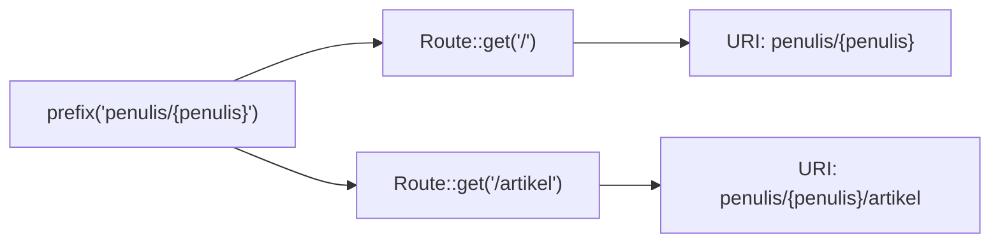

# Prefix Route

Pada sub bab *Grup Route* kamu sudah memakai `prefix('admin')` sebagai salah satu atribut grup. Sekarang kita menelaah **prefix** lebih dalam: bagaimana awalan URI
disusun, bagaimana prefix bersarang digabung, bagaimana prefix bisa berisi parameter, dan bagaimana prefix dipakai untuk membedakan versi antarmuka (misalnya `/v1` dan `/v2`).

## Tujuan Pembelajaran

Setelah menyelesaikan sub bab ini, kamu dapat:

- [ ] Memakai `Route::prefix()` dan memahami cara URI route dirangkai dari prefix.
- [ ] Menulis route "akar" sebuah grup (`/`) dan menjelaskan URI hasilnya.
- [ ] Memakai prefix yang berisi parameter route.
- [ ] Menyusun versi (`/v1`, `/v2`) dengan prefix dan prefix nama yang tidak bentrok.
- [ ] Menjelaskan awalan `/api` pada `routes/api.php` dan cara mengubahnya lewat `apiPrefix`.
- [ ] Mengelola perubahan awalan dengan aman (pengalihan dan kompatibilitas).

## Prasyarat

- Sub bab [Grup Route](02-06-route-groups.md): grup bersarang dan prefix nama.
- Sub bab [Parameter Route](02-03-route-parameters.md) dan [Named Route](02-05-named-routes.md).
- Proyek `~/belajar-laravel/portal-artikel` dengan area `admin`.

## Pengantar

Awalan URI punya dua peran praktis. Pertama, **mengelompokkan** alamat berdasarkan area (`/admin/...`, `/penulis/...`). Kedua, **memisahkan versi** (`/v1/artikel`, `/v2/artikel`) supaya
perubahan besar tidak merusak klien lama. Keduanya diselesaikan dengan satu fitur: prefix.

## Penjelasan Konsep

### Dasar `prefix`

Menurut dokumentasi, metode `prefix` dipakai untuk menambahkan awalan URI pada setiap route dalam grup:

```php-inline
Route::prefix('admin')->group(function () {
    Route::get('/users', function () {
        // Cocok dengan URL "/admin/users"
    });
});
```

URI akhir adalah **prefix + URI route**. Dokumentasi menyebut bahwa garis miring pada prefix URI ditambahkan otomatis di tempat yang tepat sehingga kamu tidak perlu mengatur sendiri
`/` di pertemuan keduanya.

!!! tip "Analogi"
    Prefix seperti **nama jalan** pada alamat: "Jalan Admin" lalu "No. 5 (artikel)". Mengganti nama jalan mengubah semua alamat di jalan itu sekaligus.

### Route "akar" di dalam prefix

Route dengan URI `/` di dalam grup berprefix menghasilkan URI prefix itu sendiri:

```php-inline
Route::prefix('admin')->group(function () {
    Route::get('/', function () {
        // URI: /admin
    });
});
```

Ini cara menulis halaman utama sebuah area, misalnya dasbor admin di `/admin`.

### Prefix bersarang

Prefix pada grup bersarang **ditambahkan** (dirangkai) dengan prefix grup induk:

```php-inline
Route::prefix('admin')->group(function () {
    Route::prefix('laporan')->group(function () {
        Route::get('/bulanan', function () {
            // URI: /admin/laporan/bulanan
        });
    });
});
```

Satu prefix juga boleh memuat beberapa segmen sekaligus: `Route::prefix('admin/laporan')`.

### Prefix yang berisi parameter

Prefix dapat memuat parameter route, mirip URI biasa. Parameter di prefix diteruskan ke closure route anggota sesuai urutannya (sebelum parameter yang ada di URI route itu sendiri):

```php-inline
Route::prefix('penulis/{penulis}')->group(function () {
    Route::get('/', function (string $penulis) {
        // URI: /penulis/{penulis}
    });

    Route::get('/artikel/{id}', function (string $penulis, string $id) {
        // URI: /penulis/{penulis}/artikel/{id}
    });
});
```

Pola ini berguna untuk sumber daya bersarang: semua halaman yang berkaitan dengan satu penulis berada di bawah `/penulis/{penulis}`. Parameter di prefix tetap berasal dari URL,
sehingga harus diperlakukan tidak tepercaya (escape dan validasi).

### Prefix untuk versi

Prefix cocok untuk membedakan versi:

```php-inline
Route::prefix('v1')->name('v1.')->group(function () {
    // /v1/artikel, nama: v1.artikel.index
});

Route::prefix('v2')->name('v2.')->group(function () {
    // /v2/artikel, nama: v2.artikel.index
});
```

Prefix URI membedakan alamat, dan prefix nama membedakan namanya, jadi kedua versi bisa memiliki `artikel.index` tanpa bentrok. Pembahasan versi API ada di bab utama REST API
(*API Versioning Concepts*).

### Prefix `/api` pada `routes/api.php`

Dokumentasi menjelaskan bahwa route di `routes/api.php` otomatis diberi awalan `/api` dan berada di grup middleware `api` (stateless). Berkas ini baru ada setelah menjalankan
`php artisan install:api`. Awalannya dapat diubah lewat argumen `apiPrefix` pada `withRouting` di `bootstrap/app.php`:

File: `bootstrap/app.php`

```php-inline
->withRouting(
    api: __DIR__.'/../routes/api.php',
    apiPrefix: 'api/admin',
    // ...
)
```

Pada sub bab ini kita tidak menjalankan `install:api`; topik API dibahas di bab utama *REST API Development*.

### Kapan memakai prefix?

| Situasi | Saran |
|---|---|
| Area terpisah (admin, penulis) | Prefix URI + prefix nama |
| Versi antarmuka | Prefix versi + prefix nama versi |
| Sumber daya bersarang dengan induk berparameter | Prefix berparameter |
| Hanya beberapa route kebetulan sama awalannya | Tulis awalan langsung, tidak perlu grup |

### Perubahan awalan dan kompatibilitas

Mengganti prefix mengubah URI sehingga tautan lama menjadi 404. Cara menguranginya:

- Gunakan **route bernama** di dalam aplikasi, sehingga hanya tautan *dari luar* (bookmark, mesin pencari) yang terpengaruh.
- Pasang **pengalihan permanen** dari alamat lama ke baru (`Route::permanentRedirect`) selama masa transisi.
- Untuk API, pertahankan versi lama sampai klien berpindah.

### Keamanan

- Prefix **bukan** kontrol akses; area admin tetap butuh middleware autentikasi dan otorisasi (*Middleware Route*).
- Hindari menaruh data sensitif di prefix atau URL (token, kata sandi): URL tercatat di riwayat browser dan log.
- Parameter di prefix diperlakukan seperti parameter route lain: escape saat ditampilkan, dan validasi formatnya.

## Cara Kerja



Saat grup dimuat, setiap route yang didefinisikan di dalamnya digabungkan dengan prefix aktif dan diperlakukan seperti route biasa dengan URI lengkap.

## Contoh Praktik

Pada `portal-artikel` kamu membuat dua versi route (`v1` dan `v2`), grup `penulis` dengan prefix berparameter lengkap dengan route akar, lalu menguji URI hasilnya, URL dari nama route,
dan perilaku saat awalan diganti dengan pengalihan permanen.

## Penjelasan Kode

File: `routes/web.php` (tambahkan di bagian bawah)

```php-inline
Route::prefix('v1')->name('v1.')->group(function () {
    Route::get('/artikel', function () {
        return ['versi' => 'v1', 'data' => []];
    })->name('artikel.index');
});

Route::prefix('v2')->name('v2.')->group(function () {
    Route::get('/artikel', function () {
        return ['versi' => 'v2', 'data' => [], 'meta' => ['total' => 0]];
    })->name('artikel.index');
});

Route::prefix('penulis/{penulis}')->name('penulis.')->group(function () {
    Route::get('/', function (string $penulis) {
        return 'Profil ' . e($penulis);
    })->name('profil');

    Route::get('/artikel', function (string $penulis) {
        return 'Artikel oleh ' . e($penulis);
    })->name('artikel');
});
```

| Bagian | Penjelasan |
|---|---|
| `prefix('v1')->name('v1.')` | URI `/v1/...` dan nama `v1....` |
| `prefix('v2')->name('v2.')` | Versi kedua tanpa bentrok nama |
| `prefix('penulis/{penulis}')` | Prefix dengan parameter; diteruskan ke closure anggota |
| `Route::get('/')` di dalam prefix | URI `/penulis/{penulis}` |
| `e($penulis)` | Meng-escape parameter dari URL |

## Implementasi Langkah demi Langkah

### Langkah 1: tambahkan route

```bash
cd ~/belajar-laravel/portal-artikel
php -l routes/web.php
php artisan route:list --path=v1
php artisan route:list --path=penulis
```

Perhatikan kolom URI dan nama untuk tiap grup.

### Langkah 2: jalankan dan uji URI

```bash
php artisan serve
```

Di terminal lain (di Windows PowerShell tulis `curl.exe`):

```bash
curl -i http://127.0.0.1:8000/v1/artikel
curl -i http://127.0.0.1:8000/v2/artikel
curl -i http://127.0.0.1:8000/penulis/budi
curl -i http://127.0.0.1:8000/penulis/budi/artikel
curl -i http://127.0.0.1:8000/v3/artikel
```

### Langkah 3: URL dari nama route

Tambahkan route diagnostik sementara:

```php-inline
Route::get('/peta-prefix', function () {
    return [
        'v1' => route('v1.artikel.index'),
        'v2' => route('v2.artikel.index'),
        'profil' => route('penulis.profil', ['penulis' => 'budi']),
        'artikel' => route('penulis.artikel', ['penulis' => 'sari']),
    ];
});
```

```bash
curl -i http://127.0.0.1:8000/peta-prefix
```

### Langkah 4: uji keamanan parameter di prefix

```bash
curl -i "http://127.0.0.1:8000/penulis/%3Cb%3Etebal%3C%2Fb%3E"
```

Pastikan isi respons ter-escape.

### Langkah 5: uji garis miring di akhir

```bash
curl -i http://127.0.0.1:8000/v1/artikel/
```

Catat kode statusnya dan bandingkan dengan Langkah 2.

### Langkah 6: ganti awalan dengan pengalihan

Ubah prefix `v1` menjadi `versi-1` (dan prefix nama tetap `v1.`), lalu tambahkan pengalihan permanen untuk alamat lama di luar grup:

```php-inline
Route::permanentRedirect('/v1/artikel', '/versi-1/artikel');
```

```bash
php artisan route:list --path=artikel
curl -i http://127.0.0.1:8000/v1/artikel
curl -iL http://127.0.0.1:8000/v1/artikel
curl -i http://127.0.0.1:8000/peta-prefix
```

Perhatikan bahwa `/peta-prefix` menghasilkan URL baru (karena memakai nama route) tanpa diubah.

### Langkah 7: bersihkan dan catat di Git

Kembalikan prefix `v1`, hapus pengalihan dan route `/peta-prefix`, lalu:

```bash
git add routes/web.php
git commit -m "Tambah prefix versi dan prefix berparameter"
```

## Eksekusi dan Verifikasi

| Langkah | Cara memverifikasi |
|---|---|
| 1 | `route:list` menampilkan `v1/artikel`, `v2/artikel`, `penulis/{penulis}`, dan `penulis/{penulis}/artikel` dengan nama yang benar |
| 2 | Hasil sesuai tabel hasil yang diharapkan |
| 3 | `/peta-prefix` mengembalikan empat URL |
| 4 | Isi memuat `&lt;b&gt;tebal&lt;/b&gt;` |
| 5 | Status dicatat (kemungkinan sama dengan tanpa garis miring) |
| 6 | `/v1/artikel` berstatus `301` ke alamat baru; `-L` mengikuti sampai `200` |
| 7 | `git log --oneline` memuat commit baru |

## Hasil yang Diharapkan

| Permintaan | Status | Isi |
|---|---|---|
| `GET /v1/artikel` | `200` | JSON `{"versi":"v1","data":[]}` |
| `GET /v2/artikel` | `200` | JSON dengan `versi` `v2` dan `meta` |
| `GET /penulis/budi` | `200` | `Profil budi` |
| `GET /penulis/budi/artikel` | `200` | `Artikel oleh budi` |
| `GET /v3/artikel` | `404` | Prefix `v3` tidak ada |
| `GET /v1/artikel/` | kemungkinan `200` | Garis miring di akhir umumnya diabaikan oleh Laravel; catat hasilmu |

`/peta-prefix` mengembalikan URL berbentuk `http://127.0.0.1:8000/v1/artikel`, `.../v2/artikel`, `.../penulis/budi`, dan `.../penulis/sari/artikel`. Setelah Langkah 6, URL `v1` berubah menjadi
`.../versi-1/artikel` sementara `/v1/artikel` berstatus `301`. Hasil ini diturunkan dari dokumentasi dan perilaku framework, dan belum dijalankan oleh penulis materi; cocokkan dengan hasilmu,
terutama untuk perilaku garis miring di akhir dan prefix berparameter.

## Kesalahan Umum dan Pemecahan Masalah

| Gejala | Penyebab | Cara mengenali | Solusi | Pencegahan |
|---|---|---|---|---|
| URI ganda `/admin/admin/...` | Prefix ditulis juga di dalam route | URI di `route:list` berlebih | Hapus awalan dari route anggota | Tulis URI relatif di dalam grup |
| Route akar tidak ditemukan | Mengakses `/penulis/` tanpa nilai parameter | `404` | Gunakan `/penulis/budi` | Ingat parameter prefix wajib |
| Nilai parameter prefix tertukar | Urutan argumen closure tidak sama dengan URI | Hasil terbalik | Samakan urutan: parameter prefix dulu, lalu parameter route | Beri nama dan urutan konsisten |
| Nama route bentrok antar versi | Tidak memakai prefix nama | Satu route tak terjangkau lewat nama | Tambahkan `name('v1.')` dan `name('v2.')` | Pasangkan prefix URI dengan prefix nama |
| Tautan lama menjadi 404 setelah ganti prefix | URI berubah | Bookmark/pencarian gagal | Tambahkan `permanentRedirect` | Rencanakan transisi |
| Data sensitif muncul di URL | Token/kata sandi ditaruh di prefix | URL tercatat di log | Pindahkan ke header atau body | Jangan taruh rahasia di URL |
| Prefix `admin` dianggap melindungi | Salah paham keamanan | Halaman terbuka tanpa login | Tambahkan middleware autentikasi | Lihat sub bab Middleware Route |
| `routes/api.php` tidak ada | `install:api` belum dijalankan | Berkas tidak ditemukan | Jalankan `php artisan install:api` bila memang butuh API | Baca bab REST API terlebih dahulu |
| Perubahan prefix tidak muncul | Cache route | `route:list` lama | `php artisan route:clear` | Jangan `route:cache` saat pengembangan |

## Latihan Praktik

### Latihan dasar

**D1. Prefix sederhana**
- *Masalah:* beberapa route informasi berbagi awalan.
- *Persyaratan:* buat grup `Route::prefix('info')` dengan route `/tentang`, `/kontak`, dan `/` yang masing-masing mengembalikan satu kalimat; sebutkan URI hasilnya.
- *Perilaku yang diharapkan:* `/info`, `/info/tentang`, dan `/info/kontak`.
- *Tujuan belajar:* prefix dan route akar.

**D2. Prediksi URI**
- *Masalah:* tebak hasil prefix bersarang.
- *Persyaratan:* untuk `Route::prefix('a')->group(fn () => Route::prefix('b/c')->group(fn () => Route::get('/d', ...)))`, tulis URI hasil, lalu verifikasi dengan `route:list`.
- *Perilaku yang diharapkan:* `/a/b/c/d`.
- *Tujuan belajar:* menggabungkan prefix.

### Latihan implementasi

**I1. Sumber daya bersarang**
- *Masalah:* komentar milik artikel tertentu.
- *Persyaratan:* buat grup `Route::prefix('artikel/{artikel}/komentar')->name('komentar.')` dengan route daftar (`/`), form baru (`/baru`), dan detail (`/{komentar}`), semuanya mengembalikan teks yang memuat
  kedua ID (ter-escape). Periksa agar tidak bentrok dengan route `/artikel/{id}` yang sudah ada.
- *Perilaku yang diharapkan:* URL seperti `/artikel/12/komentar/5` menampilkan `artikel 12, komentar 5`.
- *Tujuan belajar:* prefix berparameter dan pengecekan bentrok.

**I2. Transisi awalan**
- *Masalah:* `/admin` akan diganti `/manajemen`.
- *Persyaratan:* ganti prefix grup admin, tambahkan pengalihan permanen untuk **setiap** halaman admin lama (minimal tiga), dan buktikan dengan `curl -iL` bahwa semua alamat lama berakhir di
  halaman baru dengan status `200`. Jelaskan batas pendekatan ini bila jumlah halaman sangat banyak.
- *Perilaku yang diharapkan:* tidak ada tautan lama yang menghasilkan 404.
- *Tujuan belajar:* mengelola perubahan URL.

### Latihan tantangan

**T1. Rancangan versi**
- *Masalah:* tim akan merilis versi kedua antarmuka daftar artikel dengan format respons berbeda.
- *Persyaratan:* rancang dan implementasikan `/v1/artikel` (format lama) dan `/v2/artikel` (format baru), tulis kebijakan dua kalimat tentang kapan versi lama dihapus, dan
  tambahkan `deprecated: true` pada respons v1 beserta tanggal rencana penghapusan. Jelaskan mengapa tidak mengubah format v1 langsung.
- *Perilaku yang diharapkan:* klien v1 tetap bekerja; klien v2 mendapat format baru.
- *Tujuan belajar:* versi antarmuka lewat prefix.
- *Catatan:* kerjakan mandiri; tidak ada kunci jawaban.

## Uji Pemahaman

1. Bagaimana URI akhir sebuah route di dalam grup berprefix dibentuk?
2. Apa URI route `Route::get('/')` di dalam `Route::prefix('admin')`?
3. Bagaimana prefix pada grup bersarang digabung?
4. Apakah prefix boleh berisi parameter? Bagaimana parameter itu diteruskan ke closure?
5. Mengapa prefix versi biasanya dipasangkan dengan prefix nama?
6. Apa awalan route di `routes/api.php`, dan bagaimana mengubahnya?
7. Bagaimana mengurangi dampak penggantian prefix pada tautan lama?
8. Mengapa prefix `admin` tidak mengamankan halaman?

??? success "Kunci jawaban singkat"
    1. Prefix ditambahkan di depan URI route; garis miring diatur otomatis.
    2. `/admin`.
    3. Prefix induk dan anak dirangkai (ditambahkan).
    4. Ya; parameter prefix diteruskan sesuai urutan, sebelum parameter route itu sendiri.
    5. Agar nama route tiap versi unik dan tidak bentrok.
    6. `/api`; ubah lewat argumen `apiPrefix` pada `withRouting` di `bootstrap/app.php`.
    7. Gunakan route bernama di aplikasi dan `permanentRedirect` untuk alamat lama.
    8. Awalan hanya mengubah alamat; perlindungan butuh middleware autentikasi dan otorisasi.

## Ringkasan

- `Route::prefix()` menambahkan awalan URI ke semua route dalam grup; garis miring diatur otomatis.
- Route `/` di dalam prefix menjadi URI prefix itu sendiri; prefix bersarang dirangkai.
- Prefix dapat berisi parameter; parameter itu tetap tidak tepercaya.
- Pasangkan prefix versi dengan prefix nama; `routes/api.php` otomatis berawalan `/api` yang dapat diubah lewat `apiPrefix`.
- Ganti prefix dengan aman memakai route bernama dan pengalihan permanen; prefix bukan kontrol akses.

Selanjutnya: *Middleware Route*, yaitu menyaring request sebelum sampai ke route.

## Referensi Resmi

- [Laravel: Route Prefixes](https://laravel.com/docs/13.x/routing#route-group-prefixes)
- [Laravel: Route Groups](https://laravel.com/docs/13.x/routing#route-groups)
- [Laravel: API Routes (`install:api`, `apiPrefix`)](https://laravel.com/docs/13.x/routing#api-routes)
- [Laravel: Route Name Prefixes](https://laravel.com/docs/13.x/routing#route-group-name-prefixes)
- [Laravel: Redirect Routes](https://laravel.com/docs/13.x/routing#redirect-routes)
- [Laravel: Middleware](https://laravel.com/docs/13.x/middleware)
