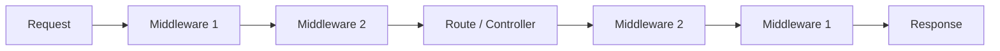
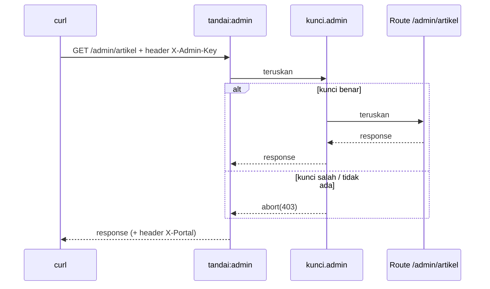

# Middleware Route

Beberapa pemeriksaan harus dilakukan untuk **banyak** halaman sekaligus: apakah pengunjung sudah login, apakah request membawa kunci yang benar, apakah aplikasi sedang dalam pemeliharaan.
Menulis pemeriksaan itu di setiap route berulang-ulang melelahkan dan mudah terlewat. **Middleware** adalah penyaring yang dipasang di jalur request, sebelum route dijalankan (atau sesudahnya).

## Tujuan Pembelajaran

Setelah menyelesaikan sub bab ini, kamu dapat:

- [ ] Menjelaskan apa itu middleware dan posisinya dalam alur request dan response.
- [ ] Membuat middleware dengan `php artisan make:middleware` dan menulis metode `handle`.
- [ ] Membedakan middleware yang bekerja sebelum dan sesudah route.
- [ ] Memasang middleware pada route, grup, dan secara global, serta memberinya alias.
- [ ] Memakai parameter middleware dan mengecualikan middleware dengan `withoutMiddleware`.
- [ ] Menjelaskan mengapa pemeriksaan akses sebaiknya "menolak secara bawaan" (*fail closed*).

## Prasyarat

- Sub bab [Grup Route](02-06-route-groups.md) dan [Prefix Route](02-07-route-prefix.md): grup `admin` pada `portal-artikel`.
- [Request Lifecycle](../level-01/01-13-request-lifecycle.md): middleware dalam alur request.
- [Environment Variables](../level-01/01-11-environment-variables.md) dan [Konfigurasi Laravel](../level-01/01-10-laravel-configuration.md).
- [Penanganan Exception](../level-00/00-21-exception-handling.md) (karena penolakan memakai `abort`).

## Pengantar

Di Request Lifecycle kamu melihat bahwa request melewati lapisan middleware sebelum mencapai route, dan response melewatinya lagi pada perjalanan pulang. Laravel sendiri memakai middleware untuk
sesi, verifikasi CSRF, dan mode pemeliharaan. Sekarang kamu membuat middleware sendiri untuk melindungi area admin pada `portal-artikel`.

!!! warning "Peringatan penting"
    Middleware yang dibuat di sub bab ini memakai **kunci rahasia sederhana** pada header sebagai bahan belajar. Itu **bukan** pengganti sistem autentikasi nyata (login, sesi, hak akses), yang dibahas di bab utama
    *Form Validation, Authentication, and Security*.

## Penjelasan Konsep

### Apa itu middleware?

Menurut dokumentasi, middleware adalah mekanisme yang nyaman untuk **memeriksa dan menyaring** request HTTP yang masuk ke aplikasi. Contohnya: middleware autentikasi memeriksa apakah pengguna sudah login; jika belum, ia mengarahkan ke halaman login, jika sudah,
request diteruskan lebih dalam.

!!! tip "Analogi"
    Petugas keamanan di pintu gedung. Ia memeriksa kartu tamu sebelum mengizinkan masuk (sebelum route), dan bisa juga memberi stempel pada tamu saat keluar (sesudah route).



Dokumentasi menyarankan membayangkannya sebagai serangkaian "lapisan" yang harus dilewati request sebelum mencapai aplikasi. Setiap lapisan dapat memeriksa request dan bahkan menolaknya sepenuhnya.

### Membuat middleware

```bash
php artisan make:middleware EnsureAdminKey
```

Perintah ini membuat kelas di `app/Http/Middleware/`. Metode intinya adalah `handle`, yang menerima `Request` dan callback `$next`:

```php-inline
public function handle(Request $request, Closure $next): Response
{
    // Periksa atau ubah request di sini...

    return $next($request);   // teruskan ke lapisan berikutnya / route
}
```

| Bagian | Arti |
|---|---|
| `$request` | Request yang masuk |
| `$next($request)` | Meneruskan request ke lapisan berikutnya; hasilnya adalah response |
| Tidak memanggil `$next` | Request berhenti di sini (misalnya dengan `redirect()` atau `abort()`) |

Semua middleware di-*resolve* lewat service container, jadi kamu boleh menaruh type-hint ketergantungan pada constructor-nya.

### Sebelum atau sesudah route

Bergantung posisi kode terhadap `$next`:

```php-inline
// Sebelum: bekerja sebelum request diproses aplikasi
public function handle(Request $request, Closure $next): Response
{
    // aksi...
    return $next($request);
}

// Sesudah: bekerja setelah request diproses aplikasi
public function handle(Request $request, Closure $next): Response
{
    $response = $next($request);
    // aksi pada $response...
    return $response;
}
```

### Memasang middleware

| Cara | Kode | Berlaku untuk |
|---|---|---|
| Pada satu route | `Route::get(...)->middleware(Kelas::class)` | Route itu saja |
| Beberapa middleware | `->middleware([A::class, B::class])` | Dijalankan sesuai urutan |
| Pada grup | `Route::middleware([...])->group(...)` | Semua route di grup |
| Global | `$middleware->append(Kelas::class)` di `bootstrap/app.php` | Setiap request HTTP |
| Alias | `$middleware->alias(['nama' => Kelas::class])` | Pemakaian lebih singkat: `->middleware('nama')` |

Pendaftaran alias dan middleware global dilakukan di `bootstrap/app.php`:

File: `bootstrap/app.php`

```php-inline
->withMiddleware(function (Middleware $middleware): void {
    $middleware->alias([
        'kunci.admin' => \App\Http\Middleware\EnsureAdminKey::class,
    ]);
})
```

Dokumentasi menyatakan beberapa middleware bawaan sudah memiliki alias, misalnya `auth`, `guest`, `can`, `throttle`, `verified`, `signed`. Karena itu `->middleware('auth')` bekerja tanpa pendaftaran
tambahan.

### Parameter middleware

Middleware dapat menerima parameter tambahan, dipisahkan dengan `:` setelah namanya, dan beberapa parameter dipisahkan koma. Parameter diteruskan setelah `$next`:

```php-inline
public function handle(Request $request, Closure $next, string $peran): Response
{
    // ...
}

// dipasang:
->middleware('peran:editor,penerbit');   // atau Kelas::class.':editor'
```

### Mengecualikan middleware

Bila sebuah grup memakai middleware tetapi satu route harus dikecualikan, gunakan `withoutMiddleware`:

```php-inline
Route::middleware([EnsureAdminKey::class])->group(function () {
    Route::get('/profil', function () {
        // ...
    })->withoutMiddleware([EnsureAdminKey::class]);
});
```

Menurut dokumentasi, `withoutMiddleware` hanya dapat membuang **middleware route** dan tidak berlaku untuk middleware global.

### Prinsip keamanan untuk middleware akses

- **Tolak secara bawaan** (*fail closed*): jika konfigurasi kunci hilang atau kosong, semua akses ditolak, bukan diizinkan.
- Bandingkan rahasia dengan **`hash_equals`**, yang waktu eksekusinya konstan sehingga tidak membocorkan informasi lewat perbedaan waktu.
- Jangan menaruh kunci di URL (tercatat di log dan riwayat); gunakan header, dan gunakan HTTPS di produksi.
- Simpan kunci di `.env` (lewat `config/`), bukan di kode, dan jangan mencatatnya di log.
- Middleware ini hanya contoh belajar; produksi memakai sistem autentikasi dan otorisasi sungguhan.

## Cara Kerja



Middleware dijalankan sesuai urutan daftar: `tandai:admin` di luar, `kunci.admin` di dalam.

## Contoh Praktik

Pada `portal-artikel` kamu membuat dua middleware: `EnsureAdminKey` (menolak request tanpa kunci yang benar, sebelum route) dan `TandaiResponse` (menambah header pada response, sesudah route, dengan parameter).
Lalu kamu memasangnya pada grup admin, menguji semua kemungkinan, dan mengecualikan satu route.

## Penjelasan Kode

File: `config/portal.php`

```php
<?php

return [
    'admin_key' => env('PORTAL_ADMIN_KEY'),
];
```

File: `.env` (tambahkan) dan `.env.example` (tambahkan placeholder tanpa nilai)

```ini
PORTAL_ADMIN_KEY=kunci-latihan-123
```

```ini
PORTAL_ADMIN_KEY=
```

(`.env` hanya untuk latihan lokal; nilai itu bukan rahasia sungguhan. `.env.example` dibiarkan kosong.)

File: `app/Http/Middleware/EnsureAdminKey.php`

```php
<?php

namespace App\Http\Middleware;

use Closure;
use Illuminate\Http\Request;
use Symfony\Component\HttpFoundation\Response;

class EnsureAdminKey
{
    public function handle(Request $request, Closure $next): Response
    {
        $dikirim = $request->header('X-Admin-Key');
        $kunci = config('portal.admin_key');

        if (! is_string($dikirim) || ! is_string($kunci) || $kunci === '' || ! hash_equals($kunci, $dikirim)) {
            abort(403, 'Akses ditolak.');
        }

        return $next($request);
    }
}
```

File: `app/Http/Middleware/TandaiResponse.php`

```php
<?php

namespace App\Http\Middleware;

use Closure;
use Illuminate\Http\Request;
use Symfony\Component\HttpFoundation\Response;

class TandaiResponse
{
    public function handle(Request $request, Closure $next, string $nilai = 'umum'): Response
    {
        $response = $next($request);

        $response->headers->set('X-Portal', $nilai);

        return $response;
    }
}
```

File: `bootstrap/app.php` (ubah blok `withMiddleware` dan tambahkan `use` di atas)

```php-inline
use App\Http\Middleware\EnsureAdminKey;
use App\Http\Middleware\TandaiResponse;

->withMiddleware(function (Middleware $middleware): void {
    $middleware->alias([
        'kunci.admin' => EnsureAdminKey::class,
        'tandai' => TandaiResponse::class,
    ]);
})
```

File: `routes/web.php` (ubah)

```php-inline
Route::get('/artikel', function () {
    return 'Daftar artikel';
})->name('artikel.index')->middleware('tandai:publik');

Route::prefix('admin')->name('admin.')->middleware(['tandai:admin', 'kunci.admin'])->group(function () {
    // ... route admin yang sudah ada ...

    Route::get('/ping', function () {
        return 'pong';
    })->name('ping')->withoutMiddleware([EnsureAdminKey::class]);
});
```

(Tambahkan `use App\Http\Middleware\EnsureAdminKey;` di bagian atas `routes/web.php`.)

| Bagian | Penjelasan |
|---|---|
| `$request->header('X-Admin-Key')` | Membaca header; `null` bila tidak ada |
| `is_string(...)`, `$kunci === ''` | Menolak bila kunci tidak dikirim atau konfigurasi kosong (*fail closed*) |
| `hash_equals($kunci, $dikirim)` | Perbandingan rahasia dengan waktu konstan |
| `abort(403, ...)` | Menghentikan dan menjawab 403 Forbidden |
| `$next($request)` | Meneruskan; pada `TandaiResponse` hasilnya ditangkap dulu agar bisa diubah |
| `$response->headers->set(...)` | Menambah header pada response (kerja sesudah route) |
| `string $nilai = 'umum'` | Parameter middleware dari `tandai:admin` atau `tandai:publik` |
| `withoutMiddleware([EnsureAdminKey::class])` | Mengecualikan satu route dari middleware grup |

## Implementasi Langkah demi Langkah

### Langkah 1: siapkan konfigurasi

Buat `config/portal.php`, tambahkan `PORTAL_ADMIN_KEY` ke `.env` dan `.env.example` sesuai Penjelasan Kode.

### Langkah 2: buat middleware

```bash
cd ~/belajar-laravel/portal-artikel
php artisan make:middleware EnsureAdminKey
php artisan make:middleware TandaiResponse
```

Isi kedua berkas dengan kode di atas.

### Langkah 3: daftarkan alias

Ubah `bootstrap/app.php` seperti pada Penjelasan Kode.

### Langkah 4: pasang pada route

Ubah `routes/web.php`: tambahkan `->middleware('tandai:publik')` pada route `/artikel`, pasang `middleware(['tandai:admin', 'kunci.admin'])` pada grup admin, dan tambahkan route `/admin/ping`
dengan `withoutMiddleware`.

```bash
php -l routes/web.php
php artisan route:list -v --path=admin
php artisan config:clear
```

Perhatikan daftar middleware di kolom setiap route admin.

### Langkah 5: jalankan dan uji

```bash
php artisan serve
```

Di terminal lain (di Windows PowerShell tulis `curl.exe`):

```bash
curl -i http://127.0.0.1:8000/artikel
curl -i http://127.0.0.1:8000/admin/artikel
curl -i -H "X-Admin-Key: salah" http://127.0.0.1:8000/admin/artikel
curl -i -H "X-Admin-Key: kunci-latihan-123" http://127.0.0.1:8000/admin/artikel
curl -i http://127.0.0.1:8000/admin/ping
```

Catat kode status dan header `X-Portal` pada tiap respons.

### Langkah 6: uji sikap "tolak secara bawaan"

Kosongkan nilai `PORTAL_ADMIN_KEY` di `.env`, lalu jalankan `php artisan config:clear` dan ulangi permintaan dengan header `X-Admin-Key: kunci-latihan-123`. Setelah itu kembalikan nilainya.

### Langkah 7: catat di Git

```bash
git status
git add app config routes bootstrap .env.example
git commit -m "Tambah middleware kunci admin dan penanda response"
```

Pastikan `.env` tidak ikut ter-commit.

## Eksekusi dan Verifikasi

| Langkah | Cara memverifikasi |
|---|---|
| 1 | `php artisan config:show portal` menampilkan `admin_key` |
| 2 | Dua berkas ada di `app/Http/Middleware/` |
| 3 | `php -l bootstrap/app.php` tanpa error |
| 4 | `route:list -v` menampilkan `tandai`/`kunci.admin` pada route admin dan tidak menampilkan `kunci.admin` pada `/admin/ping` |
| 5 | Hasil sesuai tabel hasil yang diharapkan |
| 6 | Dengan kunci kosong, semua permintaan ke area admin ditolak (403) |
| 7 | `.env` tidak terdaftar pada `git status` setelah `add` |

## Hasil yang Diharapkan

| Permintaan | Status | Catatan |
|---|---|---|
| `GET /artikel` | `200` | Header `X-Portal: publik` |
| `GET /admin/artikel` (tanpa header) | `403` | Ditolak oleh `kunci.admin` |
| `GET /admin/artikel` (kunci salah) | `403` | Ditolak |
| `GET /admin/artikel` (kunci benar) | `200` | Isi `Admin: daftar artikel`; header `X-Portal: admin` |
| `GET /admin/ping` | `200` | Isi `pong`; tidak memerlukan kunci |
| Kunci di `.env` kosong, header benar | `403` | Menolak secara bawaan |

Apakah header `X-Portal` juga muncul pada respons `403` bergantung cara Laravel memperlakukan exception di dalam pipeline middleware; catat apa yang kamu lihat. Hasil lainnya diturunkan dari dokumentasi dan perilaku
framework, dan belum dijalankan oleh penulis materi; cocokkan dengan hasilmu.

## Kesalahan Umum dan Pemecahan Masalah

| Gejala | Penyebab | Cara mengenali | Solusi | Pencegahan |
|---|---|---|---|---|
| `Target class [kunci.admin] does not exist` | Alias belum didaftarkan atau salah ejaan | Pesan menyebut alias | Periksa `bootstrap/app.php` | Daftarkan alias sebelum memakainya |
| Selalu 403 padahal kunci benar | Header salah nama, atau konfigurasi ter-cache | `config('portal.admin_key')` kosong | Periksa nama header `X-Admin-Key`, jalankan `php artisan config:clear` | Uji dengan `config:show portal` |
| Middleware tidak berjalan | Tidak terpasang pada route/grup | `route:list -v` tidak menampilkannya | Pasang dengan `->middleware(...)` | Selalu cek `route:list -v` |
| Request tak pernah mencapai route | Lupa `return $next($request)` | Halaman kosong atau tidak ada respons | Tambahkan `return $next($request);` | Periksa semua cabang `handle` |
| Perubahan response tidak terjadi | Mengubah response sebelum `$next` | Header tidak muncul | Tangkap `$response = $next($request)` lalu ubah | Pahami posisi kode terhadap `$next` |
| `withoutMiddleware` tak berpengaruh | Middleware itu global, bukan middleware route | Middleware tetap berjalan | Gunakan middleware route; global tidak bisa dikecualikan | Baca batasan `withoutMiddleware` |
| Kunci bocor ke repositori | `.env` ter-commit atau kunci di kode | `git status` memuat `.env` | Ganti kunci, keluarkan dari riwayat sesuai panduan | `git check-ignore -v .env` sebelum commit |
| Perbandingan kunci dengan `==` | Rentan serangan waktu dan kesalahan tipe | Kode memakai `==` | Gunakan `hash_equals` | Ikuti prinsip keamanan di atas |
| Mengira ini cukup sebagai autentikasi | Salah paham cakupan | Tidak ada identitas pengguna | Gunakan sistem autentikasi sungguhan | Baca peringatan di awal sub bab |

## Latihan Praktik

### Latihan dasar

**D1. Pasang pada satu route**
- *Masalah:* hanya route `/artikel/baru` yang perlu ditandai.
- *Persyaratan:* pasang `tandai:editor` pada `/artikel/baru` saja dan buktikan header `X-Portal: editor` muncul, sedangkan `/artikel` tetap `publik`.
- *Perilaku yang diharapkan:* header berbeda per route.
- *Tujuan belajar:* memasang middleware pada route tunggal dengan parameter.

**D2. Baca middleware yang terpasang**
- *Masalah:* ingin tahu middleware yang aktif.
- *Persyaratan:* jalankan `php artisan route:list -v` dan tulis middleware untuk route `/` dan `/admin/artikel`.
- *Perilaku yang diharapkan:* terlihat middleware grup `web` dan middleware yang kamu pasang.
- *Tujuan belajar:* memeriksa middleware yang melekat.

### Latihan implementasi

**I1. Middleware pencatat akses**
- *Masalah:* tim ingin catatan akses ke area admin.
- *Persyaratan:* buat middleware `CatatAkses` yang menulis ke log `masuk: METODE path` sebelum dan `keluar: status N` sesudah route (tanpa mencatat header `X-Admin-Key`), pasang pada grup admin, dan buktikan urutan
  baris log. Jelaskan mengapa kunci tidak boleh dicatat.
- *Perilaku yang diharapkan:* dua baris log per request dengan urutan benar.
- *Tujuan belajar:* middleware sebelum dan sesudah route.

**I2. Middleware berparameter untuk batas waktu**
- *Masalah:* sebagian halaman hanya boleh diakses pada jam kerja.
- *Persyaratan:* buat middleware `HanyaJam` dengan parameter `mulai` dan `selesai` (mis. `hanya.jam:8,17`) yang menolak (403) di luar rentang berdasarkan jam sekarang. Uji dengan rentang yang mencakup dan
  tidak mencakup jam saat ini.
- *Perilaku yang diharapkan:* rentang yang mencakup waktu sekarang diizinkan, yang tidak mencakup ditolak.
- *Tujuan belajar:* parameter middleware.

### Latihan tantangan

**T1. Audit perlindungan area admin**
- *Masalah:* sebelum rilis, pastikan semua route admin terlindungi.
- *Persyaratan:* tulis skrip Bash yang memakai `php artisan route:list --json --path=admin` untuk memeriksa bahwa setiap route admin (kecuali daftar pengecualian yang kamu tentukan, mis. `/admin/ping`) memuat
  `kunci.admin`, lalu menguji ke server yang berjalan bahwa tanpa header semua route non-pengecualian menjawab 403. Jelaskan batas pendekatan ini dibanding autentikasi sungguhan.
- *Perilaku yang diharapkan:* skrip melaporkan route yang tidak terlindungi.
- *Tujuan belajar:* memverifikasi perlindungan secara otomatis.
- *Catatan:* kerjakan mandiri; tidak ada kunci jawaban.

## Uji Pemahaman

1. Apa fungsi middleware?
2. Apa yang terjadi jika `handle` tidak memanggil `$next($request)`?
3. Bagaimana middleware bekerja sebelum dan sesudah route?
4. Bagaimana memasang middleware pada satu route, pada grup, dan secara global?
5. Apa fungsi alias middleware dan di mana didaftarkan?
6. Bagaimana mengirim parameter ke middleware?
7. Mengapa `hash_equals` lebih baik daripada `==` untuk membandingkan kunci?
8. Mengapa middleware kunci sederhana ini bukan pengganti autentikasi?

??? success "Kunci jawaban singkat"
    1. Memeriksa dan menyaring request (dan response) yang melewati aplikasi.
    2. Request berhenti di middleware itu; route tidak dijalankan.
    3. Kode sebelum `$next` bekerja sebelum route; kode setelah `$next` (pada `$response`) bekerja sesudahnya.
    4. `->middleware(...)` pada route; `Route::middleware([...])->group(...)` untuk grup; `$middleware->append(...)` di `bootstrap/app.php` untuk global.
    5. Nama pendek untuk middleware; didaftarkan dengan `$middleware->alias([...])` di `bootstrap/app.php`.
    6. Dengan `:` setelah nama (`tandai:admin`), dipisah koma untuk beberapa parameter; diterima setelah `$next`.
    7. `hash_equals` berwaktu konstan dan aman dari kebocoran lewat perbedaan waktu.
    8. Tidak ada identitas pengguna, sesi, atau hak akses; hanya satu kunci bersama.

## Ringkasan

- Middleware menyaring request dan response; dibuat dengan `make:middleware` dan ditulis di metode `handle`.
- Kode sebelum `$next` bekerja sebelum route, kode sesudahnya bekerja sesudah route; tidak memanggil `$next` berarti menghentikan request.
- Pasang pada route, grup, atau global; beri alias di `bootstrap/app.php`; kirim parameter dengan `:`; kecualikan dengan `withoutMiddleware` (hanya middleware route).
- Rancang pemeriksaan akses yang menolak secara bawaan, bandingkan rahasia dengan `hash_equals`, dan simpan rahasia di `.env`.
- Middleware kunci sederhana hanya latihan; autentikasi sungguhan dibahas di bab utama keamanan.

Selanjutnya: *Batasan Route*, yaitu membatasi format parameter route.

## Referensi Resmi

- [Laravel: Middleware](https://laravel.com/docs/13.x/middleware)
- [Laravel: Defining Middleware](https://laravel.com/docs/13.x/middleware#defining-middleware)
- [Laravel: Registering Middleware](https://laravel.com/docs/13.x/middleware#registering-middleware)
- [Laravel: Middleware Aliases](https://laravel.com/docs/13.x/middleware#middleware-aliases)
- [Laravel: Middleware Parameters](https://laravel.com/docs/13.x/middleware#middleware-parameters)
- [Laravel: Excluding Middleware](https://laravel.com/docs/13.x/middleware#excluding-middleware)
- [PHP Manual: hash_equals](https://www.php.net/manual/en/function.hash-equals.php)
