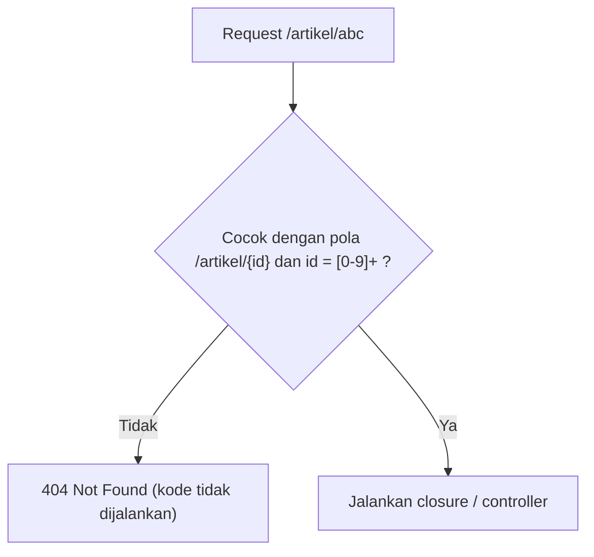

# Batasan Route

Di sub bab *Parameter Route*, URL `/artikel/abc` diterima oleh route `/artikel/{id}` dan menampilkan "Detail artikel #abc", padahal ID artikel seharusnya angka. Parameter route menerima hampir
teks apa pun. **Batasan route** (*route constraints*) memungkinkan kamu menetapkan format yang sah untuk sebuah parameter, sehingga URL yang tidak sesuai langsung ditolak dengan `404` tanpa menjalankan kodemu.

## Tujuan Pembelajaran

Setelah menyelesaikan sub bab ini, kamu dapat:

- [ ] Membatasi parameter dengan `where()` dan ekspresi reguler.
- [ ] Memakai metode bantu: `whereNumber`, `whereAlpha`, `whereAlphaNumeric`, `whereUuid`, `whereUlid`, dan `whereIn`.
- [ ] Menggabungkan beberapa batasan dalam satu pemanggilan.
- [ ] Menetapkan batasan global dengan `Route::pattern` di `AppServiceProvider`.
- [ ] Mengizinkan garis miring dalam parameter dengan aman.
- [ ] Menjelaskan perbedaan batasan route dan validasi, serta batas keamanannya.

## Prasyarat

- Sub bab [Parameter Route](02-03-route-parameters.md) dan [Parameter Route Opsional](02-04-optional-route-parameters.md).
- Sub bab [Grup Route](02-06-route-groups.md) dan proyek `~/belajar-laravel/portal-artikel`.
- Pengetahuan dasar ekspresi reguler (*regular expression*): `[0-9]`, `+`, `{4}`. Penjelasan singkat ada di bagian konsep.

## Pengantar

Bayangkan kode berikut:

```php-inline
Route::get('/artikel/{id}', function (string $id) {
    return 'Detail artikel #' . $id;
});
```

Tanpa batasan, `id` bisa `abc`, `1; DROP TABLE`, atau teks sangat panjang. Kamu harus memeriksanya di dalam closure setiap kali. Dengan batasan, pemeriksaan dilakukan oleh router **sebelum**
kodemu dijalankan: URL yang tidak cocok langsung menghasilkan `404`.

## Penjelasan Konsep

### Dasar `where`

Menurut dokumentasi, batasan format parameter dipasang dengan metode `where` pada route, menerima nama parameter dan ekspresi reguler yang membatasinya:

```php-inline
Route::get('/user/{name}', function (string $name) {
    // ...
})->where('name', '[A-Za-z]+');

Route::get('/user/{id}', function (string $id) {
    // ...
})->where('id', '[0-9]+');

Route::get('/user/{id}/{name}', function (string $id, string $name) {
    // ...
})->where(['id' => '[0-9]+', 'name' => '[a-z]+']);
```

Bentuk ketiga menerima array sehingga beberapa parameter dibatasi sekaligus. Jika request tidak cocok dengan batasan, Laravel menjawab `404`.

!!! tip "Analogi"
    Seperti **lubang bentuk pada mainan balok**: balok bundar hanya masuk lubang bundar. Parameter yang formatnya salah tidak "masuk" ke route sama sekali.

### Ekspresi reguler dasar

| Pola | Arti | Cocok dengan |
|---|---|---|
| `[0-9]+` | Satu atau lebih angka | `7`, `2026` |
| `[0-9]{4}` | Tepat empat angka | `2026` |
| `[A-Za-z]+` | Satu atau lebih huruf | `Budi` |
| `[a-z-]+` | Huruf kecil dan tanda hubung | `budi-santoso` |
| `[a-z0-9-]+` | Huruf kecil, angka, tanda hubung (pola *slug*) | `belajar-laravel-2026` |
| `.*` | Karakter apa pun, termasuk `/` | `a/b/c` |

Ekspresi reguler dibahas penuh di dokumentasi PHP; di sini cukup pola di atas. Laravel mengikat pola pada seluruh nilai parameter (cocok penuh, bukan sebagian).

### Metode bantu

Untuk pola yang sering dipakai, dokumentasi menyediakan metode siap pakai:

| Metode | Membatasi parameter menjadi | Contoh nilai sah |
|---|---|---|
| `whereNumber('id')` | Angka | `12` |
| `whereAlpha('nama')` | Huruf alfabet | `budi` |
| `whereAlphaNumeric('kode')` | Huruf dan angka | `ab12` |
| `whereUuid('uuid')` | UUID | `123e4567-e89b-12d3-a456-426614174000` |
| `whereUlid('ulid')` | ULID | (identifikasi berurutan 26 karakter) |
| `whereIn('kategori', [...])` | Salah satu dari daftar nilai | `teknologi` |

Metode-metode itu bisa dirangkai: `->whereNumber('id')->whereAlpha('name')`. `whereIn` juga menerima array hasil `Enum::cases()` pada PHP 8.1+.

### Batasan global dengan `Route::pattern`

Bila sebuah parameter selalu memakai batasan yang sama di seluruh aplikasi, tetapkan sekali di `AppServiceProvider::boot()`:

File: `app/Providers/AppServiceProvider.php`

```php-inline
use Illuminate\Support\Facades\Route;

public function boot(): void
{
    Route::pattern('id', '[0-9]+');
}
```

Setelah ditetapkan, pola otomatis berlaku untuk semua route yang memakai parameter bernama `id`. Dokumentasi memberi contoh `/user/{id}`: closure hanya dijalankan bila `{id}` berupa angka.

### Mengizinkan garis miring

Dokumentasi menjelaskan bahwa komponen routing mengizinkan semua karakter pada nilai parameter **kecuali `/`**. Untuk mengizinkan `/`, gunakan `where` dengan ekspresi reguler yang cocok:

```php-inline
Route::get('/search/{search}', function (string $search) {
    return $search;
})->where('search', '.*');
```

Dokumentasi memberi peringatan: garis miring yang di-*encode* hanya didukung pada **segmen terakhir** route.

### Batasan route bukan validasi lengkap

| | Batasan route | Validasi |
|---|---|---|
| Tempat | Router, sebelum kode jalan | Di dalam kode (dibahas di bab utama Keamanan) |
| Respons bila gagal | `404 Not Found` | Pesan kesalahan untuk pengguna (mis. `422`) |
| Cocok untuk | Format dasar parameter di URL | Aturan bisnis (rentang, keberadaan data, kepemilikan) |

Contoh: `whereNumber('id')` memastikan `id` angka, tetapi tidak memastikan artikel dengan ID itu **ada** atau **boleh dibaca** pengguna. Itu tetap harus diperiksa (misalnya lewat
route model binding di sub bab berikutnya).

### Keamanan

- Batasan adalah pertahanan lapis pertama: ia menolak masukan aneh lebih awal, tetapi bukan pengganti validasi dan otorisasi.
- Hindari pola rumit dengan pengulangan bersarang (`(a+)+`): berisiko memicu *ReDoS* (ekspresi reguler yang memakan waktu sangat lama pada masukan jahat). Gunakan pola sederhana atau metode bantu.
- Jangan memakai `.*` lalu meneruskan nilainya mentah ke jalur berkas atau perintah; itu membuka celah *path traversal* (`../`). Bersihkan dan validasi dulu.
- `404` pada format salah tidak membocorkan alasan penolakan, yang justru baik untuk keamanan.

## Cara Kerja



Saat mencocokkan, router mengubah pola URI dan batasan menjadi ekspresi reguler; hanya request yang lolos pencocokan yang sampai ke aksi route.

## Contoh Praktik

Pada `portal-artikel` kamu memasang batasan pada route yang sudah ada, membandingkan perilaku sebelum dan sesudah, mencoba `whereIn` dan `whereUuid`, menetapkan satu batasan global, dan mengizinkan garis miring
pada route pencarian.

## Penjelasan Kode

File: `routes/web.php` (ubah route yang ada dengan menambah batasan, dan tambahkan route baru)

```php-inline
Route::get('/artikel/{id}', function (string $id) {
    return 'Detail artikel #' . $id;
})->name('artikel.show')->whereNumber('id');

Route::get('/penulis/{nama}/artikel/{id}', function (string $nama, string $id) {
    return "Artikel #{$id} oleh " . e($nama);
})->where(['nama' => '[a-z-]+', 'id' => '[0-9]+']);

Route::get('/arsip/{tahun?}/{bulan?}', function (?string $tahun = null, ?string $bulan = null) {
    if ($tahun === null) {
        return 'Arsip semua';
    }

    if ($bulan === null) {
        return 'Arsip tahun ' . $tahun;
    }

    return 'Arsip ' . $tahun . '-' . $bulan;
})->where('tahun', '[0-9]{4}')->whereIn('bulan', array_map(
    fn (int $b) => sprintf('%02d', $b),
    range(1, 12)
));

Route::get('/kategori/{kategori}', function (string $kategori) {
    return 'Kategori ' . $kategori;
})->whereIn('kategori', ['teknologi', 'olahraga', 'budaya']);

Route::get('/dokumen/{uuid}', function (string $uuid) {
    return 'Dokumen ' . $uuid;
})->whereUuid('uuid');

Route::get('/cari/{kata}', function (string $kata) {
    return 'Cari: ' . e($kata);
})->where('kata', '.*');
```

| Route | Batasan | Efek |
|---|---|---|
| `/artikel/{id}` | `whereNumber('id')` | `abc` ditolak (404) |
| `/penulis/{nama}/artikel/{id}` | `nama` = `[a-z-]+`, `id` = `[0-9]+` | Nama hanya huruf kecil dan tanda hubung |
| `/arsip/{tahun?}/{bulan?}` | `tahun` empat angka, `bulan` salah satu dari `01` sampai `12` | `13` ditolak |
| `/kategori/{kategori}` | `whereIn(...)` | Hanya tiga kategori |
| `/dokumen/{uuid}` | `whereUuid` | Hanya UUID sah |
| `/cari/{kata}` | `.*` | Boleh memuat `/` |

Nilai bulan dibuat dengan `range(1, 12)` dan `sprintf('%02d', ...)` (menjadi `01` sampai `12`), memakai fungsi `array_map` dan `sprintf` dari bab utama pertama.

## Implementasi Langkah demi Langkah

### Langkah 1: catat perilaku sebelum batasan

Dengan server berjalan (`php artisan serve`), di terminal lain (di Windows PowerShell tulis `curl.exe`):

```bash
cd ~/belajar-laravel/portal-artikel
curl -i http://127.0.0.1:8000/artikel/abc
curl -i http://127.0.0.1:8000/arsip/2026/13
```

Catat statusnya (sebelum batasan, keduanya biasanya `200`).

### Langkah 2: pasang batasan

Ubah route sesuai Penjelasan Kode (tambahkan rantai `->whereNumber('id')` dan seterusnya, serta route baru), lalu:

```bash
php -l routes/web.php
php artisan route:list --path=artikel
php artisan route:list --path=arsip
```

Pada `route:list` di versi tertentu batasan tidak ditampilkan; yang penting URI dan nama tetap benar.

### Langkah 3: uji URL yang sah dan tidak sah

```bash
curl -i http://127.0.0.1:8000/artikel/12
curl -i http://127.0.0.1:8000/artikel/abc
curl -i http://127.0.0.1:8000/artikel/baru
curl -i http://127.0.0.1:8000/penulis/budi-santoso/artikel/5
curl -i http://127.0.0.1:8000/penulis/Budi/artikel/5
curl -i http://127.0.0.1:8000/arsip
curl -i http://127.0.0.1:8000/arsip/2026/11
curl -i http://127.0.0.1:8000/arsip/2026/13
curl -i http://127.0.0.1:8000/arsip/26
curl -i http://127.0.0.1:8000/kategori/teknologi
curl -i http://127.0.0.1:8000/kategori/fashion
curl -i http://127.0.0.1:8000/dokumen/123e4567-e89b-12d3-a456-426614174000
curl -i http://127.0.0.1:8000/dokumen/bukan-uuid
curl -i http://127.0.0.1:8000/cari/laravel/routing
```

### Langkah 4: tetapkan batasan global

Tambahkan di `AppServiceProvider::boot()` (dengan `use Illuminate\Support\Facades\Route;`):

```php-inline
Route::pattern('id', '[0-9]+');
```

Hapus sementara `->whereNumber('id')` dari route `/artikel/{id}`, lalu uji ulang:

```bash
curl -i http://127.0.0.1:8000/artikel/12
curl -i http://127.0.0.1:8000/artikel/abc
```

Perhatikan bahwa `abc` tetap ditolak karena batasan global. Setelah selesai, hapus `Route::pattern(...)` dan kembalikan `->whereNumber('id')` agar batasan terlihat jelas pada route.

### Langkah 5: pahami batas batasan

Uji `curl -i http://127.0.0.1:8000/artikel/999999`. Route menerima karena formatnya angka, padahal artikelnya tidak ada. Tulis satu kalimat tentang cara menangani ini (dibahas di *Route Model Binding*).

### Langkah 6: catat di Git

```bash
git add routes/web.php app/Providers/AppServiceProvider.php
git commit -m "Tambah batasan format pada route"
```

## Eksekusi dan Verifikasi

| Langkah | Cara memverifikasi |
|---|---|
| 1 | Dua permintaan sebelum batasan biasanya `200` |
| 2 | `php -l` tidak menunjukkan kesalahan sintaks |
| 3 | Hasil sesuai tabel hasil yang diharapkan |
| 4 | `abc` tetap `404` walau `whereNumber` dilepas, berkat `Route::pattern` |
| 5 | `/artikel/999999` berstatus `200` meski datanya tidak ada |
| 6 | `git log --oneline` memuat commit baru |

## Hasil yang Diharapkan

| Permintaan | Status | Catatan |
|---|---|---|
| `GET /artikel/12` | `200` | `Detail artikel #12` |
| `GET /artikel/abc` | `404` | Format salah ditolak |
| `GET /artikel/baru` | `200` | Route statis `/artikel/baru` ditulis lebih dulu |
| `GET /penulis/budi-santoso/artikel/5` | `200` | Memenuhi `[a-z-]+` |
| `GET /penulis/Budi/artikel/5` | `404` | Huruf kapital tidak sesuai pola |
| `GET /arsip` | `200` | `Arsip semua` |
| `GET /arsip/2026/11` | `200` | `Arsip 2026-11` |
| `GET /arsip/2026/13` | `404` | Bulan di luar `01`-`12` |
| `GET /arsip/26` | `404` | Tahun bukan empat angka |
| `GET /kategori/teknologi` | `200` | Termasuk daftar |
| `GET /kategori/fashion` | `404` | Tidak ada di daftar |
| `GET /dokumen/123e4567-e89b-12d3-a456-426614174000` | `200` | UUID sah |
| `GET /dokumen/bukan-uuid` | `404` | Bukan UUID |
| `GET /cari/laravel/routing` | `200` | `Cari: laravel/routing` |
| `GET /artikel/999999` | `200` | Format sah, data tidak diperiksa |

Hasil ini diturunkan dari dokumentasi dan perilaku framework, dan belum dijalankan oleh penulis materi; cocokkan dengan hasilmu. Perhatikan bahwa kegagalan batasan selalu `404`, bukan pesan validasi.

## Kesalahan Umum dan Pemecahan Masalah

| Gejala | Penyebab | Cara mengenali | Solusi | Pencegahan |
|---|---|---|---|---|
| Semua URL menjadi 404 | Pola terlalu ketat atau salah | Bahkan nilai yang diharapkan sah ditolak | Uji pola; longgarkan | Uji dengan nilai sah dan tidak sah |
| Batasan tidak berlaku | Nama parameter di `where` berbeda dari di URI | Nilai aneh tetap diterima | Samakan nama (`{id}` dan `'id'`) | Salin nama dari URI |
| `/artikel/baru` ditangkap `{id}` | Route dinamis ditulis lebih dulu (dan tanpa batasan) | Isi respons "Detail artikel #baru" | Tulis route statis dulu, atau pasang `whereNumber` | Batasan angka juga mengurangi bentrok |
| Bulan `1` ditolak padahal valid | Daftar `whereIn` memakai `01` dua digit | `/arsip/2026/1` menghasilkan 404 | Samakan format (selalu dua digit) atau terima keduanya | Tentukan format URL sejak awal |
| `.*` menangkap terlalu banyak | Pola mencakup `/` | Route tumpang tindih | Batasi pola seperlunya | Gunakan `.*` hanya pada segmen terakhir |
| Perilaku `%2F` tidak sesuai | Server atau lapisan di depannya mendekode garis miring | Path terbelah | Uji dengan garis miring literal; ingat batasan segmen terakhir | Hindari mengandalkan `%2F` |
| Pola rumit lambat | Ekspresi reguler dengan pengulangan bersarang | Respons sangat lambat pada masukan tertentu | Sederhanakan pola | Gunakan metode bantu |
| Menganggap batasan sebagai validasi penuh | Tidak ada pemeriksaan data | `/artikel/999999` berstatus 200 | Periksa keberadaan dan hak akses di kode | Gunakan route model binding dan otorisasi |
| `Route::pattern` memengaruhi route lain tak terduga | Pola global berlaku untuk semua parameter bernama sama | Route lain dengan `{id}` jadi 404 | Ganti nama parameter atau pakai batasan lokal | Dokumentasikan pola global |

## Latihan Praktik

### Latihan dasar

**D1. ID berupa angka**
- *Masalah:* detail penulis harus menerima ID angka saja.
- *Persyaratan:* buat `/penulis-id/{id}` dengan `whereNumber('id')`; uji `5` dan `lima`.
- *Perilaku yang diharapkan:* `5` berstatus 200 dan `lima` 404.
- *Tujuan belajar:* memakai `whereNumber`.

**D2. Slug artikel**
- *Masalah:* artikel diakses lewat slug.
- *Persyaratan:* buat `/baca/{slug}` yang hanya menerima huruf kecil, angka, dan tanda hubung (`[a-z0-9-]+`); uji `belajar-laravel-2026` dan `Belajar_Laravel`.
- *Perilaku yang diharapkan:* contoh pertama 200, kedua 404.
- *Tujuan belajar:* menulis ekspresi reguler sederhana.

### Latihan implementasi

**I1. Arsip yang ketat**
- *Masalah:* arsip hanya menerima tahun 2000 sampai 2099.
- *Persyaratan:* batasi `tahun` dengan pola `20[0-9]{2}` dan `bulan` dengan `whereIn`; buat tabel pengujian `curl` untuk `1999`, `2000`, `2099`, `2100`, `abcd`, serta bulan `00`, `01`, `12`, `13`.
- *Perilaku yang diharapkan:* hanya kombinasi sah yang berstatus 200.
- *Tujuan belajar:* menggabungkan beberapa batasan.

**I2. Batasan global dan bentrok**
- *Masalah:* ingin `{id}` selalu angka di seluruh aplikasi.
- *Persyaratan:* tetapkan `Route::pattern('id', '[0-9]+')`, lalu cari satu route yang memakai parameter `id` untuk tujuan lain (mis. ID berupa kode huruf), tunjukkan bahwa ia ikut terbatasi, dan putuskan
  perbaikannya (ganti nama parameter atau batasan lokal). Jelaskan keputusanmu.
- *Perilaku yang diharapkan:* tidak ada route yang terkena batasan secara tak sengaja.
- *Tujuan belajar:* memahami cakupan batasan global.

### Latihan tantangan

**T1. Kebijakan URL aman**
- *Masalah:* portal akan mempublikasikan URL untuk artikel, penulis, kategori, dan dokumen.
- *Persyaratan:* tulis tabel kebijakan format untuk tiap parameter publik (pola, contoh sah, contoh tidak sah, alasan), terapkan ke seluruh `routes/web.php`, dan buat skrip `curl` yang menguji semua contoh sah dan
  tidak sah serta melaporkan yang menyimpang dari harapan. Jelaskan di mana validasi atau otorisasi tambahan masih diperlukan.
- *Perilaku yang diharapkan:* skrip melaporkan nol penyimpangan.
- *Tujuan belajar:* menetapkan dan menegakkan kebijakan format URL.
- *Catatan:* kerjakan mandiri; tidak ada kunci jawaban.

## Uji Pemahaman

1. Apa fungsi `where` pada route?
2. Apa yang terjadi bila request tidak memenuhi batasan?
3. Sebutkan empat metode bantu batasan.
4. Bagaimana membuat satu batasan berlaku untuk seluruh aplikasi, dan di mana menuliskannya?
5. Bagaimana mengizinkan garis miring pada parameter, dan apa batasannya?
6. Mengapa batasan route bukan pengganti validasi?
7. Mengapa pola ekspresi reguler yang rumit berisiko?
8. Mengapa `.*` yang diteruskan ke jalur berkas berbahaya?

??? success "Kunci jawaban singkat"
    1. Membatasi format nilai parameter dengan ekspresi reguler.
    2. Laravel menjawab `404`; kode route tidak dijalankan.
    3. Contoh: `whereNumber`, `whereAlpha`, `whereAlphaNumeric`, `whereUuid`, `whereUlid`, `whereIn`.
    4. `Route::pattern('id', '[0-9]+')` di `AppServiceProvider::boot()`.
    5. Gunakan `->where('nama', '.*')`; garis miring ter-encode hanya didukung pada segmen terakhir.
    6. Ia hanya memeriksa format; keberadaan data, aturan bisnis, dan hak akses tetap harus diperiksa.
    7. Dapat memicu ReDoS (waktu eksekusi sangat lama pada masukan tertentu).
    8. Membuka path traversal (`../`) ke berkas di luar folder yang dimaksud.

## Ringkasan

- `where`, `whereNumber`, `whereAlpha`, `whereAlphaNumeric`, `whereUuid`, `whereUlid`, dan `whereIn` membatasi format parameter route.
- Request yang tidak cocok dengan batasan menghasilkan `404` tanpa menjalankan kodemu.
- `Route::pattern` di `AppServiceProvider::boot()` menetapkan batasan global untuk parameter bernama tertentu.
- `where('x', '.*')` mengizinkan garis miring (hanya ini yang diizinkan pada segmen terakhir).
- Batasan adalah pertahanan lapis pertama, bukan validasi atau otorisasi; hindari pola rumit dan jangan meneruskan `.*` mentah ke sistem berkas.

Selanjutnya: *Route Model Binding*, yaitu mengubah parameter route langsung menjadi model.

## Referensi Resmi

- [Laravel: Regular Expression Constraints](https://laravel.com/docs/13.x/routing#parameters-regular-expression-constraints)
- [Laravel: Global Constraints](https://laravel.com/docs/13.x/routing#parameters-global-constraints)
- [Laravel: Encoded Forward Slashes](https://laravel.com/docs/13.x/routing#parameters-encoded-forward-slashes)
- [Laravel: Route Parameters](https://laravel.com/docs/13.x/routing#route-parameters)
- [PHP Manual: Regular Expressions (PCRE)](https://www.php.net/manual/en/book.pcre.php)
- [OWASP: Regular expression Denial of Service (ReDoS)](https://owasp.org/www-community/attacks/Regular_expression_Denial_of_Service_-_ReDoS)
- [OWASP: Path Traversal](https://owasp.org/www-community/attacks/Path_Traversal)
