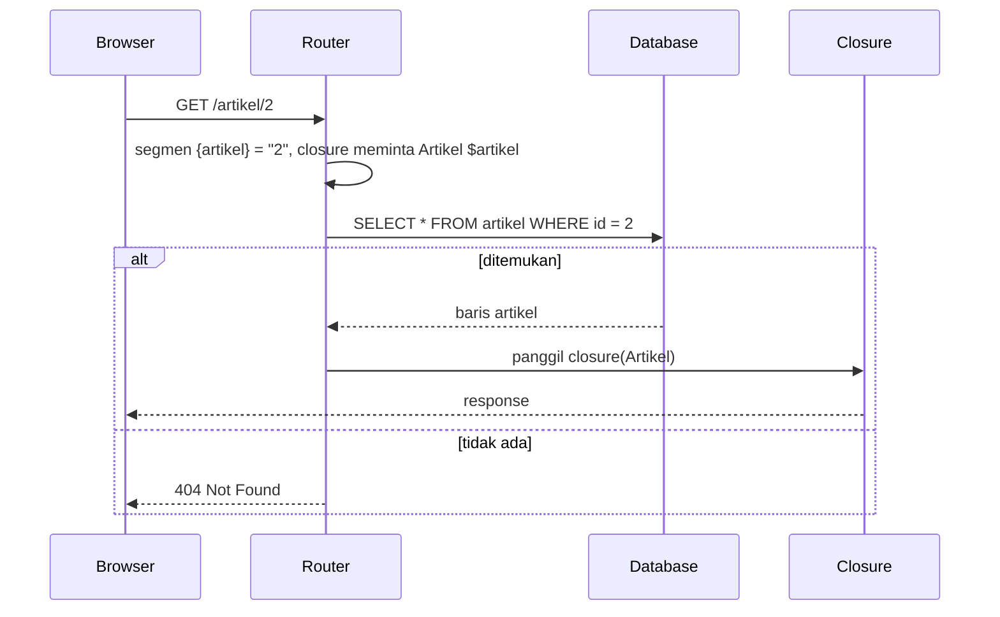

# Route Model Binding

Route `/artikel/{id}` memberi kamu ID sebagai teks. Hampir selalu langkah berikutnya sama: mengambil artikel dari database dengan ID itu, lalu menjawab 404 bila tidak ada. Mengulangi dua langkah ini di setiap route itu melelahkan.
**Route model binding** membuat Laravel mengerjakannya otomatis: kamu menulis `function (Artikel $artikel)` dan menerima objek artikel yang sudah diambil dari database.

## Tujuan Pembelajaran

Setelah menyelesaikan sub bab ini, kamu dapat:

- [ ] Menjelaskan apa itu route model binding dan masalah yang diselesaikannya.
- [ ] Menerapkan *implicit binding* dengan type-hint model dan nama parameter yang sama dengan segmen route.
- [ ] Memakai kunci selain `id` (misalnya `{artikel:slug}`) dan atribut `#[RouteKey]`.
- [ ] Menyesuaikan perilaku saat model tidak ditemukan dengan `missing()`.
- [ ] Menjelaskan implicit enum binding, explicit binding, dan scoped binding secara garis besar.
- [ ] Menjelaskan risiko keamanan binding (akses langsung ke objek) dan peran otorisasi.

## Prasyarat

- Sub bab [Batasan Route](02-09-route-constraints.md) dan [Parameter Route](02-03-route-parameters.md).
- Proyek `~/belajar-laravel/portal-artikel` dengan database SQLite bawaan dan `php artisan migrate` pernah dijalankan.
- Pengantar [Arsitektur MVC](../level-01/01-03-mvc-architecture.md) (peran model). **Eloquent dan database dibahas penuh di bab utama
  *Database dan Eloquent ORM***; di sini kamu cukup menyalin kode model, migration, dan seeder yang disediakan.

## Pengantar

Tanpa binding:

```php-inline
Route::get('/artikel/{id}', function (string $id) {
    $artikel = Artikel::find($id);

    abort_if($artikel === null, 404);

    return $artikel->judul;
});
```

Dengan binding:

```php-inline
Route::get('/artikel/{artikel}', function (Artikel $artikel) {
    return $artikel->judul;
});
```

Dua baris pengambilan data dan pemeriksaan 404 hilang karena Laravel mengerjakannya sebelum closure dijalankan.

## Penjelasan Konsep

### Apa itu model?

**Model** adalah class PHP yang mewakili satu tabel database; satu objek model mewakili satu baris. Di Laravel, model berasal dari **Eloquent ORM**. Untuk sub bab ini kita memerlukan satu model sederhana, `Artikel`, yang
mewakili tabel `artikel` (kolom `id`, `judul`, `slug`, `isi`).

!!! note "Hanya yang dibutuhkan"
    Kita memakai model hanya sebagai sumber objek untuk binding. Cara membuat, mengubah, dan menyaring data dengan Eloquent dibahas di bab utama *Database dan Eloquent ORM*.

### Implicit binding

Menurut dokumentasi, Laravel otomatis me-*resolve* model Eloquent yang didefinisikan di route atau aksi controller **bila nama variabel yang di-type-hint cocok dengan nama segmen route**:

```php-inline
use App\Models\User;

Route::get('/users/{user}', function (User $user) {
    return $user->email;
});
```

Karena `$user` di-type-hint sebagai model `User` dan namanya sama dengan segmen `{user}`, Laravel menyuntikkan objek `User` yang `id`-nya sama dengan nilai di URL. Jika tidak ditemukan,
Laravel **otomatis menjawab 404**.

!!! tip "Analogi"
    Seperti pelayan yang kamu beri nomor meja: ia kembali bukan dengan nomor, melainkan langsung membawa pesananmu. Bila nomor meja tidak ada, ia langsung berkata "tidak ditemukan".

Syaratnya: **nama variabel = nama segmen**. `{artikel}` dengan `Artikel $artikel` berpasangan; `{id}` dengan `Artikel $artikel` tidak.

### Memakai kunci selain `id`

Secara bawaan binding mencari lewat kolom `id`. Untuk kolom lain, tulis kolomnya di definisi parameter:

```php-inline
use App\Models\Post;

Route::get('/posts/{post:slug}', function (Post $post) {
    return $post;
});
```

Bila ingin model *selalu* di-bind lewat kolom tertentu, dokumentasi 13.x menyediakan atribut `RouteKey` pada model:

```php-inline
use Illuminate\Database\Eloquent\Attributes\RouteKey;
use Illuminate\Database\Eloquent\Model;

#[RouteKey('slug')]
class Post extends Model
{
    // ...
}
```

### Perilaku saat model tidak ditemukan

Secara bawaan, model yang tidak ditemukan menghasilkan 404. Dokumentasi menyediakan metode `missing()` untuk mengganti perilaku itu, misalnya dengan pengalihan:

```php-inline
Route::get('/locations/{location:slug}', [LocationsController::class, 'show'])
    ->name('locations.view')
    ->missing(function (Request $request) {
        return Redirect::route('locations.index');
    });
```

### Soft delete, enum, scoped, dan explicit binding (gambaran)

| Fitur | Penjelasan singkat | Dibahas lebih lanjut |
|---|---|---|
| **Soft deleted** | Model yang di-*soft delete* tidak diambil secara bawaan; tambahkan `->withTrashed()` untuk menyertakannya | Bab utama Database dan Eloquent ORM |
| **Implicit enum binding** | Type-hint *enum* string; route hanya dijalankan bila segmen cocok dengan nilai enum, selain itu 404 | Dokumentasi resmi |
| **Scoped binding** | Pada `/users/{user}/posts/{post:slug}`, model kedua dibatasi sebagai anak model pertama; bisa dipaksa dengan `scopeBindings()` | Bab utama Eloquent (relasi) |
| **Explicit binding** | `Route::model('user', User::class)` di `AppServiceProvider::boot()`, atau `Route::bind(...)` untuk logika sendiri | Dokumentasi resmi |

### Hubungan dengan batasan route

Batasan (sub bab sebelumnya) dan binding saling melengkapi:

| | Batasan | Binding |
|---|---|---|
| Memeriksa | Format teks di URL | Keberadaan data di database |
| Gagal berarti | 404 sebelum kode jalan | 404 setelah database dicek |

Menambahkan `->whereNumber('artikel')` mengurangi kueri database yang sia-sia untuk ID yang jelas tidak valid.

### Keamanan: binding bukan otorisasi

!!! danger "Binding tidak memeriksa hak akses"
    Binding hanya menjawab "apakah ada artikel dengan ID ini?", bukan "apakah pengguna ini boleh melihat atau mengubahnya?". Jika ID berurutan (`1`, `2`, `3`) dan tidak ada pemeriksaan hak akses,
    siapa pun dapat membuka data orang lain hanya dengan mengubah angka di URL. Kerentanan ini disebut *IDOR* (*Insecure Direct Object Reference*). Perbaikannya adalah **otorisasi** (policy dan gate),
    dibahas di bab utama keamanan. Untuk data yang tak perlu tebak-tebakan, pertimbangkan slug atau UUID sebagai kunci URL.

## Cara Kerja



Router membaca type-hint closure, mencari model yang cocok lewat kunci, lalu memanggil closure dengan objek model; bila tidak ada, ia berhenti dengan 404 sebelum kodemu dijalankan.

## Contoh Praktik

Di `portal-artikel` kamu menyiapkan tabel `artikel` (migration), model `Artikel`, dan seeder berisi tiga artikel. Lalu kamu mengubah route detail agar memakai binding, mencoba kunci `slug`, mengatur `missing()`,
dan membandingkan dengan cara manual.

## Penjelasan Kode

File: `database/migrations/xxxx_xx_xx_xxxxxx_create_artikel_table.php`

```php
<?php

use Illuminate\Database\Migrations\Migration;
use Illuminate\Database\Schema\Blueprint;
use Illuminate\Support\Facades\Schema;

return new class extends Migration
{
    public function up(): void
    {
        Schema::create('artikel', function (Blueprint $table) {
            $table->id();
            $table->string('judul');
            $table->string('slug')->unique();
            $table->text('isi');
            $table->timestamps();
        });
    }

    public function down(): void
    {
        Schema::dropIfExists('artikel');
    }
};
```

File: `app/Models/Artikel.php`

```php
<?php

namespace App\Models;

use Illuminate\Database\Eloquent\Attributes\Table;
use Illuminate\Database\Eloquent\Model;

#[Table('artikel')]
class Artikel extends Model
{
}
```

File: `database/seeders/ArtikelSeeder.php`

```php
<?php

namespace Database\Seeders;

use Illuminate\Database\Seeder;
use Illuminate\Support\Facades\DB;

class ArtikelSeeder extends Seeder
{
    public function run(): void
    {
        $sekarang = now();

        DB::table('artikel')->insert([
            [
                'judul' => 'Belajar Routing Laravel',
                'slug' => 'belajar-routing-laravel',
                'isi' => 'Routing memetakan URL ke kode.',
                'created_at' => $sekarang,
                'updated_at' => $sekarang,
            ],
            [
                'judul' => 'Memahami Middleware',
                'slug' => 'memahami-middleware',
                'isi' => 'Middleware menyaring request dan response.',
                'created_at' => $sekarang,
                'updated_at' => $sekarang,
            ],
            [
                'judul' => 'Batasan Route yang Aman',
                'slug' => 'batasan-route-yang-aman',
                'isi' => 'Batasan route menolak format yang salah lebih awal.',
                'created_at' => $sekarang,
                'updated_at' => $sekarang,
            ],
        ]);
    }
}
```

| Bagian | Penjelasan |
|---|---|
| Migration | Membuat tabel `artikel` dengan kolom `id`, `judul`, `slug` (unik), `isi`, dan waktu |
| `#[Table('artikel')]` | Memberi tahu model nama tabelnya (dokumentasi 13.x memakai atribut ini) |
| Seeder | Mengisi tiga baris contoh dengan `DB::table(...)->insert(...)` |

(Penjelasan lengkap migration, model, dan seeder ada di bab utama Database dan Eloquent ORM.)

File: `routes/web.php` (ubah route detail dan tambahkan route baru)

```php-inline
use App\Models\Artikel;

Route::get('/artikel/{artikel}', function (Artikel $artikel) {
    return [
        'id' => $artikel->id,
        'judul' => $artikel->judul,
    ];
})->name('artikel.show')->whereNumber('artikel');

Route::get('/tulisan/{artikel:slug}', function (Artikel $artikel) {
    return $artikel->judul;
})->name('tulisan.show')
    ->missing(function () {
        return redirect()->route('artikel.index');
    });

Route::get('/manual/{id}', function (string $id) {
    $artikel = Artikel::find($id);

    abort_if($artikel === null, 404);

    return $artikel->judul;
})->whereNumber('id');
```

| Route | Penjelasan |
|---|---|
| `/artikel/{artikel}` | Binding implisit lewat `id`; `whereNumber('artikel')` menolak format non-angka lebih awal |
| `/tulisan/{artikel:slug}` | Binding lewat kolom `slug`; `missing()` mengalihkan ke daftar bila slug tidak ada |
| `/manual/{id}` | Cara manual sebagai pembanding: `find` dan `abort_if` |

## Implementasi Langkah demi Langkah

### Langkah 1: siapkan tabel, model, dan data

```bash
cd ~/belajar-laravel/portal-artikel
php artisan make:migration create_artikel_table
php artisan make:model Artikel
php artisan make:seeder ArtikelSeeder
```

Isi ketiga berkas sesuai Penjelasan Kode. Pada migration, ganti isi `up()` dan `down()` bawaan.

```bash
php artisan migrate
php artisan migrate:status
php artisan db:seed --class=ArtikelSeeder
```

Verifikasi data lewat Tinker:

```bash
php artisan tinker
```

```php-inline
\App\Models\Artikel::count()
\App\Models\Artikel::pluck('judul')
exit
```

!!! warning "Jalankan seeder satu kali"
    Kolom `slug` bersifat unik. Menjalankan seeder kedua kali gagal dengan galat *UNIQUE constraint*. Itu perilaku yang benar. Untuk mengulang dari awal: `php artisan migrate:fresh` lalu seed lagi
    (menghapus semua tabel; hanya di lokal).

### Langkah 2: ubah route detail menjadi binding

Ubah route `/artikel/{id}` menjadi `/artikel/{artikel}` dan tambahkan dua route lain sesuai Penjelasan Kode (dengan `use App\Models\Artikel;` di atas berkas).

```bash
php -l routes/web.php
php artisan route:list --path=artikel
```

### Langkah 3: uji binding lewat id

```bash
php artisan serve
```

Di terminal lain (di Windows PowerShell tulis `curl.exe`):

```bash
curl -i http://127.0.0.1:8000/artikel/1
curl -i http://127.0.0.1:8000/artikel/99
curl -i http://127.0.0.1:8000/artikel/abc
curl -i http://127.0.0.1:8000/artikel/baru
curl -i http://127.0.0.1:8000/manual/2
curl -i http://127.0.0.1:8000/manual/99
```

### Langkah 4: uji kunci `slug` dan `missing()`

```bash
curl -i http://127.0.0.1:8000/tulisan/belajar-routing-laravel
curl -i http://127.0.0.1:8000/tulisan/tidak-ada
curl -iL http://127.0.0.1:8000/tulisan/tidak-ada
```

### Langkah 5: lihat akibat nama variabel tidak cocok

Ubah sementara route pertama menjadi `Route::get('/artikel/{id}', function (Artikel $artikel) { ... })` (nama segmen `{id}` tidak sama dengan `$artikel`), simpan, lalu:

```bash
curl -i http://127.0.0.1:8000/artikel/1
```

Catat hasilnya, lalu kembalikan ke `{artikel}`.

### Langkah 6: renungkan keamanan

Buka `/artikel/1`, `/artikel/2`, `/artikel/3` secara berurutan. Tulis satu kalimat: bila ini artikel pribadi, apa yang kurang dari route ini? (Jawaban: otorisasi.)

### Langkah 7: catat di Git

```bash
git status
git add app database routes
git commit -m "Tambah model Artikel dan route model binding"
```

Pastikan `database/database.sqlite` dan `.env` tidak ikut ter-commit (periksa `git status`).

## Eksekusi dan Verifikasi

| Langkah | Cara memverifikasi |
|---|---|
| 1 | `migrate:status` menunjukkan migration `create_artikel_table` sudah dijalankan; Tinker menampilkan `3` dan tiga judul |
| 2 | `route:list` menampilkan `artikel/{artikel}`, `tulisan/{artikel}`, dan `manual/{id}` |
| 3 | Hasil sesuai tabel hasil yang diharapkan |
| 4 | Slug yang ada menampilkan judul; slug yang tidak ada dialihkan |
| 5 | Dengan nama tidak cocok, hasilnya tidak berupa model yang benar (lihat tabel) |
| 6 | Kamu dapat menyebut IDOR dan otorisasi |
| 7 | `git log --oneline` memuat commit baru |

## Hasil yang Diharapkan

| Permintaan | Status | Isi |
|---|---|---|
| `GET /artikel/1` | `200` | JSON `{"id":1,"judul":"Belajar Routing Laravel"}` |
| `GET /artikel/99` | `404` | Artikel tidak ada |
| `GET /artikel/abc` | `404` | Ditolak batasan `whereNumber` (tanpa kueri database) |
| `GET /artikel/baru` | `200` | `Form artikel baru` (route statis ditulis lebih dulu) |
| `GET /manual/2` | `200` | `Memahami Middleware` |
| `GET /manual/99` | `404` | Dari `abort_if` |
| `GET /tulisan/belajar-routing-laravel` | `200` | `Belajar Routing Laravel` |
| `GET /tulisan/tidak-ada` | `302` | Dialihkan ke `/artikel` oleh `missing()` |
| `GET /artikel/1` dengan segmen `{id}` dan `Artikel $artikel` | tidak sesuai | Closure tidak menerima model (kemungkinan error argumen, bukan model yang benar) |

Teks error pada baris terakhir bergantung versi. Hasil ini diturunkan dari dokumentasi dan perilaku framework, dan belum dijalankan oleh penulis materi; cocokkan dengan hasilmu.

## Kesalahan Umum dan Pemecahan Masalah

| Gejala | Penyebab | Cara mengenali | Solusi | Pencegahan |
|---|---|---|---|---|
| Closure menerima teks/error, bukan model | Nama variabel tidak sama dengan nama segmen | `{id}` vs `Artikel $artikel` | Samakan menjadi `{artikel}` dan `Artikel $artikel` | Satu nama untuk segmen dan variabel |
| `404` untuk ID yang jelas ada | Kolom kunci berbeda (mis. `{artikel:slug}` tapi diakses dengan ID) | Nilai di URL tidak cocok dengan kolom kunci | Gunakan nilai kolom yang benar | Dokumentasikan kunci tiap route |
| `no such table: artikel` | Migration belum dijalankan | Pesan error SQL | `php artisan migrate` | Cek `migrate:status` |
| `no such table: artikels` | Model tanpa `#[Table('artikel')]` | Tabel berbeda dari yang dibuat | Tambahkan atribut `Table` pada model | Tetapkan nama tabel eksplisit |
| `UNIQUE constraint failed: artikel.slug` | Seeder dijalankan dua kali | Galat saat seeding | `migrate:fresh` (lokal) lalu seed sekali | Seed hanya sekali |
| `Class "App\Models\Artikel" not found` | Lupa `use` di berkas route atau namespace salah | Pesan class not found | Tambahkan `use App\Models\Artikel;` | Gunakan `make:model` |
| `missing()` tidak dipanggil | Model ditemukan atau route tidak memakai binding | Respons tetap 404 | Pastikan route memakai type-hint model | Uji dengan nilai yang pasti tidak ada |
| Data pengguna lain terbaca lewat ID | Tidak ada otorisasi (IDOR) | Mengubah angka di URL menampilkan data lain | Tambahkan pemeriksaan hak akses (policy) | Jangan mengandalkan binding sebagai keamanan |
| `database.sqlite` ikut ter-commit | Tidak diabaikan | `git status` memuatnya | Pastikan masuk `.gitignore` bila berisi data pribadi | Periksa sebelum `add` |

## Latihan Praktik

### Latihan dasar

**D1. Binding sederhana**
- *Masalah:* tampilkan isi artikel.
- *Persyaratan:* buat `/isi/{artikel}` yang mengembalikan `$artikel->isi` dengan `whereNumber('artikel')`; uji ID yang ada dan tidak ada.
- *Perilaku yang diharapkan:* 200 untuk ID 1-3 dan 404 untuk lainnya.
- *Tujuan belajar:* implicit binding.

**D2. Bandingkan jumlah kode**
- *Masalah:* ingin melihat manfaat binding.
- *Persyaratan:* tulis dua versi route yang menampilkan judul (manual dan binding), lalu hitung baris yang hilang dan jelaskan dua hal yang kini ditangani otomatis.
- *Perilaku yang diharapkan:* versi binding lebih pendek, dan 404 tetap benar.
- *Tujuan belajar:* menilai manfaat binding.

### Latihan implementasi

**I1. Atribut `RouteKey`**
- *Masalah:* semua URL artikel ingin memakai slug.
- *Persyaratan:* tambahkan `#[RouteKey('slug')]` pada model `Artikel`, ubah route menjadi `/baca/{artikel}`, dan buktikan bahwa `/baca/memahami-middleware` berhasil sedangkan `/baca/2` 404. Jelaskan dampaknya pada route lain
  yang memakai model `Artikel` dan batasan `whereNumber`.
- *Perilaku yang diharapkan:* binding memakai slug di semua route yang meng-bind `Artikel`.
- *Tujuan belajar:* mengubah kunci binding secara global.

**I2. Pengalihan dari ID ke slug**
- *Masalah:* tautan lama memakai ID, tautan baru memakai slug.
- *Persyaratan:* buat `/lama/artikel/{artikel}` (binding lewat ID) yang mengalihkan permanen (301) ke `route('tulisan.show', $artikel)`, atau ke URL slug-nya. Uji dengan `curl -iL`.
- *Perilaku yang diharapkan:* ID lama berakhir di halaman slug baru dengan status 200.
- *Tujuan belajar:* memigrasi URL tanpa merusak tautan.

### Latihan tantangan

**T1. Audit IDOR**
- *Masalah:* sebelum rilis, kamu harus memastikan tidak ada data yang bisa dibuka sembarang orang lewat ID.
- *Persyaratan:* tambahkan kolom `milik` (nama pemilik) pada artikel, buat route `/pribadi/{artikel}` yang memakai middleware kunci dari sub bab sebelumnya, lalu rancang dan implementasikan
  pemeriksaan sederhana bahwa hanya pemilik (dikenali dari header `X-Pemilik`) yang boleh membuka artikelnya, dengan `abort(403)` jika bukan. Tulis skrip `curl` yang membuktikan pemilik berhasil dan bukan pemilik ditolak,
  dan jelaskan mengapa solusi sungguhan memakai autentikasi dan policy.
- *Perilaku yang diharapkan:* pemilik 200, bukan pemilik 403.
- *Tujuan belajar:* membedakan binding dari otorisasi.
- *Catatan:* kerjakan mandiri; tidak ada kunci jawaban.

## Uji Pemahaman

1. Apa yang dilakukan route model binding?
2. Syarat apa agar implicit binding bekerja?
3. Apa yang terjadi jika model tidak ditemukan?
4. Bagaimana mengikat model lewat kolom `slug`? Sebutkan dua cara.
5. Apa fungsi `missing()`?
6. Apa beda batasan route dan model binding?
7. Apa itu IDOR dan mengapa binding tidak mencegahnya?
8. Mengapa tabel `artikel` perlu diberi tahu lewat `#[Table('artikel')]` pada model kita?

??? success "Kunci jawaban singkat"
    1. Mengubah parameter route menjadi objek model yang diambil dari database secara otomatis.
    2. Variabel closure/aksi di-type-hint model dan namanya sama dengan nama segmen route.
    3. Laravel otomatis menjawab 404.
    4. Tulis `{artikel:slug}` pada route, atau tambahkan atribut `#[RouteKey('slug')]` pada model.
    5. Mengatur apa yang dilakukan bila model tidak ditemukan, misalnya mengalihkan.
    6. Batasan memeriksa format teks di URL; binding memeriksa keberadaan data di database.
    7. IDOR: mengakses objek milik orang lain dengan mengubah ID di URL; binding tidak memeriksa hak akses.
    8. Nama tabel bawaan model berasal dari bentuk jamak bahasa Inggris dan tidak sama dengan tabel `artikel`.

## Ringkasan

- Implicit binding: type-hint model dengan nama variabel sama dengan segmen route; Laravel mengambil model dan menjawab 404 bila tidak ada.
- Kunci selain `id`: `{artikel:slug}` atau atribut `#[RouteKey('slug')]` pada model; `missing()` mengganti perilaku saat tidak ditemukan.
- Ada binding enum, explicit binding (`Route::model`, `Route::bind`), dan scoped binding untuk kebutuhan lanjut.
- Batasan route mencegah kueri sia-sia; binding memeriksa keberadaan data.
- Binding bukan otorisasi: tanpa pemeriksaan hak akses, ID yang dapat ditebak membuka celah IDOR.

Dengan ini bagian *Dasar Routing* dan *Mengelola Banyak Route* selesai. Selanjutnya: *Pengantar Controller*, yaitu memindahkan logika dari closure ke class.

## Referensi Resmi

- [Laravel: Route Model Binding](https://laravel.com/docs/13.x/routing#route-model-binding)
- [Laravel: Implicit Binding](https://laravel.com/docs/13.x/routing#implicit-binding)
- [Laravel: Customizing the Key](https://laravel.com/docs/13.x/routing#customizing-the-default-key-name)
- [Laravel: Customizing Missing Model Behavior](https://laravel.com/docs/13.x/routing#customizing-missing-model-behavior)
- [Laravel: Explicit Binding](https://laravel.com/docs/13.x/routing#explicit-binding)
- [Laravel: Eloquent ORM](https://laravel.com/docs/13.x/eloquent)
- [OWASP: IDOR Prevention Cheat Sheet](https://cheatsheetseries.owasp.org/cheatsheets/Insecure_Direct_Object_Reference_Prevention_Cheat_Sheet.html)
- [OWASP Top 10: Broken Access Control](https://owasp.org/Top10/A01_2021-Broken_Access_Control/)
