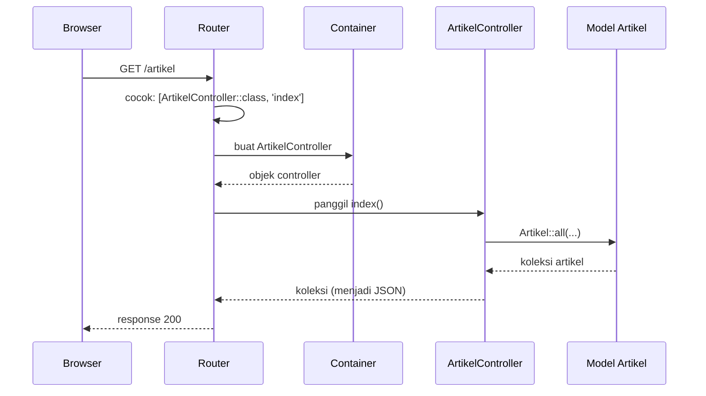

# Pengantar Controller

Sampai sekarang, semua logika route ditulis sebagai closure di `routes/web.php`. Itu praktis untuk percobaan, tetapi berkas route cepat membengkak, logika tersebar, dan sulit dipakai ulang.
**Controller** adalah class yang menampung logika penanganan request. Route cukup menunjuk "class mana, method mana". Sub bab ini memperkenalkan konsep controller dan membuat controller pertamamu
dengan tangan, supaya strukturnya terlihat jelas. Pembuatan dengan Artisan dibahas pada sub bab berikutnya.

## Tujuan Pembelajaran

Setelah menyelesaikan sub bab ini, kamu dapat:

- [ ] Menjelaskan masalah closure route yang diselesaikan controller.
- [ ] Menjelaskan peran controller dalam MVC dan batas tanggung jawabnya ("controller tipis").
- [ ] Menulis class controller (namespace, nama, method) dan menghubungkannya ke route.
- [ ] Memakai dependency injection pada constructor dan method controller.
- [ ] Menjelaskan fungsi class dasar `Controller` dan lokasi berkas controller.
- [ ] Menyebutkan cara memasang middleware pada controller.

## Prasyarat

- Sub bab [Route Model Binding](02-10-route-model-binding.md): model `Artikel` dan data contoh di `portal-artikel`.
- [Arsitektur MVC](../level-01/01-03-mvc-architecture.md) dan [Gambaran Service Container](../level-01/01-14-service-container-overview.md).
- [Class dan Objek](../level-00/00-19-classes-and-objects.md) serta [Namespace dan Autoloading](../level-00/00-22-namespace-and-autoloading.md).

## Pengantar

Perhatikan `routes/web.php` pada `portal-artikel`: puluhan route dengan closure, sebagian berisi lebih dari satu pernyataan. Pertanyaan yang muncul: di mana kamu akan menaruh logika
yang lebih panjang? bagaimana dua route memakai logika yang sama? bagaimana menguji logika tanpa melewati URL? Jawabannya: pindahkan logika ke method di sebuah class. Itulah controller.

## Penjelasan Konsep

### Apa itu controller?

**Controller** adalah class yang mengelompokkan logika penanganan request yang saling berkaitan. Menurut dokumentasi, daripada mendefinisikan semua logika sebagai closure di berkas route,
kamu dapat mengaturnya dengan class controller; controller dapat mengelompokkan logika penanganan request yang terkait ke dalam satu class. Misalnya, `ArtikelController` menangani semua request
terkait artikel: menampilkan daftar, menampilkan satu artikel, membuat, mengubah, dan menghapus.

!!! tip "Analogi"
    Di restoran, **pelayan** menerima pesanan, meneruskannya ke dapur, lalu mengantar hasilnya. Controller adalah pelayan itu: ia menerima request, meminta data ke model (dapur), dan
    mengembalikan response. Ia tidak memasak sendiri.

### Letak dan struktur

Berkas controller berada di `app/Http/Controllers/` dan memakai namespace `App\Http\Controllers`. Kerangka aplikasi 13.x menyertakan class dasar:

File: `app/Http/Controllers/Controller.php`

```php
<?php

namespace App\Http\Controllers;

abstract class Controller
{
    //
}
```

Dokumentasi menyatakan controller **tidak wajib** mewarisi class dasar, tetapi lazim mewarisinya sebagai tempat berbagi perilaku untuk semua controller.

Contoh controller dasar (dari dokumentasi, disesuaikan):

```php
<?php

namespace App\Http\Controllers;

use App\Models\User;
use Illuminate\View\View;

class UserController extends Controller
{
    public function show(string $id): View
    {
        return view('user.profile', [
            'user' => User::findOrFail($id),
        ]);
    }
}
```

Dan route yang menghubungkannya:

```php-inline
use App\Http\Controllers\UserController;

Route::get('/user/{id}', [UserController::class, 'show']);
```

Array `[UserController::class, 'show']` berarti: "class `UserController`, method `show`". `UserController::class` menghasilkan nama class lengkap sebagai teks. Saat request cocok, method `show`
dipanggil dan parameter route diteruskan sebagai argumen.

### Anatomi controller

| Bagian | Penjelasan |
|---|---|
| `namespace App\Http\Controllers;` | Lokasi class; harus sesuai folder (PSR-4) |
| `class ArtikelController extends Controller` | Nama berakhiran `Controller`, diawali nama sumber daya tunggal, `StudlyCaps` |
| `public function index()` | Method publik = aksi yang bisa dipanggil route |
| Argumen method | Parameter route dan objek dari container |
| Nilai kembalian | Menjadi response (array/collection menjadi JSON, `view(...)`, `redirect(...)`) |

Hanya method `public` yang dapat dijadikan aksi route, dan **hanya route yang kamu daftarkan** yang dapat diakses. Laravel tidak mengekspos method controller secara otomatis hanya karena method itu ada.

### Controller yang tipis

Prinsip yang umum: controller sebaiknya **tipis**, yaitu hanya perantara.

| Tugas controller | Bukan tugas controller |
|---|---|
| Menerima dan membaca input request | Menyusun HTML panjang |
| Memanggil model atau layanan untuk data/aksi | Aturan bisnis rumit dan kueri berlapis |
| Memilih response (view, JSON, redirect) | Perhitungan atau pemrosesan berat |
| Menangani kasus tidak ditemukan atau tidak sah | Mengatur autentikasi secara manual berulang-ulang |

Logika yang rumit sebaiknya pindah ke model atau class pendukung (layanan), yang dibahas di bab utama *Advanced Laravel Features*.

### Dependency injection pada controller

Semua controller dibuat oleh service container, sehingga ketergantungan dapat disuntikkan:

- **Constructor injection**: ketergantungan yang dipakai banyak method.
- **Method injection**: ketergantungan khusus satu method, misalnya `Request`.

```php-inline
class ArtikelController extends Controller
{
    public function __construct(
        protected PenyimpanArtikel $penyimpan,
    ) {}

    public function cari(Request $request)
    {
        // $request disuntikkan khusus untuk method ini
    }
}
```

Dokumentasi menyarankan: bila method juga menerima parameter route, tulis argumen route **setelah** ketergantungan lain (`Request $request, string $id`).

### Middleware pada controller

Selain di route, middleware dapat dipasang pada controller. Dokumentasi 13.x menyediakan antarmuka `HasMiddleware` (metode statis `middleware()`) dan atribut PHP `#[Middleware]` pada class atau method.
Pembahasan praktisnya muncul pada sub bab berikutnya; di sini cukup tahu bahwa kamu tidak harus memasangnya satu per satu pada route.

### Penamaan

| Hal | Konvensi | Contoh |
|---|---|---|
| Nama class | `StudlyCaps` + akhiran `Controller` | `ArtikelController` |
| Nama method | `camelCase`, kata kerja jelas | `index`, `show`, `store`, `cari` |
| Satu controller | Satu sumber daya/topik | `ArtikelController`, `PenulisController` |
| Nama berkas | Sama dengan nama class | `ArtikelController.php` |

Nama method standar `index`, `create`, `store`, `show`, `edit`, `update`, `destroy` mengikuti resource controller (sub bab *Resource Controller*).

## Cara Kerja



## Contoh Praktik

Di `portal-artikel` kamu menulis `ArtikelController` dengan tangan, memindahkan route daftar dan detail dari closure ke controller, menambah satu method yang menerima `Request`, lalu memastikan perilaku route
tidak berubah.

## Penjelasan Kode

File: `app/Http/Controllers/ArtikelController.php`

```php
<?php

namespace App\Http\Controllers;

use App\Models\Artikel;
use Illuminate\Database\Eloquent\Collection;
use Illuminate\Http\Request;

class ArtikelController extends Controller
{
    public function index(): Collection
    {
        return Artikel::all(['id', 'judul', 'slug']);
    }

    public function show(Artikel $artikel): array
    {
        return [
            'id' => $artikel->id,
            'judul' => $artikel->judul,
        ];
    }

    public function cari(Request $request): Collection
    {
        $kata = (string) $request->query('q', '');

        return Artikel::where('judul', 'like', '%' . $kata . '%')
            ->get(['id', 'judul']);
    }
}
```

| Bagian | Penjelasan |
|---|---|
| `extends Controller` | Mewarisi class dasar proyek |
| `index(): Collection` | Mengembalikan koleksi artikel; Laravel mengubahnya menjadi JSON |
| `Artikel::all([...])` | Mengambil semua baris dengan kolom tertentu (detail Eloquent di bab utama berikutnya) |
| `show(Artikel $artikel)` | Route model binding bekerja di controller sama seperti di closure |
| `cari(Request $request)` | *Method injection*: container menyuntikkan objek request |
| `$request->query('q', '')` | Membaca `?q=` dari URL dengan nilai cadangan kosong |
| `where('judul', 'like', ...)` | Mencari judul yang memuat kata; nilai dikirim sebagai parameter terikat, aman dari SQL injection |

File: `routes/web.php` (ubah route daftar dan detail, tambahkan route pencarian)

```php-inline
use App\Http\Controllers\ArtikelController;

Route::get('/artikel', [ArtikelController::class, 'index'])
    ->name('artikel.index')
    ->middleware('tandai:publik');

Route::get('/artikel/{artikel}', [ArtikelController::class, 'show'])
    ->name('artikel.show')
    ->whereNumber('artikel');

Route::get('/artikel-cari', [ArtikelController::class, 'cari'])
    ->name('artikel.cari');
```

(Hapus versi closure lama dari `/artikel` dan `/artikel/{artikel}`; jangan mendefinisikan dua kali. Route `/artikel/baru` tetap closure dan harus tetap **sebelum** `/artikel/{artikel}`.)

## Implementasi Langkah demi Langkah

### Langkah 1: periksa class dasar

```bash
cd ~/belajar-laravel/portal-artikel
cat app/Http/Controllers/Controller.php
ls app/Http/Controllers
```

### Langkah 2: tulis controller dengan tangan

Buat berkas `app/Http/Controllers/ArtikelController.php` dengan isi di atas. Pastikan nama berkas sama persis dengan nama class (huruf besar-kecil penting di Linux).

```bash
php -l app/Http/Controllers/ArtikelController.php
```

### Langkah 3: hubungkan ke route

Ubah `routes/web.php` sesuai Penjelasan Kode, lalu:

```bash
php -l routes/web.php
php artisan route:list --path=artikel
```

Perhatikan kolom aksi: kini menampilkan `ArtikelController@index` dan seterusnya, bukan `Closure`.

### Langkah 4: jalankan dan uji

```bash
php artisan serve
```

Di terminal lain (di Windows PowerShell tulis `curl.exe`):

```bash
curl -i http://127.0.0.1:8000/artikel
curl -i http://127.0.0.1:8000/artikel/1
curl -i http://127.0.0.1:8000/artikel/99
curl -i "http://127.0.0.1:8000/artikel-cari?q=route"
curl -i "http://127.0.0.1:8000/artikel-cari"
curl -i http://127.0.0.1:8000/artikel/baru
```

Bandingkan hasil dengan sebelum dipindahkan: perilakunya harus sama.

### Langkah 5: lihat kesalahan nama method

Ubah sementara `'index'` pada route menjadi `'daftar'`, simpan, lalu:

```bash
curl -i http://127.0.0.1:8000/artikel
```

Catat pesan error, lalu kembalikan.

### Langkah 6: periksa keamanan pencarian

```bash
curl -i "http://127.0.0.1:8000/artikel-cari?q=%27%20OR%201%3D1%20--"
```

Perhatikan bahwa masukan berisi tanda kutip dan kata `OR` diperlakukan sebagai teks pencarian biasa (tidak ada judul yang cocok), bukan sebagai bagian perintah SQL.

### Langkah 7: catat di Git

```bash
git add app routes
git commit -m "Tambah ArtikelController dan pindahkan route daftar dan detail"
```

## Eksekusi dan Verifikasi

| Langkah | Cara memverifikasi |
|---|---|
| 1 | Class dasar `Controller` ada dan kosong |
| 2 | `php -l` tidak menunjukkan kesalahan |
| 3 | `route:list` menampilkan `ArtikelController@index`, `@show`, dan `@cari` |
| 4 | Hasil sesuai tabel hasil yang diharapkan |
| 5 | Pesan error menyebut method yang tidak ada pada class |
| 6 | Respons berupa daftar kosong (`[]`), bukan galat SQL |
| 7 | `git log --oneline` memuat commit baru |

## Hasil yang Diharapkan

| Permintaan | Status | Isi |
|---|---|---|
| `GET /artikel` | `200` | JSON berisi tiga artikel (`id`, `judul`, `slug`); header `X-Portal: publik` |
| `GET /artikel/1` | `200` | `{"id":1,"judul":"Belajar Routing Laravel"}` |
| `GET /artikel/99` | `404` | Dari route model binding |
| `GET /artikel-cari?q=route` | `200` | Artikel yang judulnya memuat "route" (mis. "Belajar Routing Laravel", "Batasan Route yang Aman") |
| `GET /artikel-cari` | `200` | Semua artikel (kata kosong cocok dengan semua judul) |
| `GET /artikel/baru` | `200` | `Form artikel baru` |
| Method dirujuk tidak ada | `500` | Error bahwa method tidak ada (teks mengikuti versi) |
| `GET /artikel-cari?q=' OR 1=1 --` | `200` | Daftar kosong `[]` |

Pencarian dengan `like` pada SQLite tidak membedakan huruf besar-kecil untuk huruf ASCII secara bawaan, sehingga `route` cocok dengan "Routing" dan "Route". Hasil ini diturunkan dari dokumentasi dan perilaku
framework, dan belum dijalankan oleh penulis materi; cocokkan dengan hasilmu.

## Kesalahan Umum dan Pemecahan Masalah

| Gejala | Penyebab | Cara mengenali | Solusi | Pencegahan |
|---|---|---|---|---|
| `Class "App\Http\Controllers\ArtikelController" not found` | Namespace salah atau nama berkas tidak sama dengan nama class | Pesan class not found | Samakan namespace dan nama berkas | Gunakan `php artisan make:controller` (sub bab berikutnya) |
| `Method ... does not exist` | Nama method pada route berbeda dari di class | Pesan menyebut method | Samakan ejaan | Salin nama method |
| Lupa `use` controller di berkas route | Class tidak dikenali | `Class "ArtikelController" not found` | Tambahkan `use App\Http\Controllers\ArtikelController;` | Pasang `use` setiap menambah controller |
| Route model binding tidak jalan di controller | Nama parameter method tidak sama dengan segmen route | `Artikel $artikel` vs `{id}` | Samakan nama | Gunakan nama sama (`{artikel}`) |
| Controller berisi terlalu banyak logika | Menumpuk semua di controller | Method puluhan baris | Pindahkan ke model/layanan | Jaga controller tipis |
| Method private/protected tidak bisa dipanggil lewat route | Hanya method publik yang bisa jadi aksi | Error visibilitas | Jadikan `public` bila memang aksi | Pisahkan aksi (public) dan bantu (private) |
| Dua route untuk `/artikel` | Closure lama tidak dihapus | Hasil tidak sesuai harapan | Hapus yang lama | Periksa `route:list` setelah memindahkan |
| Urutan route statis/dinamis terbalik | `/artikel/{artikel}` sebelum `/artikel/baru` | `baru` ditangkap binding (404) | Pindahkan route statis ke atas | Statis dulu, dinamis kemudian |
| Perubahan route tak muncul | Cache route | `route:list` lama | `php artisan route:clear` | Jangan `route:cache` saat pengembangan |

## Latihan Praktik

### Latihan dasar

**D1. Pindahkan satu route**
- *Masalah:* halaman `/tentang` masih closure.
- *Persyaratan:* buat `HalamanController` dengan method `tentang()` yang mengembalikan teks yang sama, hubungkan ke route `/tentang`, dan pastikan `route:list` menampilkan `HalamanController@tentang`.
- *Perilaku yang diharapkan:* respons identik dengan versi closure.
- *Tujuan belajar:* menghubungkan route ke method controller.

**D2. Baca kolom aksi**
- *Masalah:* ingin tahu route mana yang masih closure.
- *Persyaratan:* gunakan `route:list` untuk mendaftar route berstatus `Closure` dan yang sudah memakai controller; tulis jumlahnya.
- *Perilaku yang diharapkan:* daftar dua kelompok sesuai keluaran.
- *Tujuan belajar:* memantau kemajuan refactoring.

### Latihan implementasi

**I1. Penulis**
- *Masalah:* route penulis berserakan di closure.
- *Persyaratan:* buat `PenulisController` dengan method `profil(string $penulis)` dan `artikel(string $penulis)` (nilai di-*escape* dengan `e()`), hubungkan ke grup `penulis/{penulis}` yang ada tanpa
  mengubah URI dan nama route.
- *Perilaku yang diharapkan:* URI dan nama route sama seperti sebelumnya.
- *Tujuan belajar:* memindahkan grup route ke controller.

**I2. Constructor injection**
- *Masalah:* beberapa method butuh ketergantungan yang sama.
- *Persyaratan:* buat class `app/Services/Penyaring.php` dengan method `bersihkan(string $kata): string` (misalnya memotong spasi dan membatasi panjang 50 karakter), suntikkan ke constructor
  `ArtikelController`, dan pakai di method `cari`. Buktikan dengan `curl` bahwa kata yang sangat panjang dipotong.
- *Perilaku yang diharapkan:* container membuat `Penyaring` tanpa pendaftaran manual (class konkret).
- *Tujuan belajar:* constructor injection di controller.

### Latihan tantangan

**T1. Audit routes/web.php**
- *Masalah:* berkas route terlalu panjang.
- *Persyaratan:* identifikasi semua route yang logikanya lebih dari satu pernyataan dan rancang pembagian controller (nama controller, method, dan route yang dipindah) dalam tabel; implementasikan setidaknya dua controller;
  buktikan dengan skrip `curl` bahwa respons semua route yang dipindah identik sebelum dan sesudah (simpan keluaran sebelum, bandingkan dengan `diff`).
- *Perilaku yang diharapkan:* `diff` tidak menunjukkan perbedaan isi respons.
- *Tujuan belajar:* refactoring aman dengan bukti.
- *Catatan:* kerjakan mandiri; tidak ada kunci jawaban.

## Uji Pemahaman

1. Apa masalah utama yang diselesaikan controller dibandingkan closure?
2. Di mana berkas controller berada dan apa namespace-nya?
3. Apa arti `[ArtikelController::class, 'index']`?
4. Apa artinya "controller tipis"?
5. Apa beda constructor injection dan method injection?
6. Mengapa hanya route yang terdaftar yang dapat mengakses method controller?
7. Bagaimana middleware dapat dipasang pada controller?
8. Mengapa urutan route statis dan dinamis tetap penting walau memakai controller?

??? success "Kunci jawaban singkat"
    1. Logika terkelompok, dapat dipakai ulang dan diuji, dan berkas route tetap ringkas.
    2. `app/Http/Controllers/` dengan namespace `App\Http\Controllers`.
    3. Class `ArtikelController`, method `index`.
    4. Controller hanya perantara: menerima input, memanggil model/layanan, memilih response.
    5. Constructor: ketergantungan dipakai banyak method; method: khusus satu aksi (mis. `Request`).
    6. Laravel tidak mengekspos method otomatis; hanya route yang kamu daftarkan.
    7. Lewat `HasMiddleware`/metode statis `middleware()` atau atribut `#[Middleware]`.
    8. Pencocokan route tidak bergantung pada closure atau controller; route dinamis tetap dapat menangkap URL statis bila ditulis lebih dulu.

## Ringkasan

- Controller adalah class di `app/Http/Controllers` yang menampung logika penanganan request; route menunjuknya dengan `[Controller::class, 'metode']`.
- Controller berperan sebagai perantara: input masuk, panggil model/layanan, pilih response (tipis).
- Semua controller dibuat oleh container sehingga mendukung constructor dan method injection; route model binding juga bekerja.
- Hanya method publik yang dapat menjadi aksi, dan hanya route terdaftar yang dapat diakses.
- Pindahkan logika dari closure ke controller secara bertahap dan pastikan perilaku tidak berubah.

Selanjutnya: *Membuat Controller*, yaitu memakai `php artisan make:controller` dan opsinya.

## Referensi Resmi

- [Laravel: Controllers](https://laravel.com/docs/13.x/controllers)
- [Laravel: Writing Controllers](https://laravel.com/docs/13.x/controllers#writing-controllers)
- [Laravel: Controller Middleware](https://laravel.com/docs/13.x/controllers#controller-middleware)
- [Laravel: Dependency Injection and Controllers](https://laravel.com/docs/13.x/controllers#dependency-injection-and-controllers)
- [Laravel: Routing](https://laravel.com/docs/13.x/routing)
- [Laravel: Service Container](https://laravel.com/docs/13.x/container)
