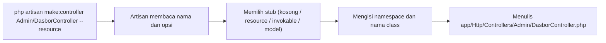

# Membuat Controller

Di sub bab sebelumnya kamu menulis controller dengan tangan untuk memahami strukturnya. Dalam kerja sehari-hari kamu cukup menjalankan satu perintah Artisan, dan kerangka controller dibuat otomatis di folder dan
namespace yang benar. Sub bab ini membahas `php artisan make:controller` dan opsinya, serta cara mengelompokkan route yang memakai controller yang sama.

## Tujuan Pembelajaran

Setelah menyelesaikan sub bab ini, kamu dapat:

- [ ] Membuat controller dengan `php artisan make:controller` dan memeriksa hasilnya.
- [ ] Membuat controller di subfolder dan memahami namespace yang dihasilkan.
- [ ] Menyebutkan opsi utama: `--resource`, `--api`, `--invokable`, `--model`, `--requests`, `--singleton`, `--parent`, dan `--force`.
- [ ] Menghubungkan banyak route ke satu controller dengan `Route::controller(...)->group(...)`.
- [ ] Menggunakan `php artisan help make:controller` dan `php artisan list make` untuk menemukan opsi.
- [ ] Membersihkan hasil percobaan dengan aman.

## Prasyarat

- Sub bab [Pengantar Controller](02-11-introduction-to-controllers.md): `ArtikelController` yang ditulis dengan tangan.
- [Artisan CLI](../level-01/01-12-artisan-cli.md) dan [Grup Route](02-06-route-groups.md).
- Proyek `~/belajar-laravel/portal-artikel` dengan Git yang bersih.

## Pengantar

Menulis controller dengan tangan rawan salah: nama berkas tidak sama dengan nama class, namespace keliru, atau `use` terlewat. Perintah `make:controller` menghilangkan kesalahan itu dan membuat kerangka sesuai
konvensi. Dokumentasi menyatakan semua controller aplikasi disimpan di folder `app/Http/Controllers` dan dapat dibuat dengan perintah ini.

## Penjelasan Konsep

### Perintah dasar

```bash
php artisan make:controller NamaController
```

Perintah ini membuat `app/Http/Controllers/NamaController.php` berisi class yang mewarisi `Controller` dengan namespace `App\Http\Controllers`. Deskripsi perintah di kode framework: "Create a new controller class".

!!! tip "Analogi"
    Seperti **formulir yang sudah berkop surat dan bernomor**: kamu tinggal mengisi isinya. Kop (namespace) dan nomor (nama berkas) sudah benar.

### Menaruh controller di subfolder

Awali nama dengan nama folder untuk mengelompokkan controller:

```bash
php artisan make:controller Admin/DasborController
```

Hasilnya `app/Http/Controllers/Admin/DasborController.php` dengan namespace `App\Http\Controllers\Admin`. Di berkas route, import dengan namespace lengkap:
`use App\Http\Controllers\Admin\DasborController;`.

### Opsi `make:controller`

Berdasarkan definisi perintah pada framework 13.x:

| Opsi | Singkatan | Fungsi |
|---|---|---|
| `--resource` | `-r` | Membuat controller *resource* dengan tujuh method CRUD |
| `--api` | | Seperti resource, tanpa method `create` dan `edit` (karena tidak ada form HTML) |
| `--invokable` | `-i` | Controller satu aksi (satu method `__invoke`) |
| `--model=Artikel` | `-m` | Resource controller untuk model tertentu (method memakai type-hint model) |
| `--requests` | `-R` | Ikut membuat class *form request* untuk `store` dan `update` |
| `--singleton` | `-s` | Controller resource tunggal (satu sumber daya per aplikasi, mis. profil) |
| `--creatable` | | Menandai resource singleton dapat dibuat |
| `--parent=Penulis` | `-p` | Resource controller bersarang di bawah model induk |
| `--force` | | Menimpa controller yang sudah ada |
| `--type=` | | Memilih berkas stub tertentu |

Tiga bentuk yang akan paling sering kamu pakai:

| Perintah | Hasil |
|---|---|
| `php artisan make:controller HalamanController` | Controller kosong (kerangka biasa) |
| `php artisan make:controller ArtikelController --resource` | Tujuh method: `index`, `create`, `store`, `show`, `edit`, `update`, `destroy` |
| `php artisan make:controller TentangController --invokable` | Satu method `__invoke` |

Resource, API, dan invokable dibahas rinci pada dua sub bab berikutnya. Di sini cukup mengenali keberadaan dan fungsinya.

### Kerangka yang dihasilkan

Controller kosong dari stub framework berbentuk (ringkasan):

```php
<?php

namespace App\Http\Controllers;

class HalamanController extends Controller
{
    //
}
```

(Karena controller berada pada namespace yang sama dengan `Controller`, baris `use` untuk class dasar tidak diperlukan; detail baris `use` dapat berbeda antar versi.)

Stub bentuk `--resource` berisi tujuh method kosong dengan komentar, misalnya `index()`, `show(string $id)`, `update(Request $request, string $id)`, dan `destroy(string $id)`. Dengan `--model`, argumen
`$id` diganti type-hint model sehingga route model binding langsung bekerja.

Bila ingin mengubah kerangkanya, dokumentasi Artisan menyediakan `php artisan stub:publish` yang menyalin stub ke folder `stubs` proyek.

### Mengelompokkan route untuk satu controller

Bila banyak route memakai controller yang sama, grup `controller` menghindari pengulangan nama class:

```php-inline
use App\Http\Controllers\HalamanController;

Route::controller(HalamanController::class)->group(function () {
    Route::get('/tentang', 'tentang')->name('tentang');
    Route::get('/kontak', 'kontak')->name('kontak');
});
```

Di dalam grup, cukup menulis nama method sebagai string.

### Memilih nama dan bentuk

| Kebutuhan | Bentuk |
|---|---|
| Halaman-halaman statis | `HalamanController` biasa |
| CRUD untuk satu model | `--resource --model=NamaModel` |
| Antarmuka JSON saja | `--api` |
| Satu aksi khusus (unduh laporan) | `--invokable` |
| Area admin | Subfolder `Admin/` |

### Keamanan dan kerapian

- Perintah `make:` hanya membuat berkas; **kamu** yang bertanggung jawab atas validasi input dan otorisasi pada method yang dibuat.
- Jangan menjalankan `--force` tanpa memeriksa: perintah ini menimpa controller yang sudah ada, termasuk perubahan yang belum di-commit.
- Hapus controller percobaan yang tidak dipakai agar tidak menjadi kode mati dengan akses tak sengaja.

## Cara Kerja



Artisan memilih stub sesuai opsi, mengganti placeholder namespace dan nama class, lalu menulis hasilnya ke folder yang sesuai dengan namespace (aturan PSR-4).

## Contoh Praktik

Di `portal-artikel` kamu membuat `HalamanController` (dengan grup route), `Admin/DasborController`, serta tiga controller percobaan (`--resource`, `--invokable`, `--model`) hanya untuk diperiksa dan dihapus.

## Penjelasan Kode

File: `app/Http/Controllers/HalamanController.php` (hasil `make:controller`, lalu isi dengan dua method)

```php
<?php

namespace App\Http\Controllers;

class HalamanController extends Controller
{
    public function tentang(): string
    {
        return 'Portal Artikel: tempat belajar menulis dan membaca.';
    }

    public function kontak(): string
    {
        return 'Hubungi kami di redaksi@contoh.id';
    }
}
```

File: `app/Http/Controllers/Admin/DasborController.php` (hasil `make:controller Admin/DasborController`, lalu isi)

```php
<?php

namespace App\Http\Controllers\Admin;

use App\Http\Controllers\Controller;
use App\Models\Artikel;

class DasborController extends Controller
{
    public function index(): array
    {
        return [
            'halaman' => 'Dasbor admin',
            'jumlah_artikel' => Artikel::count(),
        ];
    }
}
```

File: `routes/web.php` (ubah dan tambahkan)

```php-inline
use App\Http\Controllers\Admin\DasborController;
use App\Http\Controllers\HalamanController;

Route::controller(HalamanController::class)->group(function () {
    Route::get('/tentang', 'tentang')->name('tentang');
    Route::get('/kontak', 'kontak')->name('kontak');
});

// di dalam grup admin yang sudah ada:
Route::get('/', [DasborController::class, 'index'])->name('dasbor');
```

| Bagian | Penjelasan |
|---|---|
| `namespace App\Http\Controllers\Admin;` | Namespace mengikuti subfolder |
| `use App\Http\Controllers\Controller;` | Wajib karena class dasar berada di namespace lain |
| `Artikel::count()` | Menghitung jumlah baris tabel `artikel` |
| `Route::controller(...)->group(...)` | Semua route di dalamnya memakai `HalamanController` |
| `Route::get('/', ...)` di grup `admin` | URI `/admin`, nama `admin.dasbor` (prefix dan prefix nama dari grup) |

(Hapus route `/tentang` dan `/kontak` lama berbentuk closure agar tidak ada dua definisi.)

## Implementasi Langkah demi Langkah

### Langkah 1: lihat bantuan perintah

```bash
cd ~/belajar-laravel/portal-artikel
php artisan help make:controller
php artisan list make
git status --short
```

Catat opsi yang tampil dan bandingkan dengan tabel opsi di atas.

### Langkah 2: buat controller biasa

```bash
php artisan make:controller HalamanController
cat app/Http/Controllers/HalamanController.php
```

Isi dengan dua method pada Penjelasan Kode, lalu ubah route (grup `controller`).

### Langkah 3: buat controller di subfolder

```bash
php artisan make:controller Admin/DasborController
ls app/Http/Controllers/Admin
```

Isi sesuai Penjelasan Kode dan tambahkan route `/` pada grup admin.

```bash
php -l app/Http/Controllers/HalamanController.php
php -l app/Http/Controllers/Admin/DasborController.php
php -l routes/web.php
php artisan route:list --path=tentang
php artisan route:list --path=admin
```

### Langkah 4: uji

```bash
php artisan serve
```

Di terminal lain (di Windows PowerShell tulis `curl.exe`):

```bash
curl -i http://127.0.0.1:8000/tentang
curl -i http://127.0.0.1:8000/kontak
curl -i http://127.0.0.1:8000/admin
curl -i -H "X-Admin-Key: kunci-latihan-123" http://127.0.0.1:8000/admin
```

### Langkah 5: periksa tiga bentuk lain (percobaan)

```bash
php artisan make:controller PercobaanResourceController --resource
php artisan make:controller PercobaanInvokableController --invokable
php artisan make:controller PercobaanModelController --model=Artikel
```

Buka ketiga berkas yang dibuat. Catat: nama method pada resource, nama method pada invokable, dan type-hint pada versi `--model`.

### Langkah 6: coba menimpa dengan benar

```bash
php artisan make:controller PercobaanResourceController
php artisan make:controller PercobaanResourceController --force
```

Perintah pertama seharusnya menolak karena berkas sudah ada, sedangkan yang kedua menimpanya. Catat perbedaannya.

### Langkah 7: bersihkan percobaan

Periksa dulu, lalu hapus hanya tiga berkas percobaan:

```bash
git status --short
rm app/Http/Controllers/PercobaanResourceController.php app/Http/Controllers/PercobaanInvokableController.php app/Http/Controllers/PercobaanModelController.php
git status --short
```

!!! warning "Periksa sebelum `rm`"
    Pastikan `pwd` adalah `portal-artikel` dan hanya tiga berkas percobaan itu yang dihapus. `rm` tidak dapat dibatalkan.

### Langkah 8: catat di Git

```bash
git add app routes
git commit -m "Tambah HalamanController dan Admin/DasborController"
```

## Eksekusi dan Verifikasi

| Langkah | Cara memverifikasi |
|---|---|
| 1 | `help make:controller` menampilkan opsi `--resource`, `--api`, `--invokable`, `--model`, dan lainnya |
| 2 | Berkas `HalamanController.php` ada dengan namespace `App\Http\Controllers` |
| 3 | `Admin/DasborController.php` ada dengan namespace `App\Http\Controllers\Admin`; `route:list` menampilkan route `tentang`, `kontak`, `admin` |
| 4 | Hasil sesuai tabel hasil yang diharapkan |
| 5 | Tiga berkas percobaan berbeda bentuknya |
| 6 | Pembuatan ulang tanpa `--force` ditolak; dengan `--force` menimpa |
| 7 | `git status` tidak lagi menampilkan berkas percobaan |
| 8 | `git log --oneline` memuat commit baru |

## Hasil yang Diharapkan

| Permintaan | Status | Isi |
|---|---|---|
| `GET /tentang` | `200` | `Portal Artikel: tempat belajar menulis dan membaca.` |
| `GET /kontak` | `200` | `Hubungi kami di redaksi@contoh.id` |
| `GET /admin` (tanpa kunci) | `403` | Ditolak middleware `kunci.admin` |
| `GET /admin` (kunci benar) | `200` | JSON `{"halaman":"Dasbor admin","jumlah_artikel":3}` |

Pada Langkah 5:

- `--resource`: tujuh method (`index`, `create`, `store`, `show`, `edit`, `update`, `destroy`).
- `--invokable`: satu method `__invoke`.
- `--model=Artikel`: method resource dengan type-hint model `Artikel` (bukan `string $id`).

Pada Langkah 6, perintah tanpa `--force` menolak karena controller sudah ada (teks pesan mengikuti versi). Hasil ini diturunkan dari dokumentasi dan kode framework, dan belum dijalankan oleh penulis materi;
cocokkan dengan hasilmu.

## Kesalahan Umum dan Pemecahan Masalah

| Gejala | Penyebab | Cara mengenali | Solusi | Pencegahan |
|---|---|---|---|---|
| `Class "...DasborController" not found` | Lupa `use` di berkas route atau namespace subfolder | Pesan class not found | `use App\Http\Controllers\Admin\DasborController;` | Salin namespace dari berkas controller |
| `Class "Controller" not found` pada subfolder | Lupa `use App\Http\Controllers\Controller;` | Pesan error saat controller dibuka | Tambahkan `use` | Berkas hasil `make:` biasanya sudah menyertakannya |
| Controller sudah ada | Menjalankan perintah dua kali | Pesan bahwa controller sudah ada | Pakai nama lain, atau `--force` bila memang ingin menimpa | Periksa `ls` dulu |
| `--force` menimpa pekerjaan | Tidak sadar berkas diganti | Isi controller kembali kosong | Pulihkan dengan `git restore <berkas>` | Commit sebelum memakai `--force` |
| Route tidak menemukan method | Ejaan method di grup `controller` salah | Error method tidak ada | Samakan ejaan | Salin nama method |
| `--model=Artikel` gagal | Model belum ada | Artisan menawarkan membuat model atau menolak | Buat model `Artikel` lebih dulu | Pastikan model tersedia |
| Nama controller tanpa akhiran `Controller` | Menyalahi konvensi | Sulit dibedakan dari class lain | Tambahkan akhiran `Controller` | Ikuti konvensi penamaan |
| Berkas percobaan tertinggal | Lupa membersihkan | `git status` menampilkan berkas baru | Hapus berkas percobaan | Jalankan Langkah 7 |
| `rm` menghapus berkas yang salah | Jalur keliru | Berkas penting hilang | `git restore <jalur>` | Periksa `pwd` dan jalur |

## Latihan Praktik

### Latihan dasar

**D1. Buat dan periksa**
- *Masalah:* membuat controller untuk kategori.
- *Persyaratan:* jalankan `make:controller KategoriController`, tuliskan lokasi dan namespace berkasnya, lalu tambahkan method `index()` yang mengembalikan teks `Daftar kategori`.
- *Perilaku yang diharapkan:* berkas ada di `app/Http/Controllers` dan route ke method itu berfungsi.
- *Tujuan belajar:* alur dasar `make:controller`.

**D2. Bandingkan tiga bentuk**
- *Masalah:* ingin tahu perbedaan bentuk kerangka.
- *Persyaratan:* buat controller percobaan dengan `--resource`, `--api`, dan `--invokable`, lalu tulis tabel method pada tiap bentuk. Hapus berkas percobaan setelah selesai.
- *Perilaku yang diharapkan:* `--api` tidak memiliki `create` dan `edit`.
- *Tujuan belajar:* mengenali perbedaan opsi.

### Latihan implementasi

**I1. Area penulis**
- *Masalah:* area penulis butuh controller sendiri.
- *Persyaratan:* buat `Penulis/DasborController` dengan method `index()` yang mengembalikan array berisi jumlah artikel dan nama area, lalu hubungkan ke grup `penulis` dengan prefix nama yang konsisten (`penulis.dasbor`).
  Jelaskan perbedaan namespace dengan `Admin\DasborController`.
- *Perilaku yang diharapkan:* dua controller bernama sama di namespace berbeda tidak bentrok.
- *Tujuan belajar:* subfolder dan namespace.

**I2. Resource dengan model**
- *Masalah:* siapkan kerangka CRUD artikel.
- *Persyaratan:* buat `ArtikelAdminController --model=Artikel` (nama lain agar tidak menimpa `ArtikelController`), baca method yang dihasilkan, isi `index` dan `show` agar mengembalikan data, dan hubungkan sementara dengan
  route manual. Pada sub bab berikutnya, kamu akan menggantinya dengan `Route::resource`.
- *Perilaku yang diharapkan:* `show` menerima model lewat binding.
- *Tujuan belajar:* kerangka resource berbasis model.

### Latihan tantangan

**T1. Skrip pembuat modul**
- *Masalah:* tim sering membuat satu paket controller, model, dan route sekaligus.
- *Persyaratan:* tulis skrip Bash `buat-modul.sh NamaModul` yang menjalankan `make:controller` bentuk resource untuk modul itu, memeriksa bahwa berkas dibuat, mencetak nama berkas, dan menolak (dengan pesan jelas) jika controller
  sudah ada. Skrip tidak boleh memakai `--force`.
- *Perilaku yang diharapkan:* menjalankan dua kali menghasilkan penolakan pada kali kedua.
- *Tujuan belajar:* otomatisasi pembuatan kerangka yang aman.
- *Catatan:* kerjakan mandiri; tidak ada kunci jawaban.

## Uji Pemahaman

1. Perintah apa yang membuat controller, dan di folder mana hasilnya?
2. Apa namespace controller yang dibuat dengan nama `Admin/DasborController`?
3. Apa beda opsi `--resource`, `--api`, dan `--invokable`?
4. Apa fungsi opsi `--model`?
5. Apa fungsi `--force` dan risikonya?
6. Bagaimana mengelompokkan route untuk satu controller?
7. Bagaimana melihat semua opsi `make:controller`?
8. Apa fungsi `php artisan stub:publish`?

??? success "Kunci jawaban singkat"
    1. `php artisan make:controller Nama`; di `app/Http/Controllers`.
    2. `App\Http\Controllers\Admin`.
    3. `--resource`: tujuh method CRUD; `--api`: tanpa `create` dan `edit`; `--invokable`: satu method `__invoke`.
    4. Membuat resource controller untuk model tertentu dengan method bertipe model.
    5. Menimpa controller yang sudah ada; risiko kehilangan perubahan yang belum di-commit.
    6. `Route::controller(Kelas::class)->group(function () { ... })` dengan nama method sebagai string.
    7. `php artisan help make:controller` atau `php artisan make:controller --help`.
    8. Menyalin stub ke folder `stubs` proyek agar kerangka hasil `make:` dapat disesuaikan.

## Ringkasan

- `php artisan make:controller` membuat controller di folder dan namespace yang benar; subfolder (`Admin/NamaController`) menghasilkan namespace bertingkat.
- Opsi utama: `--resource`, `--api`, `--invokable`, `--model`, `--requests`, `--singleton`, `--parent`, dan `--force`.
- `Route::controller(Kelas::class)->group(...)` mengelompokkan route ke satu controller.
- `stub:publish` memungkinkan penyesuaian kerangka; `--force` menimpa berkas sehingga commit dulu.
- Controller hasil `make:` tinggal kerangka: validasi dan otorisasi tetap tanggung jawabmu.

Selanjutnya: *Resource Controller*, yaitu CRUD lengkap dengan satu baris route.

## Referensi Resmi

- [Laravel: Controllers](https://laravel.com/docs/13.x/controllers)
- [Laravel: Basic Controllers](https://laravel.com/docs/13.x/controllers#basic-controllers)
- [Laravel: Route Group Controllers](https://laravel.com/docs/13.x/routing#route-group-controllers)
- [Laravel: Stub Customization](https://laravel.com/docs/13.x/artisan#stub-customization)
- [Laravel: Artisan Console](https://laravel.com/docs/13.x/artisan)
- [Kode sumber `make:controller` (13.x)](https://github.com/laravel/framework/blob/13.x/src/Illuminate/Routing/Console/ControllerMakeCommand.php)
