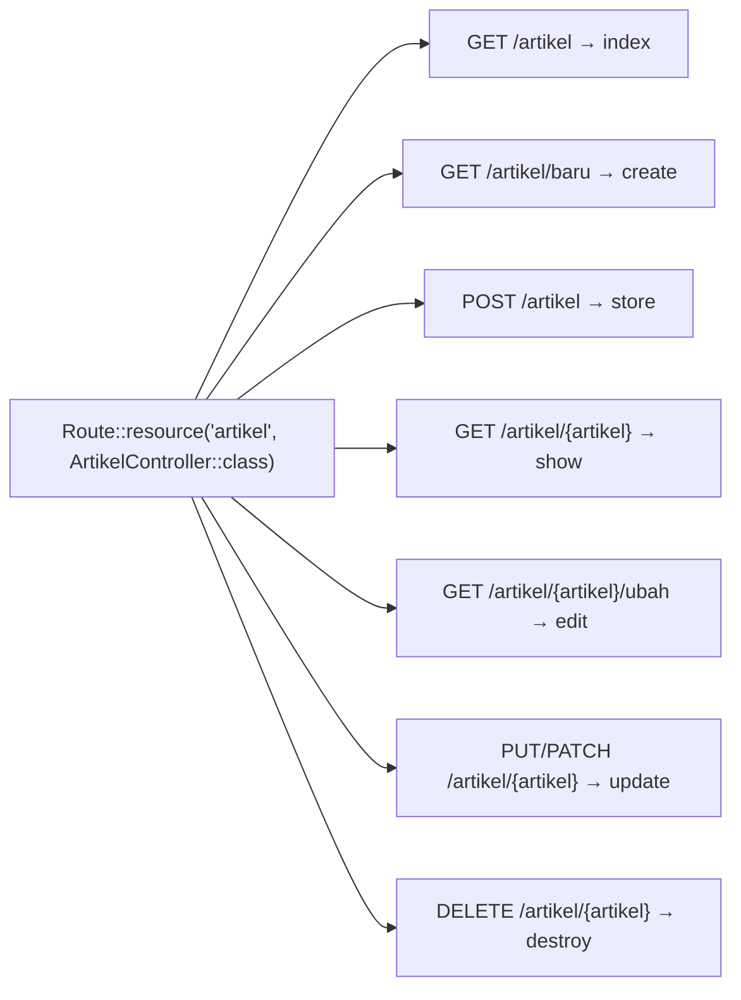

# Resource Controller

Hampir setiap sumber daya dalam aplikasi, seperti artikel, penulis, atau komentar, membutuhkan rangkaian aksi yang sama: melihat daftar, melihat satu, membuat, mengubah, dan menghapus (CRUD). Menulis tujuh route untuk
setiap sumber daya itu berulang. **Resource controller** memetakan seluruh rangkaian itu ke satu controller dengan **satu baris route**.

## Tujuan Pembelajaran

Setelah menyelesaikan sub bab ini, kamu dapat:

- [ ] Mendaftarkan resource controller dengan `Route::resource` dan menyebutkan tujuh route yang dihasilkan.
- [ ] Membuat resource controller berbasis model dengan `make:controller --resource --model`.
- [ ] Membatasi aksi dengan `only`, `except`, dan `apiResource`.
- [ ] Menambah route tambahan di luar tujuh aksi baku dengan urutan yang benar.
- [ ] Mengatur nama route, nama parameter, dan kata `create`/`edit` agar sesuai kebutuhan.
- [ ] Memasang middleware pada seluruh atau sebagian aksi resource.
- [ ] Menjelaskan resource bersarang dan *shallow nesting* secara garis besar.

## Prasyarat

- Sub bab [Membuat Controller](02-12-creating-controllers.md) dan [Pengantar Controller](02-11-introduction-to-controllers.md).
- [Route Model Binding](02-10-route-model-binding.md) serta [Middleware Route](02-08-route-middleware.md).
- [Laravel dibanding PHP Native](../level-01/01-04-laravel-vs-php-native.md) (tabel resource route sudah pernah dibaca).
- Proyek `~/belajar-laravel/portal-artikel` dengan Git yang bersih.

## Pengantar

Pada proyek siswa PHP native, CRUD membutuhkan empat berkas halaman (`index.php`, `tambah.php`, `ubah.php`, `hapus.php`). Di Laravel, satu baris `Route::resource('artikel', ArtikelController::class)` mendaftarkan
semua route CRUD, dan satu controller menampung seluruh aksinya. Itu sebabnya resource controller adalah bentuk controller yang paling sering kamu pakai.

## Penjelasan Konsep

### Satu baris, tujuh route

Menurut dokumentasi, resource routing menetapkan route CRUD yang umum ke sebuah controller dengan satu baris kode. Contoh (sumber daya `photos`):

```php-inline
use App\Http\Controllers\PhotoController;

Route::resource('photos', PhotoController::class);
```

Untuk sumber daya kita, `artikel`, tabel yang dihasilkan:

| Verb | URI | Aksi (method) | Nama route | Fungsi |
|---|---|---|---|---|
| GET | `/artikel` | `index` | `artikel.index` | Daftar semua |
| GET | `/artikel/create` | `create` | `artikel.create` | Form membuat |
| POST | `/artikel` | `store` | `artikel.store` | Menyimpan data baru |
| GET | `/artikel/{artikel}` | `show` | `artikel.show` | Menampilkan satu |
| GET | `/artikel/{artikel}/edit` | `edit` | `artikel.edit` | Form mengubah |
| PUT/PATCH | `/artikel/{artikel}` | `update` | `artikel.update` | Menyimpan perubahan |
| DELETE | `/artikel/{artikel}` | `destroy` | `artikel.destroy` | Menghapus |

!!! tip "Analogi"
    Seperti **paket menu standar** di restoran: satu pesanan sekaligus mencakup hidangan pembuka sampai penutup. Kamu bisa mengurangi isinya (`only`/`except`), tetapi susunan dasarnya sudah baku.

Parameter route diberi nama dari bentuk tunggal nama sumber daya (`photos` menjadi `{photo}`). Untuk `artikel`, parameternya `{artikel}`, sehingga cocok dengan route model binding `Artikel $artikel`.

### Membuat controller resource

```bash
php artisan make:controller ArtikelController --resource --model=Artikel
```

Opsi `--resource` membuat tujuh method kosong (`index`, `create`, `store`, `show`, `edit`, `update`, `destroy`). Opsi `--model=Artikel` membuat method yang memakai type-hint model sehingga route model binding langsung
bekerja. Dokumentasi juga menyebut `--requests` untuk menyiapkan *form request* pada `store` dan `update` (dibahas di bab utama validasi).

### Membatasi aksi

Berikan hanya aksi yang kamu butuhkan:

```php-inline
Route::resource('photos', PhotoController::class)->only(['index', 'show']);

Route::resource('photos', PhotoController::class)->except(['create', 'store', 'update', 'destroy']);

Route::apiResource('photos', PhotoController::class);
```

| Metode | Hasil |
|---|---|
| `only([...])` | Hanya aksi yang disebut |
| `except([...])` | Semua kecuali yang disebut |
| `apiResource(...)` | Tanpa `create` dan `edit` (tidak ada form HTML), cocok untuk API; ada juga `apiResources([...])` untuk banyak sekaligus |

Prinsip keamanan: **daftarkan hanya route yang kamu perlukan**. Aksi yang tidak didaftarkan tidak bisa diakses.

### Menambah route di luar tujuh aksi

Dokumentasi menyatakan route tambahan harus didefinisikan **sebelum** pemanggilan `Route::resource`; jika tidak, route dari `resource` dapat mengambil alih lebih dulu:

```php-inline
Route::get('/photos/popular', [PhotoController::class, 'popular']);
Route::resource('photos', PhotoController::class);
```

Alasannya sama dengan aturan statis-sebelum-dinamis: `/photos/popular` cocok dengan pola `/photos/{photo}`. Dokumentasi menambahkan saran: jika kamu sering butuh method di luar aksi baku,
pertimbangkan memecah controller menjadi dua yang lebih kecil dan terfokus.

### Penamaan dan lokalisasi

| Kebutuhan | Cara |
|---|---|
| Mengganti nama route aksi tertentu | `->names(['create' => 'photos.build'])` |
| Mengganti nama parameter | `->parameters(['users' => 'admin_user'])` menghasilkan `/users/{admin_user}` |
| Mengganti kata `create` dan `edit` pada URI | `Route::resourceVerbs(['create' => 'baru', 'edit' => 'ubah'])` di awal `AppServiceProvider::boot()` |

Dengan `resourceVerbs`, URI menjadi `/artikel/baru` dan `/artikel/{artikel}/ubah`, sehingga cocok dengan URL berbahasa Indonesia yang sudah kita pakai sejak awal bab utama ini.

### Middleware pada resource

Dokumentasi 13.x menyediakan `middleware`, `middlewareFor`, dan `withoutMiddlewareFor`:

```php-inline
Route::resource('users', UserController::class)->middleware(['auth', 'verified']);

Route::resource('users', UserController::class)->middlewareFor('show', 'auth');

Route::apiResource('users', UserController::class)->middlewareFor(['show', 'update'], 'auth');
```

`middleware` berlaku untuk semua aksi; `middlewareFor` hanya untuk aksi tertentu.

### Resource bersarang dan singleton (gambaran)

| Fitur | Contoh | Hasil |
|---|---|---|
| Bersarang (notasi titik) | `Route::resource('photos.comments', PhotoCommentController::class)` | `/photos/{photo}/comments/{comment}` |
| *Shallow nesting* | `...->shallow()` | Aksi `show`/`edit`/`update`/`destroy` memakai `/comments/{comment}` tanpa induk |
| *Scoped* | `...->scoped(['comment' => 'slug'])` | Komentar dicari lewat `slug` dan dibatasi pada induknya |
| *Singleton* | `Route::singleton('profile', ProfileController::class)` | Sumber daya tunggal tanpa ID (mis. profil) |

Semuanya dibahas lebih lanjut pada dokumentasi dan bab Eloquent (relasi); di sini cukup mengenalnya.

### Form HTML dan metode `PUT`/`DELETE`

Form HTML hanya mengirim `GET` dan `POST`. Untuk `update` (PUT/PATCH) dan `destroy` (DELETE), Blade menyediakan direktif `@method('PUT')`/`@method('DELETE')` (form method spoofing), ditambah `@csrf`. Keduanya dibahas di
bab utama Blade; pada sub bab ini kita menguji lewat `curl`.

### Keamanan resource

- Aksi `store`, `update`, dan `destroy` mengubah data: pastikan **validasi**, **otorisasi**, dan perlindungan CSRF sebelum mengimplementasikan isinya (bab utama keamanan).
- Jangan menaruh `destroy` di balik `GET`; resource sudah memakai `DELETE`.
- Batasi aksi dengan `only`/`except` untuk mengurangi permukaan serangan.
- ID berurutan pada `show`/`edit`/`update`/`destroy` rawan IDOR tanpa otorisasi (lihat sub bab Route Model Binding).

## Cara Kerja



Satu pemanggilan `Route::resource` mendaftarkan tujuh route dengan metode, URI, aksi, dan nama yang konsisten.

## Contoh Praktik

Di `portal-artikel` kamu mengganti route artikel yang tersebar dengan satu `Route::resource`, menyesuaikan kata URI menjadi bahasa Indonesia, memasang middleware hanya pada `index`, menguji semua aksi (termasuk yang butuh CSRF), dan
mengalami sendiri pentingnya urutan route tambahan.

## Penjelasan Kode

File: `app/Http/Controllers/ArtikelController.php` (ganti dengan versi resource lengkap)

```php
<?php

namespace App\Http\Controllers;

use App\Models\Artikel;
use Illuminate\Database\Eloquent\Collection;
use Illuminate\Http\Request;

class ArtikelController extends Controller
{
    public function index(): Collection
    {
        return Artikel::all(['id', 'judul', 'slug']);
    }

    public function create(): string
    {
        return 'Form artikel baru';
    }

    public function store(Request $request): array
    {
        return ['aksi' => 'store', 'pesan' => 'Belum diimplementasikan'];
    }

    public function show(Artikel $artikel): array
    {
        return ['id' => $artikel->id, 'judul' => $artikel->judul];
    }

    public function edit(Artikel $artikel): string
    {
        return 'Form ubah artikel #' . $artikel->id;
    }

    public function update(Request $request, Artikel $artikel): array
    {
        return ['aksi' => 'update', 'id' => $artikel->id, 'pesan' => 'Belum diimplementasikan'];
    }

    public function destroy(Artikel $artikel): array
    {
        return ['aksi' => 'destroy', 'id' => $artikel->id, 'pesan' => 'Belum diimplementasikan'];
    }

    public function cari(Request $request): Collection
    {
        $kata = (string) $request->query('q', '');

        return Artikel::where('judul', 'like', '%' . $kata . '%')
            ->get(['id', 'judul']);
    }
}
```

Method `store`, `update`, dan `destroy` sengaja hanya mengembalikan penanda. Implementasi yang benar membutuhkan validasi, otorisasi, dan penyimpanan data, yang dibahas di bab-bab berikutnya.

File: `app/Providers/AppServiceProvider.php` (metode `boot`)

```php-inline
use Illuminate\Support\Facades\Route;

public function boot(): void
{
    Route::resourceVerbs([
        'create' => 'baru',
        'edit' => 'ubah',
    ]);
}
```

File: `routes/web.php` (hapus route artikel yang berbentuk closure atau terpisah, lalu tambahkan)

```php-inline
use App\Http\Controllers\ArtikelController;

Route::get('/artikel-cari', [ArtikelController::class, 'cari'])->name('artikel.cari');

Route::resource('artikel', ArtikelController::class)
    ->middlewareFor('index', 'tandai:publik');
```

Route sementara untuk pengujian (hapus setelah selesai):

```php-inline
Route::get('/token', function () {
    return csrf_token();
});
```

| Bagian | Penjelasan |
|---|---|
| `Route::resource('artikel', ...)` | Tujuh route CRUD untuk `artikel` |
| `middlewareFor('index', 'tandai:publik')` | Middleware `tandai` hanya pada aksi `index` |
| `Route::resourceVerbs([...])` | `create` menjadi `baru` dan `edit` menjadi `ubah` pada URI |
| `/token` | Menghasilkan token CSRF untuk pengujian dengan `curl`; **sementara dan hanya lokal** |
| `Artikel $artikel` | Binding implisit pada `show`, `edit`, `update`, dan `destroy` |

## Implementasi Langkah demi Langkah

### Langkah 1: catat kondisi awal

```bash
cd ~/belajar-laravel/portal-artikel
git status --short
php artisan route:list --path=artikel
```

### Langkah 2: perbarui controller dan provider

Ganti isi `ArtikelController.php` dan ubah `boot()` pada `AppServiceProvider.php` sesuai Penjelasan Kode.

```bash
php -l app/Http/Controllers/ArtikelController.php
php -l app/Providers/AppServiceProvider.php
```

### Langkah 3: ganti route dengan satu resource

Hapus route artikel lama pada `routes/web.php` (daftar, detail, baru, simpan, ubah, hapus) dan pasang `Route::resource` seperti di atas. Pertahankan route lain yang tidak berkaitan.

```bash
php -l routes/web.php
php artisan route:list --name=artikel
```

Cocokkan tujuh route dengan tabel di bagian konsep, terutama URI `artikel/baru` dan `artikel/{artikel}/ubah`.

### Langkah 4: jalankan dan uji aksi GET

```bash
php artisan serve
```

Di terminal lain (di Windows PowerShell tulis `curl.exe`):

```bash
curl -i http://127.0.0.1:8000/artikel
curl -i http://127.0.0.1:8000/artikel/baru
curl -i http://127.0.0.1:8000/artikel/1
curl -i http://127.0.0.1:8000/artikel/1/ubah
curl -i http://127.0.0.1:8000/artikel/99
```

### Langkah 5: uji aksi yang mengubah data tanpa token

```bash
curl -i -X POST http://127.0.0.1:8000/artikel
curl -i -X PUT http://127.0.0.1:8000/artikel/1
curl -i -X PATCH http://127.0.0.1:8000/artikel/1
curl -i -X DELETE http://127.0.0.1:8000/artikel/1
```

Catat kode statusnya dan jelaskan mengapa semuanya sama.

### Langkah 6: uji dengan token CSRF (sementara)

Tambahkan route `/token`, lalu ambil token dengan menyimpan cookie sesi:

```bash
TOKEN=$(curl -s -c cookies.txt http://127.0.0.1:8000/token)
curl -i -b cookies.txt -X POST -H "X-CSRF-TOKEN: $TOKEN" http://127.0.0.1:8000/artikel
curl -i -b cookies.txt -X PUT -H "X-CSRF-TOKEN: $TOKEN" http://127.0.0.1:8000/artikel/1
curl -i -b cookies.txt -X DELETE -H "X-CSRF-TOKEN: $TOKEN" http://127.0.0.1:8000/artikel/1
rm cookies.txt
```

Setelah selesai, **hapus route `/token`** dari `routes/web.php`.

### Langkah 7: urutan route tambahan

Tambahkan **di bawah** `Route::resource` sebuah route:

```php-inline
Route::get('/artikel/populer', function () {
    return 'Artikel populer';
});
```

```bash
curl -i http://127.0.0.1:8000/artikel/populer
```

Catat hasilnya, pindahkan route itu ke **atas** `Route::resource`, dan ulangi.

### Langkah 8: coba pembatasan

Ubah sementara menjadi `->only(['index', 'show'])`, jalankan `route:list --name=artikel`, lalu coba `curl -i http://127.0.0.1:8000/artikel/baru`. Kembalikan ke versi penuh.

### Langkah 9: catat di Git

```bash
git status --short
git add app routes
git commit -m "Ganti route artikel dengan resource controller"
```

## Eksekusi dan Verifikasi

| Langkah | Cara memverifikasi |
|---|---|
| 2 | `php -l` tanpa kesalahan |
| 3 | `route:list --name=artikel` menampilkan tujuh route resource ditambah `artikel.cari` dan `artikel.info` (bila masih ada) |
| 4 | Hasil sesuai tabel hasil yang diharapkan |
| 5 | Keempat permintaan menjawab `419` |
| 6 | Dengan token, permintaan lolos CSRF dan menampilkan penanda aksi |
| 7 | Route di bawah resource ditangkap `{artikel}`; di atas, berfungsi |
| 8 | Dengan `only`, `/artikel/baru` tidak lagi menampilkan form |
| 9 | `git log --oneline` memuat commit baru |

## Hasil yang Diharapkan

`route:list --name=artikel` kira-kira menampilkan (urutan dan format bergantung versi):

```text
GET|HEAD   artikel ................... artikel.index
POST       artikel ................... artikel.store
GET|HEAD   artikel/baru .............. artikel.create
GET|HEAD   artikel/{artikel} ......... artikel.show
PUT|PATCH  artikel/{artikel} ......... artikel.update
DELETE     artikel/{artikel} ......... artikel.destroy
GET|HEAD   artikel/{artikel}/ubah .... artikel.edit
```

| Permintaan | Status | Isi |
|---|---|---|
| `GET /artikel` | `200` | JSON tiga artikel; header `X-Portal: publik` |
| `GET /artikel/baru` | `200` | `Form artikel baru` |
| `GET /artikel/1` | `200` | `{"id":1,"judul":"Belajar Routing Laravel"}` |
| `GET /artikel/1/ubah` | `200` | `Form ubah artikel #1` |
| `GET /artikel/99` | `404` | Binding tidak menemukan model |
| `POST`/`PUT`/`PATCH`/`DELETE` tanpa token | `419` | Ditolak CSRF |
| `POST /artikel` dengan token | `200` | `{"aksi":"store","pesan":"Belum diimplementasikan"}` |
| `PUT /artikel/1` dengan token | `200` | `{"aksi":"update","id":1,...}` |
| `DELETE /artikel/1` dengan token | `200` | `{"aksi":"destroy","id":1,...}` |
| `GET /artikel/populer` (di bawah resource) | `404` | Ditangkap `{artikel}`, model tidak ditemukan |
| `GET /artikel/populer` (di atas resource) | `200` | `Artikel populer` |

Pada Langkah 6, header `X-CSRF-TOKEN` dan cookie sesi hasil `curl -c` dipakai bersama; jika kamu mendapat `419`, periksa bahwa cookie dan token berasal dari permintaan yang sama. Hasil ini diturunkan dari dokumentasi
dan perilaku framework, dan belum dijalankan oleh penulis materi; cocokkan dengan hasilmu.

## Kesalahan Umum dan Pemecahan Masalah

| Gejala | Penyebab | Cara mengenali | Solusi | Pencegahan |
|---|---|---|---|---|
| `/artikel/baru` menghasilkan 404 | `resourceVerbs` belum diatur atau URI masih `create` | `route:list` menampilkan `artikel/create` | Atur `Route::resourceVerbs` di awal `boot()` | Konsisten dengan URL yang dipakai |
| Route lama dan resource bentrok | Route lama tidak dihapus | `route:list` menampilkan route ganda | Hapus route lama | Periksa `route:list` setelah mengganti |
| `GET /artikel/populer` ditangkap `{artikel}` | Route tambahan di bawah `Route::resource` | 404 dari binding | Tulis route tambahan **sebelum** resource | Ikuti saran dokumentasi |
| `PUT`/`DELETE` dari form tidak jalan | Form HTML hanya mengirim GET/POST | Aksi terdeteksi sebagai `POST` | Gunakan `@method('PUT')`/`@method('DELETE')` (bab Blade) | Ingat batasan form HTML |
| `419` pada semua aksi pengubah | Tidak ada token CSRF | Pesan *Page Expired* | Sertakan token (`@csrf` atau header `X-CSRF-TOKEN`) | Jangan mematikan CSRF |
| Binding gagal di `show` | Nama parameter method tidak sama dengan `{artikel}` | Method menerima string alih-alih model | Samakan nama variabel dengan parameter | Gunakan `make:controller --model` |
| Aksi yang tak diperlukan masih terbuka | Tidak memakai `only`/`except` | `route:list` menampilkan aksi berlebih | Batasi aksi | Daftarkan hanya yang dibutuhkan |
| Route `/token` tertinggal | Lupa menghapus | `route:list` memuat `token` | Hapus route | Selalu jalankan pembersihan |
| `cookies.txt` ter-commit | File tidak dihapus | `git status` memuatnya | Hapus berkas, jangan di-commit | Hapus segera setelah pengujian |

## Latihan Praktik

### Latihan dasar

**D1. Baca tabel route**
- *Masalah:* pahami route yang dihasilkan.
- *Persyaratan:* dari `route:list --name=artikel`, buat tabel tujuh aksi berisi metode, URI, nama, dan method controller.
- *Perilaku yang diharapkan:* tabel sesuai dengan keluaran.
- *Tujuan belajar:* membaca route resource.

**D2. Resource read-only**
- *Masalah:* katalog hanya boleh dibaca.
- *Persyaratan:* daftarkan `Route::resource('katalog', KatalogController::class)->only(['index', 'show'])` (buat controllernya dengan `make:controller KatalogController --resource` dan isi dua method) dan buktikan `POST /katalog` menghasilkan 405.
- *Perilaku yang diharapkan:* hanya `index` dan `show` yang ada.
- *Tujuan belajar:* membatasi aksi.

### Latihan implementasi

**I1. API artikel**
- *Masalah:* aplikasi lain membutuhkan data artikel.
- *Persyaratan:* daftarkan `Route::apiResource('api-artikel', ApiArtikelController::class)` dengan controller bergaya `--api`, isi `index` dan `show`, dan tulis tabel perbedaan route dengan `Route::resource` biasa.
- *Perilaku yang diharapkan:* tidak ada route `create` dan `edit`.
- *Tujuan belajar:* memakai `apiResource`.

**I2. Nama route dan parameter kustom**
- *Masalah:* tim ingin nama route `tulisan.*` dan parameter `{tulisan}` untuk sumber daya `artikel`.
- *Persyaratan:* gunakan `->names([...])` dan `->parameters([...])`, sesuaikan controller (nama variabel binding), dan buktikan lewat `route:list` dan `curl`.
- *Perilaku yang diharapkan:* URI tetap `/artikel/...`, nama route berawalan `tulisan.`, dan binding tetap berfungsi.
- *Tujuan belajar:* menyesuaikan penamaan resource.

### Latihan tantangan

**T1. Resource bersarang dengan komentar**
- *Masalah:* komentar milik artikel.
- *Persyaratan:* rencanakan dan daftarkan `Route::resource('artikel.komentar', KomentarController::class)->shallow()`; tulis tabel 7 route yang dihasilkan (URI, nama), bandingkan dengan versi tanpa `shallow()`, dan jelaskan alasan memilih
  masing-masing. Belum perlu menyimpan data.
- *Perilaku yang diharapkan:* tabel sesuai `route:list`, dengan penjelasan alasan.
- *Tujuan belajar:* memahami resource bersarang.
- *Catatan:* kerjakan mandiri; tidak ada kunci jawaban.

## Uji Pemahaman

1. Sebutkan tujuh route yang dihasilkan `Route::resource` beserta metode HTTP-nya.
2. Apa beda `Route::resource` dan `Route::apiResource`?
3. Apa fungsi opsi `--model` pada `make:controller --resource`?
4. Mengapa route tambahan harus didefinisikan sebelum `Route::resource`?
5. Bagaimana mengubah kata `create` dan `edit` pada URI?
6. Bagaimana memasang middleware hanya pada aksi `index`?
7. Mengapa aksi `store`, `update`, dan `destroy` perlu perhatian keamanan khusus?
8. Mengapa memakai `only`/`except` termasuk praktik keamanan yang baik?

??? success "Kunci jawaban singkat"
    1. `GET index`, `GET create`, `POST store`, `GET show`, `GET edit`, `PUT/PATCH update`, `DELETE destroy`.
    2. `apiResource` tanpa `create` dan `edit`.
    3. Membuat method dengan type-hint model sehingga route model binding langsung berfungsi.
    4. Pola `{artikel}` pada resource dapat menangkap URL statis seperti `/artikel/populer` bila route tambahan ditulis sesudahnya.
    5. `Route::resourceVerbs(['create' => 'baru', 'edit' => 'ubah'])` di awal `AppServiceProvider::boot()`.
    6. `->middlewareFor('index', 'nama-middleware')`.
    7. Mengubah data: butuh validasi, otorisasi, dan perlindungan CSRF.
    8. Mengurangi permukaan serangan: aksi yang tidak didaftarkan tidak dapat diakses.

## Ringkasan

- `Route::resource('artikel', ArtikelController::class)` mendaftarkan tujuh route CRUD dengan nama `artikel.*` dan parameter `{artikel}`.
- `make:controller --resource --model=Artikel` membuat kerangka controller yang siap dengan route model binding.
- `only`, `except`, dan `apiResource` membatasi aksi; route tambahan ditulis sebelum `Route::resource`.
- `names`, `parameters`, dan `Route::resourceVerbs` menyesuaikan penamaan; `middleware`, `middlewareFor`, dan `withoutMiddlewareFor` mengatur middleware.
- Aksi pengubah data harus dilengkapi validasi, otorisasi, dan CSRF; daftarkan hanya aksi yang diperlukan.

Selanjutnya: *Single Action Controller*, yaitu controller yang hanya melakukan satu tugas.

## Referensi Resmi

- [Laravel: Resource Controllers](https://laravel.com/docs/13.x/controllers#resource-controllers)
- [Laravel: Partial Resource Routes](https://laravel.com/docs/13.x/controllers#restful-partial-resource-routes)
- [Laravel: Nested Resources](https://laravel.com/docs/13.x/controllers#restful-nested-resources)
- [Laravel: Naming Resource Routes](https://laravel.com/docs/13.x/controllers#restful-naming-resource-routes)
- [Laravel: Localizing Resource URIs](https://laravel.com/docs/13.x/controllers#restful-localizing-resource-uris)
- [Laravel: Supplementing Resource Controllers](https://laravel.com/docs/13.x/controllers#restful-supplementing-resource-controllers)
- [Laravel: Middleware and Resource Controllers](https://laravel.com/docs/13.x/controllers#middleware-and-resource-controllers)
- [Laravel: CSRF Protection](https://laravel.com/docs/13.x/csrf)
