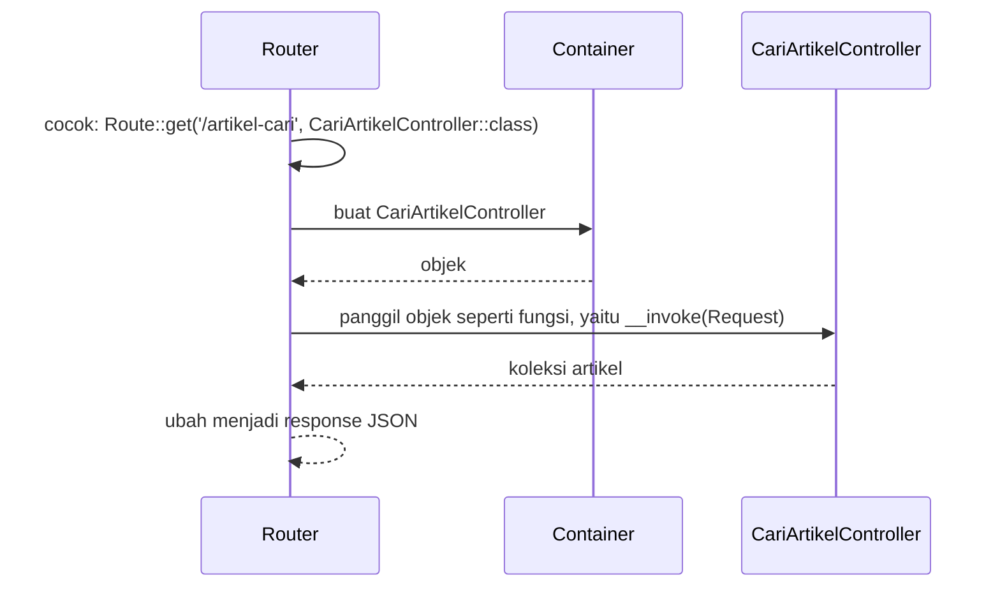

# Single Action Controller

Resource controller cocok untuk sumber daya dengan banyak aksi. Tetapi ada aksi yang berdiri sendiri: menghitung statistik, mengirim ulang email verifikasi, menyiapkan laporan, atau mencari artikel.
Memaksa aksi seperti itu masuk ke controller yang sudah berisi tujuh method membuat controller penuh dan tidak fokus. **Single action controller** adalah controller yang hanya mengerjakan **satu tugas**.

## Tujuan Pembelajaran

Setelah menyelesaikan sub bab ini, kamu dapat:

- [ ] Menjelaskan apa itu single action controller dan metode khusus `__invoke`.
- [ ] Membuat controller satu aksi dengan `php artisan make:controller --invokable`.
- [ ] Mendaftarkan route yang menunjuk langsung ke class controller tanpa nama method.
- [ ] Memindahkan aksi tambahan dari resource controller ke controller satu aksi.
- [ ] Memilih antara controller biasa, resource, dan satu aksi.
- [ ] Memasang middleware dan dependency injection pada controller satu aksi.

## Prasyarat

- Sub bab [Resource Controller](02-13-resource-controllers.md) dan [Membuat Controller](02-12-creating-controllers.md).
- [Class dan Objek](../level-00/00-19-classes-and-objects.md) (method, `$this`) dan [Fungsi](../level-00/00-14-functions.md).
- Proyek `~/belajar-laravel/portal-artikel` dengan Git yang bersih.

## Pengantar

Pada sub bab sebelumnya, `ArtikelController` berisi tujuh aksi resource ditambah `cari`. Dokumentasi menyarankan: jika kamu rutin membutuhkan method di luar aksi resource baku, pertimbangkan
memecah controller menjadi dua yang lebih kecil. Controller satu aksi adalah cara paling ringkas untuk melakukannya.

## Penjelasan Konsep

### Apa itu single action controller?

Menurut dokumentasi, jika sebuah aksi cukup kompleks, kamu bisa mendedikasikan seluruh class controller untuk aksi itu dengan mendefinisikan satu method `__invoke`:

```php
<?php

namespace App\Http\Controllers;

class ProvisionServer extends Controller
{
    /**
     * Provision a new web server.
     */
    public function __invoke()
    {
        // ...
    }
}
```

`__invoke` adalah **metode ajaib** (*magic method*) PHP: bila sebuah objek "dipanggil seperti fungsi" (`$objek()`), PHP menjalankan `__invoke` miliknya. Router Laravel memanfaatkannya: ia membuat objek controller dan memanggilnya.

!!! tip "Analogi"
    Resource controller seperti **loket pelayanan lengkap** dengan tujuh jendela. Controller satu aksi seperti **mesin kasir mandiri**: hanya satu tugas, dan tombolnya cuma satu.

### Mendaftarkan route

Karena hanya ada satu aksi, route cukup menyebut nama class tanpa nama method:

```php-inline
use App\Http\Controllers\ProvisionServer;

Route::post('/server', ProvisionServer::class);
```

Membuatnya dengan Artisan:

```bash
php artisan make:controller ProvisionServer --invokable
```

Stub bawaan menghasilkan class dengan method `__invoke(Request $request)` yang kosong.

### Membandingkan tiga bentuk controller

| | Controller biasa | Resource controller | Single action |
|---|---|---|---|
| Jumlah aksi | Bebas | Tujuh baku (CRUD) | Satu (`__invoke`) |
| Pendaftaran route | `[Kelas::class, 'metode']` | `Route::resource(...)` | `Kelas::class` |
| Cocok untuk | Beberapa aksi terkait yang bukan CRUD | CRUD untuk satu sumber daya | Satu tugas yang berdiri sendiri |
| Contoh | `HalamanController` (tentang, kontak) | `ArtikelController` | `StatistikController`, `CariArtikelController` |

### Kapan memakai satu aksi?

- Aksi tidak termasuk CRUD sumber daya mana pun (misalnya statistik, ekspor, pencarian khusus, webhook).
- Aksi cukup kompleks sehingga layak punya class sendiri.
- Kamu ingin satu route memiliki middleware dan tanggung jawab yang jelas.
- Kamu ingin menguji aksi itu secara terpisah dengan mudah.

Satu aksi tidak cocok bila hanya ada beberapa baris kode di satu tempat; closure atau controller biasa bisa lebih sederhana.

### Penamaan

Beri nama berupa **kata kerja + objek** yang menjelaskan tugasnya, diakhiri `Controller`: `CariArtikelController`, `UnduhLaporanController`, `KirimUlangVerifikasiController`. Nama yang jelas membuat daftar controller
berfungsi sebagai ringkasan fitur aplikasi.

### Dependency injection dan middleware

Karena dibuat oleh service container, controller satu aksi dapat menerima ketergantungan lewat constructor atau argumen `__invoke` (misalnya `Request`). Middleware juga dapat dipasang dengan cara biasa (`->middleware(...)`) atau lewat
`HasMiddleware`/atribut `#[Middleware]` pada class seperti dijelaskan di sub bab Pengantar Controller.

### Keamanan

Satu aksi per class memudahkan pemetaan hak akses: mudah menunjuk "siapa boleh menjalankan `UnduhLaporanController`". Tetap berlaku: validasi masukan, otorisasi, dan jangan membuat route `GET` yang mengubah data.

## Cara Kerja



## Contoh Praktik

Di `portal-artikel` kamu membuat `StatistikController` (statistik artikel) dan `CariArtikelController` (memindahkan pencarian dari `ArtikelController`), mendaftarkan keduanya tanpa nama method, dan memastikan pencarian lama tetap bekerja.

## Penjelasan Kode

File: `app/Http/Controllers/StatistikController.php`

```php
<?php

namespace App\Http\Controllers;

use App\Models\Artikel;

class StatistikController extends Controller
{
    public function __invoke(): array
    {
        return [
            'jumlah' => Artikel::count(),
            'terbaru' => Artikel::orderByDesc('id')->value('judul'),
        ];
    }
}
```

File: `app/Http/Controllers/CariArtikelController.php`

```php
<?php

namespace App\Http\Controllers;

use App\Models\Artikel;
use Illuminate\Database\Eloquent\Collection;
use Illuminate\Http\Request;

class CariArtikelController extends Controller
{
    public function __invoke(Request $request): Collection
    {
        $kata = (string) $request->query('q', '');

        return Artikel::where('judul', 'like', '%' . $kata . '%')
            ->get(['id', 'judul']);
    }
}
```

File: `routes/web.php` (ubah)

```php-inline
use App\Http\Controllers\CariArtikelController;
use App\Http\Controllers\StatistikController;

Route::get('/statistik', StatistikController::class)->name('statistik');
Route::get('/artikel-cari', CariArtikelController::class)->name('artikel.cari');
```

Hapus method `cari` dari `ArtikelController` dan route lama `[ArtikelController::class, 'cari']`.

| Bagian | Penjelasan |
|---|---|
| `__invoke()` | Satu-satunya aksi; dipanggil router |
| `Artikel::count()` | Jumlah baris artikel |
| `orderByDesc('id')->value('judul')` | Judul dari artikel dengan ID terbesar |
| `__invoke(Request $request)` | Method injection `Request` |
| `Route::get('/statistik', StatistikController::class)` | Route tanpa nama method |

## Implementasi Langkah demi Langkah

### Langkah 1: buat controller satu aksi

```bash
cd ~/belajar-laravel/portal-artikel
git status --short
php artisan make:controller StatistikController --invokable
php artisan make:controller CariArtikelController --invokable
cat app/Http/Controllers/StatistikController.php
```

Perhatikan method `__invoke` yang sudah disiapkan stub. Isi kedua controller sesuai Penjelasan Kode.

### Langkah 2: pindahkan pencarian

Hapus method `cari` dari `ArtikelController.php` (dan `use` yang tidak lagi terpakai bila ada), lalu ubah `routes/web.php` seperti pada Penjelasan Kode.

```bash
php -l app/Http/Controllers/ArtikelController.php
php -l app/Http/Controllers/StatistikController.php
php -l app/Http/Controllers/CariArtikelController.php
php -l routes/web.php
php artisan route:list --path=statistik
php artisan route:list --name=artikel.cari
```

Perhatikan kolom aksi: untuk controller satu aksi, tampil nama class tanpa `@metode`.

### Langkah 3: jalankan dan uji

```bash
php artisan serve
```

Di terminal lain (di Windows PowerShell tulis `curl.exe`):

```bash
curl -i http://127.0.0.1:8000/statistik
curl -i "http://127.0.0.1:8000/artikel-cari?q=route"
curl -i "http://127.0.0.1:8000/artikel-cari"
curl -i http://127.0.0.1:8000/artikel
```

Pastikan `/artikel` (resource) tetap bekerja setelah `cari` dipindahkan.

### Langkah 4: coba kesalahan umum

Tambahkan sementara route yang salah:

```php-inline
Route::get('/uji-salah', ArtikelController::class);
```

```bash
curl -i http://127.0.0.1:8000/uji-salah
```

`ArtikelController` tidak punya `__invoke`. Catat pesan error, lalu hapus route percobaan itu.

### Langkah 5: pasang middleware

Pasang `middleware('tandai:statistik')` pada route `/statistik`:

```php-inline
Route::get('/statistik', StatistikController::class)
    ->name('statistik')
    ->middleware('tandai:statistik');
```

```bash
curl -i http://127.0.0.1:8000/statistik
```

Periksa header `X-Portal: statistik`.

### Langkah 6: catat di Git

```bash
git status --short
git add app routes
git commit -m "Tambah controller satu aksi: statistik dan pencarian artikel"
```

## Eksekusi dan Verifikasi

| Langkah | Cara memverifikasi |
|---|---|
| 1 | Dua berkas controller ada, masing-masing memiliki `__invoke` |
| 2 | `php -l` tanpa kesalahan; `route:list` menampilkan aksi tanpa `@metode` |
| 3 | Hasil sesuai tabel hasil yang diharapkan |
| 4 | Pesan error menyebut aksi route yang tidak valid atau method tidak ada |
| 5 | Header `X-Portal: statistik` muncul |
| 6 | `git log --oneline` memuat commit baru |

## Hasil yang Diharapkan

| Permintaan | Status | Isi |
|---|---|---|
| `GET /statistik` | `200` | `{"jumlah":3,"terbaru":"Batasan Route yang Aman"}` (dengan data seeder; tambahkan header `X-Portal: statistik` setelah Langkah 5) |
| `GET /artikel-cari?q=route` | `200` | Artikel yang judulnya memuat "route" |
| `GET /artikel-cari` | `200` | Semua artikel |
| `GET /artikel` | `200` | Daftar artikel dari resource controller (tidak terpengaruh) |
| `GET /uji-salah` | `500` | Error aksi route tidak valid atau method `__invoke` tidak ada (teks mengikuti versi) |

Angka dan judul pada `/statistik` bergantung data di database-mu. Hasil ini diturunkan dari dokumentasi dan perilaku framework, dan belum dijalankan oleh penulis materi; cocokkan dengan hasilmu.

## Kesalahan Umum dan Pemecahan Masalah

| Gejala | Penyebab | Cara mengenali | Solusi | Pencegahan |
|---|---|---|---|---|
| Error `Invalid route action` | Class yang dipasang tidak memiliki `__invoke` | Pesan menyebut aksi tidak valid | Tambahkan `__invoke` atau sebutkan nama method | Gunakan `--invokable` |
| `Method ... does not exist` | `__invoke` salah ketik (mis. `_invoke` satu garis bawah) | Method tidak ditemukan | Gunakan dua garis bawah: `__invoke` | Salin dari stub |
| Route lama masih memanggil `cari` | Route dan method lama tidak dihapus bersamaan | Error method tidak ada setelah dihapus | Hapus route lama dan ganti | Periksa `route:list` setelah memindahkan |
| Controller satu aksi dipakai untuk semuanya | Salah paham fungsi | Puluhan controller kecil untuk CRUD sederhana | Gunakan resource untuk CRUD | Pilih bentuk sesuai tabel perbandingan |
| `use` tidak diperbarui di berkas route | Lupa mengimpor class baru | `Class "..." not found` | Tambahkan `use` | Impor setiap controller baru |
| Nama controller tidak menjelaskan tugas | Nama generik (`HandlerController`) | Sulit memahami fungsi | Pakai kata kerja + objek | Terapkan konvensi penamaan |
| Method injection tidak jalan | Tipe `Request` tidak diimpor | Error class not found | `use Illuminate\Http\Request;` | Cek `use` |
| Perubahan route tak muncul | Cache route | `route:list` lama | `php artisan route:clear` | Jangan `route:cache` saat pengembangan |
| Route percobaan tertinggal | Lupa menghapus `/uji-salah` | `route:list` memuatnya | Hapus | Jalankan pembersihan akhir |

## Latihan Praktik

### Latihan dasar

**D1. Kerangka invokable**
- *Masalah:* butuh controller untuk salam.
- *Persyaratan:* buat `SalamController --invokable` yang mengembalikan `Selamat datang di Portal Artikel` dan daftarkan ke `/salam`.
- *Perilaku yang diharapkan:* `/salam` menampilkan teks itu dan `route:list` menunjukkan aksi tanpa `@metode`.
- *Tujuan belajar:* membuat dan mendaftarkan controller satu aksi.

**D2. Pilih bentuk controller**
- *Masalah:* tentukan bentuk yang tepat.
- *Persyaratan:* untuk lima kebutuhan berikut pilih biasa, resource, atau satu aksi, dengan alasan: CRUD kategori, halaman tentang dan kontak, unduh laporan PDF, webhook pembayaran, daftar penulis read-only.
- *Perilaku yang diharapkan:* pilihan konsisten dengan tabel perbandingan.
- *Tujuan belajar:* memilih bentuk yang tepat.

### Latihan implementasi

**I1. Pecah controller yang membengkak**
- *Masalah:* `HalamanController` mulai berisi banyak hal.
- *Persyaratan:* tambahkan ke `HalamanController` method `statistikPengunjung()` dan `peta()`; lalu pecahkan keduanya menjadi `StatistikPengunjungController` dan `PetaSitusController` (satu aksi), pertahankan nama dan URI route
  dan buktikan dengan `route:list` bahwa nama route tidak berubah.
- *Perilaku yang diharapkan:* URL dan nama route sama, kode lebih terpisah.
- *Tujuan belajar:* refactoring tanpa mengubah antarmuka.

**I2. Controller satu aksi dengan ketergantungan**
- *Masalah:* pencarian butuh pembatasan panjang kata.
- *Persyaratan:* buat `app/Services/Penyaring.php` (metode `bersihkan(string $kata): string` yang memotong spasi dan membatasi 50 karakter), suntikkan lewat constructor `CariArtikelController`, dan uji dengan kata yang sangat panjang.
- *Perilaku yang diharapkan:* kata dipotong 50 karakter.
- *Tujuan belajar:* constructor injection pada controller satu aksi.

### Latihan tantangan

**T1. Kebijakan akses per aksi**
- *Masalah:* tim ingin memetakan siapa boleh menjalankan apa.
- *Persyaratan:* buat tabel yang memetakan setiap controller satu aksi di `portal-artikel` ke middleware yang seharusnya dipasang (publik, kunci admin, dan lainnya) beserta alasan; pasang middleware sesuai tabel, dan tulis skrip `curl` yang
  membuktikan setiap route merespons sesuai kebijakan (mis. 200 untuk publik, 403 tanpa kunci untuk admin).
- *Perilaku yang diharapkan:* skrip melaporkan semua route lolos kebijakan.
- *Tujuan belajar:* menghubungkan tanggung jawab satu aksi dengan kebijakan akses.
- *Catatan:* kerjakan mandiri; tidak ada kunci jawaban.

## Uji Pemahaman

1. Apa itu single action controller?
2. Method apa yang wajib ada dan mengapa disebut ajaib?
3. Bagaimana mendaftarkan route ke controller satu aksi?
4. Perintah apa yang membuat kerangkanya?
5. Kapan sebaiknya memilih controller satu aksi dibanding resource controller?
6. Bagaimana nama controller satu aksi sebaiknya ditulis?
7. Apa yang dapat disuntikkan ke `__invoke`?
8. Apa keuntungan keamanan dan pengujian dari satu aksi per class?

??? success "Kunci jawaban singkat"
    1. Controller yang hanya menangani satu tugas.
    2. `__invoke`; dipanggil PHP ketika objek dipanggil seperti fungsi.
    3. `Route::get('/uri', NamaController::class)` tanpa nama method.
    4. `php artisan make:controller Nama --invokable`.
    5. Saat aksi berdiri sendiri, bukan bagian CRUD sumber daya, atau cukup kompleks untuk class sendiri.
    6. Kata kerja + objek + `Controller`, misalnya `CariArtikelController`.
    7. Ketergantungan dari container, seperti `Request`, lewat argumen atau constructor.
    8. Pemetaan hak akses lebih jelas dan aksi lebih mudah diuji secara terpisah.

## Ringkasan

- Single action controller memiliki satu method `__invoke` dan didaftarkan hanya dengan nama class.
- `php artisan make:controller Nama --invokable` membuat kerangkanya.
- Gunakan untuk tugas yang berdiri sendiri; resource untuk CRUD; controller biasa untuk beberapa aksi terkait.
- Memindahkan aksi di luar CRUD dari resource controller menjaga controller tetap fokus.
- Controller satu aksi mendukung dependency injection dan middleware seperti controller lain.

Selanjutnya: *Objek Request*, yaitu membaca data dan informasi dari request yang masuk.

## Referensi Resmi

- [Laravel: Single Action Controllers](https://laravel.com/docs/13.x/controllers#single-action-controllers)
- [Laravel: Controllers](https://laravel.com/docs/13.x/controllers)
- [Laravel: Supplementing Resource Controllers](https://laravel.com/docs/13.x/controllers#restful-supplementing-resource-controllers)
- [Laravel: Stub Customization](https://laravel.com/docs/13.x/artisan#stub-customization)
- [PHP Manual: Magic methods (`__invoke`)](https://www.php.net/manual/en/language.oop5.magic.php)
