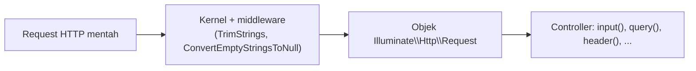

# Objek Request

Setiap request yang masuk membawa banyak informasi: metode, alamat, header, data dari query string, data form, bahkan JSON. Di PHP native kamu membacanya lewat `$_GET`, `$_POST`, dan `$_SERVER`. Di Laravel
semuanya dibungkus dalam satu objek, `Illuminate\Http\Request`, dengan metode yang jelas untuk membaca dan memeriksa setiap bagian request.

## Tujuan Pembelajaran

Setelah menyelesaikan sub bab ini, kamu dapat:

- [ ] Mendapatkan objek `Request` lewat dependency injection pada route atau controller.
- [ ] Membaca informasi request: path, URL, metode, host, IP, header, dan kebutuhan format (JSON atau HTML).
- [ ] Membaca input dengan `input`, `query`, `all`, `only`, `except`, `string`, `integer`, dan `boolean`.
- [ ] Memeriksa keberadaan input dengan `has`, `filled`, dan kawan-kawannya.
- [ ] Menjelaskan efek middleware `TrimStrings` dan `ConvertEmptyStringsToNull`.
- [ ] Menjelaskan mengapa semua input dan sebagian informasi request tidak boleh dipercaya.

## Prasyarat

- Sub bab [Single Action Controller](02-14-single-action-controllers.md) dan [Pengantar Controller](02-11-introduction-to-controllers.md).
- [Request dan Response](../level-00/00-04-request-and-response.md) serta [Penanganan Form PHP](../level-00/00-16-php-form-handling.md): query string, body, dan sifat input yang tidak tepercaya.
- Proyek `~/belajar-laravel/portal-artikel` dengan Git yang bersih.

## Pengantar

Pada proyek siswa, kamu menulis fungsi `ambilTeks($_POST, 'nama')` agar aman terhadap nilai bukan teks, serta memanggil `trim` di berbagai tempat. Objek `Request` Laravel sudah menyediakan banyak hal itu, dan beberapa
(seperti `trim` otomatis) dijalankan oleh middleware sebelum kodemu menyentuh input.

## Penjelasan Konsep

### Mendapatkan objek request

Menurut dokumentasi, cara utama mendapatkan request adalah dengan menaruh type-hint `Illuminate\Http\Request` pada closure route atau method controller; container menyuntikkannya:

```php
<?php

namespace App\Http\Controllers;

use Illuminate\Http\RedirectResponse;
use Illuminate\Http\Request;

class UserController extends Controller
{
    public function store(Request $request): RedirectResponse
    {
        $name = $request->name;

        // Store the user...

        return redirect('/users');
    }
}
```

Bila method juga menerima parameter route, tulis argumen route **setelah** ketergantungan lain: `update(Request $request, string $id)`.

!!! tip "Analogi"
    Objek request adalah **map berisi dokumen kiriman**: alamat pengirim, jenis kiriman, dan isi paket. Kamu membuka bagian yang kamu perlukan lewat metode yang bernama jelas.

### Informasi tentang request

| Metode | Hasil (contoh `http://localhost:8000/foo/bar?x=1`) |
|---|---|
| `path()` | `foo/bar` |
| `url()` | `http://localhost:8000/foo/bar` (tanpa query string) |
| `fullUrl()` | `http://localhost:8000/foo/bar?x=1` |
| `host()` | `localhost` |
| `httpHost()` | `localhost:8000` |
| `schemeAndHttpHost()` | `http://localhost:8000` |
| `method()` | `GET` |
| `isMethod('post')` | `true`/`false` |
| `is('admin/*')` | Apakah path cocok dengan pola |
| `routeIs('admin.*')` | Apakah route aktif cocok dengan nama berpola |
| `ip()` | Alamat IP klien |
| `header('X-Nama', 'bawaan')` | Nilai header, atau nilai bawaan |
| `hasHeader('X-Nama')` | Apakah header ada |
| `bearerToken()` | Token dari header `Authorization` (teks kosong bila tidak ada) |

### Negosiasi konten

Header `Accept` memberi tahu format respons yang diharapkan klien:

| Metode | Arti |
|---|---|
| `getAcceptableContentTypes()` | Daftar tipe konten yang diterima |
| `accepts(['text/html', 'application/json'])` | `true` bila salah satu diterima |
| `prefers([...])` | Tipe yang paling disukai dari daftar |
| `expectsJson()` | `true` bila klien mengharapkan JSON |

Banyak aplikasi hanya melayani HTML atau JSON, sehingga `expectsJson()` sering cukup.

### Membaca input

| Metode | Fungsi |
|---|---|
| `all()` | Semua input sebagai array |
| `input('nama', 'bawaan')` | Satu nilai dari seluruh payload (query string dan body); mendukung notasi titik: `input('user.name')` |
| `input()` | Semua input sebagai array asosiatif |
| `query('nama', 'bawaan')` | Hanya dari query string |
| `string('nama')` | Sebagai objek `Stringable` (mis. `->trim()`), `->toString()` untuk teks |
| `integer('halaman', 1)` | Dikonversi ke bilangan bulat dengan nilai bawaan |
| `boolean('arsip')` | `true` untuk `1`, `"1"`, `true`, `"true"`, `"on"`, `"yes"`; selain itu `false` |
| `only(['a', 'b'])`, `except(['c'])` | Sebagian input |
| `$request->nama` | Properti dinamis: dicari di payload, lalu di parameter route |

Metode `input` bekerja untuk semua metode HTTP. Untuk request JSON, nilai juga dapat dibaca lewat `input` selama header `Content-Type` adalah `application/json`.

!!! warning "`only` tidak membuat kunci yang tidak ada"
    Dokumentasi mengingatkan bahwa `only` hanya mengembalikan pasangan yang **ada** pada request. Kunci yang tidak dikirim tidak muncul di hasil.

### Memeriksa keberadaan input

| Metode | `true` bila |
|---|---|
| `has('nama')` | Nilai ada pada request (walau kosong) |
| `has(['nama', 'email'])` | **Semua** nilai ada |
| `hasAny([...])` | **Salah satu** ada |
| `filled('nama')` | Nilai ada **dan tidak kosong** |
| `missing('nama')` | Nilai tidak ada |

### Normalisasi input otomatis

Menurut dokumentasi, secara bawaan aplikasi memasang dua middleware global: `TrimStrings` (membuang spasi di tepi semua string) dan `ConvertEmptyStringsToNull` (mengubah string kosong menjadi `null`).
Akibatnya:

| Input mentah | Setelah middleware | `has()` | `filled()` |
|---|---|---|---|
| `?q=%20%20halo%20%20` (spasi di tepi) | `"halo"` | `true` | `true` |
| `?q=` (kosong) | `null` | `true` | `false` |
| tanpa `q` | tidak ada | `false` | `false` |

Perilaku ini dapat dimatikan dengan `$middleware->remove([...])` di `bootstrap/app.php`, tetapi sebaiknya dibiarkan aktif kecuali ada alasan khusus.

### Kepercayaan terhadap data request

| Data | Dapat dipercaya? |
|---|---|
| Semua input (query, form, JSON) | **Tidak**: dikendalikan pengguna; validasi dan escape |
| Header seperti `User-Agent`, `Referer`, `X-Forwarded-For` | **Tidak**: dapat dipalsukan |
| `ip()` | Dokumentasi: anggap sebagai input tak tepercaya, hanya untuk informasi |
| Metode HTTP | Ditentukan klien; periksa lewat route dan middleware, bukan asumsi |

Pada keluaran, selalu escape (`e()`/Blade). Pada penyimpanan, jangan memakai `all()` mentah untuk membuat atau mengubah data (*mass assignment*): ambil hanya kolom yang diizinkan dengan `only` atau hasil validasi.
Laravel juga menyediakan pengaturan *trusted proxies* dan *trusted hosts* agar informasi seperti IP dan host dapat dipercaya di belakang proxy (dibahas pada bab Deployment).

## Cara Kerja



Request dibungkus menjadi objek, input dinormalisasi oleh middleware global, lalu objek disuntikkan ke controller melalui container.

## Contoh Praktik

Di `portal-artikel` kamu membuat controller satu aksi `InspeksiRequestController` yang menampilkan hasil berbagai metode `Request`, menguji dengan beragam query string dan header, mengamati normalisasi spasi dan string kosong,
dan (opsional) mengirim JSON lewat `POST`.

## Penjelasan Kode

File: `app/Http/Controllers/InspeksiRequestController.php`

```php
<?php

namespace App\Http\Controllers;

use Illuminate\Http\Request;

class InspeksiRequestController extends Controller
{
    public function __invoke(Request $request): array
    {
        return [
            'metode' => $request->method(),
            'path' => $request->path(),
            'url' => $request->url(),
            'url_lengkap' => $request->fullUrl(),
            'host' => $request->host(),
            'ip' => $request->ip(),
            'user_agent' => $request->userAgent(),
            'ingin_json' => $request->expectsJson(),
            'query' => $request->query(),
            'input' => $request->input(),
            'q' => $request->input('q'),
            'ada_q' => $request->has('q'),
            'terisi_q' => $request->filled('q'),
            'halaman' => $request->integer('halaman', 1),
            'urut' => $request->string('urut', 'terbaru')->toString(),
            'arsip' => $request->boolean('arsip'),
            'hanya' => $request->only(['q', 'urut']),
            'tanpa_arsip' => $request->except(['arsip']),
        ];
    }
}
```

File: `routes/web.php` (tambahkan)

```php-inline
use App\Http\Controllers\InspeksiRequestController;

Route::match(['get', 'post'], '/inspeksi', InspeksiRequestController::class)
    ->name('inspeksi');
```

| Kunci hasil | Penjelasan |
|---|---|
| `metode`, `path`, `url`, `url_lengkap`, `host` | Informasi alamat dan metode |
| `ip`, `user_agent` | Informasi klien (tidak tepercaya) |
| `ingin_json` | `true` bila header `Accept` meminta JSON |
| `query`, `input` | Hanya query string vs seluruh payload |
| `ada_q`, `terisi_q` | Perbedaan `has` dan `filled` |
| `halaman`, `urut`, `arsip` | Pembacaan bertipe dengan nilai bawaan |
| `hanya`, `tanpa_arsip` | Sebagian input |

Route ini hanya untuk belajar karena menampilkan informasi request; **hapus sebelum rilis**.

## Implementasi Langkah demi Langkah

### Langkah 1: buat controller dan route

```bash
cd ~/belajar-laravel/portal-artikel
git status --short
php artisan make:controller InspeksiRequestController --invokable
```

Isi controller sesuai Penjelasan Kode, tambahkan route, lalu:

```bash
php -l app/Http/Controllers/InspeksiRequestController.php
php -l routes/web.php
php artisan route:list --name=inspeksi
```

### Langkah 2: jalankan dan uji tanpa input

```bash
php artisan serve
```

Di terminal lain (di Windows PowerShell tulis `curl.exe`; `-s` menyembunyikan progres):

```bash
curl -s http://127.0.0.1:8000/inspeksi
```

Perhatikan nilai bawaan: `halaman` 1, `urut` `terbaru`, `arsip` `false`, `ada_q` `false`.

### Langkah 3: uji dengan query string

```bash
curl -s "http://127.0.0.1:8000/inspeksi?q=laravel&halaman=3&urut=terlama&arsip=yes&sisa=abc"
```

Periksa `halaman` (3), `urut`, `arsip` (`true`), `hanya` (hanya `q` dan `urut`), dan `tanpa_arsip` (tidak memuat `arsip`).

### Langkah 4: uji normalisasi

```bash
curl -s "http://127.0.0.1:8000/inspeksi?q=%20%20halo%20%20"
curl -s "http://127.0.0.1:8000/inspeksi?q="
curl -s "http://127.0.0.1:8000/inspeksi?halaman=abc"
curl -s "http://127.0.0.1:8000/inspeksi?arsip=false"
```

Bandingkan nilai `q`, `ada_q`, `terisi_q`, `halaman`, dan `arsip` pada keempat permintaan.

### Langkah 5: uji header dan negosiasi konten

```bash
curl -s -H "Accept: application/json" http://127.0.0.1:8000/inspeksi
curl -s -H "User-Agent: AplikasiUji/1.0" http://127.0.0.1:8000/inspeksi
```

Perhatikan `ingin_json` dan `user_agent`.

### Langkah 6 (opsional): kirim JSON lewat `POST`

Route `POST` di grup web membutuhkan token CSRF. Tambahkan route sementara `Route::get('/token', fn () => csrf_token());` (jangan lupa menghapusnya), lalu:

```bash
TOKEN=$(curl -s -c cookies.txt http://127.0.0.1:8000/token)
curl -s -b cookies.txt -X POST \
  -H "X-CSRF-TOKEN: $TOKEN" \
  -H "Content-Type: application/json" \
  -H "Accept: application/json" \
  -d '{"q":"  uji json  ","urut":"terlama","user":{"nama":"Budi"}}' \
  http://127.0.0.1:8000/inspeksi
rm cookies.txt
```

Perhatikan `metode` `POST`, `q` yang dipotong spasi, dan bahwa `query` kosong sementara `input` berisi data JSON. Hapus route `/token` setelah selesai.

### Langkah 7: bersihkan dan catat di Git

Hapus route `/token` (bila ada). Pertimbangkan menghapus `/inspeksi` sebelum rilis; untuk latihan boleh disimpan.

```bash
git status --short
git add app routes
git commit -m "Tambah controller inspeksi request"
```

## Eksekusi dan Verifikasi

| Langkah | Cara memverifikasi |
|---|---|
| 1 | `route:list` menampilkan route `inspeksi` dengan metode `GET|POST|HEAD` |
| 2 | Hasil menunjukkan nilai bawaan |
| 3 | Pembacaan bertipe sesuai (`halaman` bilangan bulat, `arsip` boolean) |
| 4 | `q` berubah menjadi `"halo"` (tanpa spasi) atau `null` |
| 5 | `ingin_json` `true` dengan header `Accept`; `user_agent` sesuai |
| 6 | JSON terbaca lewat `input`, dan `query` kosong |
| 7 | `git log --oneline` memuat commit baru |

## Hasil yang Diharapkan

Untuk `GET /inspeksi?q=laravel&halaman=3&urut=terlama&arsip=yes&sisa=abc`, JSON hasil kira-kira berisi:

```json
{
    "metode": "GET",
    "path": "inspeksi",
    "url": "http://127.0.0.1:8000/inspeksi",
    "host": "127.0.0.1",
    "ip": "127.0.0.1",
    "ingin_json": false,
    "q": "laravel",
    "ada_q": true,
    "terisi_q": true,
    "halaman": 3,
    "urut": "terlama",
    "arsip": true,
    "hanya": {"q": "laravel", "urut": "terlama"}
}
```

Kunci lain (`url_lengkap`, `user_agent`, `query`, `input`, `tanpa_arsip`) juga muncul; urutan parameter pada `url_lengkap` dapat disusun ulang oleh Laravel.

| Permintaan | Hasil penting |
|---|---|
| Tanpa input | `halaman` 1, `urut` `terbaru`, `arsip` `false`, `ada_q` `false` |
| `?q=%20%20halo%20%20` | `q` `"halo"`, `ada_q` `true`, `terisi_q` `true` |
| `?q=` | `q` `null`, `ada_q` `true`, `terisi_q` `false` |
| `?halaman=abc` | `halaman` `0` (konversi `integer` tidak mengembalikan nilai bawaan untuk teks non-angka) |
| `?arsip=false` | `arsip` `false` |
| Header `Accept: application/json` | `ingin_json` `true` |
| `POST` JSON dengan token | `metode` `POST`, `q` `"uji json"`, `query` kosong |

Nilai `halaman` untuk `abc` bergantung implementasi konversi; catat apa yang kamu lihat dan jelaskan perbedaannya dengan nilai bawaan `1`. Hasil ini diturunkan dari dokumentasi, dan belum dijalankan oleh penulis
materi; cocokkan dengan hasilmu.

## Kesalahan Umum dan Pemecahan Masalah

| Gejala | Penyebab | Cara mengenali | Solusi | Pencegahan |
|---|---|---|---|---|
| `Class "Request" not found` | Lupa `use Illuminate\Http\Request;` | Pesan error saat dijalankan | Tambahkan `use` | Periksa `use` di atas berkas |
| `input('nama')` bernilai `null` padahal dikirim | Nama field berbeda atau dikirim di tempat lain | `input()` tanpa argumen tidak memuatnya | Cocokkan nama field; periksa `query()` dan `input()` | Cetak `input()` saat debugging |
| JSON tidak terbaca | Header `Content-Type` bukan `application/json` | `input()` kosong | Kirim `-H "Content-Type: application/json"` | Selalu set header |
| `419` pada `POST` | Tidak ada token CSRF | Pesan Page Expired | Sertakan token | Ingat CSRF pada route web |
| String kosong terbaca `null` | `ConvertEmptyStringsToNull` aktif | `q` bernilai `null` | Terima perilaku ini atau matikan dengan sadar | Periksa dengan `filled()` |
| Spasi hilang dari input | `TrimStrings` aktif | Nilai terpotong | Terima atau kecualikan field tertentu | Pahami normalisasi bawaan |
| `only()` tidak menyertakan kunci | Kunci tidak dikirim | Hasil lebih kecil dari harapan | Beri nilai bawaan setelahnya | Ingat perilaku `only` |
| Mempercayai IP/header | Menganggap data klien benar | Pemeriksaan akses berdasar `X-Forwarded-For` | Jangan jadikan dasar keamanan | Perlakukan sebagai informasi |
| Route inspeksi tertinggal di produksi | Lupa menghapus | `route:list` memuat `inspeksi` | Hapus | Daftar periksa rilis |

## Latihan Praktik

### Latihan dasar

**D1. Salam dari query string**
- *Masalah:* sapaan memakai nama dari query string.
- *Persyaratan:* buat route `/sapa-q` yang mengembalikan `Halo, {nama}!` dari `?nama=` (ter-escape dengan `e()`), nilai bawaan `Tamu`.
- *Perilaku yang diharapkan:* tanpa `?nama` menjadi `Halo, Tamu!`.
- *Tujuan belajar:* `query()` dengan nilai bawaan.

**D2. Bedakan `has` dan `filled`**
- *Masalah:* form pencarian bisa dikirim kosong.
- *Persyaratan:* buat route yang mengembalikan `['ada' => has('q'), 'terisi' => filled('q')]` dan uji `?q=`, `?q=%20`, `?q=abc`, serta tanpa `q`. Tulis tabel hasil dan jelaskan perbedaannya.
- *Perilaku yang diharapkan:* `?q=%20` menghasilkan `ada` `true`, `terisi` `false` (spasi dipotong menjadi kosong, lalu `null`).
- *Tujuan belajar:* memahami `has`, `filled`, dan normalisasi.

### Latihan implementasi

**I1. Pagination dari query string**
- *Masalah:* daftar artikel perlu paginasi manual.
- *Persyaratan:* ubah `ArtikelController::index` agar membaca `halaman` (bilangan bulat, minimal 1) dan `per_halaman` (1-50, bawaan 10) dari query string, membatasi nilai di luar rentang, dan memotong hasil dengan `skip`/`take` pada query. Uji dengan nilai
  wajar dan tidak wajar (`-5`, `0`, `1000`, `abc`).
- *Perilaku yang diharapkan:* nilai tidak wajar dijepit ke batas yang aman, tidak menimbulkan error.
- *Tujuan belajar:* membaca input bertipe dan membatasi rentang.

**I2. Negosiasi konten**
- *Masalah:* satu route melayani dua format.
- *Persyaratan:* buat `/ringkasan` yang mengembalikan JSON bila `expectsJson()` dan teks biasa selain itu. Uji dengan dan tanpa header `Accept: application/json`.
- *Perilaku yang diharapkan:* format respons berubah mengikuti header.
- *Tujuan belajar:* memakai `expectsJson`.

### Latihan tantangan

**T1. Audit pemakaian input**
- *Masalah:* tim ingin memastikan tidak ada input mentah yang dipakai berbahaya.
- *Persyaratan:* periksa semua controller dan route di `portal-artikel`; untuk setiap pemakaian `$request->all()`, `input()`, atau `query()`, catat (a) apakah nilainya di-escape saat keluaran, (b) apakah divalidasi, dan (c) apakah dipakai untuk
  query/penyimpanan. Perbaiki yang tidak aman dan sertakan uji `curl` yang membuktikan perbaikan (mis. dengan masukan `<script>`).
- *Perilaku yang diharapkan:* tidak ada input mentah yang tampil tanpa escape atau masuk penyimpanan tanpa validasi.
- *Tujuan belajar:* mengaudit penanganan input.
- *Catatan:* kerjakan mandiri; tidak ada kunci jawaban.

## Uji Pemahaman

1. Bagaimana mendapatkan objek `Request` di controller?
2. Apa beda `input()` dan `query()`?
3. Apa beda `has()` dan `filled()`?
4. Apa yang dilakukan middleware `TrimStrings` dan `ConvertEmptyStringsToNull`?
5. Kapan `boolean('arsip')` bernilai `true`?
6. Mengapa `only()` lebih aman daripada `all()` saat menyimpan data?
7. Apa fungsi `expectsJson()`?
8. Mengapa IP dan header request tidak boleh dipercaya?

??? success "Kunci jawaban singkat"
    1. Type-hint `Illuminate\Http\Request` pada method (atau closure); container menyuntikkannya.
    2. `input()` membaca seluruh payload (query string dan body, termasuk JSON); `query()` hanya query string.
    3. `has()` benar bila nilai ada (walau kosong); `filled()` benar bila ada dan tidak kosong.
    4. Membuang spasi di tepi string dan mengubah string kosong menjadi `null` secara otomatis.
    5. Untuk `1`, `"1"`, `true`, `"true"`, `"on"`, dan `"yes"`.
    6. `only()` mengambil kunci yang diizinkan saja sehingga tidak ada kolom tak terduga yang ikut tersimpan (mass assignment).
    7. Memeriksa apakah klien mengharapkan respons JSON (lewat header `Accept`).
    8. Dikendalikan klien sehingga dapat dipalsukan.

## Ringkasan

- `Illuminate\Http\Request` membungkus semua data request dan disuntikkan lewat type-hint.
- Informasi request: `path`, `url`, `fullUrl`, `host`, `method`, `ip`, `header`, dan `expectsJson`.
- Input: `input`, `query`, `all`, `only`, `except`, `string`, `integer`, `boolean`; kehadiran: `has`, `hasAny`, `filled`, `missing`.
- `TrimStrings` dan `ConvertEmptyStringsToNull` menormalisasi input secara global; `filled()` dan `has()` bereaksi berbeda.
- Semua input dan sebagian besar informasi request tidak tepercaya: validasi, escape, dan batasi dengan `only`.

Selanjutnya: *Objek Response*, yaitu membuat berbagai jenis jawaban dari aplikasi.

## Referensi Resmi

- [Laravel: HTTP Requests](https://laravel.com/docs/13.x/requests)
- [Laravel: Interacting With The Request](https://laravel.com/docs/13.x/requests#interacting-with-the-request)
- [Laravel: Retrieving Input](https://laravel.com/docs/13.x/requests#retrieving-input)
- [Laravel: Input Presence](https://laravel.com/docs/13.x/requests#input-presence)
- [Laravel: Input Trimming and Normalization](https://laravel.com/docs/13.x/requests#input-trimming-and-normalization)
- [Laravel: Content Negotiation](https://laravel.com/docs/13.x/requests#content-negotiation)
- [Laravel: Configuring Trusted Proxies](https://laravel.com/docs/13.x/requests#configuring-trusted-proxies)
