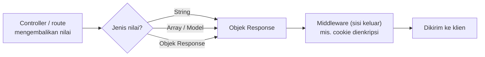

# Objek Response

Setiap request harus dijawab. Jawaban itu berupa response HTTP: kode status, header, dan isi (body). Sub bab ini membahas cara Laravel membentuk response, mulai dari mengembalikan teks biasa sampai menyusun objek `Response` lengkap dengan status, header, dan cookie.

## Tujuan Pembelajaran

Setelah menyelesaikan sub bab ini, kamu dapat:

- [ ] Menjelaskan bahwa nilai kembalian route atau controller diubah Laravel menjadi response HTTP.
- [ ] Mengembalikan string, array, dan model Eloquent, serta menjelaskan konversinya.
- [ ] Membuat objek response dengan `response()` dan mengatur kode status.
- [ ] Menambahkan dan menghapus header dengan `header`, `withHeaders`, dan `withoutHeader`.
- [ ] Menambahkan cookie ke response dan menjelaskan enkripsi cookie bawaan.
- [ ] Memeriksa response dengan `curl -i`.

## Prasyarat

- Sub bab [Objek Request](02-15-request-object.md).
- [Request dan Response](../level-00/00-04-request-and-response.md): kode status dan header HTTP.
- Proyek `~/belajar-laravel/portal-artikel` dengan Git yang bersih.

## Pengantar

Sejauh ini route kita hanya mengembalikan teks atau array. Di balik layar, Laravel mengubah nilai itu menjadi objek response. Untuk mengontrol kode status (mis. `201 Created`), header khusus, atau cookie, kamu perlu membuat objek response sendiri.

## Penjelasan Konsep

### Apa yang boleh dikembalikan

Menurut dokumentasi, semua route dan controller harus mengembalikan response. Beberapa bentuk yang umum:

| Nilai kembalian | Hasil |
|---|---|
| String | Menjadi response HTML/teks penuh |
| Array | Otomatis menjadi response JSON |
| Model atau koleksi Eloquent | Otomatis menjadi JSON, menghormati *hidden attributes* model |
| Objek `Response` | Dikirim apa adanya (status, header, isi dapat diatur) |
| View | Dibahas pada bab Blade |
| Redirect, JSON, unduhan | Dibahas pada tiga sub bab berikutnya |

### Membuat objek response

```php-inline
return response('Hello World', 200)
    ->header('Content-Type', 'text/plain');
```

`Illuminate\Http\Response` mewarisi `Symfony\Component\HttpFoundation\Response`, sehingga metode Symfony juga tersedia, dan banyak metode dapat dirangkai (*chainable*).

### Header

| Metode | Fungsi |
|---|---|
| `header('Nama', 'nilai')` | Menambah satu header |
| `withHeaders([...])` | Menambah banyak header sekaligus |
| `withoutHeader('X-Debug')` | Menghapus header (juga menerima array) |

Middleware `cache.headers` dapat mengatur `Cache-Control` untuk sekelompok route (dibahas lebih lanjut pada bab performa).

### Cookie

| Cara | Keterangan |
|---|---|
| `->cookie('nama', 'nilai', $menit)` | Menambah cookie ke objek response |
| `Cookie::queue('nama', 'nilai', $menit)` | Mengantre cookie bila response belum ada |
| `->withoutCookie('nama')` | Menghapus cookie (dikedaluwarsakan) |

!!! warning "Keamanan cookie"
    Menurut dokumentasi, middleware `EncryptCookies` mengenkripsi dan menandatangani semua cookie yang dibuat Laravel sehingga klien tidak dapat membaca atau mengubahnya. Menonaktifkan enkripsi
    hampir tidak pernah dianjurkan karena membuka data ke sisi klien dan risiko pemalsuan. Jangan menyimpan data rahasia di cookie tanpa alasan kuat, dan pertimbangkan atribut `secure` dan `httpOnly`.

!!! tip "Analogi"
    Response adalah **paket balasan**: kode status adalah stempel di luar paket ("berhasil", "tidak ditemukan"), header adalah label pengiriman, dan body adalah isi paket.

## Cara Kerja



Nilai kembalian dinormalisasi menjadi objek response, melewati middleware sisi keluar, lalu dikirim.

## Contoh Praktik

Di `portal-artikel` kamu membuat `ContohResponseController` dengan beberapa route yang mengembalikan string, array, response dengan status khusus, header kustom, dan cookie. Hasilnya diperiksa dengan `curl -i`.

## Penjelasan Kode

File: `app/Http/Controllers/ContohResponseController.php`

```php
<?php

namespace App\Http\Controllers;

use App\Models\Artikel;
use Illuminate\Http\Response;

class ContohResponseController extends Controller
{
    public function teks(): string
    {
        return 'Halo dari portal artikel';
    }

    public function larik(): array
    {
        return ['status' => 'ok', 'jumlah' => 3];
    }

    public function model(): Artikel
    {
        return Artikel::query()->firstOrFail();
    }

    public function status(): Response
    {
        return response('Dibuat', 201)
            ->header('Content-Type', 'text/plain');
    }

    public function header(): Response
    {
        return response('Lihat header')
            ->withHeaders([
                'X-Portal-Versi' => '1',
                'X-Debug' => 'hapus-saya',
            ])
            ->withoutHeader('X-Debug');
    }

    public function cookie(): Response
    {
        return response('Cookie dikirim')
            ->cookie('tema', 'gelap', 60, '/', null, false, true);
    }
}
```

File: `routes/web.php` (tambahkan)

```php-inline
use App\Http\Controllers\ContohResponseController;

Route::prefix('contoh-response')->name('contoh.')->controller(ContohResponseController::class)->group(function () {
    Route::get('teks', 'teks')->name('teks');
    Route::get('larik', 'larik')->name('larik');
    Route::get('model', 'model')->name('model');
    Route::get('status', 'status')->name('status');
    Route::get('header', 'header')->name('header');
    Route::get('cookie', 'cookie')->name('cookie');
});
```

| Bagian | Penjelasan |
|---|---|
| `teks()` | String menjadi response teks/HTML |
| `larik()` | Array otomatis menjadi JSON |
| `model()` | Model otomatis menjadi JSON (kolom `hidden` tidak ikut) |
| `response('Dibuat', 201)` | Response dengan kode status `201` |
| `withHeaders` + `withoutHeader` | Menambah dua header lalu menghapus satu |
| `->cookie('tema', 'gelap', 60, '/', null, false, true)` | Nama, nilai, menit, path, domain, secure, httpOnly |

Argumen cookie mengikuti urutan dokumentasi: `$minutes, $path, $domain, $secure, $httpOnly`. Pada produksi dengan HTTPS, `secure` sebaiknya `true`.

## Implementasi Langkah demi Langkah

### Langkah 1: buat controller dan route

```bash
cd ~/belajar-laravel/portal-artikel
git status --short
php artisan make:controller ContohResponseController
```

Isi controller dan route sesuai Penjelasan Kode, lalu:

```bash
php -l app/Http/Controllers/ContohResponseController.php
php -l routes/web.php
php artisan route:list --name=contoh
```

### Langkah 2: jalankan server

```bash
php artisan serve
```

### Langkah 3: periksa string dan array

Di terminal lain (Windows PowerShell: `curl.exe`). Opsi `-i` menampilkan header:

```bash
curl -i http://127.0.0.1:8000/contoh-response/teks
curl -i http://127.0.0.1:8000/contoh-response/larik
```

Bandingkan header `Content-Type` kedua response.

### Langkah 4: periksa model

Pastikan seeder sudah dijalankan (`php artisan migrate --seed`), lalu:

```bash
curl -i http://127.0.0.1:8000/contoh-response/model
```

### Langkah 5: periksa status dan header

```bash
curl -i http://127.0.0.1:8000/contoh-response/status
curl -i http://127.0.0.1:8000/contoh-response/header
```

### Langkah 6: periksa cookie

```bash
curl -i http://127.0.0.1:8000/contoh-response/cookie
```

Perhatikan header `Set-Cookie`: nilai cookie `tema` terenkripsi, bukan `gelap`.

### Langkah 7: catat di Git

```bash
git status --short
git add app routes
git commit -m "Tambah contoh berbagai jenis response"
```

## Eksekusi dan Verifikasi

| Langkah | Cara memverifikasi |
|---|---|
| 1 | `route:list` memuat enam route `contoh.*` |
| 3 | Teks: `Content-Type` HTML/teks; array: `application/json` |
| 4 | Model diterima sebagai JSON |
| 5 | Status `201`; header `X-Portal-Versi` ada, `X-Debug` tidak ada |
| 6 | Ada `Set-Cookie: tema=...` dengan nilai terenkripsi |
| 7 | `git log --oneline` memuat commit baru |

## Hasil yang Diharapkan

Hasil di bawah diturunkan dari dokumentasi dan belum dijalankan oleh penulis materi; nilai tepatnya (mis. header tambahan, tanggal, nilai cookie) akan berbeda.

| Permintaan | Hasil penting |
|---|---|
| `/contoh-response/teks` | Status `200`, isi `Halo dari portal artikel` |
| `/contoh-response/larik` | Status `200`, `Content-Type: application/json`, isi `{"status":"ok","jumlah":3}` |
| `/contoh-response/model` | Status `200`, JSON berisi kolom artikel |
| `/contoh-response/status` | Status `201 Created`, `Content-Type: text/plain` |
| `/contoh-response/header` | Header `X-Portal-Versi: 1`, tanpa `X-Debug` |
| `/contoh-response/cookie` | Header `Set-Cookie: tema=<nilai terenkripsi>; ... HttpOnly` |

## Kesalahan Umum dan Pemecahan Masalah

| Gejala | Penyebab | Cara mengenali | Solusi | Pencegahan |
|---|---|---|---|---|
| `Class "Response" not found` / tipe salah | Lupa `use Illuminate\Http\Response;` | Error saat dijalankan | Tambahkan `use` | Periksa `use` |
| Model tidak ditemukan (`404`) | Tabel kosong, `firstOrFail` gagal | Respons `404` pada `/model` | Jalankan `migrate --seed` | Seed data lebih dulu |
| Header tidak muncul | Lupa `-i` pada `curl` | Hanya body yang tampil | Tambahkan `-i` | Biasakan `curl -i` |
| Nilai cookie tidak terbaca | Cookie terenkripsi | `Set-Cookie` berisi teks acak | Normal; baca lewat `$request->cookie()` | Jangan baca nilai dari browser |
| Cookie tidak terkirim di HTTPS | `secure` salah/`SameSite` | Cookie tidak tersimpan | Atur argumen cookie dengan benar | Uji di lingkungan mirip produksi |
| Data sensitif bocor di JSON | Mengembalikan model utuh | Kolom rahasia ikut tampil | Atur `hidden` pada model atau pilih kolom | Tinjau setiap keluaran JSON |
| Status tidak sesuai | Argumen kedua `response()` salah | `curl -i` menunjukkan kode lain | Perbaiki kode status | Periksa dengan `-i` |

## Latihan Praktik

### Latihan dasar

**D1. Status khusus**
- *Masalah:* beberapa endpoint perlu menandai hasil dengan kode yang tepat.
- *Persyaratan:* buat route `/contoh-response/tidak-ada` yang mengembalikan teks `Tidak ada` dengan status `404`. Buktikan dengan `curl -i`.
- *Perilaku yang diharapkan:* baris status menunjukkan `404`.
- *Tujuan belajar:* mengatur kode status.

**D2. Header kustom**
- *Masalah:* respons perlu label versi.
- *Persyaratan:* buat route yang menambahkan `X-Portal-Versi` dan `X-Lingkungan` (nilai dari `app()->environment()`), lalu hapus salah satunya di route kedua.
- *Perilaku yang diharapkan:* header sesuai.
- *Tujuan belajar:* `withHeaders` dan `withoutHeader`.

### Latihan implementasi

**I1. Cookie preferensi**
- *Masalah:* pengguna ingin menyimpan tema tampilan.
- *Persyaratan:* buat `/tema/{nama}` yang hanya menerima `terang` atau `gelap` (gunakan `whereIn`), menyimpan cookie `tema` selama 30 hari, dan `/tema` yang membaca cookie dengan `$request->cookie('tema', 'terang')`. Pastikan nilai di luar daftar ditolak.
- *Perilaku yang diharapkan:* nilai tersimpan dan terbaca ulang; nilai lain `404`.
- *Tujuan belajar:* cookie dan batasan route.

**I2. Pilih kolom JSON**
- *Masalah:* mengembalikan model utuh dapat membuka kolom yang tidak perlu.
- *Persyaratan:* buat route yang mengembalikan daftar artikel hanya dengan `judul` dan `slug` (`select` atau `only`). Bandingkan dengan keluaran model utuh.
- *Perilaku yang diharapkan:* hanya dua kolom muncul.
- *Tujuan belajar:* membatasi data yang dikirim.

### Latihan tantangan

**T1. Peninjauan header keamanan**
- *Masalah:* tim ingin menambah header keamanan dasar.
- *Persyaratan:* buat middleware sisi keluar yang menambahkan `X-Content-Type-Options: nosniff` ke semua response web. Daftarkan di `bootstrap/app.php`, buktikan dengan `curl -i`, dan tulis catatan singkat tentang tujuan header itu (rujuk dokumentasi resmi, jangan mengarang).
- *Perilaku yang diharapkan:* header muncul pada semua route web.
- *Tujuan belajar:* middleware sisi keluar dan header keamanan.
- *Catatan:* kerjakan mandiri; tidak ada kunci jawaban.

## Uji Pemahaman

1. Apa yang terjadi bila route mengembalikan array?
2. Bagaimana membuat response dengan status `201`?
3. Apa beda `header()` dan `withHeaders()`?
4. Bagaimana menghapus header dari response?
5. Mengapa nilai cookie Laravel tampak acak di `Set-Cookie`?
6. Kapan `Cookie::queue()` dipakai?
7. Mengapa mengembalikan model utuh perlu hati-hati?
8. Untuk apa opsi `-i` pada `curl`?

??? success "Kunci jawaban singkat"
    1. Diubah otomatis menjadi response JSON.
    2. `response('isi', 201)`.
    3. `header()` menambah satu header; `withHeaders()` menambah banyak sekaligus lewat array.
    4. `withoutHeader('Nama')`.
    5. Karena `EncryptCookies` mengenkripsi dan menandatangani cookie.
    6. Saat belum ada objek response untuk dilampiri cookie.
    7. Semua atribut yang tidak `hidden` ikut menjadi JSON, sehingga data tak perlu bisa bocor.
    8. Menampilkan header response selain body.

## Ringkasan

- Nilai kembalian route dan controller diubah menjadi response HTTP.
- String menjadi isi, array dan model menjadi JSON, `response()` memberi kendali penuh atas status, header, dan isi.
- Header diatur dengan `header`, `withHeaders`, `withoutHeader`; cookie dengan `cookie` atau `Cookie::queue`.
- Cookie dienkripsi secara bawaan; jangan matikan tanpa alasan kuat.
- Batasi data yang dikirim dalam JSON agar tidak membocorkan kolom sensitif.

Selanjutnya: *Redirect Response*, yaitu mengarahkan pengguna ke alamat lain.

## Referensi Resmi

- [Laravel: HTTP Responses](https://laravel.com/docs/13.x/responses)
- [Laravel: Creating Responses](https://laravel.com/docs/13.x/responses#creating-responses)
- [Laravel: Attaching Headers to Responses](https://laravel.com/docs/13.x/responses#attaching-headers-to-responses)
- [Laravel: Attaching Cookies to Responses](https://laravel.com/docs/13.x/responses#attaching-cookies-to-responses)
- [Laravel: Cookies and Encryption](https://laravel.com/docs/13.x/responses#cookies-and-encryption)
