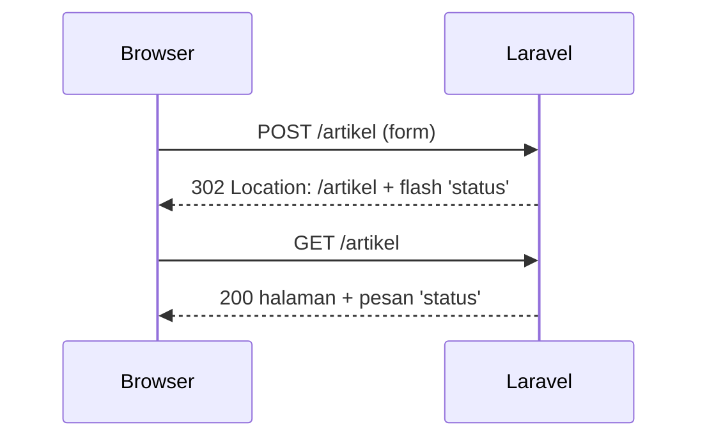

# Redirect Response

Setelah pengguna mengirim form atau menyelesaikan suatu aksi, aplikasi biasanya tidak langsung menampilkan halaman, melainkan **mengarahkan** browser ke alamat lain. Sub bab ini membahas `RedirectResponse`: redirect ke URL, route bernama, aksi controller, domain eksternal, serta membawa pesan dan input lewat session.

## Tujuan Pembelajaran

Setelah menyelesaikan sub bab ini, kamu dapat:

- [ ] Menjelaskan apa itu redirect dan bagaimana browser menanganinya (status `3xx` dan header `Location`).
- [ ] Membuat redirect dengan `redirect()`, `redirect()->route()`, `to_route()`, dan `redirect()->action()`.
- [ ] Memakai `back()` dan memahami ketergantungannya pada session.
- [ ] Mengirim pesan satu kali dengan `with()` dan input lama dengan `withInput()`.
- [ ] Menjelaskan risiko *open redirect* dan perilaku `away()`.
- [ ] Memeriksa redirect dengan `curl -i` dan `curl -L`.

## Prasyarat

- Sub bab [Objek Response](02-16-response-object.md) dan [Named Route](02-05-named-routes.md).
- Proyek `~/belajar-laravel/portal-artikel` dengan Git yang bersih.

## Pengantar

Bayangkan form tambah artikel dikirim lewat `POST`. Bila server langsung menampilkan halaman hasil, dan pengguna menekan *refresh*, browser akan mengirim ulang form yang sama. Pola yang lebih aman adalah **Post/Redirect/Get**: setelah `POST` berhasil, server membalas redirect, lalu browser membuka halaman tujuan dengan `GET`.

## Penjelasan Konsep

### Apa itu redirect

Redirect adalah response dengan kode status `3xx` (umumnya `302`) dan header `Location` berisi alamat tujuan. Browser otomatis membuka alamat itu. Menurut dokumentasi, response ini adalah instance `Illuminate\Http\RedirectResponse`.

### Cara membuat redirect

| Cara | Fungsi |
|---|---|
| `redirect('/home/dashboard')` | Ke URL di dalam aplikasi |
| `redirect()->route('login')` | Ke route bernama |
| `redirect()->route('profil', ['id' => 1])` | Route bernama dengan parameter |
| `redirect()->route('profil', [$user])` | Parameter diambil dari model (kunci route model) |
| `to_route('login')` | Helper singkat setara `redirect()->route()` |
| `redirect()->action([UserController::class, 'index'])` | Ke aksi controller |
| `redirect()->away('https://contoh.com')` | Ke domain luar |
| `back()` | Ke lokasi sebelumnya |

Untuk model, nilai yang masuk ke parameter route mengikuti kunci route model yang sudah kamu pelajari di [Route Model Binding](02-10-route-model-binding.md) (mis. `slug` bila model memakai `#[RouteKey('slug')]`, atau sesuai definisi `{id:slug}` pada route).

### Membawa data lewat session

| Metode | Fungsi |
|---|---|
| `->with('status', 'Tersimpan')` | Menaruh pesan *flash* di session untuk request berikutnya |
| `->withInput()` | Menaruh input request saat ini di session (untuk mengisi ulang form) |
| `session('status')` | Membaca pesan di request berikutnya |
| `old('judul')` | Membaca input lama (di Blade) |

Data *flash* hanya tersedia pada **satu** request berikutnya, lalu hilang. Karena memakai session, `back()` dan `with()` mensyaratkan route berada di grup middleware `web`.

### Keamanan: open redirect

Redirect ke alamat yang berasal dari input pengguna (mis. `?kembali=https://situs-jahat.test`) memungkinkan penyerang membuat tautan yang tampak sah namun mengirim korban ke situs lain (*open redirect*, dipakai untuk phishing). Aturannya:

- Jangan mengarahkan ke URL mentah dari query string atau form.
- Lebih baik memakai route bernama atau daftar tujuan yang diizinkan.
- Dokumentasi menyebut `away()` membuat redirect **tanpa** encoding, validasi, atau verifikasi tambahan, sehingga hanya gunakan untuk alamat yang kamu tentukan sendiri.

!!! tip "Analogi"
    Redirect adalah **papan penunjuk**: "Loket ini pindah ke ruang sebelah." Pemilik gedung menulis papan itu; kamu tidak mau papan yang tulisannya ditentukan sembarang pengunjung.

## Cara Kerja



Setelah aksi berhasil, server membalas `302`. Browser mengikuti `Location` dengan `GET`; pesan flash dibaca sekali lalu dihapus.

## Contoh Praktik

Di `portal-artikel` kamu membuat `ContohRedirectController` berisi beberapa route `GET` yang mengarahkan ke tujuan berbeda. Route `GET` dipilih supaya mudah diuji dengan `curl` tanpa token CSRF; pada aplikasi nyata, redirect setelah form biasanya menyertai `POST`.

## Penjelasan Kode

File: `app/Http/Controllers/ContohRedirectController.php`

```php
<?php

namespace App\Http\Controllers;

use App\Models\Artikel;
use Illuminate\Http\RedirectResponse;

class ContohRedirectController extends Controller
{
    public function keUrl(): RedirectResponse
    {
        return redirect('/tentang');
    }

    public function keRoute(): RedirectResponse
    {
        return to_route('artikel.index');
    }

    public function keArtikel(): RedirectResponse
    {
        $artikel = Artikel::query()->firstOrFail();

        return redirect()->route('artikel.show', [$artikel]);
    }

    public function keAksi(): RedirectResponse
    {
        return redirect()->action([HalamanController::class, 'tentang']);
    }

    public function denganPesan(): RedirectResponse
    {
        return redirect('/contoh-redirect/pesan')
            ->with('status', 'Artikel berhasil disimpan');
    }

    public function pesan(): string
    {
        return session('status', 'Tidak ada pesan');
    }
}
```

File: `routes/web.php` (tambahkan)

```php-inline
use App\Http\Controllers\ContohRedirectController;

Route::prefix('contoh-redirect')->name('redirect.')->controller(ContohRedirectController::class)->group(function () {
    Route::get('url', 'keUrl');
    Route::get('route', 'keRoute');
    Route::get('artikel', 'keArtikel');
    Route::get('aksi', 'keAksi');
    Route::get('dengan-pesan', 'denganPesan');
    Route::get('pesan', 'pesan');
});
```

| Bagian | Penjelasan |
|---|---|
| `redirect('/tentang')` | Redirect ke URL; status bawaan `302` |
| `to_route('artikel.index')` | Redirect ke route bernama `artikel.index` (dari `Route::resource`) |
| `route('artikel.show', [$artikel])` | Parameter diisi dari model; nilainya mengikuti kunci route model |
| `action([HalamanController::class, 'tentang'])` | Redirect ke aksi controller; membutuhkan route yang terdaftar untuk aksi itu |
| `with('status', ...)` | Flash satu kali ke session |
| `session('status', 'Tidak ada pesan')` | Membaca flash, dengan nilai bawaan |

`HalamanController` berada di namespace yang sama (`App\Http\Controllers`), sehingga tidak perlu `use`.
Method `tentang` dan route `/tentang` dibuat pada sub bab sebelumnya; bila namamu berbeda, sesuaikan.

## Implementasi Langkah demi Langkah

### Langkah 1: buat controller dan route

```bash
cd ~/belajar-laravel/portal-artikel
git status --short
php artisan make:controller ContohRedirectController
```

Isi controller dan route sesuai Penjelasan Kode, lalu:

```bash
php -l app/Http/Controllers/ContohRedirectController.php
php -l routes/web.php
php artisan route:list --path=contoh-redirect
```

### Langkah 2: jalankan server dan lihat header redirect

```bash
php artisan serve
```

Di terminal lain (Windows PowerShell: `curl.exe`). Tanpa `-L`, `curl` tidak mengikuti redirect:

```bash
curl -i http://127.0.0.1:8000/contoh-redirect/url
curl -i http://127.0.0.1:8000/contoh-redirect/route
curl -i http://127.0.0.1:8000/contoh-redirect/aksi
```

Perhatikan baris status dan header `Location`.

### Langkah 3: redirect dengan parameter model

```bash
curl -i http://127.0.0.1:8000/contoh-redirect/artikel
```

Pastikan data sudah ada (`php artisan migrate --seed`). Perhatikan bentuk URL pada `Location`.

### Langkah 4: ikuti redirect

```bash
curl -L http://127.0.0.1:8000/contoh-redirect/url
```

Opsi `-L` membuat `curl` mengikuti `Location`.

### Langkah 5: uji pesan flash

Flash membutuhkan cookie session. Simpan dan kirim cookie dengan `-c` dan `-b`, serta ikuti redirect dengan `-L`:

```bash
curl -s -L -c cookies.txt -b cookies.txt http://127.0.0.1:8000/contoh-redirect/dengan-pesan
curl -s -c cookies.txt -b cookies.txt http://127.0.0.1:8000/contoh-redirect/pesan
rm cookies.txt
```

Permintaan pertama (setelah redirect) menampilkan pesan; permintaan kedua seharusnya menampilkan `Tidak ada pesan` karena flash hanya hidup satu request. Tanpa cookie, pesan tidak akan terbaca.

### Langkah 6: catat di Git

```bash
git status --short
git add app routes
git commit -m "Tambah contoh redirect response"
```

## Eksekusi dan Verifikasi

| Langkah | Cara memverifikasi |
|---|---|
| 1 | `route:list` memuat enam route `contoh-redirect` |
| 2 | Status `302` dan `Location` mengarah ke tujuan |
| 3 | `Location` memuat URL detail artikel |
| 4 | Isi halaman tujuan tampil |
| 5 | Pesan tampil sekali, lalu hilang |
| 6 | `git log --oneline` memuat commit baru |

## Hasil yang Diharapkan

Hasil diturunkan dari dokumentasi dan belum dijalankan oleh penulis materi; header lain (tanggal, cookie) akan berbeda.

| Permintaan | Hasil penting |
|---|---|
| `/contoh-redirect/url` | `302 Found`, `Location: http://127.0.0.1:8000/tentang` |
| `/contoh-redirect/route` | `302`, `Location` ke `/artikel` |
| `/contoh-redirect/artikel` | `302`, `Location` ke detail artikel (memakai kunci route model) |
| `/contoh-redirect/aksi` | `302`, `Location` ke route yang terhubung ke aksi tersebut |
| `-L` pada `/url` | Isi halaman `/tentang` |
| Langkah 5, permintaan pertama | `Artikel berhasil disimpan` |
| Langkah 5, permintaan kedua | `Tidak ada pesan` |

## Kesalahan Umum dan Pemecahan Masalah

| Gejala | Penyebab | Cara mengenali | Solusi | Pencegahan |
|---|---|---|---|---|
| `Route [x] not defined` | Nama route salah | Pesan error | Cek `route:list` | Salin nama dari `route:list` |
| `Action ... not defined` | Aksi belum punya route | Error pada `action()` | Daftarkan route untuk aksi tersebut | Gunakan route bernama |
| Pesan flash tidak muncul | Tanpa cookie session / route di luar `web` | `session('status')` kosong | Gunakan `-c`/`-b`; pastikan di grup `web` | Uji dengan cookie |
| Pesan muncul dua kali | Anggapan keliru | Sebenarnya hanya sekali | Flash memang satu request | Pahami siklus flash |
| `curl` tidak mengikuti redirect | Lupa `-L` | Hanya melihat `302` | Tambahkan `-L` | Biasakan `-i` dan `-L` |
| Redirect berputar (*too many redirects*) | Tujuan mengarah kembali ke dirinya | Browser/curl berhenti | Perbaiki tujuan | Gambar alur redirect |
| Open redirect | Tujuan dari input pengguna | `?kembali=` mengarah ke situs luar | Gunakan route bernama atau daftar izin | Jangan redirect ke URL mentah |
| `419` pada form `POST` | Tidak ada token CSRF | Page Expired | Sertakan `@csrf` | Ingat CSRF pada route web |

## Latihan Praktik

### Latihan dasar

**D1. Redirect ke route bernama**
- *Masalah:* alamat lama harus mengarah ke alamat baru.
- *Persyaratan:* buat `/beranda-lama` yang mengarah ke `route('artikel.index')` dengan `to_route`. Buktikan dengan `curl -i`.
- *Perilaku yang diharapkan:* status `302`, `Location` ke `/artikel`.
- *Tujuan belajar:* redirect ke route bernama.

**D2. Kode status khusus**
- *Masalah:* halaman yang pindah permanen perlu kode berbeda.
- *Persyaratan:* buat `/profil-lama` yang mengarah ke `/tentang` dengan status `301` (argumen kedua `redirect()`). Buktikan dengan `curl -i`.
- *Perilaku yang diharapkan:* status `301 Moved Permanently`.
- *Tujuan belajar:* mengatur status redirect.

### Latihan implementasi

**I1. Pola Post/Redirect/Get**
- *Masalah:* `store` pada `ArtikelController` masih placeholder.
- *Persyaratan:* ubah `store` agar (tanpa menyimpan ke database dulu) mengarahkan ke `artikel.index` dengan flash `status`. Tambahkan form HTML sederhana dengan `@csrf` yang memanggilnya, dan tampilkan flash pada halaman indeks.
- *Perilaku yang diharapkan:* setelah submit, halaman indeks tampil dengan pesan sekali; *refresh* tidak mengirim ulang form.
- *Tujuan belajar:* pola PRG dan flash.

**I2. Tujuan aman setelah masuk**
- *Masalah:* halaman perlu mengembalikan pengguna ke tujuan terpilih.
- *Persyaratan:* buat `/pilih-tujuan?ke=...` yang hanya menerima nilai `artikel` atau `tentang` dan mengarahkan ke route bernama yang sesuai; nilai lain menghasilkan `404`. Uji juga `?ke=https://situs-jahat.test`.
- *Perilaku yang diharapkan:* alamat luar tidak pernah menjadi tujuan.
- *Tujuan belajar:* mencegah open redirect.

### Latihan tantangan

**T1. Audit redirect**
- *Masalah:* tim perlu memastikan tidak ada open redirect di aplikasi.
- *Persyaratan:* telusuri semua pemakaian `redirect(`, `back(`, dan `away(` di `portal-artikel`. Untuk tiap kemunculan, catat sumber tujuannya (tetap atau dari input) dan perbaiki yang berisiko. Tulis laporan singkat.
- *Perilaku yang diharapkan:* tidak ada tujuan redirect yang dikendalikan input pengguna tanpa daftar izin.
- *Tujuan belajar:* mengaudit redirect.
- *Catatan:* kerjakan mandiri; tidak ada kunci jawaban.

## Uji Pemahaman

1. Apa yang dikirim server pada redirect (status dan header)?
2. Apa keuntungan pola Post/Redirect/Get?
3. Apa beda `redirect()->route()` dan `redirect('/url')`?
4. Mengapa `back()` mensyaratkan grup middleware `web`?
5. Berapa lama pesan flash tersedia?
6. Apa fungsi `withInput()`?
7. Apa itu open redirect dan bagaimana mencegahnya?
8. Apa yang istimewa dari `away()`?

??? success "Kunci jawaban singkat"
    1. Status `3xx` (umumnya `302`) dengan header `Location`.
    2. Mencegah pengiriman ulang form saat halaman di-*refresh*.
    3. `route()` memakai nama route sehingga tidak bergantung pada bentuk URL; `redirect('/url')` memakai URL langsung.
    4. Karena memakai session, yang disediakan middleware grup `web`.
    5. Hanya pada satu request berikutnya.
    6. Menyimpan input saat ini di session agar form dapat diisi ulang.
    7. Redirect ke alamat luar yang berasal dari input pengguna; cegah dengan route bernama atau daftar tujuan yang diizinkan.
    8. Membuat redirect ke domain luar tanpa encoding, validasi, atau verifikasi tambahan, sehingga hanya untuk alamat yang kamu tentukan sendiri.

## Ringkasan

- Redirect adalah response `3xx` dengan header `Location`, dibuat lewat `redirect()`, `to_route()`, atau `back()`.
- Redirect dapat menuju URL, route bernama, aksi controller, atau domain luar (`away`).
- `with()` dan `withInput()` membawa data lewat session untuk satu request berikutnya.
- Jangan pernah mengarahkan ke tujuan mentah dari input pengguna.
- Pola Post/Redirect/Get menghindari pengiriman ulang form.

Selanjutnya: *JSON Response*, yaitu mengembalikan data terstruktur untuk klien lain.

## Referensi Resmi

- [Laravel: Redirects](https://laravel.com/docs/13.x/responses#redirects)
- [Laravel: Redirecting to Named Routes](https://laravel.com/docs/13.x/responses#redirecting-named-routes)
- [Laravel: Redirecting to Controller Actions](https://laravel.com/docs/13.x/responses#redirecting-controller-actions)
- [Laravel: Redirecting to External Domains](https://laravel.com/docs/13.x/responses#redirecting-external-domains)
- [Laravel: Redirecting With Flashed Session Data](https://laravel.com/docs/13.x/responses#redirecting-with-flashed-session-data)
- [OWASP: Unvalidated Redirects and Forwards Cheat Sheet](https://cheatsheetseries.owasp.org/cheatsheets/Unvalidated_Redirects_and_Forwards_Cheat_Sheet.html)
