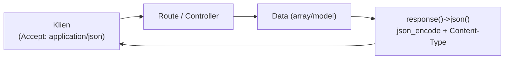

# JSON Response

Aplikasi tidak selalu melayani browser. Aplikasi seluler, JavaScript di halaman, atau layanan lain sering meminta **data**, bukan halaman HTML. Format yang paling umum untuk itu adalah JSON. Sub bab ini membahas cara Laravel membuat response JSON dengan benar, termasuk kode status dan batasan data yang dikirim.

## Tujuan Pembelajaran

Setelah menyelesaikan sub bab ini, kamu dapat:

- [ ] Menjelaskan apa itu JSON dan header `Content-Type: application/json`.
- [ ] Membuat response JSON dengan `response()->json()`, atau dengan mengembalikan array atau model.
- [ ] Mengatur kode status dan header pada response JSON.
- [ ] Merancang struktur JSON yang konsisten untuk data dan error.
- [ ] Memilih hanya data yang aman dikirim ke klien.
- [ ] Menguji response JSON dengan `curl`.

## Prasyarat

- Sub bab [Objek Response](02-16-response-object.md) dan [Objek Request](02-15-request-object.md).
- [Tipe data array di PHP](../level-00/00-13-arrays.md) bila perlu mengulang.
- Proyek `~/belajar-laravel/portal-artikel` dengan Git yang bersih.

## Pengantar

Pada sub bab sebelumnya kamu sudah melihat bahwa array yang dikembalikan route otomatis menjadi JSON. Cara itu praktis, tetapi untuk kontrol penuh (kode status, header, opsi encoding) dan untuk kejelasan maksud, Laravel menyediakan `response()->json()`.

## Penjelasan Konsep

### Apa itu JSON

JSON (*JavaScript Object Notation*) adalah format teks untuk data terstruktur: objek `{ "kunci": nilai }`, larik `[ ... ]`, string, angka, boolean, dan `null`. Pada response, header `Content-Type: application/json` memberi tahu klien cara membacanya.

### Cara mengembalikan JSON

| Cara | Keterangan |
|---|---|
| Mengembalikan array | Otomatis menjadi JSON |
| Mengembalikan model/koleksi Eloquent | Otomatis menjadi JSON, menghormati atribut `hidden` |
| `response()->json($data)` | Eksplisit; mengatur `Content-Type` dan memakai `json_encode` |
| `response()->json($data, 201)` | Dengan kode status |
| `response()->json($data, 200, $headers, $opsi)` | Dengan header dan opsi `json_encode` |

Menurut dokumentasi, metode `json` otomatis mengatur header `Content-Type` ke `application/json` dan mengubah array menjadi JSON dengan fungsi PHP `json_encode`. Signature di source framework adalah `json($data = [], $status = 200, array $headers = [], $options = 0)`.

### Kode status yang tepat

| Kode | Arti | Contoh pemakaian |
|---|---|---|
| `200 OK` | Berhasil | Data dikembalikan |
| `201 Created` | Sumber daya dibuat | Setelah `store` berhasil |
| `204 No Content` | Berhasil tanpa isi | Setelah `destroy` |
| `404 Not Found` | Tidak ada | Artikel tidak ditemukan |
| `422 Unprocessable Content` | Data tidak valid | Hasil validasi gagal (dibahas pada bab validasi) |

Jangan mengirim `200` dengan isi `{"error": ...}`; klien bergantung pada kode status untuk membedakan sukses dan gagal.

### Struktur yang konsisten

Pilih satu bentuk dan pakai terus di seluruh API. Contoh sederhana:

```json
{
    "data": { "id": 1, "judul": "Belajar Routing Laravel" }
}
```

dan untuk kesalahan:

```json
{
    "pesan": "Artikel tidak ditemukan"
}
```

Membungkus data dalam kunci `data` memberi ruang untuk menambah informasi lain (mis. paginasi) tanpa mengubah bentuk dasar. Laravel menyediakan *API Resources* untuk transformasi yang lebih rapi; itu dibahas pada bab lain.

### Keamanan

- **Kirim hanya yang perlu.** Mengembalikan model utuh membuka semua atribut yang tidak `hidden`. Pilih kolom secara eksplisit.
- **Jangan membocorkan detail internal** (pesan exception, SQL, path berkas) pada pesan error.
- **JSONP** (`withCallback`) disebut di dokumentasi, tetapi memuat callback dari input pengguna dan merupakan teknik lama; hindari untuk aplikasi baru dan gunakan CORS bila perlu.
- **Autentikasi dan otorisasi** tetap berlaku untuk endpoint JSON; endpoint data yang terbuka berarti data terbuka bagi siapa pun.

!!! tip "Analogi"
    JSON adalah **formulir tabel yang disepakati**: pengirim dan penerima sama-sama tahu kolom apa saja yang ada. Kode status adalah stempel "diterima" atau "ditolak" di bagian luar amplop.

## Cara Kerja



Controller menyusun data, lalu `response()->json()` mengubahnya menjadi teks JSON dan memberi header yang sesuai.

## Contoh Praktik

Di `portal-artikel` kamu membuat `ApiArtikelController` dengan dua endpoint baca: daftar artikel dan detail artikel. Keduanya mengembalikan struktur `data` yang konsisten, hanya memuat kolom aman, dan memakai status yang tepat. Kamu juga menambah endpoint contoh yang mengembalikan `201` dan `204`.

## Penjelasan Kode

File: `app/Http/Controllers/ApiArtikelController.php`

```php
<?php

namespace App\Http\Controllers;

use App\Models\Artikel;
use Illuminate\Http\JsonResponse;
use Illuminate\Http\Request;

class ApiArtikelController extends Controller
{
    public function index(): JsonResponse
    {
        $data = Artikel::query()
            ->select(['id', 'judul', 'slug'])
            ->orderBy('id')
            ->get();

        return response()->json(['data' => $data]);
    }

    public function show(string $slug): JsonResponse
    {
        $artikel = Artikel::query()
            ->select(['id', 'judul', 'slug'])
            ->where('slug', $slug)
            ->first();

        if ($artikel === null) {
            return response()->json(['pesan' => 'Artikel tidak ditemukan'], 404);
        }

        return response()->json(['data' => $artikel]);
    }

    public function buat(Request $request): JsonResponse
    {
        // Simulasi: data belum disimpan ke database.
        return response()->json(
            ['data' => ['judul' => $request->string('judul')->toString()]],
            201,
            ['X-Contoh' => 'simulasi']
        );
    }

    public function hapus(): JsonResponse
    {
        return response()->json(null, 204);
    }
}
```

File: `routes/web.php` (tambahkan)

```php-inline
use App\Http\Controllers\ApiArtikelController;

Route::prefix('api-contoh')->name('api-contoh.')->controller(ApiArtikelController::class)->group(function () {
    Route::get('artikel', 'index')->name('index');
    Route::get('artikel/{slug}', 'show')->name('show');
    Route::post('artikel', 'buat')->name('buat');
    Route::delete('artikel/{slug}', 'hapus')->name('hapus');
});
```

| Bagian | Penjelasan |
|---|---|
| `select(['id', 'judul', 'slug'])` | Hanya kolom yang aman dan perlu dikirim |
| `response()->json(['data' => $data])` | Struktur dibungkus kunci `data`; koleksi menjadi larik JSON |
| `first()` lalu cek `null` | Mengembalikan `404` dengan JSON sendiri, bukan halaman HTML |
| `json(..., 201, ['X-Contoh' => ...])` | Status `201` dan header tambahan |
| `$request->string('judul')->toString()` | Membaca input sebagai teks (nilai tidak tepercaya; belum divalidasi) |
| `json(null, 204)` | Status `204` tanpa isi |

Route ini ditempatkan di `routes/web.php`, sehingga `POST` dan `DELETE` membutuhkan token CSRF. Materi lanjutan membahas route API terpisah (`routes/api.php`) yang dipasang lewat `php artisan install:api`; bagian itu **tidak** dilakukan di sini.

## Implementasi Langkah demi Langkah

### Langkah 1: buat controller dan route

```bash
cd ~/belajar-laravel/portal-artikel
git status --short
php artisan make:controller ApiArtikelController
```

Isi controller dan route sesuai Penjelasan Kode, lalu:

```bash
php -l app/Http/Controllers/ApiArtikelController.php
php -l routes/web.php
php artisan route:list --path=api-contoh
```

### Langkah 2: jalankan server dan uji daftar

```bash
php artisan serve
```

Di terminal lain (Windows PowerShell: `curl.exe`):

```bash
curl -i http://127.0.0.1:8000/api-contoh/artikel
```

Perhatikan `Content-Type` dan bentuk `data`.

### Langkah 3: uji detail dan `404`

```bash
curl -i http://127.0.0.1:8000/api-contoh/artikel/belajar-routing-laravel
curl -i http://127.0.0.1:8000/api-contoh/artikel/tidak-ada
```

Slug pertama diasumsikan sama dengan data seeder; periksa slug sebenarnya di database/seeder-mu. Perhatikan status dan isi untuk slug yang tidak ada.

### Langkah 4: uji `POST` dan `DELETE` (butuh token CSRF)

Tambahkan sementara `Route::get('/token', fn () => csrf_token());` (hapus setelah selesai), lalu:

```bash
TOKEN=$(curl -s -c cookies.txt http://127.0.0.1:8000/token)
curl -i -b cookies.txt -X POST -H "X-CSRF-TOKEN: $TOKEN" -H "Accept: application/json" \
  -H "Content-Type: application/json" -d '{"judul":"Uji JSON"}' \
  http://127.0.0.1:8000/api-contoh/artikel
curl -i -b cookies.txt -X DELETE -H "X-CSRF-TOKEN: $TOKEN" -H "Accept: application/json" \
  http://127.0.0.1:8000/api-contoh/artikel/belajar-routing-laravel
rm cookies.txt
```

Perhatikan status `201` dengan header `X-Contoh`, serta `204` tanpa isi. Hapus route `/token` setelah selesai.

### Langkah 5: catat di Git

```bash
git status --short
git add app routes
git commit -m "Tambah contoh response JSON artikel"
```

## Eksekusi dan Verifikasi

| Langkah | Cara memverifikasi |
|---|---|
| 1 | `route:list` memuat empat route `api-contoh.*` |
| 2 | `200`, `application/json`, isi `{"data":[...]}` |
| 3 | Slug ada: `200`; slug tidak ada: `404` dengan `{"pesan":...}` |
| 4 | `POST`: `201` + `X-Contoh`; `DELETE`: `204` tanpa isi |
| 5 | `git log --oneline` memuat commit baru |

## Hasil yang Diharapkan

Hasil diturunkan dari dokumentasi dan source, dan belum dijalankan oleh penulis materi; nilai `id`, tanggal, dan header lain akan berbeda.

| Permintaan | Hasil penting |
|---|---|
| `GET /api-contoh/artikel` | `200`, `Content-Type: application/json`, `{"data":[{"id":1,"judul":"...","slug":"..."}, ...]}` |
| `GET /api-contoh/artikel/belajar-routing-laravel` | `200`, `{"data":{"id":...,"judul":"...","slug":"..."}}` |
| `GET /api-contoh/artikel/tidak-ada` | `404`, `{"pesan":"Artikel tidak ditemukan"}` |
| `POST` dengan token | `201`, `{"data":{"judul":"Uji JSON"}}`, header `X-Contoh: simulasi` |
| `DELETE` dengan token | `204`, tanpa isi |

## Kesalahan Umum dan Pemecahan Masalah

| Gejala | Penyebab | Cara mengenali | Solusi | Pencegahan |
|---|---|---|---|---|
| `Class "JsonResponse" not found` | Lupa `use` | Error saat dijalankan | Tambahkan `use Illuminate\Http\JsonResponse;` | Periksa `use` |
| `419` pada `POST`/`DELETE` | Tidak ada token CSRF | Page Expired | Sertakan `X-CSRF-TOKEN` dan cookie | Ingat CSRF pada route web |
| `404` berupa halaman HTML | `firstOrFail` atau route tidak ada | Bukan JSON | Tangani `null` dan kembalikan JSON; atau kirim `Accept: application/json` | Uji dengan `-i` |
| `200` berisi pesan error | Salah memilih status | Klien mengira sukses | Gunakan `4xx`/`5xx` untuk gagal | Kode status mencerminkan hasil |
| Karakter Unicode jadi `é` | Opsi `json_encode` bawaan | Teks terbaca sebagai escape | Beri opsi `JSON_UNESCAPED_UNICODE` pada argumen keempat | Putuskan kebijakan encoding |
| Kolom sensitif ikut terkirim | Mengembalikan model utuh | Atribut tak perlu muncul | `select` kolom atau atur `hidden` | Tinjau setiap JSON |
| Isi `204` muncul | Mengirim data bersama `204` | Klien bingung | `204` tidak berisi data | Pakai `200` bila ada isi |
| `json_encode` gagal | Data tak valid (mis. UTF-8 rusak) | Exception | Bersihkan data | Validasi input |

## Latihan Praktik

### Latihan dasar

**D1. Endpoint status**
- *Masalah:* layanan lain perlu memeriksa apakah portal hidup.
- *Persyaratan:* buat `/api-contoh/status` yang mengembalikan `{"status":"ok","waktu":<ISO 8601>}` dengan `now()->toIso8601String()`. Buktikan dengan `curl -i`.
- *Perilaku yang diharapkan:* `200` dan `application/json`.
- *Tujuan belajar:* `response()->json()` dasar.

**D2. Kode status**
- *Masalah:* respons gagal harus memakai status yang tepat.
- *Persyaratan:* buat `/api-contoh/gagal` yang mengembalikan `{"pesan": "Tidak diizinkan"}` dengan status `403`. Buktikan dengan `curl -i`.
- *Perilaku yang diharapkan:* baris status `403`.
- *Tujuan belajar:* status pada JSON.

### Latihan implementasi

**I1. Pencarian JSON**
- *Masalah:* klien ingin mencari artikel.
- *Persyaratan:* buat `/api-contoh/cari?q=...` yang mengembalikan artikel dengan `judul` mengandung `q` (gunakan `where('judul', 'like', ...)` dengan nilai dari input; Eloquent memakai *binding* sehingga aman dari SQL injection). Bila `q` kosong, kembalikan `422` dengan pesan. Batasi hasil maksimal 20.
- *Perilaku yang diharapkan:* hasil sesuai, dan `q` kosong menghasilkan `422`.
- *Tujuan belajar:* input, status, dan pembatasan hasil.

**I2. Bentuk konsisten**
- *Masalah:* respons error di setiap endpoint berbeda bentuknya.
- *Persyaratan:* buat satu method pribadi (`private function galat(string $pesan, int $status)`) pada controller dan pakai di semua kasus gagal. Pastikan bentuk `{"pesan": ...}` seragam.
- *Perilaku yang diharapkan:* semua error memakai bentuk yang sama.
- *Tujuan belajar:* konsistensi struktur.

### Latihan tantangan

**T1. Tinjauan kebocoran data**
- *Masalah:* tim khawatir ada kolom sensitif di JSON.
- *Persyaratan:* tambahkan kolom `catatan_internal` ke tabel `artikel` (migration baru), lalu tunjukkan bahwa `Artikel::all()` mengembalikannya. Perbaiki dengan dua cara berbeda (`select` eksplisit dan `$hidden` pada model), dan jelaskan kapan memilih masing-masing.
- *Perilaku yang diharapkan:* kolom tidak muncul di JSON dengan kedua cara.
- *Tujuan belajar:* mencegah kebocoran data.
- *Catatan:* kerjakan mandiri; tidak ada kunci jawaban.

## Uji Pemahaman

1. Header apa yang menandai response JSON?
2. Apa beda mengembalikan array dan `response()->json()`?
3. Kode status apa untuk sumber daya yang baru dibuat?
4. Mengapa tidak boleh mengirim `200` dengan isi `{"error": ...}`?
5. Apa risiko mengembalikan model Eloquent utuh?
6. Kapan memakai `204`?
7. Mengapa JSONP sebaiknya dihindari?
8. Mengapa `POST` ke route web via `curl` menghasilkan `419`?

??? success "Kunci jawaban singkat"
    1. `Content-Type: application/json`.
    2. Array otomatis menjadi JSON; `response()->json()` eksplisit dan memungkinkan status, header, dan opsi encoding diatur.
    3. `201 Created`.
    4. Klien mengandalkan status untuk membedakan sukses dan gagal.
    5. Semua atribut yang tidak `hidden` ikut terkirim, termasuk data yang tidak perlu atau sensitif.
    6. Aksi berhasil tanpa isi untuk dikembalikan, mis. setelah menghapus.
    7. Callback berasal dari input pengguna dan teknik ini lama; lebih baik memakai CORS.
    8. Route grup `web` memeriksa token CSRF dan token tidak disertakan.

## Ringkasan

- JSON adalah format data terstruktur; `Content-Type: application/json` menandainya.
- Array, model, dan `response()->json()` semuanya dapat menghasilkan JSON; yang terakhir paling eksplisit.
- Gunakan kode status yang tepat (`200`, `201`, `204`, `404`, `422`) dan struktur yang konsisten.
- Kirim hanya data yang perlu dan aman; jangan bocorkan detail internal.

Selanjutnya: *Response Unduh Berkas*, yaitu mengirim berkas kepada pengguna.

## Referensi Resmi

- [Laravel: JSON Responses](https://laravel.com/docs/13.x/responses#json-responses)
- [Laravel: Eloquent Models and Collections as Responses](https://laravel.com/docs/13.x/responses#eloquent-models-and-collections)
- [Laravel: Hiding Attributes From JSON](https://laravel.com/docs/13.x/eloquent-serialization#hiding-attributes-from-json)
- [PHP: json_encode](https://www.php.net/manual/en/function.json-encode.php)
- [MDN: Kode status respons HTTP](https://developer.mozilla.org/id/docs/Web/HTTP/Reference/Status)
