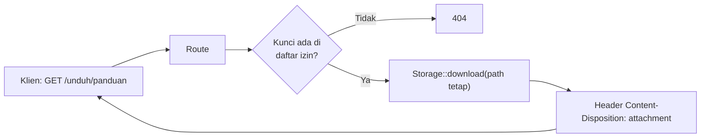

# Response Unduh Berkas

Kadang jawaban dari server bukan halaman atau data, melainkan **berkas**: laporan PDF, gambar, atau ekspor CSV. Sub bab ini membahas tiga cara mengirim berkas di Laravel (`download`, `file`, dan `streamDownload`) serta risiko keamanan terbesarnya: *path traversal*.

## Tujuan Pembelajaran

Setelah menyelesaikan sub bab ini, kamu dapat:

- [ ] Membedakan unduhan (`download`) dari menampilkan berkas di browser (`file`).
- [ ] Membuat unduhan dari berkas di disk dan dari teks yang dibuat saat itu juga (`streamDownload`).
- [ ] Mengatur nama berkas dan header unduhan.
- [ ] Menjelaskan serangan path traversal dan cara mencegahnya.
- [ ] Menyimpan berkas pribadi di luar folder publik.
- [ ] Memverifikasi unduhan dengan `curl -i` dan `curl -OJ`.

## Prasyarat

- Sub bab [Objek Response](02-16-response-object.md) dan [JSON Response](02-18-json-response.md).
- Proyek `~/belajar-laravel/portal-artikel` dengan Git yang bersih.

## Pengantar

Browser memutuskan apakah suatu berkas ditampilkan atau diunduh berdasarkan header response, terutama `Content-Disposition`. Laravel menyediakan metode yang mengatur header itu untukmu, tetapi **tempat berkas** dan **cara memilih berkas** tetap tanggung jawabmu.

## Penjelasan Konsep

### Tiga cara mengirim berkas

| Metode | Perilaku browser | Kapan dipakai |
|---|---|---|
| `response()->download($path, $nama, $headers)` | Memaksa unduhan | Laporan, ekspor, dokumen |
| `response()->file($path, $headers)` | Menampilkan langsung (mis. gambar, PDF) | Pratinjau |
| `response()->streamDownload(function () { ... }, $nama)` | Unduhan dari isi yang dibuat saat itu, tanpa menulis ke disk | CSV hasil query, teks dinamis |

Menurut dokumentasi, argumen kedua `download` menentukan nama berkas yang dilihat pengguna, dan argumen ketiga adalah array header. Dokumentasi juga memperingatkan bahwa Symfony HttpFoundation, yang menangani unduhan, mensyaratkan **nama berkas ASCII**.
`file` menerima path absolut sebagai argumen pertama.

### Berkas lewat disk Storage

Pada skeleton Laravel 13.x, disk `local` berakar di `storage/app/private`, yaitu **di luar** folder `public` sehingga tidak bisa diakses langsung lewat URL. `Storage::disk('local')->download('laporan/panduan.txt')` mengunduh berkas dari disk tersebut tanpa menulis path absolut.
Berkas pribadi sebaiknya ditaruh di sini, dan hanya diberikan lewat route yang kamu kendalikan (sehingga bisa dipasangi pemeriksaan hak akses).

### Keamanan: path traversal

Bila nama berkas diambil dari input pengguna, penyerang dapat mengirim `../../.env` atau `..%2F..%2F.env` agar server mengirim berkas rahasia. Aturan pencegahan:

- **Jangan** membentuk path dari input mentah, mis. `download(storage_path('app/' . $request->berkas))`.
- Gunakan **daftar izin** (*allowlist*): petakan kunci pendek ke berkas yang sudah ditentukan.
- Atau ambil nama dari database yang kamu isi sendiri, bukan dari input langsung.
- Simpan berkas pribadi di luar `public`, dan periksa hak akses sebelum mengirim.
- Jangan menaruh `.env`, kunci, atau cadangan database di folder yang bisa dijangkau route unduhan.

!!! warning "Peringatan"
    Route yang menerima nama berkas bebas adalah salah satu kerentanan paling klasik. Jika kamu merasa perlu `{berkas}` bebas di URL, ganti dengan `{kunci}` yang dipetakan ke daftar tetap.

Pertimbangkan juga: ukuran berkas besar (gunakan streaming), dan jenis konten (`Content-Type`) yang dideteksi dari berkas, tetapi jangan mengirim berkas unggahan pengguna sebagai `file()` tanpa pemeriksaan jenisnya (dibahas pada bab unggah berkas).

!!! tip "Analogi"
    Berkas pribadi seperti **arsip di ruang tertutup**. Petugas (route) hanya mengambilkan dokumen dari daftar yang jelas; ia tidak menuruti permintaan "ambilkan apa saja di lemari mana pun".

## Cara Kerja



Route memetakan kunci ke path tetap; hanya kunci yang dikenal yang menghasilkan unduhan.

## Contoh Praktik

Di `portal-artikel` kamu membuat `BerkasController` dengan tiga route: unduhan berkas dari daftar izin, pratinjau berkas teks, dan ekspor CSV artikel lewat `streamDownload`. Kamu juga mencoba membuktikan bahwa input aneh seperti `..` ditolak.

## Penjelasan Kode

File: `app/Http/Controllers/BerkasController.php`

```php
<?php

namespace App\Http\Controllers;

use App\Models\Artikel;
use Illuminate\Support\Facades\Storage;
use Symfony\Component\HttpFoundation\StreamedResponse;

class BerkasController extends Controller
{
    private const BERKAS = [
        'panduan' => ['path' => 'laporan/panduan.txt', 'nama' => 'panduan-portal.txt'],
    ];

    public function unduh(string $kunci)
    {
        $berkas = self::BERKAS[$kunci] ?? abort(404);

        return Storage::disk('local')->download($berkas['path'], $berkas['nama']);
    }

    public function lihat(string $kunci)
    {
        $berkas = self::BERKAS[$kunci] ?? abort(404);

        return response()->file(
            Storage::disk('local')->path($berkas['path']),
            ['Content-Type' => 'text/plain; charset=UTF-8']
        );
    }

    public function csv(): StreamedResponse
    {
        return response()->streamDownload(function () {
            $out = fopen('php://output', 'w');
            fputcsv($out, ['id', 'judul', 'slug']);

            foreach (Artikel::query()->orderBy('id')->get(['id', 'judul', 'slug']) as $a) {
                fputcsv($out, [$a->id, $a->judul, $a->slug]);
            }

            fclose($out);
        }, 'artikel.csv', ['Content-Type' => 'text/csv']);
    }
}
```

File: `routes/web.php` (tambahkan)

```php-inline
use App\Http\Controllers\BerkasController;

Route::get('/unduh/{kunci}', [BerkasController::class, 'unduh'])->name('berkas.unduh');
Route::get('/lihat/{kunci}', [BerkasController::class, 'lihat'])->name('berkas.lihat');
Route::get('/ekspor/artikel.csv', [BerkasController::class, 'csv'])->name('berkas.csv');
```

| Bagian | Penjelasan |
|---|---|
| `private const BERKAS` | Daftar izin: kunci pendek dipetakan ke path tetap dan nama unduhan |
| `?? abort(404)` | Kunci tidak dikenal menghasilkan `404`; input pengguna tidak pernah menjadi path |
| `Storage::disk('local')->download(path, nama)` | Mengunduh dari `storage/app/private` dengan nama yang kita tentukan |
| `Storage::disk('local')->path(...)` | Mengubah path relatif disk menjadi path absolut untuk `file()` |
| `response()->file($path, $headers)` | Menampilkan di browser, bukan mengunduh |
| `streamDownload(callback, nama, headers)` | Menulis isi ke output saat itu juga tanpa berkas sementara |
| `fputcsv` | Menulis satu baris CSV dengan penanganan tanda kutip yang benar |

!!! note "Catatan CSV"
    Sel yang diawali `=`, `+`, `-`, atau `@` dapat dieksekusi sebagai rumus ketika CSV dibuka di aplikasi spreadsheet (*CSV injection*). Judul artikel berasal dari data yang bisa diisi pengguna, jadi untuk data nyata saring atau awali nilai seperti itu dengan tanda kutip tunggal. Untuk latihan ini, data berasal dari seeder.

## Implementasi Langkah demi Langkah

### Langkah 1: siapkan berkas contoh

```bash
cd ~/belajar-laravel/portal-artikel
git status --short
mkdir -p storage/app/private/laporan
printf 'Panduan Portal Artikel\nBerkas ini hanya contoh.\n' > storage/app/private/laporan/panduan.txt
```

Folder `storage/app/private` sudah ada di skeleton; periksa `.gitignore` di dalamnya agar berkas data tidak ikut ter-commit (jangan commit berkas pribadi).

### Langkah 2: buat controller dan route

```bash
php artisan make:controller BerkasController
```

Isi sesuai Penjelasan Kode, lalu:

```bash
php -l app/Http/Controllers/BerkasController.php
php -l routes/web.php
php artisan route:list --name=berkas
```

### Langkah 3: jalankan server dan uji unduhan

```bash
php artisan serve
```

Di terminal lain (Windows PowerShell: `curl.exe`):

```bash
curl -i http://127.0.0.1:8000/unduh/panduan
```

Perhatikan `Content-Disposition`. Untuk menyimpan sebagai berkas dengan nama dari server:

```bash
curl -OJ http://127.0.0.1:8000/unduh/panduan
```

### Langkah 4: uji pratinjau dan CSV

```bash
curl -i http://127.0.0.1:8000/lihat/panduan
curl -i http://127.0.0.1:8000/ekspor/artikel.csv
```

### Langkah 5: uji penolakan

```bash
curl -i http://127.0.0.1:8000/unduh/tidak-ada
curl -i "http://127.0.0.1:8000/unduh/..%2F..%2F.env"
```

Keduanya seharusnya menghasilkan `404`, karena hanya kunci `panduan` yang ada di daftar izin. Hasil pasti untuk bentuk URL yang diberi `%2F` belum diuji; yang penting kodenya tidak pernah membaca `.env`.

### Langkah 6: bersihkan dan catat di Git

Hapus berkas hasil `curl -OJ` (mis. `panduan-portal.txt`) dari folder kerja.

```bash
git status --short
git add app routes
git commit -m "Tambah contoh unduhan berkas dan ekspor CSV"
```

## Eksekusi dan Verifikasi

| Langkah | Cara memverifikasi |
|---|---|
| 1 | Berkas `storage/app/private/laporan/panduan.txt` ada |
| 2 | `route:list` memuat tiga route `berkas.*` |
| 3 | `200`, `Content-Disposition: attachment; filename=panduan-portal.txt` |
| 4 | Pratinjau: `200` dan isi teks tampil; CSV: header `text/csv` dan baris data |
| 5 | Kedua permintaan: `404` |
| 6 | `git log --oneline` memuat commit baru; `git status` bersih dari berkas data |

## Hasil yang Diharapkan

Hasil diturunkan dari dokumentasi dan belum dijalankan oleh penulis materi; header tambahan (tanggal, `ETag`, dan lain-lain) akan berbeda.

| Permintaan | Hasil penting |
|---|---|
| `/unduh/panduan` | `200`, header `Content-Disposition` berisi `attachment` dan `panduan-portal.txt` |
| `/lihat/panduan` | `200`, `Content-Type: text/plain; charset=UTF-8`, isi teks langsung tampil |
| `/ekspor/artikel.csv` | `200`, `Content-Type: text/csv`, baris pertama `id,judul,slug` diikuti data artikel |
| `/unduh/tidak-ada` | `404` |
| `/unduh/..%2F..%2F.env` | `404` |

## Kesalahan Umum dan Pemecahan Masalah

| Gejala | Penyebab | Cara mengenali | Solusi | Pencegahan |
|---|---|---|---|---|
| `404` padahal kunci benar | Berkas tidak ada di disk | `Storage::disk('local')->exists(...)` bernilai `false` | Buat berkas di `storage/app/private/...` | Periksa path relatif disk |
| `FileNotFoundException` / error saat `file()` | Path salah | Pesan error menyebut path | Gunakan `Storage::...->path()` | Jangan menebak path |
| Nama berkas rusak | Nama berisi karakter non-ASCII | Error atau nama berubah | Gunakan nama ASCII | Dokumentasi mensyaratkan nama ASCII |
| Berkas terbuka di browser, bukan terunduh | Memakai `file()` bukan `download()` | Isi tampil di tab | Gunakan `download()` | Pilih metode sesuai tujuan |
| Berkas terunduh kosong | Callback `streamDownload` tidak menulis output | Ukuran 0 | Pastikan `echo`/`fputcsv` ke `php://output` | Uji dengan data kecil |
| Berkas rahasia terunduh | Path dibentuk dari input | `..` dalam URL berhasil | Pakai daftar izin | Tinjau setiap route unduhan |
| Berkas pribadi terakses lewat URL | Disimpan di `public` | Dapat dibuka tanpa route | Pindahkan ke `storage/app/private` | Pisahkan berkas publik dan pribadi |
| Rumus aktif di spreadsheet | CSV injection | Sel diawali `=` dieksekusi | Awali nilai berbahaya dengan `'` | Saring data ekspor |

## Latihan Praktik

### Latihan dasar

**D1. Nama unduhan**
- *Masalah:* pengguna menginginkan nama berkas yang rapi.
- *Persyaratan:* tambahkan kunci `kontak` (berkas `laporan/kontak.txt`, nama unduhan `daftar-kontak.txt`) pada daftar izin dan buktikan dengan `curl -OJ`.
- *Perilaku yang diharapkan:* berkas tersimpan dengan nama dari server.
- *Tujuan belajar:* argumen nama pada `download`.

**D2. Unduh vs tampil**
- *Masalah:* perilaku browser berbeda antara dua metode.
- *Persyaratan:* buka `/unduh/panduan` dan `/lihat/panduan` di browser; tulis perbedaan perilaku dan header `Content-Disposition` yang terlihat di `curl -i`.
- *Perilaku yang diharapkan:* laporan perbedaan dengan bukti header.
- *Tujuan belajar:* membedakan `download` dan `file`.

### Latihan implementasi

**I1. Ekspor dengan filter**
- *Masalah:* pengguna ingin mengekspor sebagian artikel.
- *Persyaratan:* buat `/ekspor/artikel-cari.csv?q=...` yang mengekspor artikel yang judulnya mengandung `q` (pakai query builder, bukan merangkai SQL sendiri) dengan batas 500 baris.
- *Perilaku yang diharapkan:* CSV hanya berisi hasil yang cocok.
- *Tujuan belajar:* `streamDownload` dengan input.

**I2. Unduhan terlindungi**
- *Masalah:* berkas tertentu hanya untuk admin.
- *Persyaratan:* pasang middleware `kunci.admin` (dari sub bab Middleware Route) pada route unduhan khusus `rahasia` dan buktikan `403` tanpa kunci serta `200` dengan header `X-Admin-Key` yang benar.
- *Perilaku yang diharapkan:* hanya pemegang kunci yang dapat mengunduh.
- *Tujuan belajar:* menggabungkan middleware dan unduhan.

### Latihan tantangan

**T1. Audit route unduhan**
- *Masalah:* tim ingin memastikan tidak ada route yang membaca berkas dari input mentah.
- *Persyaratan:* telusuri semua pemakaian `download(`, `file(`, `Storage::` dan `storage_path(` di `portal-artikel`; untuk tiap kemunculan, catat sumber path-nya (tetap, database, atau input). Perbaiki yang berasal dari input dan buktikan dengan percobaan `..`.
- *Perilaku yang diharapkan:* tidak ada path yang dibentuk dari input pengguna.
- *Tujuan belajar:* mengaudit path traversal.
- *Catatan:* kerjakan mandiri; tidak ada kunci jawaban.

## Uji Pemahaman

1. Apa beda `download()` dan `file()`?
2. Kapan `streamDownload()` dipakai?
3. Mengapa nama berkas unduhan harus ASCII?
4. Apa itu path traversal?
5. Apa cara paling aman memetakan permintaan pengguna ke berkas?
6. Di mana sebaiknya berkas pribadi disimpan?
7. Apa itu CSV injection?
8. Header apa yang membuat browser mengunduh?

??? success "Kunci jawaban singkat"
    1. `download()` memaksa unduhan; `file()` menampilkan berkas langsung di browser.
    2. Saat isi dibuat secara dinamis dan tidak perlu ditulis ke disk, mis. ekspor CSV.
    3. Karena Symfony HttpFoundation, yang menangani unduhan, mensyaratkan nama berkas ASCII (menurut dokumentasi).
    4. Serangan yang memakai `..` pada input untuk membaca berkas di luar folder yang dimaksud.
    5. Daftar izin: kunci pendek dipetakan ke path tetap atau data yang kamu kendalikan.
    6. Di luar `public`, mis. `storage/app/private`, diberikan lewat route yang dapat diperiksa hak aksesnya.
    7. Sel CSV yang diawali `=`, `+`, `-`, atau `@` dieksekusi sebagai rumus di spreadsheet.
    8. `Content-Disposition: attachment`.

## Ringkasan

- `download` memaksa unduhan, `file` menampilkan di browser, `streamDownload` mengirim isi dinamis.
- Simpan berkas pribadi di `storage/app/private` dan berikan lewat route yang terkendali.
- Jangan membentuk path dari input pengguna; pakai daftar izin untuk mencegah path traversal.
- Nama berkas unduhan harus ASCII; waspadai CSV injection pada data ekspor.

Selanjutnya: *Penanganan Error dan HTTP Status Code*, yaitu bagaimana aplikasi menjawab ketika sesuatu salah.

## Referensi Resmi

- [Laravel: File Downloads](https://laravel.com/docs/13.x/responses#file-downloads)
- [Laravel: File Responses](https://laravel.com/docs/13.x/responses#file-responses)
- [Laravel: Streamed Downloads](https://laravel.com/docs/13.x/responses#streamed-downloads)
- [Laravel: File Storage](https://laravel.com/docs/13.x/filesystem)
- [OWASP: Path Traversal](https://owasp.org/www-community/attacks/Path_Traversal)
- [OWASP: CSV Injection](https://owasp.org/www-community/attacks/CSV_Injection)
