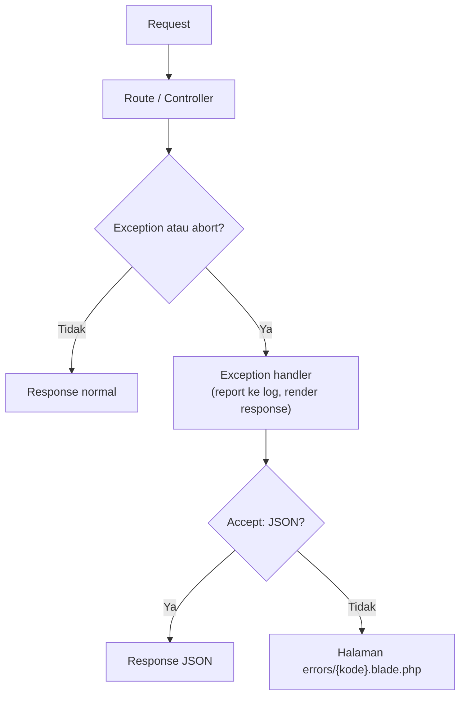

# Penanganan Error dan HTTP Status Code

Tidak semua request berakhir mulus: alamat tidak ada, pengguna tidak berhak, atau kode kita sendiri melempar exception. Sub bab ini membahas bagaimana Laravel mengubah masalah menjadi response yang tepat, bagaimana memakai kode status HTTP, dan bagaimana menyesuaikan halaman error tanpa membocorkan informasi sensitif.

## Tujuan Pembelajaran

Setelah menyelesaikan sub bab ini, kamu dapat:

- [ ] Membedakan kelompok kode status `2xx`, `3xx`, `4xx`, dan `5xx`.
- [ ] Menghasilkan error HTTP dengan `abort`, `abort_if`, dan `abort_unless`.
- [ ] Membuat halaman error khusus di `resources/views/errors`.
- [ ] Menjelaskan mengapa `APP_DEBUG` harus `false` di produksi.
- [ ] Menyesuaikan tampilan exception lewat `withExceptions` dan `render`.
- [ ] Menjelaskan bahwa Laravel memilih HTML atau JSON berdasarkan header `Accept`.

## Prasyarat

- Sub bab [JSON Response](02-18-json-response.md) dan [Objek Request](02-15-request-object.md).
- [Penanganan error di PHP](../level-00/00-21-exception-handling.md) (exception, `try`/`catch`).
- Proyek `~/belajar-laravel/portal-artikel` dengan Git yang bersih.

## Pengantar

Jika URL tidak ada, Laravel menampilkan halaman 404 bawaan. Jika kode melempar exception, tampil halaman 500 atau, pada mode debug, halaman rinci berisi jejak kode. Keduanya terjadi karena **exception handler** bawaan. Kamu tidak harus menulisnya dari nol, tetapi perlu tahu cara memicu error yang tepat dan menyesuaikannya dengan aman.

## Penjelasan Konsep

### Kelompok kode status

| Kelompok | Arti | Contoh |
|---|---|---|
| `2xx` | Berhasil | `200 OK`, `201 Created`, `204 No Content` |
| `3xx` | Pengalihan | `301`, `302` |
| `4xx` | Kesalahan dari sisi klien | `401`, `403`, `404`, `419`, `422`, `429` |
| `5xx` | Kesalahan di sisi server | `500`, `503` |

Kode `4xx` berarti permintaan yang salah atau tidak diizinkan; `5xx` berarti server gagal memprosesnya. Memilih kode yang tepat membantu klien dan alat pemantau.

| Kode | Pemakaian umum di Laravel |
|---|---|
| `401` | Belum terautentikasi |
| `403` | Terautentikasi tetapi tidak berhak |
| `404` | Route atau data tidak ditemukan |
| `419` | Token CSRF/sesi kedaluwarsa |
| `422` | Validasi gagal |
| `429` | Terlalu banyak permintaan |
| `500` | Kesalahan tak terduga di server |
| `503` | Aplikasi dalam mode pemeliharaan atau tidak tersedia |

### Memicu error HTTP

Menurut dokumentasi, helper `abort` membuat response error dari mana saja di aplikasi, mis. `abort(404);`. Helper turunannya:

| Helper | Arti |
|---|---|
| `abort(404)` | Selalu menghentikan dengan kode itu |
| `abort(403, 'Pesan')` | Dengan pesan |
| `abort_if($kondisi, 403)` | Menghentikan bila kondisi `true` |
| `abort_unless($kondisi, 403)` | Menghentikan bila kondisi `false` |

`firstOrFail()` dan Route Model Binding juga menghasilkan `404` otomatis saat data tidak ada.

### Halaman error khusus

Untuk mengganti halaman error suatu kode, buat view `resources/views/errors/{kode}.blade.php`, misalnya `404.blade.php`. Instance `HttpException` dari `abort` dikirim ke view sebagai variabel `$exception`.
Dokumentasi menyebut dua hal tambahan:

- Template bawaan dapat dipublikasikan dengan `php artisan vendor:publish --tag=laravel-errors`.
- Halaman *fallback* `4xx.blade.php` dan `5xx.blade.php` dipakai bila tidak ada halaman untuk kode spesifik, kecuali untuk `401`, `402`, `403`, `404`, `419`, `429`, `500`, dan `503` yang punya halaman bawaan sendiri dan harus diganti satu per satu.

### Menyesuaikan exception di `bootstrap/app.php`

Objek `$exceptions` pada `withExceptions` mengatur bagaimana exception dilaporkan (*report*) dan ditampilkan (*render*). Contoh dari dokumentasi: `render` dengan type-hint exception, mengembalikan response; bila closure tidak mengembalikan nilai, perilaku bawaan dipakai.
Laravel juga memilih respons **HTML atau JSON** berdasarkan header `Accept` request; ini dapat diubah dengan `shouldRenderJsonWhen`.

### Keamanan

!!! danger "APP_DEBUG di produksi"
    Dokumentasi menegaskan: di produksi `APP_DEBUG` harus selalu `false`. Bila `true`, nilai konfigurasi sensitif dapat terlihat oleh pengguna akhir (halaman debug menampilkan rincian internal seperti jejak kode dan jalur berkas).

Aturan lain:

- Pesan error untuk pengguna harus umum ("Terjadi kesalahan"), sedangkan detail dicatat di log.
- Jangan menampilkan pesan exception, query SQL, atau jalur berkas di JSON atau halaman publik.
- Pilih `404` dibanding `403` bila keberadaan sumber daya sendiri sebaiknya tidak diketahui.
- Perhatikan log: jangan mencatat kata sandi atau token.

!!! tip "Analogi"
    Exception handler adalah **meja informasi**: apa pun yang salah di belakang layar, pengunjung hanya diberi pesan yang sopan dan ringkas, sementara catatan lengkapnya disimpan di ruang staf (log).

## Cara Kerja



Exception dilaporkan ke log dan diubah menjadi response HTML atau JSON sesuai request.

## Contoh Praktik

Di `portal-artikel` kamu membuat route yang sengaja memicu `404`, `403`, dan `500`, lalu membuat halaman `errors/404.blade.php` khusus. Kamu juga membuat pengecualian `render` agar `404` pada path `api-contoh/*` selalu berupa JSON yang rapi.

## Penjelasan Kode

File: `routes/web.php` (tambahkan)

```php-inline
Route::prefix('uji-error')->group(function () {
    Route::get('tidak-ada', fn () => abort(404, 'Contoh: halaman tidak ada'));
    Route::get('dilarang', fn () => abort_if(true, 403, 'Contoh: tidak berhak'));
    Route::get('rusak', fn () => throw new RuntimeException('Contoh kerusakan internal'));
});
```

File: `resources/views/errors/404.blade.php`

```html
<!DOCTYPE html>
<html lang="id">
<head>
    <meta charset="utf-8">
    <title>Halaman tidak ditemukan</title>
</head>
<body>
    <h1>404 - Halaman tidak ditemukan</h1>
    <p>Alamat yang kamu buka tidak tersedia di Portal Artikel.</p>
    <p><a href="{{ url('/') }}">Kembali ke beranda</a></p>
</body>
</html>
```

File: `bootstrap/app.php` (ubah bagian `withExceptions`)

```php-inline
use Illuminate\Http\Request;
use Symfony\Component\HttpKernel\Exception\NotFoundHttpException;

->withExceptions(function (Exceptions $exceptions): void {
    $exceptions->render(function (NotFoundHttpException $e, Request $request) {
        if ($request->is('api-contoh/*')) {
            return response()->json(['pesan' => 'Sumber daya tidak ditemukan'], 404);
        }
    });
})
```

| Bagian | Penjelasan |
|---|---|
| `abort(404, '...')` | Menghentikan request dengan `404` dan pesan |
| `abort_if(true, 403, '...')` | Menghentikan bila kondisi benar; di sini selalu |
| `throw new RuntimeException(...)` | Exception biasa menjadi `500` |
| `errors/404.blade.php` | Halaman khusus untuk semua `404` HTML |
| `render(function (NotFoundHttpException ...))` | Mengganti respons `404` untuk path `api-contoh/*`; tidak mengembalikan nilai untuk path lain sehingga perilaku bawaan dipakai |

Pesan pada `abort` hanya untuk contoh; pada aplikasi nyata, jangan memasukkan data internal ke pesan yang tampil.
Closure `fn () => throw ...` memakai *throw expression* PHP 8, sehingga valid pada PHP 8.3.

## Implementasi Langkah demi Langkah

### Langkah 1: pastikan mode lokal

```bash
cd ~/belajar-laravel/portal-artikel
git status --short
grep -n "APP_DEBUG\|APP_ENV" .env
```

Di lokal, `APP_DEBUG=true` dan `APP_ENV=local` normal. **Jangan** menyalin nilai ini ke produksi, dan jangan menampilkan seluruh isi `.env` ke tempat lain.

### Langkah 2: tambah route, view, dan penanganan

Tambahkan route dan view sesuai Penjelasan Kode, ubah `withExceptions` di `bootstrap/app.php`, lalu:

```bash
php -l routes/web.php
php -l bootstrap/app.php
php artisan route:list --path=uji-error
```

### Langkah 3: jalankan server dan uji

```bash
php artisan serve
```

Di terminal lain (Windows PowerShell: `curl.exe`):

```bash
curl -i http://127.0.0.1:8000/uji-error/tidak-ada
curl -i http://127.0.0.1:8000/uji-error/dilarang
curl -i http://127.0.0.1:8000/uji-error/rusak
```

Perhatikan baris status dan bentuk isi (HTML dengan view khusus untuk `404`; halaman bawaan untuk `403`; halaman debug untuk `500` karena `APP_DEBUG=true`).

### Langkah 4: uji negosiasi JSON

```bash
curl -i -H "Accept: application/json" http://127.0.0.1:8000/uji-error/tidak-ada
curl -i -H "Accept: application/json" http://127.0.0.1:8000/uji-error/rusak
curl -i http://127.0.0.1:8000/api-contoh/tidak-ada
```

Perhatikan bahwa dengan header `Accept: application/json`, error menjadi JSON; dan `api-contoh/tidak-ada` menjadi JSON lewat `render` walau tanpa header `Accept`.

### Langkah 5: simulasikan produksi (sementara)

Ubah sementara `APP_DEBUG=false` di `.env` lokal, mulai ulang `php artisan serve`, ulangi `curl -i .../uji-error/rusak`, lalu **kembalikan** nilainya ke `true`.
Perhatikan bahwa isi tidak lagi menampilkan jejak kode atau pesan exception. Jangan pernah meng-commit `.env`.

### Langkah 6: catat di Git, lalu bersihkan

Hapus route `uji-error` bila tidak lagi diperlukan (atau simpan sebagai bahan latihan).

```bash
git status --short
git add routes resources bootstrap
git commit -m "Tambah contoh penanganan error dan halaman 404 khusus"
```

## Eksekusi dan Verifikasi

| Langkah | Cara memverifikasi |
|---|---|
| 2 | `route:list` memuat tiga route `uji-error` |
| 3 | `404`, `403`, dan `500` pada masing-masing route |
| 4 | Respons JSON untuk header `Accept: application/json` dan untuk `api-contoh/*` |
| 5 | Mode `APP_DEBUG=false`: tidak ada jejak kode; nilai dikembalikan setelah uji |
| 6 | `git status` tidak memuat `.env` |

## Hasil yang Diharapkan

Hasil diturunkan dari dokumentasi dan belum dijalankan oleh penulis materi; bentuk halaman debug dan teks halaman bawaan bergantung versi.

| Permintaan | Hasil penting |
|---|---|
| `/uji-error/tidak-ada` | `404`, halaman `errors/404.blade.php` khusus |
| `/uji-error/dilarang` | `403`, halaman 403 bawaan |
| `/uji-error/rusak` (debug `true`) | `500`, halaman debug rinci |
| `/uji-error/rusak` (debug `false`) | `500`, halaman umum tanpa detail |
| `/uji-error/tidak-ada` + `Accept: application/json` | `404`, isi JSON |
| `/api-contoh/tidak-ada` | `404`, `{"pesan":"Sumber daya tidak ditemukan"}` |

Apakah halaman `404.blade.php` khusus juga dipakai saat `APP_DEBUG=true` belum saya uji; catat apa yang kamu lihat.

## Kesalahan Umum dan Pemecahan Masalah

| Gejala | Penyebab | Cara mengenali | Solusi | Pencegahan |
|---|---|---|---|---|
| Halaman 404 khusus tidak muncul | Nama/jalur view salah | Halaman bawaan tetap tampil | Pastikan `resources/views/errors/404.blade.php` | Ikuti penamaan `{kode}.blade.php` |
| Halaman `5xx` fallback tak dipakai untuk 500 | Kode `500` punya halaman bawaan sendiri | Fallback diabaikan | Buat `500.blade.php` | Baca daftar pengecualian fallback |
| Jejak kode tampil di produksi | `APP_DEBUG=true` | Halaman debug terlihat publik | Ubah ke `false`, bersihkan cache konfigurasi | Periksa lingkungan sebelum rilis |
| `render` tidak berjalan | Type-hint exception tidak cocok | Respons bawaan tetap tampil | Gunakan `NotFoundHttpException` | Cek tipe exception di log |
| Error `Class "Exceptions" not found` | Lupa `use` di `bootstrap/app.php` | Error saat boot | Impor kelas yang dipakai | Salin contoh lengkap |
| JSON diharapkan tetapi HTML muncul | Header `Accept` tidak dikirim | Respons HTML | Kirim `Accept: application/json` | Biasakan header |
| `419` mengagetkan | Token CSRF/sesi kedaluwarsa | Page Expired | Muat ulang form | Pahami `419` |
| Data sensitif di pesan error | Pesan exception diteruskan | Teks internal tampil | Tampilkan pesan umum | Catat detail di log saja |

## Latihan Praktik

### Latihan dasar

**D1. Pesan 403 khusus**
- *Masalah:* halaman 403 bawaan terlalu umum.
- *Persyaratan:* buat `resources/views/errors/403.blade.php` yang menampilkan `$exception->getMessage()` dengan escape (`{{ }}`), serta tautan kembali. Buktikan lewat `/uji-error/dilarang`.
- *Perilaku yang diharapkan:* halaman khusus tampil dengan pesan.
- *Tujuan belajar:* halaman error khusus per kode.

**D2. Pilih kode status**
- *Masalah:* tim sering salah memilih kode.
- *Persyaratan:* untuk lima kasus berikut tulis kode yang tepat dan alasannya: (a) pengguna belum login, (b) pengguna login tetapi bukan pemilik, (c) artikel tidak ada, (d) judul kosong saat membuat artikel, (e) server database mati.
- *Perilaku yang diharapkan:* jawaban lima baris dengan alasan.
- *Tujuan belajar:* memilih kode status.

### Latihan implementasi

**I1. Artikel tidak ditemukan**
- *Masalah:* `ArtikelController::show` perlu menangani slug yang salah.
- *Persyaratan:* bila artikel tidak ditemukan, gunakan `abort(404)`. Buktikan dengan `curl -i` bahwa HTML dan JSON (lewat `Accept`) sama-sama `404`.
- *Perilaku yang diharapkan:* `404` pada kedua format.
- *Tujuan belajar:* `abort` dan negosiasi konten.

**I2. Fallback route**
- *Masalah:* alamat yang tidak dikenal perlu jawaban yang ramah.
- *Persyaratan:* tambahkan `Route::fallback` di akhir `routes/web.php` yang mengembalikan view dengan status `404` dan mencatat path yang diminta ke log (`Log::info`). Pastikan route lain tetap berjalan.
- *Perilaku yang diharapkan:* alamat tak dikenal menampilkan halaman ramah dan tercatat.
- *Tujuan belajar:* `Route::fallback` dan logging.

### Latihan tantangan

**T1. Audit kebocoran informasi**
- *Masalah:* tim ingin memastikan error tidak membocorkan detail.
- *Persyaratan:* dengan `APP_DEBUG=false`, picu `404`, `403`, `419`, dan `500` pada HTML maupun JSON; catat apakah ada pesan exception, jalur berkas, atau SQL yang terlihat. Perbaiki bila ada, dan tulis daftar periksa produksi singkat (mis. `APP_DEBUG`, `APP_ENV`, pesan error umum).
- *Perilaku yang diharapkan:* tidak ada informasi internal di respons.
- *Tujuan belajar:* mengaudit penanganan error.
- *Catatan:* kerjakan mandiri; tidak ada kunci jawaban.

## Uji Pemahaman

1. Apa beda `4xx` dan `5xx`?
2. Apa beda `401` dan `403`?
3. Bagaimana memicu `404` secara manual?
4. Di mana halaman 404 khusus ditaruh?
5. Mengapa `APP_DEBUG` harus `false` di produksi?
6. Apa fungsi metode `render` pada `withExceptions`?
7. Bagaimana Laravel menentukan respons error berupa HTML atau JSON?
8. Mengapa pesan exception tidak boleh ditampilkan ke pengguna?

??? success "Kunci jawaban singkat"
    1. `4xx` kesalahan dari sisi klien; `5xx` kesalahan di sisi server.
    2. `401` belum terautentikasi; `403` sudah terautentikasi tetapi tidak berhak.
    3. `abort(404)`.
    4. `resources/views/errors/404.blade.php`.
    5. Bila `true`, nilai konfigurasi sensitif dapat terlihat oleh pengguna akhir.
    6. Mengganti cara exception tertentu ditampilkan sebagai response.
    7. Dari header `Accept` request (dapat diubah dengan `shouldRenderJsonWhen`).
    8. Pesan itu dapat membuka struktur internal atau data sensitif; detail cukup dicatat di log.

## Ringkasan

- Kode status mengelompokkan hasil: `2xx` berhasil, `3xx` pengalihan, `4xx` salah klien, `5xx` salah server.
- `abort`, `abort_if`, dan `abort_unless` memicu error HTTP; `firstOrFail` dan model binding menghasilkan `404`.
- Halaman error khusus ditaruh di `resources/views/errors/{kode}.blade.php`.
- `withExceptions` di `bootstrap/app.php` menyesuaikan pelaporan dan tampilan exception.
- `APP_DEBUG` harus `false` di produksi; tampilkan pesan umum dan simpan detail di log.

Selanjutnya: proyek praktik *Routing dan Controller Artikel*, yang menyatukan seluruh materi bab ini.

## Referensi Resmi

- [Laravel: Error Handling](https://laravel.com/docs/13.x/errors)
- [Laravel: Configuration (APP_DEBUG)](https://laravel.com/docs/13.x/errors#configuration)
- [Laravel: Rendering Exceptions](https://laravel.com/docs/13.x/errors#rendering-exceptions)
- [Laravel: HTTP Exceptions](https://laravel.com/docs/13.x/errors#http-exceptions)
- [Laravel: Custom HTTP Error Pages](https://laravel.com/docs/13.x/errors#custom-http-error-pages)
- [Laravel: Fallback Routes](https://laravel.com/docs/13.x/routing#fallback-routes)
- [MDN: Kode status respons HTTP](https://developer.mozilla.org/id/docs/Web/HTTP/Reference/Status)
